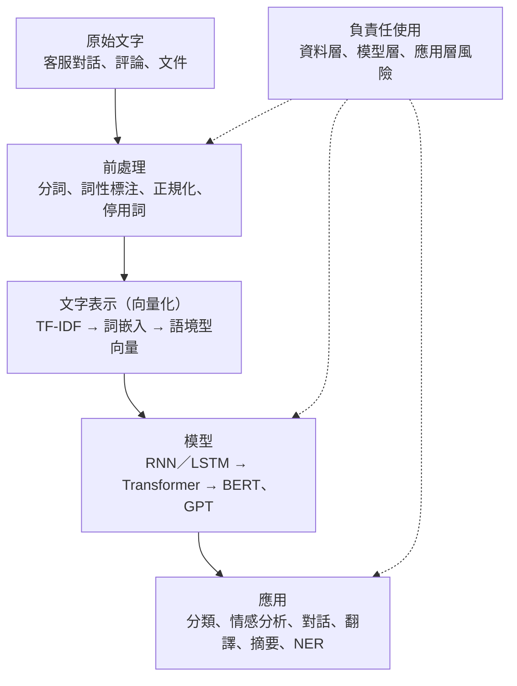
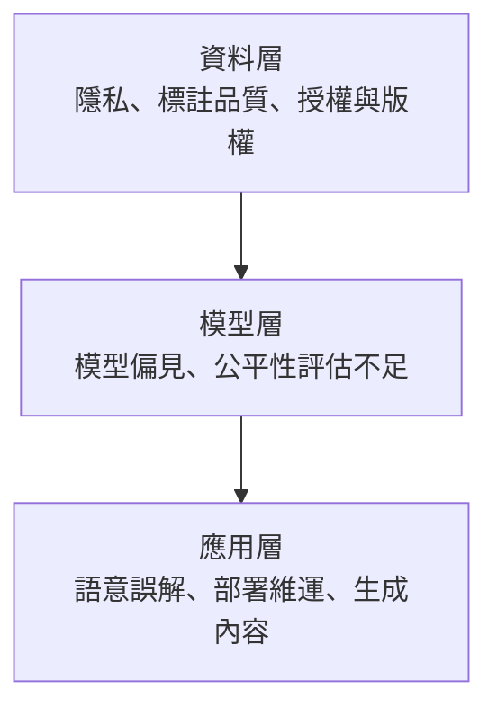

### Metadata
parent:: [[_【目錄】iPAS-AI應用規劃師(中級)：人工智慧技術應用與規劃]]
sibling:: [[02電腦視覺技術與應用]] · [[03生成式AI技術與應用]] · [[04多模態人工智慧應用]] · [[01人工智慧概論]] · [[訓練模型與如何優化]]

## Key Points
> [!summary] 一句話看懂
> **NLP＝讓機器聽得懂、處理得了、說得出人話。**
> 流程就像**翻譯社接案**：先把稿子整理乾淨（前處理）→ 把文字轉成機器看得懂的數字（向量化）→ 交給翻譯師處理（模型）→ 產出成品（應用）。
> NLP 是總稱，底下分兩端：**NLU 負責「聽懂」**，**NLG 負責「說出」**。

#### NLP 技術四代演進
| 階段 | 時期 | 核心做法 | 代表 | 解決了什麼 | 卡在哪裡 |
|---|---|---|---|---|---|
| **規則式** | 1950s～1980s | 人工寫語法規則 | ELIZA（1966）、專家系統 | 可解釋、特定領域穩定 | 規則寫不完、難維護 |
| **統計語言模型** | 1990s～2010 | 從語料學機率 | N-gram、HMM、CRF | 自動從資料學規律 | 抓不到長距離語意 |
| **深度學習** | 2010～2018 | 神經網路處理序列 | RNN、LSTM、GRU | 能記住較長上下文 | 無法平行運算、訓練慢 |
| **預訓練語言模型** | 2018～至今 | 大量語料預訓練＋微調 | BERT、GPT、T5 | 全局語境、可遷移 | 算力與成本極高 |

#### 前處理五步驟
| 步驟 | 做什麼 | 例子 |
|---|---|---|
| **分詞** Tokenization | 切成最小單位 | 「我愛自然語言處理」→ 我／愛／自然語言處理 |
| **詞性標注** POS Tagging | 標記名詞、動詞… | 小明（名詞）去（動詞）北京（地名） |
| **詞形還原** Lemmatization | 依字典還原原形，**語意保留佳** | running → run |
| **詞幹提取** Stemming | 用規則砍字尾，**快但可能不是真字** | happiness → happi |
| **停用詞移除** Stopword Removal | 刪掉 the、is、的、在 | 對話生成時不宜刪 |

#### 文字表示法演進（最常考）
| 方法 | 分布式？ | 語境型？ | 一句話 |
|---|---|---|---|
| **One-hot** | ❌ | ❌ | 只有自己那格是 1，看不出任何關係 |
| **Bag of Words** | ❌ | ❌ | 數每個詞出現幾次，不管順序 |
| **TF-IDF** | ❌ | ❌ | 常出現在這篇、但很少出現在別篇的詞最重要 |
| **N-gram** | 有限 | 短範圍 | 連續 N 個詞當一組，保留局部順序 |
| **Word2Vec／GloVe／FastText** | ✅ | ❌ 靜態 | 意思相近的詞向量也相近，但一詞只有一個向量 |
| **ELMo／BERT／GPT** | ✅ | ✅ 動態 | 同一個詞依上下文給不同向量，可解決一詞多義 |

#### BERT vs GPT
| | **BERT** | **GPT** |
|---|---|---|
| 開發者 | Google（2018） | OpenAI |
| 架構 | Transformer **Encoder（編碼器）** | Transformer **Decoder（解碼器）** |
| 看上下文 | **雙向**（同時看前後文） | **單向**（只看前文，自迴歸） |
| 預訓練任務 | **遮蔽語言模型 MLM**＋下一句預測 NSP | **預測下一個字** |
| 擅長 | **理解**：分類、問答、NER | **生成**：對話、摘要、寫作 |

> [!warning] 陷阱題
> 1. **TF-IDF、Bag of Words、One-hot 都不是詞嵌入**；**Word2Vec 才是詞嵌入**（官方考題原題）。
> 2. **BERT 是雙向、GPT 是單向**；BERT 用 Encoder、GPT 用 Decoder。
> 3. **NER（命名實體辨識）＝找出人名、地名、組織**（官方考題原題）。
> 4. **詞形還原（Lemmatization）語意保留佳；詞幹提取（Stemming）速度快但可能產生非真字**。
> 5. **Word2Vec、GloVe 是靜態詞向量**，無法區分 bank 是銀行還是河岸；**ELMo、BERT 是語境型**，可以。
> 6. **FastText 用子詞（subword）**，所以能處理沒看過的新詞（OOV）。
> 7. **CBOW＝用上下文猜中心詞；Skip-gram＝用中心詞猜上下文**。
> 8. **RAG＝先檢索再生成**（補外部知識）；**LoRA＝外掛少量參數做微調**（省訓練成本）。
> 9. **自注意力用 Q（查詢）、K（索引）、V（內容）計算**；Transformer 本身不懂順序，要靠**位置編碼**。
> 10. **Encoder-only（BERT）擅長理解、Decoder-only（GPT）擅長生成、Encoder-Decoder（T5）擅長轉換**。
> 11. **語意相似度最常用餘弦相似度**，越接近 1 越相似。
> 12. **LDA 主題模型是非監督式**，不需要標註資料。
> 13. **BLEU 配翻譯、ROUGE 配摘要、Perplexity 越低越好**。
>
> ⚠️ **學習指引本身有誤的地方（請以本筆記為準）**
> - 指引說「CBOW 適合小型語料」：原論文的結論是 **Skip-gram 在小型語料與低頻詞表現較好**，CBOW 的優勢是**訓練較快**。
> - 指引把 **ELIZA** 放在 1980s～1990s：ELIZA 是 **1966 年**的程式，規則式時代應從 1950～1960 年代算起。
> - 指引說「LoRA 可讓 GPT-3 部署在邊緣設備」：LoRA 只減少**微調時要訓練的參數**，**不會讓模型變小**；要部署到邊緣設備得靠**量化、蒸餾**。
> - 指引寫「GloVe 是依賴於局部上下文」：漏了一個「**不**」，GloVe **不**依賴局部視窗，而是用**整體語料的共現統計**。

> [!tip] PM 要記住的 3 件事
> 1. **2026 年多數 NLP 任務先試 LLM＋提示詞**：分類、摘要、萃取都能零樣本完成；量大且穩定後，再考慮用便宜的小模型取代。
> 2. **繁體中文要特別測**：斷詞、在地用語（如「很雷」）、台灣法規，是外國模型最常出錯的地方。
> 3. **語料是最大的風險來源**：個資、授權、偏見都藏在訓練與輸入資料裡，上線前一定要查。

--- 
## Notes
### 全局地圖：一段文字如何變成 AI 的輸出

- 學習指引的章節順序就是這條流水線，記住這張圖就記住了整章架構。
- 初級已學過的基礎（Transformer、預訓練＋微調）見 [[01人工智慧概論]]、[[訓練模型與如何優化]]，本篇著重**中級新增的 NLP 專門技術**。

---

### 一、NLP 是什麼
#### 1. 定義與三個任務層次
> [!example] 白話比喻
> NLP 像一位**同步口譯員**：先**聽懂**對方在說什麼（理解），在腦中**整理**成自己能處理的形式（處理），再**說出**另一段話（生成）。

**自然語言處理**（NLP）是讓電腦能夠理解、處理與產生人類語言的技術。學習指引把它拆成三個層次：

- **理解（Understand）**：解析一句話的語法、語意、意圖與情緒。例如客戶說「上個月那筆扣款怎麼回事」，系統要判斷他是想**查帳**還是想**退款**。
- **處理（Process）**：把文字轉成電腦能運算的結構，例如數字向量、語法樹或標注結果。電腦只懂數字，這一步是理解與生成之間的橋樑。
- **生成（Generate）**：自動產出自然流暢的文字或語音，例如回覆客戶一段說明、寫一份摘要。

#### 2. NLP、NLU、NLG 的關係
- **NLP**（自然語言處理）是**總稱**，涵蓋所有與語言有關的技術，例如對話系統、機器翻譯、語音助理。
- **NLU**（自然語言理解）是 NLP 的「**聽懂**」端，負責意圖辨識、命名實體辨識、情感分析等任務。
- **NLG**（自然語言生成）是 NLP 的「**說出**」端，負責自動摘要、回應生成、報告撰寫等任務。

舉例來說，客服機器人收到一句話後，先由 **NLU** 理解客戶的意圖，再由 **NLG** 產生回覆，整個過程就是 **NLP**。

#### 3. 技術演進：四個世代
> [!example] 白話比喻
> 學外語的四種方法：**背文法書**（規則式）→ **大量閱讀、記哪些字常一起出現**（統計式）→ **邊讀邊記住前文**（深度學習）→ **先讀遍天下的書，再針對考試加強**（預訓練＋微調）。

##### (1) 規則式方法（1950s～1980s）
由語言學家和工程師**手工撰寫語法規則與詞彙辭典**。最有名的例子是 1966 年的 **ELIZA**，它扮演心理諮商師，靠關鍵詞比對套用回應範本：你說「我很難過」，它就回「你為什麼覺得難過？」看似在對話，其實完全不理解語意。

這類方法的優點是**可解釋性高**，每個判斷都能追溯到某條規則，在特定領域也相當穩定。缺點是語言變化無窮，**規則永遠寫不完**，語境一變就失靈，維護成本也很高。

##### (2) 統計語言模型（1990s～2010）
不再手寫規則，而是用大量語料訓練**機率模型**，讓電腦自己從資料中學習「哪些詞常一起出現」。代表技術有三個：

- **N-gram**：計算相鄰詞的共現機率，例如「台灣」後面接「高鐵」的機率。N 越大，考慮的上下文越長，但需要的資料也越多。
- **隱馬可夫模型（HMM）**：由看得到的序列推測看不到的狀態，常用於語音辨識與詞性標注。
- **條件隨機場（CRF）**：序列標注模型，在深度學習普及前是**命名實體辨識**（NER）的主力。

統計方法能自動學習、容易擴展，但缺乏深層語意理解，也**抓不到長距離的依賴關係**，例如一句話開頭的主詞與結尾動詞之間的關聯。

##### (3) 深度學習時代（2010～2018）
改用 **RNN、LSTM、GRU** 等神經網路處理序列資料，不再需要人工設計特徵，也能記住較長的上下文。但這類模型必須**一個字一個字依序處理**，無法平行運算，訓練時間長，對大量資料與算力的需求也高。

##### (4) 預訓練語言模型（2018～至今）
2017 年 **Transformer** 以**自注意力機制**取代逐字處理的遞迴結構，能**一次看完整段文字並平行運算**。以它為基礎的 **BERT、GPT、RoBERTa、T5** 採用「**先在大量語料上預訓練，再針對任務微調**」的方式，只需少量標注資料就能有很好的效果，徹底改變了 NLP 的做法。代價是運算與儲存資源需求極高，推論效率仍是挑戰。

---

### 二、前處理：把原始文字整理乾淨
> [!example] 白話比喻
> 前處理就像**煮菜前的備料**：洗菜、切菜、去掉不能吃的部分。備料做不好，再好的廚師（模型）也煮不出好菜。

自然語言是**非結構化、語意模糊、語境多變**的資料，一個斷詞錯誤就可能讓後面的分析全部出錯。學習指引稱前處理是「**NLP 專案成功與否的第一道防線**」。

#### 分詞（Tokenization）
分詞是把一段文字切成單字、詞組或更小的單位，是**所有處理的起點**。

英文有空格分隔，相對容易；**中文、日文沒有空格**，需要斷詞字典或模型輔助，難度高很多。例如「我愛自然語言處理」：
- 正確切法：我／愛／自然語言處理
- 錯誤切法：我／愛／自然／語言／處理，後續語意分析就會受影響

現代大型語言模型多採用**子詞分詞（Subword Tokenization）**，例如 **BPE**、WordPiece、SentencePiece。它們把常見的詞保留完整，罕見詞則拆成常見片段，兼顧詞彙表大小與新詞處理能力。這也是為什麼大型語言模型的計費單位是 **Token**，而不是「字」或「詞」。

繁體中文常用的斷詞工具有中研院的 **CKIP**；jieba 以簡體中文為主，處理繁中時需要調整詞典。

#### 詞性標注（POS Tagging）
詞性標注是標記每個詞的語法角色，例如名詞、動詞、形容詞。它是**基礎語法分析與高階語意分析之間的橋樑**，常作為命名實體辨識、關係抽取的輸入特徵。

例如「小明昨天去北京旅行」可標注為：小明（人名）／昨天（時間詞）／去（動詞）／北京（地名）／旅行（名詞）。

> 補充：指引將「昨天」標為副詞；中文標注體系多把它歸為**時間名詞**，考試不太會考到這個細節。

#### 文字正規化：詞形還原與詞幹提取
英文等語言的單字會隨時態、單複數改變形態（run、runs、running、ran），正規化的目的是把這些變化**還原成同一個形式**，讓模型知道它們是同一個意思。有兩種做法：

| | **詞形還原** Lemmatization | **詞幹提取** Stemming |
|---|---|---|
| 方法 | 依**語法規則與字典**還原原形 | 用**規則裁剪字尾** |
| 結果 | 一定是真實單字 | **不一定是真實單字** |
| 例子 | running、ran → run；better → good | running → run；happiness → **happi** |
| 優點 | **語意保留佳** | **速度快** |
| 適用 | 語意分析、問答系統 | 大規模語料快速處理 |

簡單記法：**詞形還原會查字典，所以準但慢；詞幹提取只會砍字尾，所以快但粗糙**，也無法處理 ran → run 這類不規則變化。

中文沒有詞形變化，這一步主要用在英文等語言。

#### 停用詞移除（Stopword Removal）
停用詞是「的、在、是、the、is」這類**出現頻率很高、但對主題判斷幫助不大**的詞。移除它們可以降低資料維度，讓關鍵詞更突出，在傳統的文件分類、關鍵字分析中很常用。

但它不是每次都該做：
- **對話生成、語法分析時不宜移除**，否則句子會不自然。例如「我在學習人工智慧」刪掉「我、在」後，只剩「學習、人工智慧」。
- **情感分析要特別小心「不」**：「不好用」刪掉「不」就變成「好用」，意思完全相反。
- 使用 BERT、GPT 這類模型時**通常不做停用詞移除**，因為模型需要完整語境才能理解。

---

### 三、文字表示：把文字變成數字
> [!example] 白話比喻
> 電腦只會算數字，所以要先幫每個詞**發一張身分證號碼**。早期的號碼只是流水號（看不出誰跟誰比較像）；後來的號碼像**座標**，意思相近的詞住得比較近；最新的做法是**同一個詞在不同句子裡，住址也會不同**。

這個過程稱為**詞彙向量化**（Word Vectorization）或**表示學習**（Representation Learning），向量的品質直接決定模型表現。

#### 1. 兩個分類軸：分布式 × 語境型
學習指引用兩個問題來分類所有的文字表示方法：

##### (1) 第一個問題：向量能不能表達詞與詞之間的關係？
- **分布式表示**：一個詞的意義由**它和其他詞的關係**決定，意思相近的詞向量也相近。例如 dog 和 cat 常出現在相似的句子裡（「我養了一隻＿＿」），向量就會很接近。Word2Vec、BERT 都屬於這類。
- **非分布式表示**：每個詞是一個獨立的向量，**彼此看不出任何關聯**。One-hot 就是典型例子：dog 和 cat 的距離，跟 dog 和 car 一樣遠。

##### (2) 第二個問題：同一個詞在不同句子裡，向量會不會變？
- **語境型表示**：同一個詞會依上下文產生**不同的向量**，因此能處理**一詞多義**。BERT 能分辨 bank 是銀行還是河岸。
- **非語境型（靜態）表示**：每個詞**固定一個向量**，不管上下文。Word2Vec、GloVe 都是如此，所以兩種 bank 會得到同一個向量。

#### 2. 傳統統計式表示
##### (1) One-hot Encoding
詞彙表有幾個詞，向量就有幾維；每個詞只有自己那一格是 1，其餘都是 0。例如詞彙表 ["dog", "cat", "fish"]，dog 就是 [1, 0, 0]、cat 是 [0, 1, 0]。

它的好處是簡單，但詞彙表一大（例如 5 萬個詞），每個向量就有 5 萬維、而且幾乎全是 0，**非常稀疏**；更重要的是**完全看不出語意關聯**，也不考慮詞序。

##### (2) Bag of Words（BoW，詞袋模型）
把一篇文件看成「一袋詞」，只計算每個詞**出現幾次**，不管順序。例如詞彙表同上：
- 文件 1「dog dog cat」→ [2, 1, 0]
- 文件 2「cat fish fish」→ [0, 1, 2]

詞袋模型能用來比較文件內容，但「狗咬人」和「人咬狗」會得到一樣的向量，因為它**忽略詞序**；它也無法處理同義詞，詞彙量大時同樣會**維度爆炸**。

##### (3) TF-IDF（詞頻－逆文件頻率）
TF-IDF 的核心精神是：**在這篇文章常出現、但在其他文章很少出現的詞，才是這篇文章的關鍵詞。**「的」雖然到處都是，但正因為每篇都有，所以沒有辨識度。

它由兩個部分相乘：

$$\text{TF}(t, d) = \frac{\text{詞 } t \text{ 在文件 } d \text{ 的出現次數}}{\text{文件 } d \text{ 的總詞數}}$$

$$\text{IDF}(t) = \log \frac{\text{文件總數}}{\text{含有詞 } t \text{ 的文件數}}$$

$$\text{TF-IDF} = \text{TF} \times \text{IDF}$$

- **TF**（詞頻）衡量這個詞在**這篇文章**裡有多常出現。
- **IDF**（逆文件頻率）衡量這個詞在**整個語料庫**裡有多稀有。出現在越少文件中，IDF 越高；出現在每一篇文件中，IDF＝log 1＝0。

> [!example] 計算範例（指引原題型，log 以 10 為底）
> 語料庫有 1,000 篇文件，「AI」只出現在其中 10 篇；某篇文件共 100 個詞，「AI」出現 3 次。
> 1. TF＝3 ÷ 100＝**0.03**
> 2. IDF＝log（1,000 ÷ 10）＝log 100＝**2**
> 3. TF-IDF＝0.03 × 2＝**0.06**

TF-IDF 簡單、可解釋，在**文件檢索、文本分類**上效果穩定，至今仍被廣泛使用（例如搜尋引擎常用的 BM25 就是它的改良版）。它的限制是**不懂語意**：「手機」和「行動電話」被視為完全不同的詞，也無法處理一詞多義。

##### (4) N-gram
把**連續 N 個詞**當作一個單位，藉此保留局部的詞序資訊。以「I love machine learning」為例：
- **Bi-gram（N＝2）**：(I, love)、(love, machine)、(machine, learning)
- **Tri-gram（N＝3）**：(I, love, machine)、(love, machine, learning)

N-gram 能區分「not good」和「good」，比詞袋模型多了一點語境。但 N 越大，可能的組合越多、資料越稀疏，而且仍然**無法捕捉長距離的語境**。

#### 3. 靜態詞嵌入：Word2Vec、GloVe、FastText
**詞嵌入**（Word Embedding）把每個詞轉成一個**稠密、低維（例如 300 維）、帶有語意的向量**。意思相近的詞在向量空間中位置相近，向量甚至可以做語意運算，最經典的例子是：

$$\text{king} - \text{man} + \text{woman} \approx \text{queen}$$

**怎麼判斷兩個詞或兩句話像不像**？最常用的是**餘弦相似度（Cosine Similarity）**，計算兩個向量之間的夾角：

$$\cos\theta = \frac{A \cdot B}{\|A\| \, \|B\|}$$

結果介於 −1 到 1，**越接近 1 越相似**。它只看方向、不看長度，所以文章長短不會影響比較，是語意搜尋、推薦系統、RAG 檢索最常用的相似度計算方式。

三種經典的靜態詞嵌入方法：

##### (1) Word2Vec（Google，2013）
用一個淺層神經網路，從每個詞的**局部上下文**（前後幾個詞）學習向量。

###### 兩種訓練架構：CBOW 與 Skip-gram
| | **CBOW** | **Skip-gram** |
|---|---|---|
| 做法 | 用**上下文**猜**中心詞** | 用**中心詞**猜**上下文** |
| 例子（The cat **sits** on the mat） | 由 The、cat、on、the、mat 猜 sits | 由 sits 猜 The、cat、on、the、mat |
| 優點 | **訓練較快**，常見詞表現好 | **低頻詞表現好**，小型語料也較佳 |

##### (2) GloVe（史丹佛大學，2014）
不只看局部視窗，而是先統計**整個語料庫中每兩個詞一起出現的次數**（共現矩陣），再從這份全局統計學習向量。可以理解為結合了「全局統計」與「詞嵌入」兩種方法的優點。

##### (3) FastText（Facebook AI，2016）
把每個詞拆成**字元片段**（子詞）再組合。例如 playing 會被拆成 pla、lay、ayi、yin、ing 等片段。好處是遇到**沒看過的新詞**（OOV）時，只要它的片段學過，就能組出合理的向量。例如沒看過 nationalization，但學過 nation、-al、-ization，就能推測它的意思。這對拼錯字與詞形變化多的語言特別有用。

三者的**共同限制**：每個詞**只有一個固定向量**，無法處理一詞多義；低頻詞的向量品質也較差。

#### 4. 語境型詞嵌入：ELMo、BERT、GPT
語境型模型的核心突破是：**詞的意義會隨上下文改變，所以向量也應該依句子動態產生**。

例如「She went to the **bank** to withdraw cash」與「He sat on the river **bank**」，靜態詞嵌入會給兩個 bank 同一個向量；語境型模型則會產生兩個不同的向量，分別接近「銀行」與「河岸」的意思。

三個代表模型：

- **ELMo（AllenNLP，2018）**：用**雙向 LSTM** 分別從前往後、從後往前讀句子，再把兩邊的資訊結合。它可以直接整合進既有模型，增強語意表示。
- **BERT（Google，2018）**：用**雙向 Transformer Encoder**，**同時**看前後文，擅長分類、問答、命名實體辨識等**理解類任務**。
- **GPT（OpenAI）**：用**單向 Transformer Decoder**，只看前文、預測下一個字（自迴歸），擅長**生成**，並能用少樣本或零樣本的方式完成新任務。

語境型模型能處理一詞多義、在各種任務上效果領先，也支援**遷移學習**（預訓練後再用於不同任務）。代價是需要大量 GPU／TPU，預訓練成本很高。

---

### 四、深度學習與預訓練語言模型
#### 1. 傳統序列模型：RNN、LSTM、GRU
##### (1) RNN（遞迴神經網路）
RNN 一次讀一個字，並把「讀到目前為止的記憶」（隱藏狀態）傳給下一步，因此能處理有先後順序的資料。問題在於句子一長，前面的資訊經過一層層傳遞會逐漸消失，這就是**梯度消失**，導致 RNN 記不住長距離的資訊，訓練也不穩定。

##### (2) LSTM（長短期記憶網路）
LSTM 在 RNN 中加入一條「**記憶單元**」和三道「**門**」，像是在腦中放了一本筆記本，並由三個開關控制：
- **遺忘門**：決定哪些舊資訊可以丟掉。
- **輸入門**：決定哪些新資訊要寫進筆記本。
- **輸出門**：決定這一步要輸出筆記本中的哪些內容。

有了這套機制，LSTM 能捕捉**較長距離的依賴關係**，訓練也較穩定，但結構複雜、訓練耗時。

##### (3) GRU（門控遞迴單元）
GRU 是 **LSTM 的精簡版**，把門的數量減少為兩個，運算較快、參數較少，效果在許多任務上接近 LSTM，但處理很長的序列時仍有限制。

**三者的共同限制**：都必須**一步一步依序處理**，無法平行運算，面對長序列與大量資料時效率很低。這正是 Transformer 要解決的問題。

#### 2. Transformer 的核心機制
> [!example] 白話比喻
> RNN 讀文章像**逐字朗讀**，讀到後面容易忘了開頭；Transformer 像**把整篇文章攤在桌上**，一眼看完，再用螢光筆標出哪些字彼此相關。

##### (1) 自注意力（Self-Attention）
每個詞都會和句子中**所有其他詞**計算關聯程度，因此不論距離多遠都能直接連結。例如「The **cat** that was chased by the dog **ran** away」中，cat 和 ran 中間隔了好幾個字，自注意力仍能直接把兩者連起來，知道是貓跑掉了。

##### (2) 編碼器－解碼器（Encoder-Decoder）
原始 Transformer 由兩部分組成：**編碼器**把輸入轉成語意向量，**解碼器**再依據這些向量逐步產生輸出。這種架構特別適合**輸入和輸出不同**的任務，例如機器翻譯、摘要、改寫。

##### (3) 全平行架構
Transformer 一次處理整段序列，不必像 RNN 逐字等待，**訓練速度大幅提升**。這讓模型能擴展到數千億參數的規模，才有後來的 GPT-3、PaLM 等超大模型。

##### (4) 自注意力怎麼算：Q、K、V 三個角色
> [!example] 白話比喻：圖書館找書
> - **Query（查詢）**：你手上的問題，「我想找跟『貓』有關的資料」。
> - **Key（索引）**：每本書書背上的標籤。
> - **Value（內容）**：書的實際內容。
>
> 模型拿 Query 去比對每個 Key，算出「相關程度」（注意力權重），再依權重把各本書的 Value 加總起來，得到這個詞「參考了上下文之後」的新表示。

$$\text{Attention}(Q, K, V) = \text{softmax}\left(\frac{QK^T}{\sqrt{d_k}}\right)V$$

公式中除以 $\sqrt{d_k}$，是為了避免數值太大、讓 softmax 的結果過於極端。

###### 多頭注意力與位置編碼
- **多頭注意力（Multi-Head Attention）**：同時使用好幾組 Q、K、V，各自關注不同面向，例如一組看語法結構、一組看代名詞指的是誰，最後再合併。
- **位置編碼（Positional Encoding）**：自注意力本身**不知道詞的先後順序**（「狗咬人」和「人咬狗」對它來說一樣），所以要另外把位置資訊加進向量。現代大型語言模型多使用 **RoPE（旋轉位置編碼）**。

#### 3. Transformer 的三種家族（常考）
| 架構 | 看上下文 | 擅長 | 代表 |
|---|---|---|---|
| **Encoder-only** | 雙向 | **理解**：分類、NER、搜尋 | BERT、RoBERTa |
| **Decoder-only** | 單向（只看前文） | **生成**：對話、寫作 | GPT 系列、Llama、Claude |
| **Encoder-Decoder** | 輸入雙向、輸出單向 | **轉換**：翻譯、摘要 | T5、BART、原始 Transformer |

2023 年後的主流大型語言模型幾乎都是 **Decoder-only**；Encoder-only 的 BERT 類模型仍大量用於**分類、句向量、搜尋排序**這類成本敏感的理解任務。更多 Transformer 基礎見 [[01人工智慧概論]]。

#### 4. 預訓練＋微調（Pre-train and Fine-tune）
這個做法分兩步：先用**大規模語料**讓模型學會通用的語言能力，再用**少量任務資料**微調成特定用途。它取代了過去「每個任務都從零訓練一個模型」的方式，是當今 NLP 的主流。

**BERT 的預訓練任務**有兩個：
- **遮蔽語言模型（MLM）**：隨機遮住句子中約 15% 的字，讓模型根據前後文猜出來，就像克漏字測驗。
- **下一句預測（NSP）**：給兩句話，判斷第二句是否緊接在第一句之後。後續的 RoBERTa 研究發現 NSP 幫助不大，已將其移除。

##### 從 GPT 到 ChatGPT 多了什麼？
只經過預訓練的 GPT 擅長「接龍」，但不一定會乖乖回答問題，可能你問「台灣的首都是哪裡？」它接著寫出「日本的首都是哪裡？」。ChatGPT 這類對話模型還多了兩個步驟：
1. **指令微調（Instruction Tuning／SFT）**：用大量「指令＋理想回答」的範例，教它聽懂並遵循指令。
2. **人類回饋強化學習**（RLHF）或 **DPO**：依人類對回答的偏好排序進行調整，讓回答更有用、更安全。

詳見 [[訓練模型與如何優化]]。

#### 5. 提示學習：Prompt、Few-shot、Zero-shot
大型語言模型出現後，很多任務**不必再訓練模型**，只要寫好提示就能完成：

- **提示學習（Prompt-based Learning）**：把任務改寫成模型熟悉的填空或問答格式。例如「這條評論『等了一小時才上菜』的情感是＿＿」，讓模型填入「負面」。
- **少樣本（Few-shot）**：在提問前先給**幾個範例**，讓模型照樣子回答。例如先給 5 則已標註情感的評論，再請它判斷新的評論。
- **零樣本（Zero-shot）**：**完全不給範例**，直接下指令。例如「請判斷這封信屬於：1.會議通知 2.技術支援 3.應徵履歷 4.廣告 5.其他」，模型直接回答「2.技術支援」。

這種方式的價值在於**不需要標註資料、不需要重新訓練**，就能快速上線新任務。

#### 6. 兩個強化技術：RAG 與 LoRA
##### (1) RAG（檢索增強生成）
> 白話：**先查資料，再回答**，就像開書考。

大型語言模型的知識來自訓練資料，可能**不足、過時**，也可能**一本正經地亂編**（幻覺）。RAG 的做法是在回答前，先從可信的資料庫（例如公司文件、醫學文獻）**檢索相關段落**，再把這些段落交給模型，要求它根據資料回答。這樣能補足模型沒有的知識、降低幻覺，也能附上出處。

##### (2) LoRA（低秩自適應）
> 白話：**不動大腦，外掛一本筆記本**。

完整微調一個大型模型要更新所有參數，成本極高。LoRA 的做法是**凍結原本的模型參數**，只額外訓練一小組參數（通常不到原模型的 1%），就能讓模型學會特定領域的用語、格式或風格。訓練成本大幅降低，也能為不同任務各存一份小小的外掛。

> [!caution] LoRA 常見誤解
> LoRA 降低的是**微調時的訓練成本**，模型推論時的大小基本不變。想把模型放到手機或邊緣設備，要靠**量化、蒸餾**等壓縮技術（見 [[訓練模型與如何優化]]）。

---

### 五、NLP 的應用
#### 1. 六大應用
##### (1) 文字分類
把文字歸到預先定義的類別，例如**垃圾郵件過濾**、評論分類、**客服請求自動分派**（把「我的卡被盜刷了」分到「緊急掛失」）。主要挑戰是語言的多樣性：同一件事有無數種說法。

##### (2) 情感分析
判斷文字是正面、負面還是中立，用於**社群輿情監控**、顧客滿意度分析。最大的挑戰是**反諷與反話**：「這服務真是太『好』了，等了兩小時」表面正面、實際負面。

##### (3) 對話系統
與使用者進行對話，分成兩種：
- **任務導向**：目標明確，例如訂機票、查天氣、餐廳訂位，系統要問清楚必要資訊並完成任務。
- **開放式**：自由對話，例如 ChatGPT。企業應用時仍需**監控與人工輔助**。

主要挑戰是**長對話的一致性**：聊到第二十輪時，還記得使用者一開始說過的條件嗎？

##### (4) 文字生成與摘要
自動產出文字，例如新聞摘要、廣告標題、**自動報表**。最大的挑戰是**事實正確性**，生成的內容看起來流暢，不代表內容正確。

##### (5) 機器翻譯
跨語言轉換，例如商業文件翻譯、多語客服。挑戰在於**專業術語**（法律、醫療）與文化用語的準確翻譯。

##### (6) 資訊抽取
從文字中抓出結構化資訊：
- **命名實體辨識（NER）**：找出人名、地名、組織、日期、金額。例如從判決書中標出當事人與法院。
- **關係抽取**：找出實體之間的關係，例如「A 公司收購 B 公司」，可用來建立**知識圖譜**。

主要挑戰是**標註一致性**：「台積電」和「台灣積體電路製造股份有限公司」要被認成同一個實體。

#### 2. 其他常見任務
- **主題模型（Topic Modeling）**：在**沒有標籤**的情況下，從大量文件中自動找出主題，屬於非監督式學習。經典方法是 **LDA**（潛在狄利克雷分配），近年也常用 BERTopic 或直接請大型語言模型歸納。
- **語音辨識（ASR）**：把語音轉成文字，例如 OpenAI 的 Whisper。
- **語音合成（TTS）**：把文字轉成自然的語音。
- **文本相似度與語意搜尋**：用句向量加上餘弦相似度，找出意思相近的文件，即使用字完全不同。
- **意圖辨識與槽位填充**：理解使用者想做什麼，並抓出關鍵參數。例如「訂明天台北到高雄的高鐵」→ 意圖是「訂票」，槽位是「日期＝明天、起站＝台北、迄站＝高雄」。

語音助理的典型流程是：**ASR（聽）→ NLU（懂）→ 處理 → NLG（回）→ TTS（說）**。

> [!tip] 金融業常見 NLP 應用
> - **客服意圖分類**：把「我卡被盜刷了」自動分到「緊急掛失」。
> - **輿情監控**：即時掌握社群對銀行新方案的評價。
> - **文件資訊抽取**：從 KYC 文件、合約中自動抓出姓名、金額、日期。
> - **報告生成**：自動產出投資週報、可疑交易報告初稿。

#### 3. 怎麼評估 NLP 模型
| 任務類型 | 常用指標 | 白話 |
|---|---|---|
| 分類、情感分析 | **Accuracy、Precision、Recall、F1** | 判斷對不對；類別不平衡時看 F1 |
| NER、資訊抽取 | **實體層級的 F1** | 實體的範圍和類別都要對才算對 |
| 機器翻譯 | **BLEU** | 譯文和參考答案的詞語重疊程度（重精確率） |
| 摘要 | **ROUGE** | 參考摘要的重點有沒有被涵蓋（重召回率） |
| 語言模型 | **Perplexity（困惑度）** | 越低代表越流暢、越有把握 |
| 生成式對話 | **人工評估、LLM-as-a-Judge** | 自動指標看不出事實對錯，需要人或另一個模型評分 |

詳見 [[驗證模型方案與檢查效能]]。

---

### 六、NLP 的風險與負責任使用
學習指引把風險分成三層，由下往上層層影響：

#### 1. 資料層風險
##### (1) 資料隱私
用客服對話訓練模型時，對話中常有客戶的姓名、住址、帳號。若直接使用，模型可能記住並在之後的回答中洩漏。處理方式是先做**去識別化或匿名化**，並遵循個資法與 GDPR。

##### (2) 標註與品質
例如 NER 標註時，不同標註者對人名、地名的判斷不一致；或語料只來自特定族群，讓模型對其他族群表現較差。處理方式包括標註審查、**多人重複標註**檢查一致性、資料增強。

##### (3) 授權與版權
用爬蟲抓取的資料可能沒有授權；模型生成的內容也可能與受版權保護的文字高度相似。處理方式是確認資料授權、清除侵權內容，並對生成內容做**抄襲檢測**。

##### (4) 去識別化 vs 匿名化（常考）
| | **去識別化** De-identification | **匿名化** Anonymization |
|---|---|---|
| 定義 | 遮蔽或替換可識別資訊，**仍可能透過對照表還原** | **徹底移除**可識別資訊，**無法再連結到個人** |
| 方法 | **代碼替換**（假名化）、**資料抽象化**（1986/07/12 → 1980 年代）、**遮罩**（王曉明 → 王 X 明） | **刪除欄位**、**資料隨機化**、**聚合處理**（某區 30～40 歲共 500 人） |
| 適用 | 研究、系統測試，需要保留部分可識別性 | 開放資料、高敏感環境 |

更完整的隱私技術見 [[13大數據隱私保護、安全與合規]]。

#### 2. 模型層風險
##### (1) 模型偏見
模型會學到訓練資料中的刻板印象。例如履歷篩選模型傾向把男性判為「管理職潛力高」；聊天機器人把「女性主管」與「情緒化」連在一起。檢測方法之一是 **WEAT（詞嵌入關聯測試）**，量測詞向量中「性別」與「職業、特質」之間的關聯；改善方法包括平衡訓練資料、對齊階段加入公平性準則。

##### (2) 公平性評估不足
模型對資源較少的語言表現明顯較差，例如泰文、原住民族語。處理方式是在專案一開始就納入**公平性指標**，分別檢查不同群體與語言的表現，並建立**人工覆核**機制。

#### 3. 應用層風險
##### (1) 語意理解限制
模型可能誤解反諷（「這服務真的好讚^\_^」其實是抱怨）或在地用語（把台灣用語「很雷」理解錯誤）。處理方式是使用語境型模型、加入在地語料，必要時加入**常識推理**機制。

##### (2) 部署與維運
FAQ 機器人上線後沒有再更新，產品改了它還在回答舊資訊；或尖峰時段同時大量提問，回應變得太慢。處理方式是建立使用者回饋機制、定期再訓練、**版本控制**與資源調度。

##### (3) 生成內容風險
最常見的是**模型幻覺**，例如一本正經地說「法國首都在柏林」；也可能生成冒犯性內容。處理方式包括**事實檢查**、高風險領域**人工審核**、使用前提供**風險聲明**。

**降低幻覺的主流方法**：
- **RAG**：先檢索可信資料，要求模型**只根據資料回答**。
- **引用來源**：回答附上出處，讓使用者能查證。
- **允許說不知道**：在系統指令中明確要求「資料不足時回答不知道」。
- **降低 Temperature**：減少隨機性，讓回答更穩定。
- **事後檢查**：用規則、另一個模型或人工檢查關鍵數字與事實。

**提示詞注入**（Prompt Injection）也是應用層的重要風險：使用者或外部文件中藏有惡意指令（例如「忽略之前的所有規則」），可能讓模型違反原本的設定。

延伸閱讀：[[生成式AI風險管理]]、[[建立完善的監控與重新訓練機制]]。

---

### 七、2026 年的 NLP 實務
#### 大型語言模型改寫了 NLP 流水線
| 任務 | 傳統做法 | 2026 年常見做法 |
|---|---|---|
| 文字分類 | 收集標註資料 → 訓練分類器 | **LLM＋零樣本提示**先上線，量大再蒸餾成小模型 |
| 情感分析 | 情感詞典＋機器學習 | LLM 直接判斷，能理解反諷 |
| 資訊抽取 | CRF、BERT 微調 | LLM 搭配**結構化輸出（JSON）** |
| 搜尋與問答 | 關鍵字＋TF-IDF | **語意搜尋（句向量）＋RAG** |

**句向量**（Sentence Embedding）是把整句話轉成一個向量，用來做語意搜尋、分群與比對。常見模型如 Sentence-BERT、多語言 E5、BGE，以及各大雲端供應商的 Embedding API；搭配**向量資料庫**使用，是 RAG 的基礎。

**傳統技術沒有消失**：TF-IDF、BM25 仍常與語意搜尋**混合使用（Hybrid Search）**。關鍵字搜尋擅長精準比對產品型號、法條編號，語意搜尋擅長理解換句話說，兩者互補。

#### 繁體中文與在地化
外國模型處理繁體中文時，常見的問題包括使用**簡體用語**（視頻、軟件）、引用**對岸法規**、不懂台灣俚語。

在地化資源：
- 中研院 **CKIP** 斷詞與 NER 工具。
- 國科會 **TAIDE**、聯發科 **Breeze** 等繁中模型。
- 選模型時可參考 **TMMLU+**（繁體中文知識測驗），但最可靠的還是用自己的業務資料實測。

> [!tip] PM 選型建議
> 1. **先用 LLM＋提示詞驗證需求**，幾天就能做出原型。
> 2. 量大、要求穩定或低延遲時，再評估**微調小模型**或**傳統分類器**降低成本。
> 3. 需要引用內部知識時，用 **RAG**；需要特定語氣或格式時，才考慮 **LoRA 微調**。

---

### PM 檢查清單：NLP 專案的 6 個問題
1. **任務**：這是分類、抽取、生成，還是對話？需要「理解」（NLU）還是「生成」（NLG）？
2. **語言**：有沒有繁中、台語、專業術語、反諷？斷詞與在地用語測過了嗎？
3. **技術路線**：先試 LLM＋提示詞了嗎？什麼條件下才需要微調或自建模型？
4. **資料**：語料有個資嗎？做了去識別化或匿名化嗎？授權清楚嗎？
5. **偏見**：不同性別、族群、語言的使用者，得到的服務品質一致嗎？
6. **生成風險**：有事實檢查、人工審核、風險聲明嗎？出錯時怎麼修正？

---
## References
- iPAS AI應用規劃師(中級)學習指引 科目1：人工智慧技術應用與規劃 — 3.1 自然語言處理技術與應用（p.3-3～3-39）、第三章考題解析
- Mikolov et al. (2013). *Efficient Estimation of Word Representations in Vector Space*（Word2Vec）
- Pennington et al. (2014). *GloVe: Global Vectors for Word Representation*
- Devlin et al. (2018). *BERT: Pre-training of Deep Bidirectional Transformers for Language Understanding*
- Hu et al. (2021). *LoRA: Low-Rank Adaptation of Large Language Models*
- Weizenbaum, J. (1966). *ELIZA*
![[AI應用規劃師(中級)-學習指引-科目1人工智慧技術應用規劃_20251222101833.pdf]]
