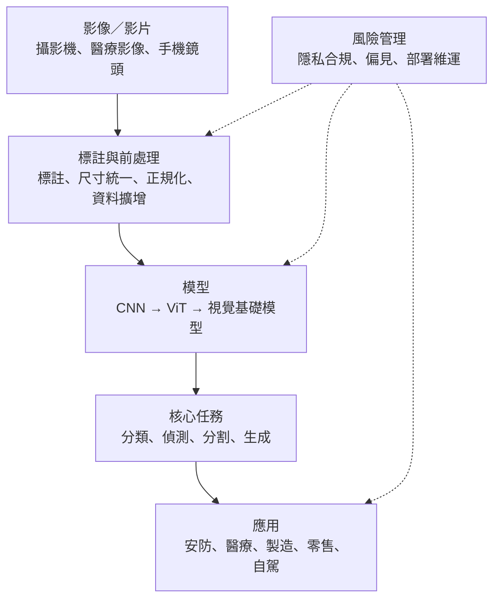

### Metadata
parent:: [[_【目錄】iPAS-AI應用規劃師(中級)：人工智慧技術應用與規劃]]
sibling:: [[01自然語言處理技術與應用]] · [[03生成式AI技術與應用]] · [[04多模態人工智慧應用]] · [[04鑒別式AI與生成式AI概念]]

## Key Points
> [!summary] 一句話看懂
> **電腦視覺（CV）＝讓機器「看懂」影像與影片。**
> 任務由粗到細就像**看一張街景照**：這是街景嗎？（分類）→ 車和行人在哪？（偵測，畫框）→ 每個像素是路還是車？（語意分割）→ 這是第幾台車？（實例分割）。
> 2020 年後，CV 從「看懂」走向「看懂＋生成＋跨模態」。

#### 四大核心任務（最常考）
| 任務 | 回答什麼 | 輸出 | 代表模型 |
|---|---|---|---|
| **影像分類** Classification | 這張圖是**什麼**？ | **整張圖一個標籤** | ResNet、ViT |
| **物件偵測** Object Detection | **有哪些東西、在哪裡**？ | **邊界框＋類別** | YOLO、Faster R-CNN、SSD、DETR |
| **語意分割** Semantic Segmentation | **每個像素**屬於哪一類？ | 像素級類別，**同類不分個體** | FCN、U-Net |
| **實例分割** Instance Segmentation | 每個像素屬於**哪一個物體**？ | 像素級遮罩，**同類也分個體** | Mask R-CNN |

#### CV 技術三個時代
| 時代 | 時期 | 做法 | 代表 |
|---|---|---|---|
| **特徵工程** | 1960s～2011 | 人工設計特徵＋傳統分類器 | Canny 邊緣偵測、SIFT、SVM |
| **CNN 革命** | 2012～2020 | 深度學習自動學特徵 | **AlexNet（2012）**、VGG、ResNet、YOLO、U-Net |
| **多模態與生成** | 2020～至今 | Transformer、跨模態、生成式 | **ViT、CLIP、SAM**、Stable Diffusion |

#### 物件偵測三大模型
| 模型 | 類型 | 特色 |
|---|---|---|
| **YOLO** | 單階段 | **速度最快**，適合即時影像 |
| **Faster R-CNN** | 兩階段（先用 RPN 找候選框，再分類） | **準確度高、速度較慢** |
| **SSD** | 單階段、多尺度 | 速度與準確度**平衡** |

#### 經典 CNN 架構
| 模型 | 年代 | 重點 |
|---|---|---|
| **LeNet** | 1998 | Yann LeCun，**手寫數字辨識** |
| **AlexNet** | 2012 | ImageNet 冠軍，**引入 ReLU、Dropout**，開啟深度學習時代 |
| **VGG** | 2014 | **小卷積核（3×3）、加深網路**（16～19 層） |
| **ResNet** | 2015 | **殘差連接**，解決深層網路梯度消失，可達 152 層 |

> [!warning] 陷阱題
> 1. **分類＝整張圖一個標籤；偵測＝畫框；語意分割＝像素分類但不分個體；實例分割＝像素分類且分個體**（官方考題原題）。
> 2. **要找出多個物體「並標示位置」→ 物件偵測**（官方考題原題）。
> 3. **YOLO 快、Faster R-CNN 準、SSD 平衡**；YOLO 和 SSD 是**單階段**，Faster R-CNN 是**兩階段**。
> 4. **U-Net 的招牌是跳躍連接（Skip Connection）**，源自醫學影像分割。
> 5. **Mask R-CNN＝Faster R-CNN＋遮罩分支**，用於**實例分割**。
> 6. **IoU＝交集 ÷ 聯集**，範圍 0～1；物件偵測常以 **IoU ≥ 0.5** 視為偵測成功。
> 7. **ResNet 用殘差連接解決梯度消失**；AlexNet 引入 ReLU 與 Dropout。
> 8. **ViT 把圖片切成小方塊（Patch）當成 Token**，用 Transformer 處理。
> 9. **物件偵測的主要評估指標是 mAP**；分類看 Accuracy、Top-5 Error。
>
> ⚠️ **學習指引不精確的地方**
> - 指引寫「YOLO 可在即時影片中進行人臉辨識」：YOLO 只能做**人臉偵測**（找出臉在哪），要知道「這是誰」還需要**人臉辨識模型**（如 FaceNet、ArcFace）比對特徵向量。**偵測 ≠ 辨識**。
> - 指引寫 U-Net「特別適用於處理不平衡的資料集」：U-Net 原論文的重點是**標註資料很少**時也能訓練得好（搭配大量資料增強），而非專門處理類別不平衡。
> - 指引描述人臉辨識是比對「眼睛、鼻子、嘴巴的相對位置」：這是早期的幾何方法，現代做法是用深度學習把人臉轉成**特徵向量**（Face Embedding）再比對相似度。

> [!tip] PM 要記住的 3 件事
> 1. **先釐清需要哪一種任務**：只要知道「有沒有」用分類，要知道「在哪裡」用偵測，要知道「精確輪廓」才用分割；越細越貴，標註成本也越高。
> 2. **影像標註是最大的隱藏成本**：分割的標註成本遠高於分類，醫學影像還需要專業醫師標註。
> 3. **人臉＝高度敏感個資**：金融業用人臉登入時，除了辨識準確度，還要有**活體偵測**防止照片、影片、深偽攻擊。

--- 
## Notes
### 全局地圖：從影像到決策

- 本篇著重中級新增的 CV 專門技術；神經網路與 CNN 的基礎見 [[01人工智慧概論]]、[[04鑒別式AI與生成式AI概念]]。

---

### 一、電腦視覺是什麼
#### 1. 定義與範疇
**電腦視覺**（Computer Vision, CV）是讓機器從**靜態影像**或**動態影片**中擷取、辨識並解釋語意資訊，進而分析、理解與決策的技術。它整合了影像處理、模式辨識、機器學習與深度學習。

關鍵轉折發生在 **2012 年**：深度學習模型 **AlexNet** 在 ImageNet 圖像分類競賽中大幅領先第二名，電腦視覺從此進入深度學習時代。

#### 2. 任務全家族（由粗到細）
##### (1) 影像分類
判斷**整張影像屬於哪一類**，只回答「是什麼」，不回答「在哪裡」。例如商品辨識、判斷 X 光片是否有肺炎。

##### (2) 物件偵測
找出影像中的物件，並用**邊界框**（Bounding Box）標出位置與類別。例如自動駕駛找出行人與車輛、安防系統計算人流。

##### (3) 語意分割
替**每一個像素**標上類別，例如這個像素是道路、那個像素是車輛。它能畫出精確的輪廓，但**不區分同類的不同個體**，兩台車都只標成「車」。用於街景理解、農作物分類。

##### (4) 實例分割
同樣是像素級分類，但會**區分同一類的不同個體**，標成「車 1」「車 2」。用於自動駕駛的多目標追蹤、精密製造檢測。

##### (5) 全景分割（Panoptic Segmentation）
**語意分割與實例分割的整合**：背景類的「東西」（道路、天空）只分類，可數的「物體」（車、人）則區分個體。用於自動駕駛的完整場景理解。

##### (6) 姿態估計（Pose Estimation）
找出人體的**關節點位置**（肩膀、手肘、膝蓋），再連成骨架。用於運動分析、復健、長者**跌倒偵測**。

##### (7) 文字辨識（OCR）
從影像中讀出文字，例如身分證、發票、支票。金融業的文件自動化處理大量依賴 OCR。

##### (8) 影像生成與合成
用生成模型產生新影像，例如設計素材、風格轉換，或合成罕見情境的訓練資料。

#### 3. 技術演進：三個時代
> [!example] 白話比喻
> 教機器認貓的三種方法：**告訴它「貓有尖耳朵、鬍鬚」**（特徵工程）→ **給它看一萬張貓照片，讓它自己歸納**（CNN）→ **讓它讀遍網路上的圖片和說明文字，連「沒看過的動物」都能靠文字描述認出來**（多模態基礎模型）。

##### (1) 特徵工程時代（1960s～2011）
由人工設計影像特徵，再交給傳統分類器判斷。常見的技術有：
- **邊緣偵測**：如 Canny，找出物體輪廓。
- **特徵點偵測**：如 **SIFT、SURF、ORB**，找出影像中具辨識度的角點，用於影像比對，例如把多張照片拼接成全景照。
- **色彩與紋理分析**。
- **傳統分類器**：SVM、KNN、隨機森林。

限制在於**特徵要靠人設計**，機器學不到「貓臉」這種高階語意，效果被特徵設計的品質綁住。

##### (2) CNN 革命（2012～2020）
卷積神經網路能**自動從資料中學習特徵**，不再需要人工設計。架構從 VGGNet、GoogLeNet 一路演進到 **ResNet**、DenseNet，任務也擴展到物件偵測（YOLO、Faster R-CNN）、語意分割（FCN、U-Net）、人臉辨識（FaceNet）。前提是要有**大量標註資料與 GPU 算力**。

##### (3) 多模態與生成式融合（2020～至今）
電腦視覺不只「理解」影像，還能**跨模態融合**與**創造輸出**：
- **ViT（Vision Transformer，Google，2020）**：把 Transformer 用在影像上，挑戰 CNN 的主導地位。
- **CLIP（OpenAI，2021）**：把**影像和文字放進同一個語意空間**，不必訓練就能用文字描述做分類（零樣本分類）。
- **DALL·E、Stable Diffusion、Midjourney**：用**文字生成圖像**。
- **SAM（Segment Anything，Meta，2023）**：**通用分割模型**，沒看過的物體也能分割；SAM 2 進一步支援影片。

---

### 二、資料標註與前處理
> [!example] 白話比喻
> 標註就像**幫教科書寫標準答案**：答案寫錯，學生（模型）學得再認真也會學錯。

#### 1. 影像標註
##### (1) 不同任務、不同的標註格式
| 任務 | 標註方式 | 標註內容 | 常用工具 |
|---|---|---|---|
| 影像分類 | 類別標籤 | 整張圖一個類別 | LabelImg、Label Studio |
| 物件偵測 | **邊界框** Bounding Box | 物件位置與類別 | CVAT、Roboflow |
| 語意分割 | 像素級標籤 | 每個像素對應類別 | LabelMe、SuperAnnotate |
| 實例分割 | 像素遮罩＋**實例 ID** | 區分同類的多個物件 | VGG Image Annotator |
| 關鍵點標註 | 座標點 | 人體關節、特定定位點 | COCO Annotator |
| 文字辨識 OCR | 區塊框選＋文字內容 | 框出文字並輸入正確字串 | Tesseract Trainer |

標註成本是 **分類 < 偵測 < 分割**。分割需要沿著物體邊緣逐像素描繪，一張圖可能要花數分鐘到數十分鐘，最貴也最慢。

##### (2) 標註準則
開始標註前必須先寫好**標註準則（Annotation Guideline）**，涵蓋三件事：
- **一致性**：所有標註者遵循同一套規則。例如「被遮住一半的車要不要標？」要事先定義。
- **準確度**：邊界框要貼齊物體、像素範圍要精確。
- **品質控制**：定期抽查，並採用**雙重標註**（兩人標同一張圖再比對），找出標註不一致的地方。

##### (3) 降低標註成本的方法
- **自動化標註（Auto-labeling）**：先用現有模型預標，人工只需檢查與修正，速度可提升數倍。
- **半監督式學習**：用少量標註資料加上大量未標註資料一起訓練。
- **主動學習（Active Learning）**：讓模型挑出**最沒把握**的樣本交給人標註，把人力花在最有學習價值的地方。
- **基礎模型輔助**：用 **SAM** 點一下就產生分割遮罩、用 **Grounding DINO** 以文字找出物體，大幅縮短標註時間。

#### 2. 影像前處理
##### (1) 尺寸處理
模型需要固定大小的輸入，所以要用 **Resize（縮放）、Padding（補邊）、Cropping**（裁切）把影像統一成相同尺寸。直接縮放可能讓物體變形，補邊則能保留原本比例。

##### (2) 正規化
把像素值從 0～255 轉成 0～1，或標準化為平均 0、標準差 1。數值範圍一致，模型訓練會更快、更穩定。

##### (3) 影像增強與雜訊去除
- **直方圖均衡化、Gamma 校正**：改善低光源、對比不足的影像。
- **高斯濾波**：平滑雜訊；**雙邊濾波**：在去雜訊的同時保留邊緣。
- **色彩空間轉換**：RGB 轉灰階可簡化輸入；轉 HSV 能把顏色與亮度分開，在光線變化時更穩定。

##### (4) 資料擴增（Data Augmentation）
對訓練影像做**翻轉、旋轉、裁剪、模糊、色彩偏移**，產生更多樣的訓練資料。目的是讓模型學會「不管角度、光線怎麼變，貓還是貓」，**增加多樣性、防止過擬合**。要注意變形必須合理，例如辨識數字時，6 旋轉 180 度會變成 9。

##### (5) 影片的影格取樣
影片每秒有數十張影格，相鄰影格幾乎一樣。實務上會以固定頻率取樣（例如每秒取 2 張），用於動作辨識與影片建模。

##### (6) 進階處理
- **資料清洗**：刪除模糊、重複、標註錯誤的圖片。
- **分層抽樣**：類別不平衡時，確保每一類都有足夠樣本。
- **影像編碼**：把影像轉成張量（Tensor）或嵌入向量（如 CLIP Embedding），供後續模型使用。

---

### 三、核心技術與模型
#### 1. 影像分類
基本流程是：資料收集與標註 → 前處理（縮放、正規化）→ 選擇模型 → 訓練與評估。

##### (1) CNN 的基本架構
> [!example] 白話比喻
> CNN 像一組**由淺到深的放大鏡**：第一層看出線條和邊緣，第二層組合成眼睛、輪子這類零件，更深的層再組合成「貓」或「車」這種完整概念。

###### 五個組件
- **卷積層**：用**卷積核**（一個小濾鏡，例如 3×3）在影像上滑動掃描，提取局部特徵，產生**特徵圖**。不同的卷積核會偵測不同的特徵，例如垂直邊緣、水平邊緣。
- **池化層**：把特徵圖縮小，例如**最大池化**在每個 2×2 區域只保留最大值。這能減少計算量，也讓模型對物體的些微位移不那麼敏感。
- **激活層**：加入非線性，最常用 **ReLU**（負值變 0、正值不變），讓模型能學習複雜的模式。
- **全連接層**：把前面萃取的特徵攤平成一維向量，整合起來做判斷。
- **輸出層**：用 **Softmax** 把結果轉成各類別的機率，總和為 1。

###### 卷積的兩個設定
- **步幅（Stride）**：卷積核每次移動幾格。步幅越大，輸出的特徵圖越小。
- **填充（Padding）**：在影像邊緣補零，避免每經過一層影像就越縮越小，也讓邊緣的資訊不被忽略。

###### 優勢、限制與遷移學習
CNN 的優勢是**自動學特徵**，而且同一個卷積核在整張圖上重複使用（**權重共享**），參數量遠少於全連接網路。限制是需要大量資料與算力，小資料集容易過擬合。

實務上的解法是**遷移學習**：直接拿在 ImageNet（上百萬張圖）上預訓練好的模型，例如 ResNet、EfficientNet，再用自己的少量資料微調。因為模型已經學會辨識邊緣、紋理、形狀這些通用特徵，只需要調整最後幾層。

##### (2) 經典與現代架構
- **LeNet**：最早的 CNN 之一，用於手寫數字辨識。
- **AlexNet**：2012 年 ImageNet 冠軍，引入 **ReLU 與 Dropout**，開啟深度學習時代。
- **VGG**：用很多層 **3×3 小卷積核**堆疊，證明「更深」能帶來更好效果。
- **ResNet**：加入**殘差連接**，讓訊號可以「抄捷徑」跳過某些層。這解決了網路太深時的梯度消失問題，讓上百層的網路也能訓練。
- **MobileNet、EfficientNet**：**輕量化**設計，在準確度與運算量之間取得平衡，適合手機與邊緣設備。
- **ViT（Vision Transformer）**：把圖片切成 **16×16 的小方塊（Patch）**，每個方塊當成一個 Token 輸入 Transformer。**資料量大時表現超越 CNN**，資料少時則不如 CNN，因為它缺少 CNN「相鄰像素有關聯」的先天假設。
- **ConvNeXt、Swin Transformer**：融合 CNN 與 Transformer 優點的現代架構。

##### (3) 評估指標
| 指標 | 說明 |
|---|---|
| **準確率** Accuracy | 預測正確的比例 |
| **Top-5 錯誤率** | 正確答案**不在**模型前 5 名預測中的比例；類別很多時使用（如 ImageNet 有 1,000 類） |
| **混淆矩陣** | 看每一類被誤判成哪一類 |
| **精確率、召回率、F1** | 類別不平衡時使用（如瑕疵檢測） |

#### 2. 物件偵測
> [!example] 白話比喻
> 分類是「這張照片裡**有貓**」；偵測是「**左上角**有一隻貓、**右下角**有一隻狗」，還要用框框圈起來。

##### (1) 三種偵測架構
###### 兩階段（Two-stage）：先找候選，再仔細看
代表是 **Faster R-CNN**。第一步用**區域提議網路**（RPN）找出「可能有物體」的候選框，第二步再逐一判斷類別並修正框的位置。因為分兩步仔細處理，**準確度高但速度較慢**。

###### 單階段（One-stage）：一眼看完
代表是 **YOLO**（You Only Look Once）與 **SSD**。一次就同時預測所有邊界框與類別，**速度快，適合即時偵測**。YOLO 持續演進（v5、v8、v11 等），是即時偵測的業界標準之一。

###### Transformer 式：直接預測一組答案
代表是 **DETR**、RT-DETR。把偵測視為「直接輸出一組物體」的集合預測，不需要候選框，也不需要後面的 NMS 處理，架構更簡潔，是近年的主流方向之一。

###### 開放詞彙偵測（Open-Vocabulary Detection）
代表是 **Grounding DINO、YOLO-World**。可以**用文字指定要找什麼**，例如「找出畫面中的紅色安全帽」，不必事先為這個類別收集資料訓練。

##### (2) IoU：預測框準不準
**IoU**（Intersection over Union，交併比）衡量預測框與正確框的**重疊程度**：

$$\text{IoU} = \frac{\text{交集面積}}{\text{聯集面積}}$$

範圍 0～1，越接近 1 越準，通常以 **IoU ≥ 0.5** 視為偵測成功。

> [!example] 計算範例（指引題型）
> 正確框面積 100、預測框面積 80、兩者重疊 40。
> 1. 聯集＝100＋80－40＝**140**（重疊部分只能算一次）
> 2. IoU＝40 ÷ 140 ≈ **0.286**
> 3. 低於 0.5，判定為**偵測失敗**

##### (3) NMS：同一個物體只留一個框
模型常會對同一個物體畫出**好幾個重疊的框**。**NMS**（非極大值抑制）的做法是：保留**信心分數最高**的框，刪除與它**高度重疊**（IoU 超過門檻）的其他框。白話就是：同一隻貓只留一個最好的框。

##### (4) mAP：偵測的評估指標
**mAP**（mean Average Precision）先算出每個類別的平均精確率（AP），再對所有類別取平均。
- **mAP@0.5**：IoU 門檻設為 0.5 時的 mAP。
- **mAP@0.5:0.95**：在 0.5、0.55……到 0.95 多個門檻下分別計算再平均，要求框得更精準，是 **COCO 競賽**的標準。

考試記法：**分類看 Accuracy、偵測看 mAP、分割看 IoU（或 Dice）**。

##### (5) 應用
- **人臉偵測**：找出臉在哪裡（注意：偵測不等於辨識是誰）。
- **車牌辨識**：先偵測車牌位置，再用 OCR 讀出字元。
- **工業瑕疵檢測**、**人流計數**。

#### 3. 影像分割
##### (1) 三種分割的比較
| | **語意分割** | **實例分割** | **全景分割** |
|---|---|---|---|
| 做什麼 | 每個像素分類 | 每個像素分類，**並區分個體** | 兩者結合 |
| 兩台車 | 都標成「車」 | 標成「車 1」「車 2」 | 車分個體，道路、天空只分類 |
| 代表模型 | FCN、U-Net、DeepLab | **Mask R-CNN** | Panoptic FPN、Mask2Former |

##### (2) 常見分割模型
###### FCN（全卷積網路）
把 CNN 最後的全連接層換成卷積層，再用**上採樣**把縮小的特徵圖還原成原圖大小，讓每個像素都得到一個類別，是像素級分類的開山之作。

###### U-Net
結構像字母 **U**：左半邊（編碼器）逐步縮小影像、萃取特徵；右半邊（解碼器）逐步放大還原。關鍵是中間的**跳躍連接**，把左邊淺層保留的細節直接傳給右邊，讓分割邊緣更精確。它原本是為**生物醫學影像**設計的，特點是**少量標註資料也能訓練得好**，至今仍是醫療影像分割的主力。

###### Mask R-CNN
在 Faster R-CNN 偵測框的基礎上，**多加一個遮罩分支**，為每個偵測到的物體輸出精確輪廓，因此能做**實例分割**。

###### SAM 與 SAM 2
Meta 推出的**通用分割基礎模型**。使用者只要點一下或框一下，就能分割出任何物體，即使是訓練時沒看過的類別；SAM 2 還能在影片中持續追蹤同一個物體。

##### (3) 分割的評估指標
| 指標 | 公式 | 說明 |
|---|---|---|
| **IoU** | 交集 ÷ 聯集 | 最常用 |
| **mIoU** | 各類別 IoU 的平均 | 語意分割的標準指標 |
| **Dice 係數** | 2 × 交集 ÷（預測面積＋正確面積） | **醫學影像**常用，對小目標較敏感 |

---

### 四、電腦視覺的應用
#### 1. 監控與安全
##### (1) 人臉辨識系統
人臉辨識分成三步：
1. **人臉偵測**：先找出畫面中人臉的位置。
2. **特徵提取**：把人臉轉成一組**特徵向量**。現代做法是用深度學習模型（如 FaceNet、ArcFace），同一個人的不同照片會得到相近的向量。
3. **比對與辨識**：和資料庫中的特徵向量計算相似度，超過門檻就判定為同一人。

##### (2) 車牌辨識（ANPR）
先偵測車牌所在區域，再用 OCR 辨識字元，用於停車場、高速公路收費、交通執法。

##### (3) 即時性與隱私公平
監控應用需要**低延遲與高效運算**；同時要遵守 GDPR 等隱私法規，並注意不同膚色族群的辨識準確度可能不一致。

> [!tip] 金融業重點：人臉辨識要搭配「活體偵測」
> 網銀人臉登入、線上開戶（eKYC）時，壞人可能拿**照片、錄影、面具或深偽影片**冒充。**活體偵測**（Liveness Detection／Anti-Spoofing）會檢查眨眼、轉頭、皮膚紋理、深度資訊，確認鏡頭前是真人。這是金融業導入人臉辨識的必備環節。

#### 2. 醫療影像診斷
- **影像分類**：判斷 CT、MRI、X 光片的診斷結果，作為醫師的第二意見，減少漏看與誤診。
- **影像分割**：用 U-Net 等模型精確圈出腫瘤、病灶的位置與大小，協助治療規劃與追蹤。
- **專業標註**：醫療影像必須由專科醫師標註，成本高，標註品質直接決定模型品質。
- **隱私法規**：病患資料受嚴格保護（如美國 HIPAA、台灣個資法的特種個資規定）；作為診斷用途的 AI 也屬於醫療器材，需經主管機關審查。

#### 3. 智慧製造與零售
##### (1) 工業瑕疵檢測
在生產線上自動找出表面刮痕、汙點、尺寸偏差。通常搭配**邊緣運算**，在產線旁的設備直接推論，發現瑕疵立即通知或剔除，不必把影像傳回雲端。

##### (2) 零售顧客分析
- **顧客行為分析**：追蹤顧客與商品的互動、在貨架前停留的時間。
- **熱點圖（Heatmap）**：統計店內哪些區域最多人經過或停留，用來優化動線與陳列。
- **無人商店**：結合物件偵測與多攝影機追蹤，自動判斷顧客拿了哪些商品並結帳。

#### 4. 其他應用
- **AR／VR**：追蹤實體物體與使用者動作，在畫面上疊加虛擬資訊。
- **自動駕駛**：偵測車道線、行人、車輛與號誌，並以**多模態感測融合**（攝影機＋雷達＋光達 LiDAR）互補各自弱點，例如攝影機怕逆光、雷達不受天候影響。
- **文件智慧處理**（金融常見）：用 OCR 讀取身分證、發票、支票、財報，再交給 NLP 抽取欄位。

---

### 五、風險與挑戰
#### 1. 資料隱私與合規
**人臉屬於高度敏感的生物特徵資料**。GDPR 將「用於識別個人的生物特徵資料」列為特殊類別個資，處理時需要更嚴格的法律依據。

常見的保護做法：
- **去識別化**：把人臉模糊化，或遮蔽車牌、門牌、兒童等敏感區域。
- **合法授權**：裝設攝影機要明示告知用途，必要時取得同意。
- **資料最小化**：只保存必要的影像，過期資料自動刪除或加密。

**倫理爭議**：在學校、公共空間使用人臉辨識，需要在「安全」與「隱私」之間取得平衡。歐盟《人工智慧法》對執法單位在公共場所使用**即時遠端生物辨識**有嚴格限制（原則禁止、例外許可）。

#### 2. 偏見與模型可靠度
##### (1) 偏見從哪裡來
- **資料不平衡**：某些膚色、性別、年齡的樣本太少，模型對這些族群的準確度就較低。
- **標註偏誤**：標註者的主觀判斷或文化差異。
- **拍攝條件偏差**：訓練資料的角度、光線、解析度和實際使用環境不同。

##### (2) 誤判的代價
| 錯誤 | 例子 | 後果 |
|---|---|---|
| **誤檢**（False Positive） | 把健康的人判為有病 | 不必要的檢查與醫療處置 |
| **漏檢**（False Negative） | 沒抓到產品瑕疵 | 瑕疵品流入市場 |

哪一種錯誤比較嚴重，要依應用情境決定，並據此調整模型的判斷門檻。

##### (3) 改善方法
- **偏見稽核（Bias Audit）**：依族群、性別、年齡分別檢驗模型表現，找出落差。
- **資料平衡**：過採樣、欠採樣、資料擴增、重新加權。
- **多維度評估**：AUC、精確率、召回率一起看，不只看整體準確率。

#### 3. 部署與維運
##### (1) 運算資源有限
監視器、手機等邊緣設備算力不足。解法是使用**輕量模型**（MobileNet、YOLO 的小型版本）、**量化**（降低數值精度），以及 TensorRT 等推論加速工具。

##### (2) 即時性與延遲
影像串流的延遲會影響反應速度，例如瑕疵品已經離開產線才發出警報。解法是**邊緣推論**與批次優化。

##### (3) 版本管理
不同版本的模型推論結果不一致，出問題時難以追查。要用 **MLOps** 管理：CI/CD、模型登錄、持續監控。

##### (4) 資料漂移
光線、季節變化或更換攝影機，都會讓影像分佈改變，模型準確度下降。需要監測影像品質並定期再訓練。

##### (5) 場域測試不足
實驗室裡很準、現場卻不準，是電腦視覺專案最常見的失敗原因。上線前一定要在**實際場域**驗證。

##### (6) 異常應變
模型突然失準時，要能**自動回退**到舊版本或預設規則，避免服務中斷。

延伸閱讀：[[建立完善的監控與重新訓練機制]]、[[生成式AI風險管理]]。

---

### 六、2026 年的電腦視覺實務
#### 1. 視覺基礎模型：一個模型做很多事
過去每個視覺任務都要「收集資料 → 標註 → 訓練」，往往花上數個月。現在有了**視覺基礎模型**，很多需求可以先直接用現成模型做出原型：

##### (1) 圖文對齊模型
代表是 **CLIP、SigLIP**。能做**零樣本分類**：不必訓練，直接用文字描述類別（例如「一張有刮痕的手機殼照片」）就能分類。

##### (2) 通用分割模型
代表是 **SAM、SAM 2**。任何物體一鍵分割，影片也能追蹤。

##### (3) 開放詞彙偵測
代表是 **Grounding DINO、YOLO-World**。用文字指定要偵測的物體，不必為每個新類別重新訓練。

##### (4) 自監督視覺特徵
代表是 **DINOv2**。不需要標註，就能從大量影像中學到通用的影像特徵，再用少量資料接上特定任務。

##### (5) 視覺語言模型（VLM）
代表是 **GPT-4o、Gemini、Claude、Qwen-VL**。能看圖回答問題、讀表格與文件、描述影像內容，詳見 [[04多模態人工智慧應用]]。

##### (6) 專用模型仍有不可取代的地方
在產線、監控這類**高速、大量、低延遲**的場景，每秒要處理數十張影像。訓練一個小型 YOLO 部署在邊緣設備，往往比每張圖都呼叫大型 VLM **便宜又快得多**。

#### 2. 深偽與內容真實性
生成式影像越來越逼真，**深偽偵測**與**內容來源標記**（如 C2PA 標準、數位浮水印）成為金融與媒體的重要議題。詳見 [[03生成式AI技術與應用]]、[[生成式AI風險管理]]。

> [!tip] PM 選型建議
> 1. **先用 VLM 或基礎模型驗證需求**（例如請 VLM 看產品照片判斷有無瑕疵），確認可行再投資標註與訓練。
> 2. **大量、即時、在邊緣設備上跑** → 訓練專用輕量模型（YOLO、MobileNet）。
> 3. **類別常變動、樣本少** → 開放詞彙偵測或 CLIP 零樣本分類。

---

### PM 檢查清單：電腦視覺專案的 6 個問題
1. **任務**：需要分類、偵測、分割，還是 OCR？精細度是否真的必要？
2. **資料**：有多少標註資料？標註格式與準則訂好了嗎？誰來標、成本多少？
3. **場域**：光線、角度、天候、攝影機規格和訓練資料一致嗎？有做實地測試嗎？
4. **部署**：要在雲端還是邊緣設備跑？延遲與成本要求是多少？
5. **隱私**：有沒有人臉、車牌、兒童影像？告知、同意、去識別化、保存期限都處理了嗎？
6. **公平與安全**：不同族群的準確度一致嗎？人臉應用有活體偵測嗎？出錯時有回退機制嗎？

---
## References
- iPAS AI應用規劃師(中級)學習指引 科目1：人工智慧技術應用與規劃 — 3.2 電腦視覺技術與應用（p.3-40～3-58）、第三章考題解析
- Krizhevsky et al. (2012). *ImageNet Classification with Deep Convolutional Neural Networks*（AlexNet）
- He et al. (2016). *Deep Residual Learning for Image Recognition*（ResNet）
- Redmon et al. (2016). *You Only Look Once*（YOLO）
- Ronneberger et al. (2015). *U-Net: Convolutional Networks for Biomedical Image Segmentation*
- Dosovitskiy et al. (2020). *An Image is Worth 16x16 Words*（ViT）
- Kirillov et al. (2023). *Segment Anything*（SAM）
![[AI應用規劃師(中級)-學習指引-科目1人工智慧技術應用規劃_20251222101833.pdf]]
