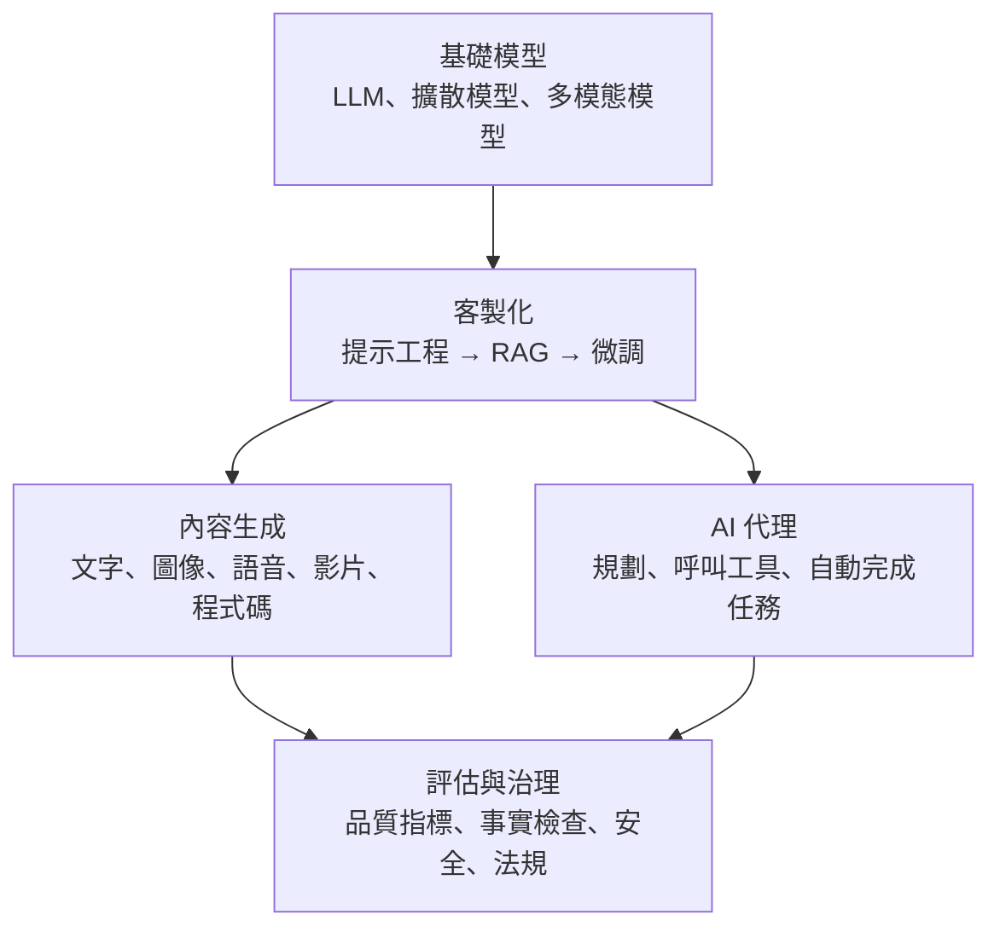
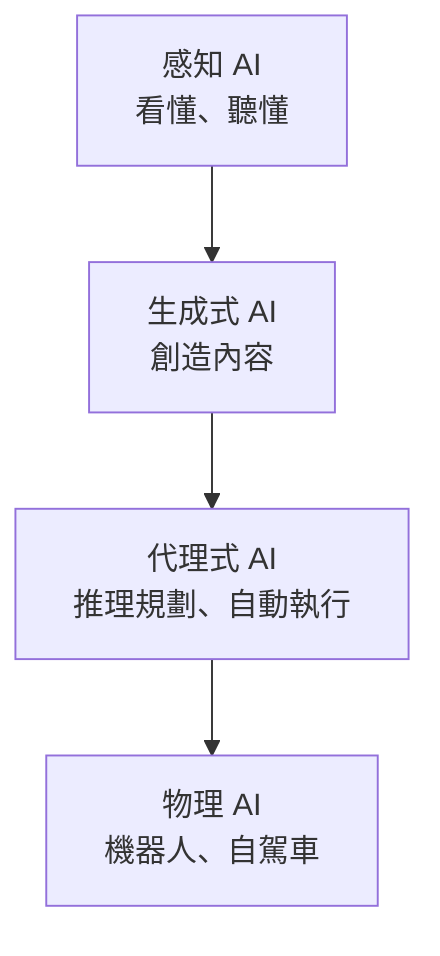
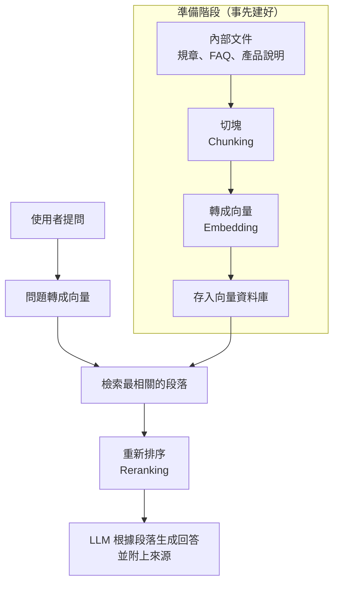

### Metadata
parent:: [[_【目錄】iPAS-AI應用規劃師(中級)：人工智慧技術應用與規劃]]
sibling:: [[01自然語言處理技術與應用]] · [[02電腦視覺技術與應用]] · [[04多模態人工智慧應用]] · [[根據數據特性與問題需求選擇合適的生成式 AI 的架構與演算法]] · [[訓練模型與如何優化]]

## Key Points
> [!summary] 一句話看懂
> **鑑別式 AI 回答「這是什麼」，生成式 AI 負責「做出新東西」。**
> 生成式 AI 不是單一模型，而是一整套技術：**基礎模型**（LLM、擴散模型）＋**客製化方法**（提示工程、RAG、微調）＋**應用**（文字、圖像、語音、影片）＋**行動能力**（AI 代理）。

#### AI 演進四階段（NVIDIA 黃仁勳，CES 2025）
| 階段 | 能力 | 例子 |
|---|---|---|
| **感知 AI** Perception | 理解影像、語音、文字 | 圖像辨識、語音轉文字 |
| **生成式 AI** Generative | **創造**新內容 | ChatGPT、Stable Diffusion |
| **代理式 AI** Agentic | **推理、規劃、自動完成任務** | 自動訂行程、寫程式並測試 |
| **物理 AI** Physical | 在真實世界**移動與操作** | 機器人、自駕車 |

#### 生成式 AI 五階段演進
| 階段 | 時期 | 核心技術 | 代表 | 特色／限制 |
|---|---|---|---|---|
| **初期** | 2013～2015 | VAE、RNN | VAE | 結果模糊、難訓練 |
| **GAN 時代** | 2014～2020 | 對抗訓練 | DCGAN、StyleGAN、CycleGAN | 寫實，但不穩定、模式崩潰 |
| **Transformer 崛起** | 2017 起 | 自注意力 | BERT、GPT、T5 | 語境建模強，NLP 主導 |
| **擴散與多模態** | 2020 起 | 擴散模型、跨模態對齊 | Stable Diffusion、DALL·E | 高品質、多模態整合 |
| **巨型模型與代理** | 2023 起 | 指令微調、工具整合 | GPT、Claude、Gemini 系列 | 自主性、任務導向 |

#### 客製化三招：提示工程 vs RAG vs 微調（必考）
| | **提示工程** | **RAG 檢索增強生成** | **微調** Fine-tuning |
|---|---|---|---|
| 白話 | 把話講清楚 | 開書考 | 送去進修 |
| 改了什麼 | 只改輸入 | 加外部資料庫 | **改模型權重** |
| 成本 | 最低 | 中 | 最高 |
| 知識更新 | — | **即時**（更新資料庫即可） | 要重新訓練 |
| 最適合 | 調整格式、語氣、任務說明 | **需要最新或內部知識、要能引用來源** | **特定風格、格式、專業行為** |
| 降低幻覺 | 有限 | **效果最好** | 有限 |

#### 生成內容評估指標
| 領域 | 指標 | 說明 |
|---|---|---|
| 文字 | **BLEU** | n-gram 重疊（重精確率），**翻譯** |
| 文字 | **ROUGE** | 重召回率，**摘要**；有 ROUGE-N、ROUGE-L（最長公共子序列） |
| 文字 | **人工評估** | 流暢性、準確性，1～5 分或排序 |
| 圖像 | **FID** | 生成圖與真實圖的分佈差距，**越低越好** |
| 圖像 | **CLIP Score** | 圖片與文字描述的吻合程度，越高越好 |
| 語音 | **MOS** | 人工評分語音自然度，**1～5 分** |
| 語音 | **WER** 字錯誤率 | 內容錯誤率，**越低越好** |

> [!warning] 陷阱題
> 1. **生成式學資料分佈、創造新樣本；鑑別式學分類邊界、做判斷**。GPT、VAE、GAN、擴散是生成式；SVM、決策樹、邏輯迴歸是鑑別式。
> 2. **GAN＝產生器＋鑑別器**（官方考題原題）；**圖片風格轉換**是生成式 AI 的典型應用（官方考題原題）。
> 3. **RAG 不改模型權重，微調會改**；要「即時更新知識」選 RAG。
> 4. **BLEU 配翻譯、ROUGE 配摘要**；**FID 越低越好**；**MOS 是 1～5 分的人工評分**。
> 5. **FastSpeech 2 是非自迴歸**（速度快），**Tacotron 2 是自迴歸**；**VITS 結合 VAE 與 GAN**，端到端生成波形。
> 6. **Whisper 是語音辨識（語音→文字）**，不是語音合成。
> 7. **NVIDIA 四階段：感知 → 生成 → 代理 → 物理**。
> 8. **對齊**（Alignment）的主流技術是 **RLHF**，並搭配**紅隊測試**強化安全。
>
> ⚠️ **學習指引不精確的地方**
> - 指引把 **CLIP** 列為「多模態生成」模型：CLIP 是**圖文對齊（理解）模型**，負責判斷圖文是否相符，**本身不生成內容**；但它常被拿來引導生成模型（例如早期 DALL·E 2、Stable Diffusion 的文字編碼器）。
> - 指引列的最新模型停在 GPT-4、Claude 2、Gemini 1.5：各家模型更新極快，考試若問「代表模型」，答**家族名稱**（GPT、Claude、Gemini、Llama）最安全。
> - 指引說 Midjourney「融合擴散模型與風格優化算法」：Midjourney **未公開技術細節**，外界普遍認為以擴散模型為基礎。

> [!tip] PM 要記住的 3 件事
> 1. **先用提示工程，再用 RAG，最後才微調**：成本由低到高，多數企業應用停在 RAG 就足夠。
> 2. **生成式 AI 的產品價值在「流程」不在「模型」**：模型能力會快速普及，真正的護城河是你的資料、流程整合與使用者體驗。
> 3. **「能做」和「能負責」是兩回事**：生成內容要有事實檢查、人工審核與來源標示，才能放進金融、醫療這類高風險流程。

--- 
## Notes
### 全局地圖：生成式 AI 的技術堆疊

- 五大生成模型（自迴歸、VAE、擴散、GAN、Flow）的原理比較見 [[根據數據特性與問題需求選擇合適的生成式 AI 的架構與演算法]]；鑑別式與生成式的差異見 [[04鑒別式AI與生成式AI概念]]。本篇著重**中級要求的應用面與實作技術**。

---

### 一、生成式 AI 是什麼
#### 1. 定義：從「判斷」到「創造」
> [!example] 白話比喻
> **鑑別式 AI 像評審**：看一幅畫，判斷是梵谷還是莫內。**生成式 AI 像畫家**：看過大量梵谷的畫之後，畫出一幅「梵谷風格」的新作品。

| | **生成式 AI** | **鑑別式 AI** |
|---|---|---|
| 目標 | **生成**新的資料樣本 | **分類、辨識、預測** |
| 學什麼 | 資料的**分佈與結構** | 資料特徵與標籤之間的**邊界** |
| 輸出 | 新的文字、圖像、聲音 | 類別標籤或數值 |
| 模型 | GPT、VAE、GAN、擴散模型 | SVM、決策樹、隨機森林、邏輯迴歸 |
| 例子 | ChatGPT、DALL·E | ResNet 影像分類、語音辨識 |

#### 2. AI 演進四階段
2025 年 CES 展上，NVIDIA 執行長黃仁勳把 AI 發展分成四個階段：

生成式 AI 是第二階段，代表 AI 從**分析工具**變成**能主動創造內容**的系統。2025～2026 年業界焦點已逐步移向**代理式 AI**，也就是讓 AI 不只產生內容，還能自己規劃並完成任務（見第六部分）。

#### 3. 應用類型
##### (1) 文本生成
對話、寫作、摘要、翻譯。代表工具：ChatGPT、Claude、Gemini。

##### (2) 圖像生成
依文字描述產生或修改圖片。代表工具：Midjourney、Stable Diffusion、DALL·E、Imagen、Flux。

##### (3) 語音與音樂
語音合成、聲音複製、配樂創作。代表工具：ElevenLabs（語音）、Suno（音樂）。

##### (4) 影片生成
依文字或圖片產生短片。代表工具：Sora、Veo、Runway、Kling。

##### (5) 程式碼生成
自動補全、撰寫與修改程式。代表工具：GitHub Copilot、Cursor、Claude Code。

##### (6) 多模態生成
同一個模型能理解並產生文字、圖像、語音。代表：GPT-4o、Gemini。

---

### 二、技術演進五階段
> [!example] 白話比喻
> 生成式 AI 的演進像**畫家的成長**：先學會畫出模糊輪廓（VAE）→ 在老師嚴格批改下畫得逼真（GAN）→ 讀懂長篇故事（Transformer）→ 從一團雜訊慢慢雕出細節（擴散）→ 最後不只會畫，還能自己規劃、調度工具完成整個專案（代理）。

#### 初期：編碼器－解碼器與 VAE（2013～2015）
以 RNN 或簡單卷積網路為基礎。**VAE**（變分自編碼器）先把資料壓縮到一個平滑的「潛在空間」，再從中取樣、還原出新資料，透過**變分推斷**學習資料的潛在分佈。

當時主要用於簡單的圖像重建（如 MNIST 手寫數字）和基礎文字生成。限制是生成結果**模糊**、品質不穩定、不易收斂。

#### GAN 時代（2014～2020）
2014 年 **Ian Goodfellow** 提出 **GAN（生成對抗網路）**：由**產生器**負責造假、**鑑別器**負責抓假，兩者在對抗中一起進步，就像偽鈔集團和警察互相較勁，最後偽鈔做得幾可亂真。

代表模型有 **DCGAN**（用深度卷積網路）、**CycleGAN**（風格轉換，例如照片轉梵谷畫風）、**StyleGAN**（產生高品質的虛構人臉）。

限制是訓練不穩定、對超參數敏感，還容易發生**模式崩潰**：產生器發現某幾種圖最容易騙過鑑別器，就只會產生那幾種，失去多樣性。

#### Transformer 崛起（2017 起）
**自注意力機制**解決了 RNN 抓不到長距離依賴的問題，並支援平行運算，讓模型能擴展到前所未有的規模，催生了**大型語言模型（LLM）**。代表有 BERT（雙向理解）、GPT（自迴歸生成）、T5（把所有任務都轉成「文字到文字」）。

#### 擴散模型與多模態（2020 起）
**擴散模型**的做法是先學會「把圖片逐步加上雜訊變成一團雜訊」，再學會反過來「**逐步去噪**」，從雜訊中雕出清晰的圖片，生成品質超越 GAN。代表有 DDPM、Stable Diffusion。

同時，多模態模型透過**跨模態對齊**整合圖文，例如 CLIP 把圖片和文字放進同一個語意空間。代表有 Stable Diffusion、DALL·E、Flamingo（視覺問答）、Gemini。

#### 巨型模型與代理化（2023 起）
參數規模達到百億到兆級，並透過**指令微調**與**工具整合**（API 呼叫、RAG、記憶）走向能自主行動的「代理」。

2024～2026 年再加入兩個重要方向：
- **推理模型**：回答前先「想一想」，在數學、程式、複雜分析上大幅進步。
- **原生多模態**：一個模型從訓練開始就同時處理文字、圖像、語音。

---

### 三、讓模型為你所用：三種客製化方法
> [!example] 白話比喻：請一位聰明的新人處理公司業務
> - **提示工程**＝**把任務交代清楚**：「請用正式語氣、條列三點、不超過 200 字。」
> - **RAG**＝**給他一份公司手冊，讓他邊查邊回答**（開書考）。
> - **微調**＝**送他去上一門專業課程**，讓他把知識內化成習慣。

三者的選用順序通常是：**先做提示工程 → 需要內部知識時加上 RAG → 都不夠時才考慮微調**。

#### 1. 提示工程（Prompt Engineering）
##### (1) 常用技巧
###### 角色設定
指定 AI 的身份與立場，例如「你是一位資深理財顧問」，回答的用詞與角度會跟著改變。

###### 明確指令與限制
說清楚任務、格式、長度、語氣。例如「用表格列出三個方案的優缺點，每格不超過 20 字」。指令越具體，結果越穩定。

###### 零樣本與少樣本
- **零樣本（Zero-shot）**：不給範例直接問，例如「判斷這則評論是正面或負面」。
- **少樣本（Few-shot）**：先給幾個範例，讓模型照樣子做。例如先給 3 則已分類的評論，再請它分類新評論。格式要求嚴格或任務較特殊時特別有效。

###### 思維鏈（Chain-of-Thought）
要求模型「一步步思考後再回答」，讓它把推理過程寫出來，對數學、邏輯判斷類的問題能明顯提升正確率。新一代推理模型已把這個能力內建。

###### 結構化輸出
要求固定格式（如 JSON），方便程式直接接續處理，是把 AI 整合進系統的關鍵。

###### 提供脈絡
附上背景資料或參考文件，例如先貼上產品規格，再請它寫文案。模型看到的資訊越完整，越不會憑空編造。

##### (2) 系統提示詞（System Prompt）
產品中通常有一段使用者看不到的**系統提示詞**，用來設定 AI 的角色、規則與禁止事項，例如「不得提供個人投資建議」。

⚠️ 系統提示詞可能被**提示詞注入**攻擊套出或繞過，敏感規則不能只靠提示詞把關，還需要程式端的護欄。

##### (3) 控制生成的參數
| 參數 | 作用 |
|---|---|
| **Temperature** | 越低越穩定保守，越高越有創意但易出錯 |
| **Top-P／Top-K** | 限制候選詞範圍 |
| **Max Tokens** | 限制輸出長度（也影響成本） |

詳見 [[根據數據特性與問題需求選擇合適的生成式 AI 的架構與演算法]] 自迴歸模型章節。

#### 2. RAG 檢索增強生成
##### (1) 運作流程

##### (2) 每個步驟的關鍵決策
###### 切塊（Chunking）
把長文件切成適當大小的段落。**切太大**，一個段落混入多個主題，檢索不精準；**切太小**，失去上下文，模型看不懂。表格、條列、標題結構都要特別處理。

###### 嵌入（Embedding）
用嵌入模型把每個段落轉成向量，語意相近的段落向量也相近。要選擇**支援繁體中文**、表現良好的嵌入模型。

###### 向量資料庫
儲存並快速搜尋大量向量，常見有 pgvector、Pinecone、Milvus、Elasticsearch。

###### 檢索
用相似度找出與問題最相關的段落。實務上常結合**關鍵字搜尋**（BM25）做**混合檢索**：關鍵字擅長精準比對產品型號、條文編號，語意搜尋擅長理解換句話說。

###### 重新排序（Reranking）
先粗略找出 20～50 個候選段落，再用更精準（但較慢）的模型重新排序，只把最相關的幾段交給 LLM，提升最終答案品質。

###### 生成
LLM 根據檢索結果回答，並在指令中要求「**只根據資料回答、資料不足就說不知道**」，附上引用來源。

##### (3) RAG 的優點與限制
**優點**：
- 知識可**即時更新**，改文件就好，不必重新訓練模型。
- 可**引用來源**，使用者能查證。
- **降低幻覺**。
- 可依使用者**權限**控管能檢索哪些文件。

**限制**：
- 答案品質受**檢索品質**限制，找錯資料就答錯。
- 文件格式雜亂（表格、掃描檔、圖表）時需要額外處理。

評估方式見 [[驗證模型方案與檢查效能]]（RAGAS：忠實度、答案相關性、上下文精確率與召回率）。

#### 3. 微調（Fine-tuning）
##### (1) 微調的種類
- **全量微調**：調整模型所有參數。效果最好，但需要大量 GPU 與資料，成本最高。
- **參數高效微調（PEFT）**：凍結原模型，只訓練少量額外參數。最常見的是 **LoRA**；**QLoRA** 則先把模型量化壓縮，再做 LoRA，一張消費級 GPU 也能微調大型模型。
- **指令微調（Instruction Tuning）**：用大量「指令＋理想回答」的範例，教模型聽懂並遵循指令。
- **偏好對齊（RLHF、DPO）**：依人類對回答的偏好排序調整模型，讓回答更有用、更安全。

詳細原理見 [[訓練模型與如何優化]]。

##### (2) 什麼時候才需要微調
- 提示工程與 RAG 都試過，仍無法達到要求的**特定風格、格式或專業判斷**時。
- 需要讓**小模型**在特定任務上接近大模型的表現，以降低成本與延遲時。

⚠️ **微調不適合用來「灌知識」**：知識會過時，模型也可能記錯或混淆；需要知識就用 RAG。

---

### 四、三大應用領域
#### 1. 文本生成
##### (1) 代表模型與平台
- **GPT 系列／ChatGPT（OpenAI）**：使用者最多的對話式 AI，整合文字、圖像與工具呼叫。
- **Claude（Anthropic）**：以**安全性、長上下文**與**程式能力**著稱。
- **Gemini（Google DeepMind）**：**原生多模態**，與 Google 服務深度整合。
- **開源權重模型**：Meta 的 Llama、Mistral、阿里巴巴的 Qwen、DeepSeek 等，可下載到自己的伺服器**地端部署**，資料不外流。

##### (2) 應用情境
自動化客服、電子郵件與報告撰寫、法律與醫療文書草擬、程式碼補全、個人化教材。

##### (3) 挑戰
- **幻覺**：自信地說出錯誤內容。
- **長文本一致性**：寫到後面忘了前面的設定。
- **事實正確性**：流暢不代表正確，重要內容需查核。

#### 2. 圖像生成
##### (1) 主流技術
- **擴散模型**：目前的主流，品質高、自由度大。代表有 Stable Diffusion、DALL·E、Imagen、Flux。
- **GAN**：擅長人臉與特定風格，生成速度快。代表有 StyleGAN、BigGAN。
- **可控生成**：讓結果更符合需求。**ControlNet** 可以用骨架、邊緣線條、深度圖控制構圖與姿勢；**InstructPix2Pix** 可以用文字指令修改圖片的局部，例如「把天空改成黃昏」。

##### (2) 常見工具
- **Midjourney**：雲端服務，以**高美學風格**聞名。
- **Stable Diffusion WebUI、ComfyUI**：**開源、可本地部署**，支援 LoRA、ControlNet 等大量擴充，客製化程度最高。
- **Adobe Firefly**：整合 Photoshop、Illustrator，以**授權資料訓練**，強調商業使用安全。
- **Canva AI**：降低設計門檻，適合非專業使用者。

##### (3) 應用情境
品牌視覺與廣告圖、社群素材、遊戲角色與場景、影片預視化、藝術創作、電商商品圖換背景。

#### 3. 語音合成（TTS）
##### (1) 代表模型
- **Tacotron 2**：採用 Seq2Seq（自迴歸）架構先產生聲音頻譜，再由 **WaveNet** 轉成波形，語調自然。
- **FastSpeech 2**：**非自迴歸**，一次產生整段，**生成速度快**、穩定，不會跳字或重複。
- **VITS**：結合 **VAE、GAN 與流模型**，**端到端**直接從文字生成波形，音質細膩，適合多位語者。
- **Whisper（OpenAI）**：這是**語音辨識**（語音 → 文字），常與 TTS 搭配，形成「聽 → 想 → 說」的語音對話流程。

##### (2) 常見平台
**ElevenLabs**（情感表達豐富、支援聲音複製）、Microsoft Azure TTS、Google Cloud TTS、Amazon Polly。

##### (3) 挑戰
- **情感自然度**：避免機械感，表達喜怒哀樂。
- **多語言與方言**：台語、客語等在地語言的訓練資源較少。
- **倫理風險**：**聲音複製**（Voice Cloning）只需幾秒錄音就能模仿一個人的聲音，可能被用於詐騙（例如假冒家人或主管來電），必須取得本人授權。

##### (4) 評估指標
| 指標 | 說明 |
|---|---|
| **MOS** 平均意見分數 | 人工評分自然度，1～5 分 |
| **WER** 字錯誤率 | 內容正確性 |
| **生成延遲** | 即時對話的關鍵 |

#### 4. 其他生成領域
- **影片生成**：Sora、Veo、Runway、Kling 等，多採**擴散模型＋Transformer**（DiT）架構。挑戰在於**前後畫面的一致性**（角色不能換臉）與高昂的運算成本。
- **音樂生成**：Suno、Udio 等，**版權爭議**是主要風險。
- **3D 生成**：從文字或圖片生成 3D 模型，應用於遊戲、電商、AR。
- **程式碼生成**：Copilot 與各類 AI 程式助理，已是企業導入最普遍、效益最明確的場景之一。

---

### 五、生成內容的評估
| 領域 | 指標 | 怎麼看 |
|---|---|---|
| **文字** | **BLEU** | 生成文字與參考答案的 **n-gram 重疊**，加上**簡短懲罰**避免太短；0～1，越高越好，**翻譯**常用 |
| | **ROUGE** | 強調**召回率**；**ROUGE-N**（n-gram）、**ROUGE-L**（最長公共子序列）、ROUGE-S（跳躍詞對）；**摘要**常用 |
| | **人工評估** | 流暢性、準確性，1～5 分或排序；成本高但最貼近真實 |
| | **LLM-as-a-Judge** | 用另一個模型依評分表打分，介於自動指標與人工之間 |
| **圖像** | **FID**（Fréchet Inception Distance） | 生成圖片與真實圖片的**特徵分佈差距**，**越低越好** |
| | **IS**（Inception Score） | 生成圖片的清晰度與多樣性，越高越好 |
| | **CLIP Score** | 圖片與提示文字的**吻合程度** |
| **語音** | **MOS**、**WER**、延遲 | 見上方語音章節 |

詳見 [[驗證模型方案與檢查效能]]。

---

### 六、從生成到行動：AI 代理（Agentic AI）
> [!example] 白話比喻
> 生成式 AI 像一位**很會寫的秘書**，你叫他寫信他就寫；AI 代理像一位**會自己辦事的特助**：你說「幫我安排下週去高雄出差」，他會自己查行事曆、訂高鐵、訂飯店、寄確認信給你。

#### 1. 代理的四種能力
##### (1) 規劃
把大任務拆成可執行的步驟，例如「安排出差」拆成查行程、訂交通、訂住宿、通知相關人員。

##### (2) 工具使用
透過 **Function Calling**（函式呼叫）操作外部系統：查資料庫、寄信、下單、呼叫 API。模型本身不會真的執行，而是產生「要呼叫哪個工具、帶什麼參數」，由程式實際執行後再把結果交回模型。

##### (3) 記憶
記住對話內容與任務進度，長期記憶還能記住使用者的偏好。

##### (4) 反思與修正
檢查每一步的結果，出錯時自行調整。經典做法是 **ReAct**：推理（Reason）與行動（Act）交替進行，「想一下 → 做一步 → 看結果 → 再想一下」。

#### 2. 相關技術與風險
- **MCP（Model Context Protocol）**：讓 AI 模型與各種工具、資料來源**標準化串接**的開放協定，就像 AI 世界的 USB-C，已被多家 AI 平台採用。
- **多代理系統**：多個代理分工合作，例如一個負責研究、一個負責撰寫、一個負責審查。
- **主要風險**：權限過大可能執行錯誤操作，例如誤刪資料、誤寄信件；也可能被提示詞注入操控。**重要動作（付款、寄信、刪除）應保留人工確認**，並遵守最小權限原則。

---

### 七、風險與發展趨勢
#### 1. 五大潛在風險（學習指引）
##### (1) 內容真偽
偽造新聞、改造影像、合成語音，可能誤導社會與市場。因應方式是事實查核，以及**內容來源標記**，例如 C2PA 標準、Google 的 SynthID 數位浮水印。

##### (2) 智慧財產權
訓練資料可能未經授權；生成內容也可能與受保護的作品高度相似。因應方式是使用授權資料，並選擇提供**智財保障**（侵權時協助處理）的供應商。

##### (3) 偏見放大
訓練資料中的刻板印象會被延續甚至強化，例如生成「工程師」的圖片幾乎都是男性。因應方式是使用多元資料、做公平性測試、人工覆核。

##### (4) 深偽濫用
利用深偽影片、聲音進行詐騙與散布假訊息。因應方式包括**深偽偵測**、**活體驗證**與法律規範。

##### (5) 可控性不足
生成式模型的輸出無法完全預測。因應方式是提示工程、**護欄（Guardrails）**、結構化輸出與人工審核。

延伸閱讀：[[生成式AI風險管理]]、[[07AI風險管理]]。

#### 2. 五大發展趨勢（學習指引）
##### (1) 多模態生成
整合語音、圖像、影片、3D，發展互動式創作與智慧代理。

##### (2) 可控生成
精準控制語氣、風格、長度與格式，提示工程成為關鍵技能。

##### (3) 小型化與邊緣部署
小型模型可以在手機、筆電、IoT 設備上執行，兼顧隱私、延遲與成本。

##### (4) 對齊與安全
透過 **RLHF**、**紅隊測試**與防濫用機制，讓模型更符合人類價值並降低風險。

##### (5) 法規治理
歐盟《人工智慧法》與各國 AI 政策陸續上路；台灣《人工智慧基本法》已於 2025 年 12 月三讀通過。

#### 3. 2026 年值得關注的方向
- **推理模型**：回答前先「想一想」，在數學、程式、複雜分析上大幅進步，但速度較慢、成本較高。
- **長上下文**：可一次讀入整本書或大量文件，但 RAG 在成本、即時性與權限控管上仍有優勢。
- **模型價格快速下降**：同等能力的 API 價格持續下滑，「能做」的門檻降低，**「做好」（資料、流程、評估）才是競爭關鍵**。

---

### PM 檢查清單：生成式 AI 專案的 6 個問題
1. **需求**：要的是「生成內容」還是「自動完成任務」？成功的標準是什麼？
2. **方法**：提示工程能解決嗎？需要 RAG 引用內部知識嗎？真的需要微調嗎？
3. **模型**：閉源 API 還是開源地端部署？資料能不能離開公司？
4. **品質**：用什麼指標與流程評估？有黃金測試集嗎？
5. **風險**：幻覺、侵權、深偽、偏見各有什麼防護？哪些輸出必須人工審核？
6. **代理權限**：AI 能執行哪些操作？哪些動作必須人工確認？

---
## References
- iPAS AI應用規劃師(中級)學習指引 科目1：人工智慧技術應用與規劃 — 3.3 生成式 AI 技術與應用（p.3-59～3-72）、第三章考題解析
- Goodfellow et al. (2014). *Generative Adversarial Nets*
- Lewis et al. (2020). *Retrieval-Augmented Generation for Knowledge-Intensive NLP Tasks*（RAG）
- Heusel et al. (2017). *GANs Trained by a Two Time-Scale Update Rule Converge to a Local Nash Equilibrium*（FID）
- Papineni et al. (2002). *BLEU*；Lin (2004). *ROUGE*
- Anthropic (2024). *Model Context Protocol*
![[AI應用規劃師(中級)-學習指引-科目1人工智慧技術應用規劃_20251222101833.pdf]]
