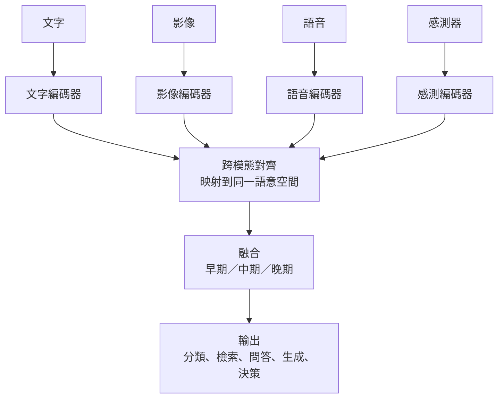
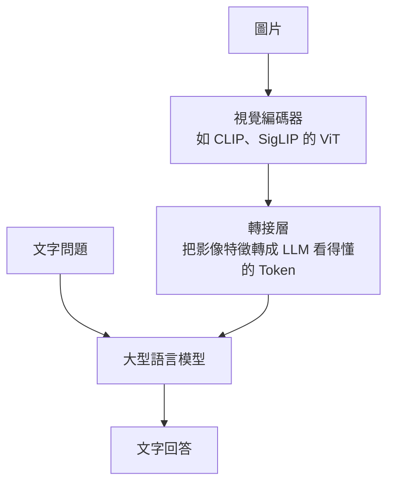
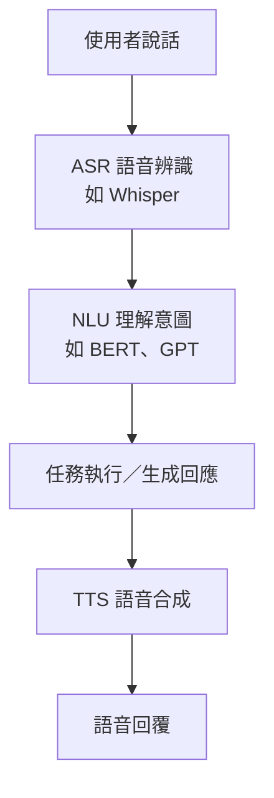

### Metadata
parent:: [[_【目錄】iPAS-AI應用規劃師(中級)：人工智慧技術應用與規劃]]
sibling:: [[01自然語言處理技術與應用]] · [[02電腦視覺技術與應用]] · [[03生成式AI技術與應用]]

## Key Points
> [!summary] 一句話看懂
> **多模態 AI＝同時看、聽、讀，再把資訊整合起來判斷。**
> 就像醫生看診：不只看 X 光片（影像），還會**讀病歷**（文字）、**聽病人描述**（語音）、**看心電圖**（感測訊號），綜合判斷。
> 核心技術有兩個：**對齊**（讓不同模態「說同一種語言」）與**融合**（把資訊合在一起用）。

#### 多模態技術三階段
| 階段 | 做法 | 代表 | 限制 |
|---|---|---|---|
| **早期：特徵拼接** | 把各模態的特徵向量**直接串接**，丟給 SVM、決策樹 | 傳統機器學習 | 無法處理模態間的語意關係 |
| **深度學習：專屬網路＋融合層** | CNN 處理影像、RNN 處理文字／語音，再用**融合層**整合 | 多模態深度學習 | 各模態仍分開設計 |
| **當前：Transformer 統一架構** | 用**自注意力**做跨模態對齊與融合 | CLIP、Flamingo、BLIP-2、GPT-4o、Gemini | 運算成本高 |

#### 三種融合策略（必考）
| 策略 | 在哪一層合併 | 白話 | 優點 | 缺點 |
|---|---|---|---|---|
| **早期融合** Early Fusion | **資料／特徵層**：先合併，再進模型 | 把所有食材一起下鍋 | 能學到模態間的細部交互 | 資料要精準同步；某模態缺失就難處理 |
| **晚期融合** Late Fusion | **決策層**：各模態先各自判斷，**最後合併結果**（投票、加權） | 幾位專家各自診斷，再開會表決 | 模組化、容錯高、某模態缺失仍可運作 | 學不到模態間的深層交互 |
| **中期／混合融合** Intermediate | **特徵中間層**：各自抽特徵後，在模型內部融合（如交叉注意力） | 專家討論過程中互相交換意見 | 兼顧兩者，現代主流 | 架構較複雜 |

#### 代表模型速記
| 模型 | 提出者 | 重點 |
|---|---|---|
| **CLIP** | OpenAI（2021） | **對比學習**讓圖文進入同一向量空間；**零樣本**能力強 |
| **BLIP／BLIP-2** | Salesforce | 強化**圖文問答**（VQA）與圖片描述生成 |
| **Flamingo** | DeepMind | **少樣本學習**，快速適應新的圖文任務 |
| **ImageBind** | Meta | 把**影像、文字、聲音、深度、紅外線、動作感測**等 6 種模態對齊到同一空間 |
| **M3AE** | 學術研究 | 多模態**遮罩預訓練**自編碼器 |
| **GPT-4o、Gemini、Claude 等** | 各大廠 | **原生多模態大型模型**，直接看圖、讀文件、聽語音 |

> [!warning] 陷阱題
> 1. **多模態 AI 的核心目標＝同時處理並整合不同類型的資料**（官方考題原題）。
> 2. **CLIP 結合「影像＋文字」**，用**對比學習**訓練（官方考題原題）。
> 3. **影片自動生成字幕**是典型的多模態應用（語音＋文字＋影像）（官方考題原題）。
> 4. **早期融合＝先合併再建模；晚期融合＝各自判斷後合併結果（決策層）**。
> 5. **感測融合的首要挑戰是「資料同步」**（採樣頻率、時間戳不同）；時序對齊常用 **DTW（動態時間校正）**。
> 6. **語音對話流程：ASR（語音→文字）→ NLU（理解）→ 回應生成 → TTS（文字→語音）**。
> 7. **ImageBind 對齊 6 種模態；CLIP 只對齊圖文 2 種**。
>
> ⚠️ **學習指引不精確的地方**
> - 指引寫「晚期融合（Late Fusion，**特徵層級**整合）」：晚期融合是**決策層級**整合（各模態模型先輸出結果，再合併）；特徵層級整合屬於**早期或中期融合**。
> - 指引把「圖片標題生成」列為 CLIP 的功能：CLIP **只能判斷圖文是否相符、做檢索與分類**，**本身不會生成文字**；要生成描述需搭配解碼器（如 BLIP、或 VLM）。
> - 指引再次寫「用 LoRA 降低參數量以利部署」：LoRA 降的是**微調要訓練的參數**，模型推論時不會變小；部署瘦身要靠**剪枝、量化、蒸餾**（指引同段也有列出）。

> [!tip] PM 要記住的 3 件事
> 1. **2026 年多數多模態需求，直接用原生多模態大模型就能做原型**：讀發票、看商品照、理解截圖，不必自己串好幾個模型。
> 2. **多模態的成本在「資料」**：對齊、同步、標註都比單模態貴得多，專案時程要預留。
> 3. **圖片和語音也是攻擊入口**：圖片裡藏的文字指令可能讓模型誤動作（多模態提示詞注入），上傳功能要有防護。

--- 
## Notes
### 全局地圖：多模態 AI 怎麼運作

- 多模態 AI 建立在 [[01自然語言處理技術與應用]]、[[02電腦視覺技術與應用]]、[[03生成式AI技術與應用]] 的基礎上，再加上**對齊**與**融合**兩項關鍵技術。

---

### 一、多模態 AI 是什麼
#### 1. 定義：能同時處理兩種以上資料模態的 AI
**模態**（Modality）指資訊的呈現形式。多模態 AI 能同時處理兩種以上的模態，四種常見模態的特性完全不同：

| 模態 | 資料特性 | 例子 |
|---|---|---|
| **文字** | **離散**、語意性強 | 問句、描述、病歷 |
| **影像** | **空間**資訊、顏色紋理 | 照片、影片、X 光 |
| **語音／音訊** | **時間序列**、情緒線索 | 對話、語調、背景聲 |
| **感測器** | **連續變化**的物理訊號 | GPS、加速度計、溫度、心率 |

正因為每種模態的**結構完全不同**，多模態 AI 的難處在於：如何從這些**異質資料**中萃取資訊並整合起來。

整合的價值在於：相較單一模態，多模態在**複雜情境判斷**與**人機互動**上更有彈性、更準確。例如智慧客服同時分析**語調、文字語意與表情**，就能分辨客戶說「好喔」時是真的同意，還是不耐煩。

#### 2. 兩大關鍵技術：對齊與融合
> [!example] 白話比喻
> - **對齊**＝幫不同國家的人**找一個共同語言**：中文的「貓」、英文的 cat、一張貓的照片，都指向同一個概念。
> - **融合**＝把大家的意見**整合成一個結論**。

##### (1) 跨模態表示學習（對齊）
把不同模態的資料映射到**同一個語意空間**，讓模型能比較、關聯與互相轉換。

例如一張貓的照片，和「一隻貓在草地上」這句話，轉成向量後在空間中的距離會很近；和「一台紅色跑車」的距離則很遠。有了這個共同空間，才能做到「用文字搜圖」或「看圖說故事」。

##### (2) 融合學習
決定**在哪個階段、用什麼方式**把各模態的資訊合在一起。主要有三種策略：

###### 早期融合（Early Fusion）
在**資料或特徵層級**先把各模態合併，再一起送進模型。

就像煮火鍋時把所有食材一次下鍋，食材之間能充分交融。優點是能學到模態之間細緻的交互關係；缺點是各模態的資料必須**精準同步**，而且只要有一個模態缺失（例如麥克風壞了），整個輸入就不完整。

###### 晚期融合（Late Fusion）
各模態**先各自建模、各自判斷**，最後在**決策層級**合併結果，例如投票或加權平均。

就像幾位專科醫師各自看診後開會表決。優點是模組化、容錯性高，某個模態缺失時其他模態仍能運作；缺點是學不到模態之間的深層交互。

###### 中期融合（Intermediate／Hybrid Fusion）
各模態先用自己的網路萃取特徵，再在**模型中間層**融合，常用**交叉注意力**讓不同模態互相參考。

就像醫師們在診斷過程中隨時交換意見。兼顧前兩者的優點，是**現代多模態模型的主流做法**，代價是架構較複雜。

> ⚠️ 學習指引把晚期融合寫成「特徵層級整合」，這是錯的。**晚期融合是決策層級**；特徵層級的整合屬於早期或中期融合。

#### 3. 技術演進三階段
##### (1) 早期：特徵拼接與簡單融合
把各模態的特徵向量**直接串接**（Feature Concatenation）成一條長向量，再交給 SVM、決策樹等傳統模型。做法簡單，但**無法處理模態間的語意對齊與交互**，也難以擴展到更多模態。

##### (2) 深度學習：模態專屬網路＋融合層
每種模態用最擅長的網路處理：CNN 處理影像、RNN 處理文字與語音，再透過**融合層**（Fusion Layer）把各自的特徵整合起來。

##### (3) 當前：Transformer 驅動的統一架構
自注意力機制大幅提升了跨模態理解能力：
- **M3AE**：用統一的編碼器，對影像與文字同時做「遮住一部分再猜回來」的預訓練。
- **Flamingo、BLIP-2**：多層次的對齊與**視覺－語言融合**，能做圖文問答、圖片描述、跨模態檢索。
- **原生多模態大模型**（GPT-4o、Gemini 等）：從訓練一開始就同時學習文字、圖像與語音，一個模型處理所有模態。

---

### 二、核心模型與技術
#### 1. CLIP：圖文對齊的里程碑
##### (1) 運作原理：對比學習（Contrastive Learning）
> [!example] 白話比喻
> 把一堆照片和一堆說明文字混在一起，請模型玩**配對遊戲**：配對正確的「照片＋說明」要拉近，配錯的要推遠。玩了 **4 億次**之後，模型就學會「什麼樣的圖對應什麼樣的文字」。

CLIP 由 OpenAI 於 **2021 年**提出，用約 **4 億對**網路上的圖片與說明文字訓練。架構包含兩個編碼器：
- **圖片編碼器**：ViT 或 ResNet，把圖片轉成向量。
- **文字編碼器**：Transformer，把文字轉成向量。

兩者用**對比損失**（Contrastive Loss）一起訓練，結果是：語意相符的圖文在向量空間中**靠近**，不相符的**遠離**。

##### (2) 四種功能
###### 圖文匹配
計算一張圖片和一段描述的相符程度，例如判斷這張圖和「一隻貓在草地上」是否相符。

###### 圖文檢索
用文字搜圖、用圖找描述。例如輸入「紅色跑車」，從圖庫中找出最相關的圖片，電商的「以文搜圖」就是這樣做的。

###### 零樣本分類
**不需要訓練**，直接用文字描述類別。例如把一張圖片分別和「狗的照片」「貓的照片」「車的照片」三段文字比對，選相似度最高的作為答案。要新增類別，只要多寫一段描述就好。

###### 引導生成
作為生成模型的「品味判斷」。DALL·E 2、Stable Diffusion 等文字生成圖像模型，都使用 CLIP 類的文字編碼器來理解提示詞。

##### (3) 優勢與限制
- **優勢**：**零樣本能力強**，不必為每個任務重新收集資料與訓練。
- **限制**：對**細節與複雜情境**理解有限，例如數清楚圖中有幾個物體、判斷左右位置；訓練資料來自網路，**可能帶有偏見**。
- ⚠️ CLIP **不會生成文字**。「圖片描述生成」要靠 BLIP 或視覺語言模型（學習指引把它列為 CLIP 的功能，是錯的）。

#### 2. 視覺語言模型（VLM）：讓大型語言模型「看得見」
##### (1) 典型架構

VLM 的核心想法是：大型語言模型已經很會理解與表達，只要把影像「翻譯」成它看得懂的 Token，它就能看圖說話。三個元件分工如下：
- **視覺編碼器**：通常直接借用 CLIP 或 SigLIP 訓練好的影像編碼器，把圖片轉成特徵。
- **轉接層**：把影像特徵轉換成和文字 Token 同樣格式的向量。
- **大型語言模型**：同時讀入影像 Token 與文字問題，產生回答。

##### (2) 代表模型
- **BLIP-2**：用名為 Q-Former 的轉接模組連接影像與語言模型。
- **Flamingo**：用交叉注意力把影像資訊注入語言模型，擅長少樣本學習。
- **LLaVA**：開源 VLM 的經典做法，架構簡單、效果好。
- 商用與開源模型：GPT-4o、Gemini、Claude、Qwen-VL 等。

##### (3) 能做的事
**圖文問答（VQA）**、圖片描述、讀懂圖表與文件、比較兩張圖片的差異、看系統截圖找出錯誤訊息。

#### 3. 語音模態的整合
##### (1) 傳統「串接式」語音流程

例如使用者問「今天天氣如何」：ASR 先轉成文字 → NLU 判斷意圖是查天氣 → 系統查詢並生成「今天晴朗，氣溫 25 度」→ TTS 唸出來。

若在中間加入**神經機器翻譯（NMT）**，就能做到**跨語言即時口譯**：聽中文、翻英文、說英文。

##### (2) 新趨勢：端到端語音模型
新一代模型（如 GPT-4o 的即時語音模式）可以**直接「聽語音、說語音」**，不必先轉成文字。好處有三：
- **延遲更低**：少了好幾個轉換步驟。
- **保留語氣與情緒**：轉成文字會丟掉「語氣很急」「在笑」這類資訊。
- **可以被打斷**：對話更像真人。

##### (3) 應用
語音助理、語音搜尋、**語音客服**、跨語言即時翻譯。

#### 4. 感測資料融合（Sensor Fusion）
整合雷達、超音波、溫濕度、GPS、加速度計等**感測器資料**，提升系統對環境的感知能力。關鍵工作是**資料同步**與**特徵對齊**。

##### (1) 智慧城市
結合監視影像與空氣品質、交通流量感測資料，用來預測交通壅塞、提前發出環境異常警報。

##### (2) 智慧醫療
結合醫學影像與生命徵象（心率、血壓），例如把 MRI 影像和連續監測的心臟數據一起分析，偵測心臟異常。

##### (3) 自動駕駛與機器人
結合攝影機、雷達、光達（LiDAR）與超音波，讓各感測器**互補弱點**：攝影機看得清楚但怕逆光與黑夜，雷達不受天候影響但解析度低，光達能精確測距。

##### (4) 主要挑戰
- **資料同步**：不同感測器的採樣頻率與時間戳記不同，例如攝影機每秒 30 張、雷達每秒 10 次，要先對齊到同一時間軸。
- **模型複雜度**：感測器越多，融合模型越複雜，運算需求也越高。

---

### 三、應用情境
#### 1. 醫療：診斷與決策支援
整合**醫學影像**（CT、MRI）、**電子病歷**（EMR）與**生理訊號**（心電圖、血糖、血壓），提供更完整的判斷依據。
- 辨識肺部 CT 的結節，再結合病歷**自動生成診斷摘要**。
- 結合連續心率數據與醫師筆記，**預測心血管疾病風險**。
- 特別適合**慢性病管理**與**加護病房（ICU）即時監控**。

**挑戰**：病患隱私（如美國 HIPAA、台灣個資法）、多源資料同步、**可解釋性不足**（醫師需要知道模型為什麼這樣判斷）。

**評估指標**：診斷**準確率**、**假陽性率**，以及生成報告的 **ROUGE**。

#### 2. 零售與顧客行為分析
整合**攝影機影像**、**POS 交易紀錄**、**顧客評論**與**社群回饋**。
- 分析顧客在店內的動線與停留時間，搭配銷售資料**調整貨架配置**。
- 用 NLP 解析評論情感（例如大量出現「口感不佳」），調整產品後推廣改良版。
- 建立多模態 **BI 儀表板**，即時監控營運。

**挑戰**：顧客隱私、多源資料的雜訊、即時處理。

**評估指標**：推薦**精確率**、動線分析的 **IoU**、情感分析的 **F1**。

#### 3. 虛實整合與沉浸式互動
同步處理**語音、文字、表情、姿勢與 3D 模型**。
- 虛擬導覽員依遊客的語音與手勢回應。
- 用語音加手勢操作智慧螢幕。
- 線上會議即時辨識手勢並產生字幕。

**挑戰**：**系統延遲**（動作與回應不同步會造成不適）、跨模態一致性、運算資源。

**評估指標**：**回應延遲**、語音辨識 **WER**、姿勢辨識準確率。

#### 4. 金融業的多模態應用
##### (1) 智慧文件處理
掃描的身分證、存摺、理賠單據、財報，同時包含影像、版面與文字。過去要用 OCR 加上大量規則；現在可以直接用 **VLM** 讀懂整份文件並抽出欄位，連手寫、表格、蓋章都能處理。

##### (2) 視訊開戶（eKYC）
結合**證件照比對**、**人臉活體偵測**與**語音確認**，在線上確認「是本人、是真人、是自願」。

##### (3) 語音客服情緒分析
同時分析語音的語調與對話文字，偵測客戶的不滿情緒，或辨識出詐騙集團常用的話術。

##### (4) 多模態 RAG
企業知識庫常包含表格、圖表、簡報。多模態 RAG 會把圖像內容也一起檢索與理解，例如回答「去年第三季各產品線營收占比」時，直接讀取簡報中的圓餅圖。

---

### 四、風險與未來趨勢
#### 1. 資料對齊與標註
##### (1) 挑戰
- **同步困難**：不同模態要在**時間軸或語意上同步**，例如監控影像和語音指令的時間戳記要對得上。
- **標註成本高**：同一張圖要標物件、又要寫文字描述。
- **資料稀缺**：高品質的多模態配對資料少，儲存與管理成本也高。

##### (2) 解法
- **時序對齊**：**DTW（Dynamic Time Warping，動態時間校正）**，能把速度不同的兩段序列對齊。例如同一句話一個人講得快、一個人講得慢，DTW 能找出兩者逐段對應的位置。
- **語意對齊**：用 CLIP 式的**對比學習**。
- **自動標註**：**弱監督學習**，或先用生成模型、VLM 產生初步標註，再由人工校正。
- **資料管理**：分散式儲存與**資料版本控制**。

#### 2. 運算與部署
訓練多模態模型需要大量 GPU／TPU，部署到邊緣設備時又要兼顧效能與資源限制。

##### (1) 部署方式的選擇
| 方式 | 優點 | 缺點 |
|---|---|---|
| **雲端** | 彈性大、可用大模型 | 延遲、隱私疑慮 |
| **邊緣** | 低延遲、資料不外流 | 算力與模型大小受限 |
| **混合** | 關鍵任務在邊緣、複雜推理交雲端 | 架構較複雜 |

##### (2) 模型瘦身與推論加速
- **模型瘦身**：**剪枝**（移除不重要的連結）、**量化**（降低數值精度）、**知識蒸餾**（用大模型教小模型），以及 MobileNet 等輕量架構。
- **推論加速**：NVIDIA **TensorRT**、Intel **OpenVINO**。

> ⚠️ 學習指引提到用 LoRA 降低部署負擔，這是誤解。**LoRA 降低的是微調成本，不會讓模型變小**；部署瘦身要靠剪枝、量化、蒸餾。

#### 3. 隱私、安全與法規
##### (1) 敏感資料外洩
人臉、聲紋、生理訊號一旦外洩，無法像密碼一樣更換。對策是**匿名化**（人臉遮罩、去識別化）與**端到端加密**。

##### (2) 深偽與偽造
多模態生成技術可偽造影像與語音。對策包括**對抗訓練**、生成內容偵測與數位浮水印。

##### (3) MLOps 缺乏管控
缺少安全審查與存取控制，模型與資料可能被濫用。對策是建立稽核流程與權限管理。

##### (4) 多模態提示詞注入
攻擊者把文字指令藏在**圖片、PDF 或網頁**中（例如白底白字），模型讀取時可能被誘導執行非預期的動作。對策是把外部內容視為「不可信資料」、在輸出前加上護欄，並限制模型可執行的動作。

##### (5) 法規
個資與生物特徵資料受到嚴格規範，要遵循 **GDPR**、台灣《個人資料保護法》，並建立稽核與監控機制。

#### 4. 五大未來趨勢
##### (1) 統一架構
一個模型支援**任意模態輸入與輸出**（Any-to-Any），例如輸入一段影片、輸出一段配樂。

##### (2) 即時與低資源部署
透過模型壓縮與最佳化，讓手機與邊緣設備也能執行多模態模型。

##### (3) 自我監督學習
利用大量未標註的資料預訓練，降低對昂貴標註資料的依賴。

##### (4) 與代理式 AI 整合
能看、能聽、還能操作電腦或機器人的智慧代理，例如看懂螢幕畫面後自動點擊、填表。

##### (5) 法規與倫理框架
隱私保護與深偽防範的規範持續強化。

---

### PM 檢查清單：多模態專案的 6 個問題
1. **必要性**：真的需要多種模態嗎？加入新模態能提升多少準確度？
2. **現成方案**：原生多模態大模型（VLM）能不能直接做出原型？
3. **資料**：各模態的資料能同步、對齊嗎？標註成本多少？
4. **融合策略**：某一模態缺失時（例如攝影機故障），系統還能運作嗎？
5. **部署**：要在雲端、邊緣還是混合？延遲要求多少？
6. **安全與隱私**：人臉、聲音、生理資料怎麼保護？圖片與文件上傳有沒有防注入機制？

---
## References
- iPAS AI應用規劃師(中級)學習指引 科目1：人工智慧技術應用與規劃 — 3.4 多模態人工智慧應用（p.3-73～3-84）、第三章考題解析
- Radford et al. (2021). *Learning Transferable Visual Models From Natural Language Supervision*（CLIP）
- Li et al. (2023). *BLIP-2: Bootstrapping Language-Image Pre-training with Frozen Image Encoders and Large Language Models*
- Alayrac et al. (2022). *Flamingo: a Visual Language Model for Few-Shot Learning*
- Girdhar et al. (2023). *ImageBind: One Embedding Space To Bind Them All*
- Liu et al. (2023). *Visual Instruction Tuning*（LLaVA）
![[AI應用規劃師(中級)-學習指引-科目1人工智慧技術應用規劃_20251222101833.pdf]]
