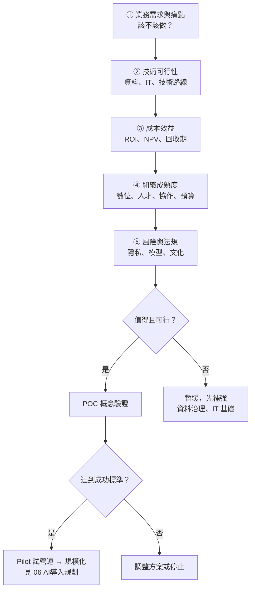

### Metadata
parent:: [[_【目錄】iPAS-AI應用規劃師(中級)：人工智慧技術應用與規劃]]
sibling:: [[06AI導入規劃]] · [[07AI風險管理]] · [[如何評估生成式 AI 方案的財務可行性與投資效益]] · [[驗證模型方案與檢查效能]]

## Key Points
> [!summary] 一句話看懂
> **AI 導入評估＝在花大錢之前，先回答「該不該做、做不做得到、划不划算、會不會出事」。**
> 就像買房前要看：**需不需要**（業務需求）、**買不買得起**（成本效益）、**房子結構好不好**（技術與資料）、**有沒有法律糾紛**（風險與法規），最後再**先租來住看看**（POC）。

#### 評估四大面向＋POC
| 面向 | 核心問題 | 關鍵檢查項目 |
|---|---|---|
| **① 業務需求** | 該不該做？ | 痛點、As-Is vs To-Be 差距、要改善的 **KPI** |
| **② 技術可行性** | 做不做得到？ | **資料品質**、IT 基礎設施、AI 技術路線適配性 |
| **③ 成本效益** | 划不划算？ | 成本組成、**ROI／NPV／回收期**、優先順序 |
| **④ 組織成熟度** | 公司準備好了嗎？ | 數位與資料成熟度、人才、跨部門協作、預算 |
| **⑤ 風險與法規** | 會不會出事？ | 個資與隱私、模型穩定性、可解釋性、變革阻力 |
| **→ POC** | 小規模驗證 | 範圍可控、具代表性、事先定好成功標準 |

#### 三個財務指標
| 指標 | 公式 | 判斷 | 弱點 |
|---|---|---|---|
| **ROI** 投資報酬率 | （收益－成本）÷ 成本 × 100% | 越高越好 | **不考慮時間價值** |
| **NPV** 淨現值 | Σ 現金流 ÷（1＋折現率）^t － 初期投資 | **> 0 才值得做** | 依賴折現率假設 |
| **回收期** Payback | 初期投資 ÷ 每年淨現金流（每年相同時） | 越短風險越低 | **不考慮時間價值、忽略回收後的收益** |

#### 風險等級＝發生機率 × 影響程度
| 等級 | 處理方式 |
|---|---|
| **低** | 可接受，持續監控 |
| **中** | 規劃因應對策 |
| **高** | **優先處理**，必要時迴避或延後導入 |

> [!warning] 陷阱題
> 1. **AI 導入評估的第一步＝業務痛點與需求辨識**，不是選演算法、不是建模型（官方考題原題）。
> 2. **商業價值評估＝預期效益與回報**；模型參數量、演算法難度屬於技術面（官方考題原題）。
> 3. **確保企業有執行能力＝技術成熟度與部署資源**（官方考題原題）。
> 4. **避免溝通斷裂與責任不清＝建立跨部門協作機制與角色分工**，不是由高階主管全權拍板（官方考題原題）。
> 5. **重視資料隱私與本地控制＝地端私有部署**（官方考題原題）。
> 6. **模型不可解釋＝決策透明性不足**；**特定族群預測不公平＝模型偏誤**（官方考題原題）。
> 7. **法律合規風險的對策＝檢視個資使用的合法性**（官方考題原題）。
> 8. **資料分佈隨時間改變導致效能下降＝建置漂移監控＋觸發再訓練**（官方考題原題）。
> 9. **ROI 與回收期都不考慮資金的時間價值**；考慮時間價值的是 **NPV（與 IRR）**。
> 10. **POC 驗證「技術上做不做得到」；Pilot 試營運驗證「真實環境下有沒有價值」**，兩者不同。
>
> ⚠️ **學習指引不精確的地方**
> - 第四章第 10 題解析把「資料分佈隨時間改變」稱為**概念漂移**。嚴格來說，**輸入資料分佈改變＝資料漂移（Data Drift）**；**輸入與答案之間的關係改變＝概念漂移（Concept Drift）**。考題情境（輸入分佈改變）其實是資料漂移，但答案（C）監控＋再訓練對兩者都適用，選它沒問題。
> - 指引的回收期公式「初期投資 ÷ 每年淨現金流」只在**每年現金流相同**時成立；每年不同時，要**逐年累加現金流，看哪一年累計回本**。

> [!tip] PM 要記住的 3 件事
> 1. **先定成功標準，再做 POC**：沒有事先講好「達到什麼數字就上線」，POC 很容易永遠停在 POC（業界稱為 **POC 煉獄**）。
> 2. **能買就先別自己做**：2026 年多數需求可先用現成的大型語言模型 API 或 SaaS 驗證，等證明有價值再考慮自建。
> 3. **成本要算「全期」**：上線後的推論費用（如 Token 費）、監控、再訓練、人工審核，常常比開發還貴。

--- 
## Notes
### 全局地圖：AI 導入評估流程

- AI 導入**不是單純的技術上線**，而是牽涉**業務策略、組織文化、資料體系、法規遵循**的系統工程。
- 評估的目的：**判斷是否有實質價值與可行性**，避免資源浪費與決策失誤。

---

### 一、可行性評估：該不該做、做不做得到、划不划算
#### 1. 業務需求與痛點分析
> [!example] 白話比喻
> 不要因為「隔壁公司導入 AI」就跟著買。先問自己：**哪裡在痛？痛多久了？治好後能省多少？**

##### (1) 找出現況與理想的差距
透過**利害關係人訪談**、跨部門訪談、流程觀察與資料分析，畫出兩張圖：
- **現況流程（As-Is）**：現在實際上怎麼做、花多少時間、哪裡出錯。
- **理想流程（To-Be）**：導入後希望變成什麼樣子。

兩者之間的**差距**，就是 AI 要解決的問題，也是後續衡量成效的基準。

##### (2) 三個關鍵問題
###### 哪些流程可以作為目標？
**重複性高、規則清晰、以數據驅動決策**的流程最適合。例如每天要人工審核上千張發票、依固定原則分派客服案件。

###### 有沒有流程瓶頸或服務缺口？
人力不足、處理太慢、品質不一致的地方，AI 可以扮演輔助或替代角色。例如夜間沒有客服人員、旺季審件積壓。

###### 要提升哪個 KPI？
導入目標要對應到**具體指標**，例如處理時間、準確率、回應速度、成本。說不出要改善哪個指標的專案，很難證明價值。

透過這三個問題，可以確認需求的真實性，避免只是追隨潮流而盲目導入。

##### (3) 判斷是否「適合用 AI」
業界常用的快速篩選：

| 適合 AI | 不一定需要 AI |
|---|---|
| 規則難以寫清楚，但有大量歷史資料（例：詐欺偵測） | 規則簡單明確（例：滿 1,000 元免運），寫程式或 RPA 就好 |
| 可以容忍一定錯誤率，或有人工覆核 | 必須 100% 正確且無人覆核 |
| 處理非結構化資料（文字、圖片、語音） | 資料量極少，且無法取得 |
| 需求量大、重複性高 | 一年只發生幾次的任務 |

##### (4) 用「價值 × 可行性」排優先順序
把候選題目放進兩個維度的四個象限：

| | **可行性高** | **可行性低** |
|---|---|---|
| **價值高** | 🎯 **優先做**：快速見效，建立信心 | 🧭 **策略投資**：先補資料與能力，列入中長期 |
| **價值低** | 🧩 **順手做**：當作團隊練兵 | 🗑️ **不做** |

學習指引也強調：資源有限時，優先選擇**技術成熟度高、效益可快速驗證、可跨部門擴展**的情境。

> [!tip]- 實務延伸：流程重新設計（考試可能性：中）
> **同樣的 AI，放進不同的流程，效益可以差好幾倍。** 評估「價值」高低時，要先想清楚打算怎麼改流程。
>
> | 層級 | 做法 | 授信審核例子 | 效益 |
> |---|---|---|---|
> | **① 工具嵌入** | 流程不動，AI 當輔助工具 | 徵信員照舊審件，多一個「AI 摘要財報」按鈕 | 小，省下部分時間 |
> | **② 流程調整** | 拿掉或合併因 AI 而多餘的步驟 | AI 先預審並標出風險點，徵信員只看被標記的項目 | 中 |
> | **③ 流程重新設計** | 以「有 AI」為前提，重新設計整條流程與分工 | 低風險小額案件由 AI 核准、人工抽查；人力集中在高風險大額案件 | 大，但要改制度、權責與法遵流程 |
>
> - **為什麼多數企業停在 ①**：改流程牽涉權責、考核與法規，比導入技術難得多。
> - **常見陷阱**：AI 省下的時間被其他雜事吸收，帳面上看不到效益，ROI 算不出來。
> - **PM 判斷法**：問自己「如果今天從零設計這個流程，而且有 AI 可用，還會長這樣嗎？」
> - **金融業注意**：做到 ③ 時，要對照金管會指引的**人工監督**要求，自動決策的範圍須先經風險評估。

#### 2. 技術可行性
##### (1) 三大檢查項目
###### 資料品質
AI 模型的效能高度依賴資料的**完整性、一致性與代表性**。要確認：有沒有足夠的歷史資料？資料有沒有標註？格式是否一致？能不能合法使用？詳見 [[08數據準備與模型選擇]]。

###### IT 能力與系統整合
企業是否有足夠的基礎設施支撐訓練與部署，例如伺服器規格、網路頻寬、雲端架構、資料倉儲；以及模型產出的結果能不能送回現有的業務系統（ERP、CRM）。

###### AI 技術路線適配性
評估問題適合**監督式、非監督式、強化式學習**，還是**生成式模型**。也要問：簡單的統計模型就足夠，還是真的需要深度學習？不是越複雜越好。

##### (2) 技術取得方式：自建、採購、還是串接？
| 方式 | 適合情境 | 優點 | 缺點 |
|---|---|---|---|
| **採購 SaaS** | 通用需求（客服、會議紀錄） | 最快上線 | 客製化低、資料可能外流 |
| **串接大型模型 API＋RAG** | 需結合企業知識，但不想自訓模型 | 快、彈性高 | 持續的 API 費用、依賴供應商 |
| **微調開源模型** | 特定領域、需地端部署 | 可控、資料不外流 | 需 ML 人才與 GPU |
| **從頭自建** | 核心競爭力、獨特資料 | 完全掌控 | 最貴、最慢、風險最高 |

2026 年的主流做法是：**先用 API 或 SaaS 驗證價值，證明有效後再考慮自建或地端化**。

##### (3) 技術條件不足怎麼辦
不代表放棄，而是列入**中長期規劃**：
- 先做**資料治理**：建立資料標準、提升資料品質與標註準確度。
- 強化 **IT 基礎**：擴充雲端資源、提升頻寬與處理能力。
- 同時挑選**簡單、容易實施的情境**小範圍試點，累積實戰經驗，再逐步擴大。

#### 3. 成本效益初步評估
##### (1) 成本組成：別只算開發費
AI 專案的成本分三層，很多專案只算了第一層：
- **初期成本**：人力、技術訓練、**資料清洗與標註**、模型開發、系統整合、顧問費、平台授權。
- **營運期成本**：**推論費用**（GPU 或 API Token 費）、雲端儲存、**監控與再訓練**、人工審核、資安與合規稽核。這部分會持續發生，用量越大越貴。
- **隱性成本**：員工學習曲線、流程調整、變革管理。

把整個生命週期的成本加總，就是**總持有成本（TCO, Total Cost of Ownership）**。

##### (2) 效益量化
先定 **KPI**，再用財務指標預測效益。效益可分兩類：
- **硬性效益**：省人力、省時間、增加營收、減少錯誤損失，可以直接換算成金額。
- **軟性效益**：顧客滿意度、員工體驗、決策品質、品牌形象。難以量化，但仍要列出，作為決策參考。

##### (3) 三大財務指標
###### ROI 投資報酬率
$$\text{ROI} = \frac{\text{投資回報} - \text{投資成本}}{\text{投資成本}} \times 100\%$$

例如投入 100 萬元，一年省下 150 萬元，ROI＝（150－100）÷ 100＝**50%**。

ROI 簡單直觀，是最常用的指標；缺點是**不考慮錢的時間價值**，三年後回收的 150 萬和今年回收的 150 萬被視為一樣。

###### NPV 淨現值
$$\text{NPV} = \sum_{t=1}^{n} \frac{\text{第 } t \text{ 期現金流}}{(1+r)^t} - \text{初期投資}$$

其中 r 是折現率（通常用公司的資金成本）。

> [!example] 白話比喻
> 「明年的 100 元」不等於「今天的 100 元」，因為今天的錢可以拿去投資。NPV 把未來每年賺的錢**換算成今天的價值**再加總，扣掉成本後 **> 0 才划算**。

NPV 適合評估**長期投資**，能比較不同期間的專案；缺點是結果很依賴折現率的假設。

###### 回收期（Payback Period）
$$\text{回收期} = \frac{\text{初期投資}}{\text{每年淨現金流}}$$

這個公式只在**每年現金流相同**時成立。每年不同時，要**逐年累加現金流**，看哪一年累計回本。

回收期越短，風險越低，主管很好理解；缺點是**不考慮時間價值**，也**看不到回本之後的長期收益**，所以要和 NPV 搭配使用。

更多財務評估細節見 [[如何評估生成式 AI 方案的財務可行性與投資效益]]；模型上線後的監控見 [[建立完善的監控與重新訓練機制]]。

---

### 二、組織成熟度盤點：公司準備好了嗎？
確認了需求與技術可行，下一步是盤點組織本身。即使技術沒問題，**數位化不足、資料治理薄弱、部門協作鬆散**，專案仍可能推不動。

#### 1. 數位與資料成熟度
##### (1) 三個檢查面向
###### 數位成熟度
現行作業流程是否已數位化？ERP、CRM、資料倉儲等系統是否建置完善？這些系統是 AI 取得可靠資料的來源。還停在**紙本或手動作業**的組織，導入 AI 門檻極高，應該先完成數位化。

###### 資料治理
資料的正確性、可追溯性與權限控管是否完備？是否有資料標準、管理制度與負責單位？完善的資料治理能確保資料在使用過程中的準確與合法。

###### 資料取得流程
不同系統之間的資料能否整合？是否已有 **API、ETL** 或自動化資料流？資料流不順暢，AI 就只能靠人工匯出資料，無法持續運作。

##### (2) AI 成熟度五階段（業界常用參考）
| 階段 | 特徵 |
|---|---|
| **1 認知** | 開始討論 AI，尚無實際專案 |
| **2 試驗** | 零星 POC，各部門各做各的 |
| **3 運作** | 有 AI 上線，開始建立流程與團隊 |
| **4 系統化** | AI 成為多數新專案的標準選項，有治理機制 |
| **5 轉型** | AI 深度融入商業模式與核心競爭力 |

這類分級（如 Gartner AI 成熟度模型）的用途是**定位現況、決定下一步要補什麼**，不必追求一步到位。

#### 2. 團隊能力與跨部門協作
##### (1) 三個檢查面向
###### 組織能力
有沒有 AI、資料分析、系統整合的核心人才？如果沒有，有沒有明確的培訓計畫或外部合作規劃？

###### 跨部門協作
部門之間曾經成功合作過嗎？有沒有**統一窗口與專案負責人**整合需求與進度？AI 專案通常牽涉資料、IT、業務、外部顧問，沒有清楚分工就容易卡住。

###### 推動責任單位
有沒有 **AI 專案辦公室**、數位轉型小組或**卓越中心**（CoE）負責落地？指定負責單位並設立監督機制，能明顯提升推動效率。

##### (2) AI 專案的典型角色
- **專案發起人（Sponsor）**：高階主管，提供資源、排除跨部門障礙。
- **產品經理／專案經理**：定義需求與成功指標，協調各方。
- **領域專家**：提供業務知識，驗收模型結果是否合理。
- **資料工程師**：資料蒐集、清理、建置資料管線。
- **資料科學家／AI 工程師**：模型選擇、訓練與評估。
- **IT 與 MLOps**：部署、監控與維運。
- **法務與資安**：合規、隱私、合約審查。

#### 3. 資源與預算支持
##### (1) 資源盤點
是否已預留可用的資金、人力與時間？能否彈性調度？資源不足的專案，即使技術可行也難以落地。

##### (2) 預算來源
預算是年度編列，還是專案提案？有沒有政府補助計畫可以申請？良好的預算規劃能避免專案因資金中斷而停擺。

##### (3) 導入條件
能否提供**試辦環境、測試資料與專責團隊**？初期需要能安全實驗的環境，才能依測試結果調整方向、降低風險。

---

### 三、初期風險辨識
在評估階段就應同步辨識風險。忽略初期風險，專案可能在中後期遇到重大阻力，甚至被迫中止或引發法規爭議。

#### 1. 四類風險
##### (1) 法規遵循與資料隱私
###### 法規遵循
AI 使用的資料是否有**合法來源與處理依據**？是否符合台灣《個人資料保護法》、歐盟 GDPR 等規範？對策是盤點每一份資料的來源與使用目的。

###### 資料隱私
模型在預測或生成時，可能洩漏訓練資料中的敏感資訊。對策是匿名化、取得使用授權、做好存取權限控管。

###### 跨境傳輸與外包
資料存放在海外雲端或交給第三方處理時，要確認跨境傳輸規範，並簽訂有明確保障的合約。

###### 侵權與版權
生成式 AI 產出的文字、圖片可能侵犯他人著作權。對策是確認訓練資料的授權，並審查生成內容。

###### 相關法規與標準
- **《人工智慧基本法》**（2025 年 12 月立法院三讀）：揭示人類自主、透明可解釋、公平不歧視、問責等原則。
- **歐盟《人工智慧法》（EU AI Act）**：依風險分四級（不可接受、高風險、有限風險、最小風險），**高風險系統**（如信用評分、招募）要符合嚴格義務。
- **金融業**：金管會《金融業運用人工智慧（AI）指引》要求治理、公平、隱私、透明、穩健與問責。
- **管理標準**：**ISO/IEC 42001**（AI 管理系統）、**NIST AI RMF**（AI 風險管理框架）。

詳見 [[07AI風險管理]]。

##### (2) 技術風險與模型穩定性
###### 資料缺口與品質不足
導入初期才發現資料不完整、格式混亂，或資料量不足以訓練。對策是事先做資料盤點、清理與前處理，必要時補充資料。

###### 模型穩定性
模型可能對輸入很敏感，業務情境一變（例如新產品上市、市場轉變）準確率就下降。對策是定期檢測、持續監控，並建立**漂移偵測**。

###### 黑箱與可解釋性
深度學習模型難以說明「為什麼這樣判斷」，會影響管理層與利害關係人的信任。對策是導入**可解釋 AI**（XAI）工具，例如 **SHAP、LIME**，讓使用者了解哪些因素影響了結果。

可解釋性在這些情境特別重要：
- **醫療診斷**：醫師需要理解模型的判斷依據，才能決定是否採納。
- **金融風控**：必須向主管機關說明風險評分的邏輯。
- **招募與教育**：避免模型延續歷史偏見而造成歧視。
- **公部門與法務**：AI 的判斷要能經得起法律審查，並有明確的問責對象。

###### 生成內容不確定
生成式 AI 可能產生幻覺、帶有偏見或不當內容。對策是人工審查、設置護欄，以及用 RAG 讓回答附上引用來源。

##### (3) 組織文化與變革阻力
###### 員工擔心被取代
AI 可能改變既有職責，引發員工的抗拒與不安。對策是領導層清楚溝通、提供培訓，並強調 AI 是**輔助**而非取代。

###### 不信任 AI 建議
組織從「依賴經驗判斷」轉向「參考 AI 建議」時，部門可能質疑。對策是逐步建立數據文化，初期**讓 AI 提供建議、由人做決定**，累積信任後再擴大自動化。

###### 跨部門配合不足
資料、業務、IT 團隊的協作成熟度，直接影響導入是否順利。對策是建立清楚的分工與資訊透明的協作機制。

##### (4) 供應商與營運風險
- **供應商鎖定**：過度依賴單一模型或雲端供應商，價格或政策一變就受影響。對策是在架構上保留**切換模型**的彈性。
- **模型版本變動**：API 模型升級或下架，可能改變輸出行為。對策是建立**評估測試集**，每次換版都重新測試。

#### 2. 風險緩解策略
##### (1) 風險矩陣（Risk Matrix）
把每個風險依**發生機率**（Likelihood）與**影響程度**（Impact）交叉評估，常見有 **3×3 或 5×5** 兩種格式。

$$\text{風險等級} = \text{發生機率} \times \text{影響程度}$$

| 影響 ＼ 機率 | **低**（罕見） | **中**（可能） | **高**（很可能） |
|---|---|---|---|
| **嚴重** | 🟡 中 | 🔴 高 | 🔴 高 |
| **重大** | 🟢 低 | 🟡 中 | 🔴 高 |
| **輕微** | 🟢 低 | 🟢 低 | 🟡 中 |

- **低風險**：可接受，持續監控即可。
- **中風險**：需要規劃因應對策。
- **高風險**：應優先處理，必要時迴避或延後導入。

##### (2) 四種風險回應策略
| 策略 | 做法 | 例子 |
|---|---|---|
| **迴避** Avoid | 不做或改變方案 | 高風險情境延後導入 |
| **降低** Mitigate | 採取措施降低機率或影響 | 先做資料清理、引入顧問 |
| **轉移** Transfer | 交給第三方承擔 | 保險、具保固責任的委外合約 |
| **接受** Accept | 風險低，接受並監控 | 低風險項目持續觀察 |

**POC 本身就是一種風險控制**：先小範圍測試，避免一次全面投入造成重大損失。

---

### 四、POC 概念驗證
完成需求、技術與組織盤點後，在正式導入前，應先規劃一個**具體且可控**的概念驗證（Proof of Concept, POC），用實際結果驗證 AI 的價值與落地能力。

#### 1. POC 怎麼選題
##### (1) 範圍清晰、風險可控
選擇小單位、單一部門或特定資料集進行，避免影響整體營運。出問題時容易修正，影響也小。

##### (2) 具代表性
選擇能代表未來擴展邏輯的業務流程，才能反映全面導入時可能遇到的挑戰。挑一個太特殊的題目，成功了也無法複製。

##### (3) 資料與技術已就緒
資料格式、存取權限與基礎 IT 支援都要準備好，避免測試過程因資源不足而中斷。

##### (4) 利害關係人支持
選擇有共識、有合作意願的業務單位，回饋快、配合度高，成功機率也高。

#### 2. POC 要觀察什麼
##### (1) 量化評估
依情境設定具體指標，例如準確率、處理速度、錯誤率、成本節省，並**與現有 KPI 比較**，確認是否明顯優於現況。

**生成式 AI 的 POC** 還要建立**評估測試集**（一組有標準答案的題目），衡量正確率、幻覺率、回應時間與單次成本。

##### (2) 質性評估
透過問卷、訪談或使用紀錄，收集實際使用者的體驗與建議。特別注意是否出現使用障礙、文化抗拒或流程磨合問題，這些常是技術以外的失敗原因。

#### 3. 事先定好成功標準與 Go／No-Go 決策
> [!example] 範例：客服 AI 助理 POC 成功標準
> - 常見問題回答正確率 **≥ 90%**
> - 平均回應時間 **< 3 秒**
> - 客服人員處理時間縮短 **≥ 30%**
> - 每次回答成本 **< 0.5 元**
> - 試用人員滿意度 **≥ 4 分（5 分制）**
>
> → 全部達標才進入 Pilot。

POC 結束後，從四個面向判斷是否繼續：
- **技術適配性**：模型能與現有系統整合嗎？資料架構相容嗎？
- **預期效益**：有明確的效能提升、效率改善或體驗改善嗎？
- **組織接受度**：使用者願意用、願意學嗎？
- **問題與瓶頸**：有沒有暴露出重大風險、資源限制或流程障礙？

#### 4. POC、Pilot、MVP 的差別
| 階段 | 要回答的問題 | 環境 | 使用者 |
|---|---|---|---|
| **POC** 概念驗證 | 技術上**做得到嗎**？ | 測試環境、樣本資料 | 開發團隊、少數專家 |
| **Pilot** 試營運 | 真實環境下**有價值嗎**？ | 正式環境、有限範圍 | 一個部門或一群真實使用者 |
| **MVP** 最小可行產品 | 使用者**願意用嗎**？ | 正式上線 | 早期客戶 |

> [!warning] POC 煉獄
> 許多企業的生成式 AI 專案停在 POC 後就被放棄，常見原因：**資料品質差、風險控管不足、成本上升、商業價值不明確**。
> 解法：**一開始就定義商業 KPI 與成功標準，並規劃好 POC 之後誰負責、預算從哪來**。

> [!tip]- 實務延伸：為什麼 POC 成功，卻擴大不了？（考試可能性：中）
> 上面的 POC 煉獄是「做完就被放棄」。另一種更常見的情況是：**POC 數字很漂亮，一擴大就失靈**。
>
> | 卡關原因 | 白話 | 解法 |
> |---|---|---|
> | **資料只在試點範圍乾淨** | POC 用精挑細選的樣本，正式資料又髒又雜 | POC 階段就用正式環境的真實資料抽樣 |
> | **沒有業務單位認養** | 由 IT 或創新部門發起，業務單位覺得「不是我的事」 | 一開始就請業務主管擔任 Product Owner，KPI 掛在業務單位 |
> | **整合成本被低估** | POC 是獨立 Demo，正式上線要串核心系統、權限與稽核紀錄 | 評估階段就把系統整合、資安審查列入 TCO |
> | **營運成本隨用量暴增** | 10 人試用很便宜，1 萬人使用時 API 費用失控 | 用單位經濟（每次任務成本）估算規模化後的費用 |
>
> 分階段投資與每一關的過關標準，見 [[如何評估生成式 AI 方案的財務可行性與投資效益#分階段投資（Stage-Gate）：避免一次押注|Stage-Gate]]。

---

### PM 檢查清單：AI 導入評估 10 問
1. **痛點**：要解決什麼問題？目前怎麼處理？痛到什麼程度？
2. **適合度**：這件事真的需要 AI 嗎？規則或 RPA 能不能解決？
3. **KPI**：成功的定義是什麼？要改善哪個指標、改善多少？
4. **資料**：資料在哪裡？品質如何？可以合法使用嗎？
5. **取得方式**：買 SaaS、串 API、微調開源，還是自建？
6. **成本**：TCO 算了嗎？包含推論、監控、再訓練、人工審核？
7. **財務**：ROI、NPV、回收期算出來合理嗎？
8. **組織**：有專案負責人、跨部門角色、預算與試辦環境嗎？
9. **風險**：法規、隱私、偏誤、可解釋性、供應商鎖定，排進風險矩陣了嗎？
10. **POC**：範圍、成功標準、Go／No-Go 決策人都定好了嗎？

---
## References
- iPAS AI應用規劃師(中級)學習指引 科目1：人工智慧技術應用與規劃 — 4.1 AI 導入評估、第四章考題解析
- 金融監督管理委員會（2024）《金融業運用人工智慧（AI）指引》
- 《人工智慧基本法》（2025 年 12 月三讀通過）
- European Union (2024). *Artificial Intelligence Act*
- NIST (2023). *AI Risk Management Framework (AI RMF 1.0)*
- ISO/IEC 42001:2023 *Artificial intelligence — Management system*
![[AI應用規劃師(中級)-學習指引-科目1人工智慧技術應用規劃_20251222101833.pdf]]
