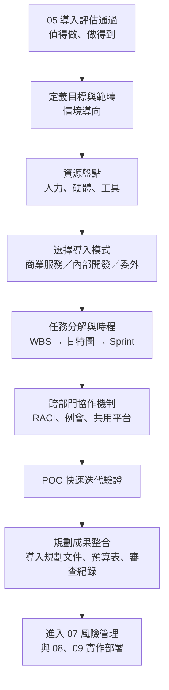
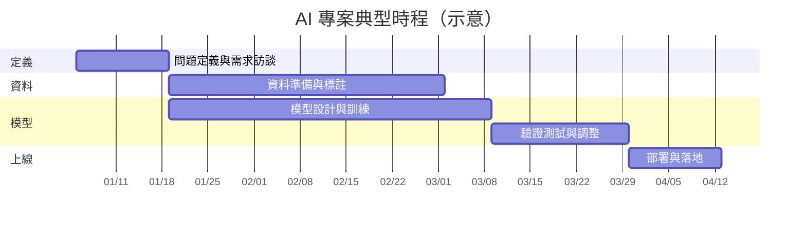
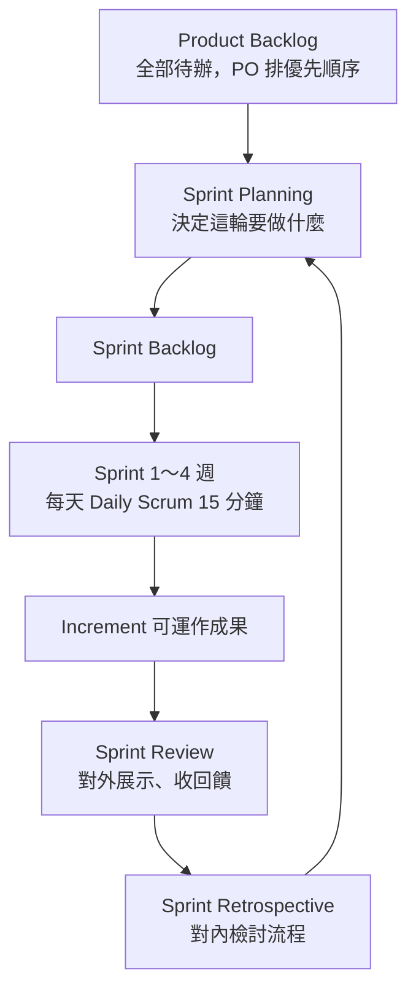
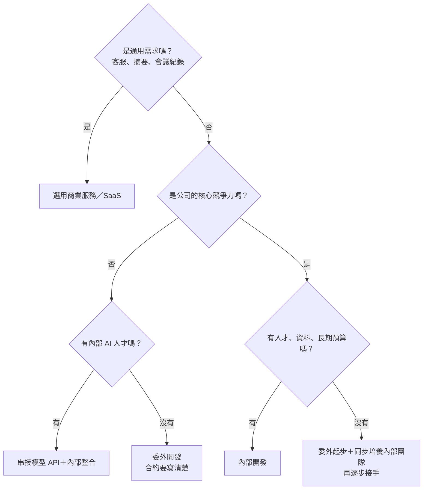

### Metadata
parent:: [[_【目錄】iPAS-AI應用規劃師(中級)：人工智慧技術應用與規劃]]
sibling:: [[05AI導入評估]] · [[07AI風險管理]] · [[如何評估生成式 AI 方案的財務可行性與投資效益]]

## Key Points
> [!summary] 一句話看懂
> **導入評估回答「要不要做」，導入規劃回答「怎麼做、誰做、何時做、花多少」。**
> 就像蓋房子：評估是確認地可以蓋、預算夠；規劃是**畫施工藍圖、排工班、訂工期、選自己蓋還是找營造廠**。

#### 導入規劃四大區塊
| 區塊 | 核心問題 | 工具與方法 |
|---|---|---|
| **① 時間與資源** | 誰做？用什麼做？何時完成？ | 角色配置、硬體、工具；**WBS、甘特圖、Scrum** |
| **② 跨部門協作** | 怎麼不打架？ | 協作流程、例行會議、**RACI**、共用平台 |
| **③ 導入模式** | 自己做、買現成、還是委外？ | 商業服務／內部開發／委外，以及混合 |
| **④ POC 與成果整合** | 怎麼驗證？要交出什麼文件？ | 快速迭代、導入規劃文件、審查紀錄 |

#### 三種任務規劃工具
| 工具 | 一句話 | 最適合 |
|---|---|---|
| **WBS** 工作分解結構 | **由上而下**把大任務拆成可執行的小任務 | 釐清「要做哪些事」 |
| **甘特圖** Gantt Chart | **時間為橫軸、任務為縱軸**，看排程、重疊與**關鍵路徑** | 跨部門溝通進度 |
| **Scrum 短衝** Sprint | 固定週期（1～4 週，常見 2 週）迭代開發 | 需求變動大、不確定性高的 AI 開發 |

#### Scrum 速記：3 個角色、5 個事件、3 個產出
| 類別 | 內容 |
|---|---|
| **角色** | **Product Owner**（定需求與優先順序、管 Product Backlog）、**Scrum Master**（排除障礙、守護流程）、**開發者**（跨職能，實際做事） |
| **事件** | **Sprint**（容器）、**Sprint Planning**、**Daily Scrum**（15 分鐘）、**Sprint Review**（展示成果、收回饋）、**Sprint Retrospective**（檢討流程、提出改善） |
| **產出** | **Product Backlog**（全部待辦）、**Sprint Backlog**（這輪要做的）、**Increment**（可運作的成果） |

#### 三種導入模式
| 模式 | 適合誰 | 優點 | 缺點 |
|---|---|---|---|
| **選用商業服務**（SaaS、低程式碼平台、大型模型 API） | 技術能力有限、要快 | 快、門檻低 | 客製化有限、長期訂閱費、資料隱私 |
| **內部開發** | 有技術人力與硬體、長期策略 | 掌控力強、可高度客製 | 初期成本高、耗時、需人才 |
| **委外開發** | 缺技術能力但有預算 | 專業、執行快 | **合約管理**、資料外流、知識留不住 |

> [!warning] 陷阱題
> 1. **Sprint Review＝對外展示成果、收回饋**；**Sprint Retrospective＝對內檢討流程**。兩者容易搞混。
> 2. **Product Owner 管「做什麼」與優先順序；Scrum Master 管「流程順不順」**，Scrum Master 不是專案經理、也不是主管。
> 3. **WBS 是由上而下拆解**；甘特圖是**時間排程**的視覺化。
> 4. **關鍵路徑（Critical Path）＝最長的那條相依任務鏈**，上面任何任務延誤，整個專案就延誤。
> 5. **避免部門間責任不清＝建立跨部門協作機制與角色分工**（官方考題原題）。
> 6. **人員規劃的重點＝AI 專案所需的跨部門協作角色**，不是 API 規格或作業系統版本（官方考題原題）。
> 7. **委外開發最大的管理重點＝合約（交付範圍、時程、驗收標準）與資料安全**。
> 8. Sprint 結束後的順序：**Review → Retrospective → 下一輪 Planning**。
>
> ⚠️ **學習指引過時或不精確的地方**
> - 指引把 Scrum 第三個角色寫成「Development Team（開發團隊）」。依 **2020 年版 Scrum Guide**，已改稱 **Developers（開發者）**，並強調三者合為**一個 Scrum Team**，不再分「團隊中的團隊」。考試若出現「開發團隊」仍指同一角色。
> - 指引舉的 **Google AutoML** 已整併進 **Google Cloud Vertex AI**；**NVIDIA A100** 也已不是最新世代（現役主力為 H100／H200、B200 等 Blackwell 系列）。概念不變，產品名稱以現況為準。
> - 指引把「商業服務」主要描述成 Low-code／No-code 平台，2026 年最常見的商業服務其實是**大型模型 API**（OpenAI、Anthropic、Google 等）與**雲端 AI 平台**（Azure AI Foundry、AWS Bedrock、Vertex AI）。

> [!tip] PM 要記住的 3 件事
> 1. **AI 專案的時程最難估在「資料」**：資料準備常佔整個專案 **50% 以上**的工時，排程時要留緩衝。
> 2. **AI 專案要「混合式」管理**：整體里程碑用甘特圖對齊高層，開發用 Sprint 快速迭代。
> 3. **委外也要留下能力**：合約寫清楚**程式碼、模型、資料的所有權**與**知識移轉**，否則換廠商就得重來。

--- 
## Notes
### 全局地圖：從評估到規劃成果

- 導入規劃是「**承上啟下**」：把評估階段的「可行性與價值潛力」轉成「**具體可執行的行動**」。
- **沒有一體適用的模式**：製造業重視感測器資料整合與即時性；金融業重視資安與法規。同一公司內，行銷部門可能先做顧客分析，生產部門先做預測維護。規劃要依組織的實際條件調整，而不是套用固定流程。

---

### 一、時間與資源規劃
#### 1. 導入規劃的三大原則
##### (1) 情境／目的導向
依產業特性與業務需求，定義專案的目標與範疇。例如零售業可能聚焦**銷售預測**，醫療業則強調**診斷輔助**。目標清楚，後續的資源與時程才有依據。

##### (2) 資源盤點
專案規模要和現有的資料、人力、預算匹配。例如資料品質不足時，應**先投資資料整備**，而不是急著開發模型。

##### (3) 彈性調整
專案推進中遇到需求改變或技術瓶頸，要能動態調整時程與策略。

> [!example] 案例
> 某企業原本計畫三個月內導入 AI 產能預測，卻發現感測器資料不完整。團隊決定先花一個月優化資料收集流程，雖然時程延後，最終專案成功上線，產能效率提升 15%。
> → 導入規劃的重點**不是照表操課，而是靈活應對實際狀況**。

#### 2. 資源盤點與配置
AI 專案需要的資源不只是技術，還包括人力、硬體與開發工具。事先盤點，才不會因資源短缺而中斷或延誤。

##### (1) 人力資源：AI 專案的角色
###### 專案負責人（PM）
負責整體協調與進度管理：制定時程、追蹤里程碑（例如「資料準備完成」）、解決跨部門衝突、向利害關係人報告進度。需要專案管理知識（如 PMP）與跨團隊溝通能力。

> 例：某醫療 AI 專案因資料部門與 IT 部門目標不一致而延誤，專案負責人召開協調會議、明確分工後，縮短了一週的延誤。

###### 業務顧問／領域專家
連結技術與業務，協助定義專案目標並提供產業洞察，例如確認銷售預測模型該看哪些關鍵指標，並驗收模型結果是否合理。

###### 資料工程師
負責資料收集、清理與整合，把多個來源的資料轉成可用格式，建置資料管線。需熟悉資料庫與 **ETL** 流程。

###### AI 模型開發者
資料科學家或機器學習工程師，負責模型設計、訓練與優化。需具備機器學習知識與 Python、PyTorch、TensorFlow 經驗。

###### AI 應用工程師
2024 年後新興的重要角色，負責串接大型模型 API、設計提示詞、建置 RAG 與 AI 代理，並建立評估測試集。

###### 系統架構師
設計整體技術架構與部署方案，確保模型能整合進現有系統，例如規劃伺服器架構、資料流與 API 介接。

> 例：某製造業專案的系統架構師將模型部署在工廠的本地伺服器，確保資料不外流，並把延遲降到 50 毫秒。

###### MLOps 工程師
負責模型部署、監控、版本管理與再訓練自動化，需熟悉 CI/CD、容器與監控工具。

###### UI/UX 設計師
專案有使用者介面時（如 AI 客服、內部工具），負責設計直觀的操作體驗，讓業務人員容易上手。

###### 測試工程師
驗證模型效能與系統穩定性，例如執行壓力測試，模擬高流量時的反應。

> 例：某客服 AI 專案的測試工程師發現語音辨識在吵雜環境下準確率下降，即時回饋給開發團隊調整模型。

###### 法務與資安
負責合規、隱私與合約審查。

###### 提前準備人力
盤點現有員工的技能（程式設計、資料分析），依時程預估人力需求，提前招聘或培訓，避免臨時調度造成延誤。

> 例：某零售企業導入推薦系統前，發現缺乏資料工程師，於是提前三個月招聘兩名，並對 IT 團隊進行 Python 培訓，確保專案啟動時人力到位。

##### (2) 硬體資源
- **GPU 伺服器**：加速深度學習的訓練與推論，例如 NVIDIA H100、B200 等，適合影像與自然語言處理。
- **雲端平台**（AWS、Google Cloud、Azure）：提供彈性擴展的儲存與運算，適合資料量大或需要即時處理的應用。
- **本地運算設備**（高效能工作站、地端伺服器）：適合小型試辦或資料高度敏感的情境，例如醫院在院內處理病歷。

如果專案只是**串接大型模型 API**，主要成本會從「買 GPU」轉成「**API 用量費**」，規劃預算時要特別注意。

##### (3) 開發工具與框架
- **程式語言與深度學習框架**：Python、PyTorch、TensorFlow。
- **大數據處理**：Spark、Hadoop、Databricks。
- **版本控制**：**Git** 管程式碼、DVC 管資料、MLflow 管模型與實驗紀錄。
- **大型語言模型應用開發**：LangChain、LlamaIndex、各家模型 SDK，以及評估與觀測平台。

#### 3. 任務分解與時程設計
AI 專案在原型開發、模型調整、資料收集階段都有高度不確定性。清楚的任務分解與時程設計，能讓進度透明、風險可控。

##### (1) WBS 工作分解結構
> [!example] 白話比喻
> 「辦一場婚禮」太大了，拆成「場地、餐飲、攝影、賓客」，再把「餐飲」拆成「試菜、訂桌數、確認菜單」，拆到**每一項都知道誰做、做多久**為止。

WBS 採用**由上而下**的拆解方式，把複雜任務拆成可管理的子任務。每個子任務都要定義四件事：**負責角色、預期成果、所需資源、預估時長**。

以「資料準備」為例，可拆成：
1. 資料源盤點：確認可用的資料來源與格式。
2. 資料清理：處理缺失值與異常值。
3. 欄位標準化：統一格式與單位。
4. 欄位對齊與標註流程建立：確保多來源資料一致並完成標註。

> 例：某製造業專案把「模型訓練」拆成資料分割、參數調整、效能評估三步，因此及早發現參數調整比預期耗時，並增派人力縮短時程。

##### (2) 甘特圖
以**時間為橫軸、任務為縱軸**，清楚呈現每項工作的排程、哪些任務重疊，以及**關鍵路徑**（最長的一串相依任務，其中任何一項延誤，整個專案就延誤）。適合用來和跨部門、高層溝通整體進度。

AI 專案的典型階段：

- **問題定義與需求訪談**：通常 1～2 週。
- **資料準備與標註**：數週到數月，依資料規模而定，常是最花時間的階段。
- **模型設計與訓練**：時程依複雜度變動。
- **驗證測試與調整**：通常需要多次迭代。
- **部署與落地**：整合進業務系統並上線。

> 例：某零售專案用甘特圖規劃三個月時程，發現資料準備與模型訓練可以部分重疊進行，調整資源後整體時程縮短 10%。

##### (3) Scrum 與短衝（Sprint）
AI 專案**需求變動快、技術不確定性高**，傳統的**瀑布式**開發（一個階段完成才進下一個）難以應付。因此 AI 團隊常採用**敏捷開發**，其中最常見的框架是 **Scrum**。

###### 三個角色
- **Product Owner（產品負責人）**：定義需求與優先順序，維護 Product Backlog，確保團隊做的是最有業務價值的事。
- **Scrum Master（敏捷教練）**：協助團隊遵守 Scrum 流程、移除障礙、促進持續改善。不是主管，也不是專案經理。
- **開發者（Developers）**：跨職能成員，實際完成資料處理、建模、測試與整合。

###### 五個事件
- **Sprint（短衝）**：固定週期的開發節奏，通常 1～4 週，常見 2 週。
- **Sprint Planning（規劃會議）**：決定這一輪要完成哪些任務。
- **Daily Scrum（每日站會）**：約 15 分鐘，快速同步進度與阻礙。
- **Sprint Review（成果展示）**：**對外**向產品負責人與利害關係人展示成果，例如模型訓練結果、Demo 畫面，並收集回饋。
- **Sprint Retrospective（回顧檢討）**：**對內**檢討執行過程的問題（資料延遲、準確度未達標、溝通不良），提出改善做法。

每一輪結束的順序是：**Review → Retrospective → 下一輪 Planning**。

###### 三個產出
- **Product Backlog**：整個產品的待辦清單。
- **Sprint Backlog**：這一輪要完成的任務清單。
- **Increment**：每一輪結束時完整、可運作的成果。

> [!example] AI 專案的 Sprint 目標範例（客服 AI）
> - 第 1 輪：語音辨識模型訓練，準確率達 80%
> - 第 2 輪：整合語意理解模組並優化介面
> - 第 3 輪：與客服系統串接並內測
>
> 每一輪都設定目標、展示成果、檢討問題，專案得以快速驗證與修正，在短時間內達到可部署的條件。

##### (4) 瀑布、敏捷、混合式怎麼選
| 方法 | 特色 | 適合 |
|---|---|---|
| **瀑布式** | 階段依序完成，前一階段結束才進下一階段 | 需求明確、法規要求完整文件 |
| **敏捷（Scrum、Kanban）** | 短週期迭代，持續回饋調整 | 需求不確定、需快速驗證 |
| **混合式** | 高層用里程碑與甘特圖管控，開發團隊用 Sprint | **多數企業 AI 專案的實務做法** |

**Kanban 看板**是另一種敏捷方法：不設固定週期，用「待辦 → 進行中 → 完成」看板管理**持續流入的工作**，並限制同時進行的工作數量（WIP 限制），適合維運與支援類任務。

##### (5) AI 專案的專屬生命週期：CRISP-DM
資料專案的業界標準流程是 **CRISP-DM**：**商業理解 → 資料理解 → 資料準備 → 建模 → 評估 → 部署**，各階段可以來回迭代。

它和 Scrum 並不衝突：**CRISP-DM 告訴你「要做哪些階段」，Scrum 告訴你「用什麼節奏做」**。

---

### 二、跨部門協作與任務追蹤
#### 1. 協作機制
AI 專案牽涉 IT、業務、法務、資料等多個部門，協作是否順暢往往決定成敗。

##### (1) 協作流程設計
明確界定各部門的責任範圍，特別是**資料提供、模型驗收、系統整合**這三個最容易互相推諉的環節，避免重疊或漏洞。

##### (2) 例行同步節奏
設立定期會議與進度報告，例如每週例會，即時處理阻礙與問題。

##### (3) 共用工具平台
- **任務看板**：Jira、Trello，管理進度。
- **共用文件**：Notion、Confluence，儲存文件並做版本控制。
- **即時通訊**：Slack、Microsoft Teams，促進快速溝通。

##### (4) RACI 責任矩陣
| 代號 | 意思 | 說明 |
|---|---|---|
| **R** Responsible | 執行者 | 實際做事的人 |
| **A** Accountable | 當責者 | **最終負責、拍板的人，每項任務只能有一位** |
| **C** Consulted | 諮詢者 | 事前要徵詢意見 |
| **I** Informed | 告知者 | 事後要通知結果 |

> [!example] 範例：「模型上線」這項任務
> - **R**：MLOps 工程師
> - **A**：專案負責人
> - **C**：資安、法務、業務單位
> - **I**：客服主管、高階主管

#### 2. 任務追蹤工具
任務追蹤工具能整合 WBS 的拆解結果，即時反映進度，降低資訊不同步的風險。

| 工具 | 特色 | 適合 | 缺點 |
|---|---|---|---|
| **Trello** | 輕量**看板**，卡片標狀態、負責人、截止日 | 小團隊、原型初期 | 缺自動化與複雜相依管理 |
| **Asana** | 任務分層、**時間軸檢視**、跨專案整合 | 跨部門協作 | 初期需花時間建立結構 |
| **Jira** | 問題追蹤、自訂工作流、**支援 Scrum 與 Kanban** | 工程師主導的技術團隊 | 非技術人員學習曲線高 |
| **ClickUp** | 結合看板與結構化、檢查清單、**里程碑** | 中型專案 | 功能多、設定複雜 |

其他常見選擇：**Linear**（工程團隊）、**Notion**（文件＋任務整合）、**Microsoft Planner**（Microsoft 365 環境）。

---

### 三、導入模式選擇
導入模式要依使用情境、技術能力、資源與時間需求選擇，兼顧效率、可控性與長期效益。

#### 1. 選用現有商業服務
##### (1) 常見形式
- **大型模型 API**：直接呼叫 GPT、Claude、Gemini 等模型。
- **雲端 AI 平台**：Azure AI Foundry、AWS Bedrock、Google Vertex AI。
- **低程式碼／無程式碼平台**：用拖拉介面建置流程或 AI 代理。
- **SaaS 成品**：AI 客服、會議紀錄、文件處理等現成產品。

##### (2) 優勢
- **部署快**：不必自行開發模型。
- **技術門檻低**：不需要深厚的程式或資料科學背景。
- **選擇多**：可依業務需求挑選合適的工具。

##### (3) 挑戰
- **彈性有限**：難以調整模型內部結構；通用模型需要額外整合企業資料（如 RAG）才能貼近業務。
- **長期成本**：訂閱或依用量計費，規模一大可能很貴。
- **資料隱私**：資料要送到雲端處理，需確認**資料是否會被拿去訓練**、存放在哪裡、保留多久。

#### 2. 內部技術團隊開發
##### (1) 適合誰
有技術人力、硬體資源，且有**長期 AI 發展計畫**的企業。

##### (2) 優勢
**掌控力強、可高度客製**，能依需求調整模型與部署方式，並保留技術自主性。

> 例：某金融機構內部開發詐欺偵測模型，整合多來源交易資料與客戶行為，準確率達 95%，且完全符合內部法規與安全要求。

##### (3) 挑戰
需要招聘資料科學家、採購 GPU、建立開發流程，**初期成本高、耗時長**。

> 反例：某零售企業缺乏 AI 人才，硬是內部開發，耗時六個月且成效不佳。

#### 3. 委外開發
##### (1) 適合誰
**缺乏內部技術能力但有預算**的企業。

##### (2) 優勢
外部團隊有成熟經驗與資源，**執行效率高**、能縮短時程。

> 例：某製造企業委外開發設備預測維護系統，六個月內完成部署，維護成本降低 15%。

##### (3) 挑戰
**合約管理**與**資料安全**。交付範圍或時程約定不清，就容易延誤；敏感資料交給外部，也有外流風險。

> 反例：某電商企業因合約條款不明確，委外開發的推薦系統延誤兩個月，調整合約細節後才上線。

> [!tip] 委外合約必寫清單
> - **交付範圍與驗收標準**（例如準確率、回應時間的具體數字）
> - **時程與里程碑**、延遲罰則
> - **智慧財產權**：程式碼、模型權重、訓練資料歸誰
> - **資料保護**：存取範圍、保密義務、結案後資料刪除
> - **知識移轉**與文件交付、後續維運與保固

#### 4. 怎麼選：決策路徑

實務上多為**混合模式**：例如以商業模型 API 為底層，內部團隊負責資料整合與應用開發，特定模組再委外。

---

### 四、POC 與規劃成果整合
#### 1. 用 POC 驗證技術與流程
##### (1) 設計與目標
- 設定**明確、可量化**的驗證目標，例如「推薦模型能否**提升銷售 5%**」。
- 技術選型**不必複雜**，可用雲端 AutoML 或大型模型 API 快速建出原型。
- 流程要涵蓋**從資料準備到模型測試的全流程**，通常需要數週。

##### (2) 小範圍測試與快速迭代
POC 不是一次完成，而是**小範圍測試、快速迭代**。每次迭代**限制時間**（例如 1～2 週）並設定具體目標，評估結果後再調整。

驗證時看三類指標：
- **技術效能**：準確率、延遲時間。
- **商業價值**：成本節省、效率提升、業務成長。
- **使用者回饋**：問卷、訪談、可用性與操作體驗。

POC 的成功標準與 Go／No-Go 判斷，見 [[05AI導入評估]]。

#### 2. 規劃成果整合：要交出的五份文件
規劃完成後，要把成果整理成正式文件，作為審查、決策與後續執行的依據。

##### (1) 導入規劃文件
**貫穿全程的核心文件**，包含專案背景、目標、執行策略、範疇、主要任務、時程、團隊結構、預算與資源需求。給全體成員參照。

##### (2) 專案成果彙整報告
摘要關鍵決策、原型成果、評估結果、分工架構與風險預警，讓**高階主管**快速掌握專案的準備狀況。

##### (3) 甘特圖與時程規劃
呈現各階段排程、**里程碑**、責任歸屬與資源分配，協助管理團隊掌握進度節點與潛在瓶頸。

##### (4) 資源估算與成本預算表
列出人力、硬體、軟體與外部合作的需求，包括預期支出、**資金來源**（自有、補助、外包）、時程分配，以及可能的成本變動情境。給財務與管理層審核。

##### (5) 利害關係人審查紀錄
規劃成果需經技術、業務、法務資安與高階主管審查，記錄意見與決議。**這份紀錄是專案進入實作階段的條件**。

---

### PM 檢查清單：AI 導入規劃 8 問
1. **目標與範疇**：這次要交付什麼？明確**不做**什麼？
2. **人力**：關鍵角色都有人嗎？缺人的話招聘、培訓還是委外？
3. **資源**：GPU 或 API 預算、雲端或地端、開發工具都確認了嗎？
4. **導入模式**：買、做、委外，還是混合？理由是什麼？
5. **時程**：WBS 拆好了嗎？關鍵路徑在哪？資料準備有留緩衝嗎？
6. **節奏**：開發用 Sprint 嗎？多久跟高層報告一次？
7. **協作**：RACI 定了嗎？每項任務只有一位「A」嗎？
8. **交付文件**：規劃文件、預算表、審查紀錄都準備好了嗎？

---
## References
- iPAS AI應用規劃師(中級)學習指引 科目1：人工智慧技術應用與規劃 — 4.2 AI 導入規劃、第四章考題解析
- Schwaber, K. & Sutherland, J. (2020). *The Scrum Guide*
- Chapman, P. et al. (2000). *CRISP-DM 1.0: Step-by-step data mining guide*
- PMI. *A Guide to the Project Management Body of Knowledge (PMBOK Guide)*
![[AI應用規劃師(中級)-學習指引-科目1人工智慧技術應用規劃_20251222101833.pdf]]
