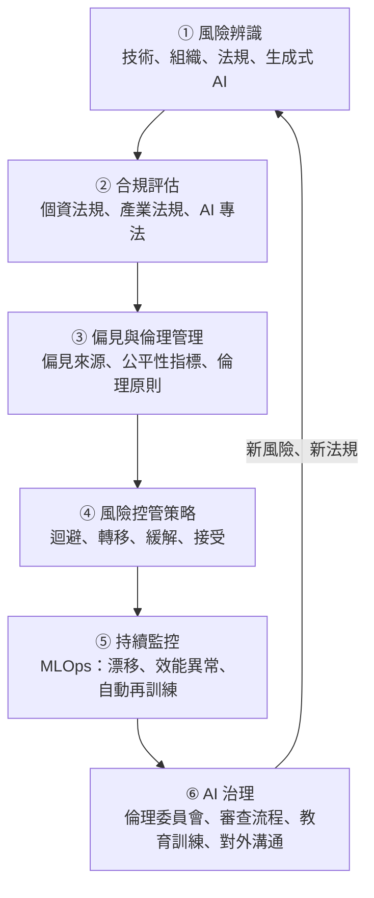
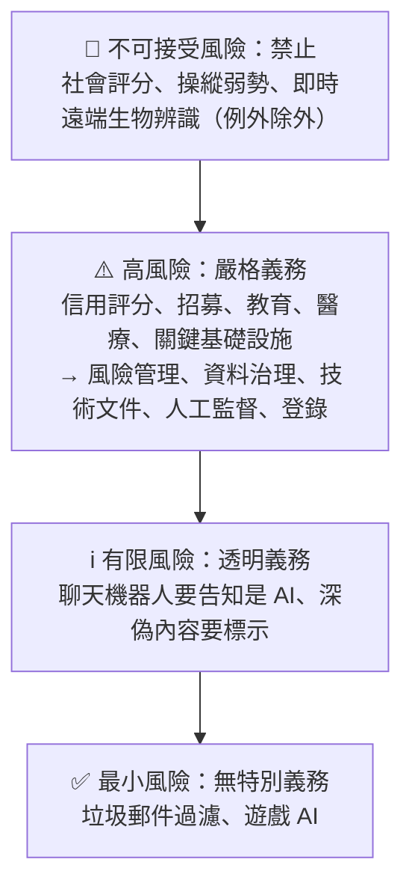
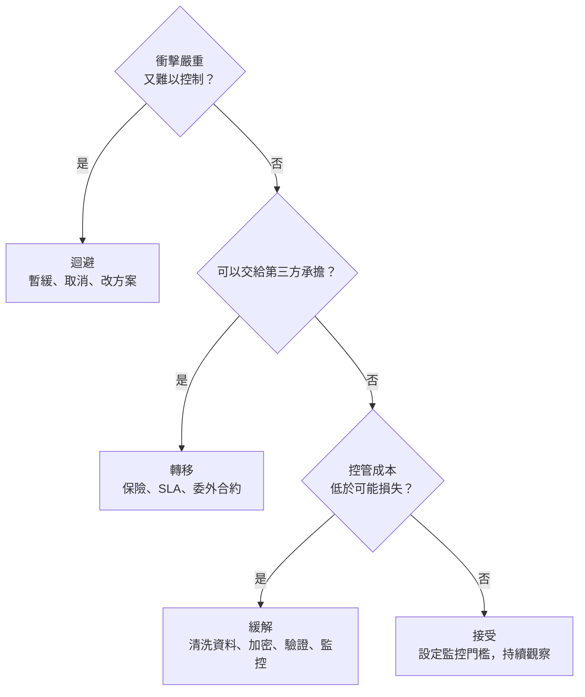
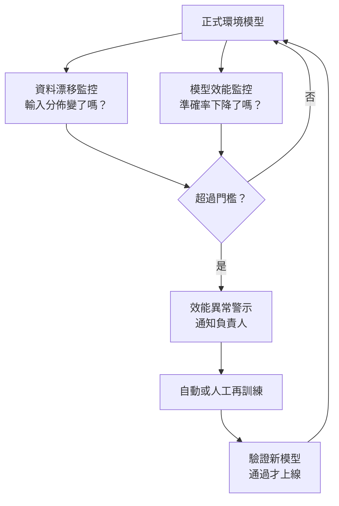

### Metadata
parent:: [[_【目錄】iPAS-AI應用規劃師(中級)：人工智慧技術應用與規劃]]
sibling:: [[05AI導入評估]] · [[06AI導入規劃]]

## Key Points
> [!summary] 一句話看懂
> **AI 風險管理＝替 AI 系統建立「健康檢查＋保險＋家規」，而且從規劃第一天就開始，不是出事才補救。**
> 傳統 IT 系統寫好就固定；AI 系統會**隨資料「變老」**、可能**學到偏見**、還常是**黑箱**，所以要**全生命週期**持續治理。

#### 三層風險速記
| 層面 | 風險 | 典型例子 |
|---|---|---|
| **技術層** | 資料品質（遺漏、偏頗、標註錯誤、漂移）、模型穩定性（漂移、過擬合） | 生產線微調後瑕疵辨識精準度下降 |
| **組織人力層** | 跨部門溝通、技能短缺、變革抵制 | 醫護擔心被取代，AI 系統使用率低 |
| **法規層** | 個資隱私、產業監管、侵權 | 未揭露資料用途遭 GDPR 重罰 |

#### 三種漂移（必考）
| 名稱 | 什麼變了 | 白話 | 例子 |
|---|---|---|---|
| **資料漂移** Data Drift | **輸入資料的分佈**變了 | 來的客人變了 | 節慶期間消費金額整體變高 |
| **概念漂移** Concept Drift | **輸入與答案之間的關係**變了 | 同樣的客人，喜好變了 | 疫情後「常買口罩」不再代表生病 |
| **模型漂移** Model Drift | **模型效能**隨時間下降（結果） | 菜還是那道菜，但客人越來越不滿意 | 推薦點擊率逐月下滑 |

- 資料漂移與概念漂移是**原因**，模型漂移（效能衰退）是**結果**。

#### 四種風險控管策略
| 策略 | 做法 | 例子 |
|---|---|---|
| **迴避** Avoidance | 不做、暫緩或改方案 | 訓練資料不足、誤診風險過高 → 暫緩醫療 AI |
| **轉移** Transfer | 交給第三方承擔 | 保險、**SLA**、委外合約賠償條款 |
| **緩解** Mitigation | 降低機率或衝擊（**最常見**） | 資料清洗、加密、合規訓練、持續監控 |
| **接受** Acceptance | 影響小、控管不划算，就接受並監控 | 小幅漂移僅影響 1% 準確率 |

#### GDPR 資料主體權利速記
| 權利 | 條文 | 一句話 |
|---|---|---|
| **查閱權** | 第 15 條 | 我有權知道你怎麼用我的資料 |
| **更正權** | 第 16 條 | 資料錯了要改 |
| **刪除權／被遺忘權** | 第 17 條 | 請刪掉我的資料（有例外） |
| **限制處理權** | 第 18 條 | 先暫停處理 |
| **資料可攜權** | 第 20 條 | 用機器可讀格式給我，讓我帶走 |
| **拒絕權** | 第 21 條 | 反對你用我的資料做行銷等處理 |
| **不受純自動化決策** | 第 22 條 | 重大決定（貸款、錄取）不能全交給機器，我可要求人工介入 |

> [!warning] 陷阱題
> 1. **模型輸出不穩定、缺乏可解釋性＝決策透明性不足**（官方考題原題）。
> 2. **特定族群預測結果不公平＝模型偏誤**（官方考題原題）。
> 3. **管理法律合規風險＝檢視個資使用的合法性**（官方考題原題）。
> 4. **資料分佈改變導致效能下降＝建置漂移監控＋觸發再訓練**（官方考題原題）。
> 5. **GDPR 第 22 條＝不受純自動化決策**，典型情境是**信用評分、招聘**。
> 6. **GDPR 適用於處理歐盟居民個資的企業，不論企業在哪裡**（域外效力）。
> 7. **SLA、保險＝風險轉移**；**資料清洗、加密＝風險緩解**；**暫停專案＝迴避**。
> 8. **歷史偏見**：資料本身忠實記錄了過去的不公平（如過去信貸審核的歧視），模型會**繼承並放大**。
> 9. **DPIA（資料保護影響評估）**：處理可能對個人權利造成**高風險**時必須做。
> 10. **HIPAA＝美國醫療資料**；**PCI-DSS＝支付卡資料**（是產業標準，不是法律）。
>
> ⚠️ **學習指引錯誤或過時的地方**
> - 指引寫 **HIPAA「自 2016 年起強制施行」**：錯誤。HIPAA 於 **1996 年**立法，隱私規則 2003 年、資安規則 2005 年起施行。
> - 指引寫 **GDPR 第 6 條「資料處理必須基於同意」**：不精確。第 6 條規定的是 **6 種合法處理基礎**：**同意、履行契約、法律義務、保護重大利益、公共利益、正當利益**，同意只是其中之一。
> - 指引寫**台灣個資法「必須取得明確同意」**：不精確。個資法要求**特定目的＋告知義務**，並符合法定要件之一即可蒐集（如法律明文規定、與當事人有契約關係、**當事人同意**等），同意不是唯一途徑。
> - 指引寫 GDPR 查閱請求要「**30 日內**」回覆：條文是「**一個月內**」，必要時可再延長兩個月。
> - 指引把 **TensorBoard** 當作持續監控工具：TensorBoard 主要用於**訓練過程視覺化**；上線後的模型監控要用 **Evidently、Arize、WhyLabs、雲端平台監控**等工具。
> - 指引寫「台灣智慧財產權法」由 TIPO「制定」：台灣**沒有一部叫《智慧財產權法》的法律**，而是《著作權法》《專利法》《商標法》《營業秘密法》等；法律由**立法院**制定，**經濟部智慧財產局**是主管機關。同理，《金融科技發展與創新實驗條例》是立法院通過、**金管會主管**。
> - 指引**沒有提到歐盟《人工智慧法》（EU AI Act）**：這是全球第一部全面性 AI 專法，2024 年 8 月生效，是目前 AI 合規最重要的參考，本筆記已補上。

> [!tip] PM 要記住的 3 件事
> 1. **風險清單要有「人」**：每一項風險都要有負責人、監控指標、觸發門檻與回報頻率，否則就只是一張表。
> 2. **先查「這個 AI 用途屬於哪個風險等級」**：信用評分、招募、醫療等屬於高風險用途，合規成本與時程完全不同。
> 3. **生成式 AI 多了新風險**：提示詞注入、幻覺、敏感資料外洩、著作權，上線前要做**紅隊測試**。

--- 
## Notes
### 全局地圖：AI 風險管理全生命週期

- AI 風險和傳統 IT 專案的相同之處：技術、組織、人員。
- **AI 特有的風險**：**資料偏誤、模型不穩定、演算法不透明、個資濫用、法規責任、社會倫理爭議**。
- 風險管理**不是部署後的補救**，而是從**規劃階段開始，貫穿開發、測試、部署、維運**的持續機制，並透過制度化的 **AI 治理**長期維持。

---

### 一、風險類型與辨識
#### 1. 技術層風險
##### (1) 資料品質風險
AI 模型高度依賴資料，資料有問題，模型的預測就會不穩定、誤導，甚至造成嚴重後果（醫療誤診、金融風險評估失準）。四種常見問題：

###### 資料遺漏（Missing Data）
資料集中缺少應有的值，原因可能是輸入錯誤、資料遺失或根本沒蒐集。缺失會影響模型訓練與預測的準確度。

###### 資料偏頗（Data Bias）
樣本分佈不均，某些群體或情境的資料過多或過少，模型對少數群體的預測就會不準或不公平。

> 例：信用評分系統使用帶有**歷史偏差**的資料訓練，導致特定族群被系統性地給予較低分數。

###### 不正確標註（Incorrect Labeling）
人工或機器標錯了答案，模型就會學到錯誤的規則，準確度下降。

###### 資料漂移（Data Drift）
模型上線後，**輸入資料的分佈**逐漸改變，例如疫情改變了消費行為，模型的預測就會逐漸偏離原有的準確度。

##### (2) 模型穩定性風險
模型在實際應用中，可能因輸入資料或外部環境改變而準確度下降，甚至失效。

###### 模型漂移（Model Drift）
模型的預測效能**隨時間變差**。這是「結果」，原因通常是資料漂移或概念漂移。

###### 概念漂移（Concept Drift）
資料背後的**輸入與答案之間的關係**改變了。例如詐騙集團換了新手法，過去代表詐騙的特徵組合不再有效。三種漂移的比較見 Key Points。

###### 過擬合（Overfitting）
模型在訓練資料上表現很好，遇到新資料卻表現很差，就像學生只會**背答案、不會舉一反三**。

> 例：製造業瑕疵辨識系統在生產線做了微小調整後，精準度明顯下降，導致成本上升。

#### 2. 組織人力層風險
##### (1) 跨部門溝通風險
AI 專案需要業務、技術、法務等部門協作，若溝通管道不足、資訊不透明、角色不清，就會產生需求落差與延誤。

> 例：金融機構的風控部門與 IT 部門溝通不足，開發出的模型與實際業務需求脫節，專案最終無法落地。

##### (2) 技能短缺風險
AI 導入需要資料科學、軟體工程與領域專業的跨界合作。團隊缺乏相應技能或人才流動太快，都會影響成效。

> 例：公共服務機構導入智慧城市專案，但內部缺乏資料分析與模型維護人員，系統上線後無法有效運作。

##### (3) 變革抵制風險
員工若不了解 AI 的價值，或把它視為工作威脅，就可能消極抵制，降低採用率。

> 例：醫療院所推動 AI 輔助診斷，醫護人員擔心被取代，系統使用率低落。

#### 3. 法規層風險
##### (1) 個資與隱私保護風險
AI 系統處理大量個人資料，若蒐集與使用不符合法規、未充分告知或取得同意，將面臨處罰與名譽損害。

> 例：科技公司未充分揭露使用者資料的用途，遭 GDPR 處以高額罰款。

##### (2) 產業特定監管風險
醫療、金融、支付等產業有專屬法規，例如美國醫療業的 HIPAA、支付卡產業的 PCI-DSS。未符合就可能營運中斷或承擔法律責任。

> 例：銀行導入 AI 客戶辨識系統，但未完整符合法規要求，導致營運暫停並遭罰款。

##### (3) 侵權風險
開發過程可能用到第三方的資料、演算法、模型或軟體。未經授權或超出授權範圍使用，可能構成著作權、專利或營業秘密侵權。

**開源授權**也要注意：有些開源模型的授權**限制商業用途或使用者規模**，使用前要確認條款。

> 例：科技公司未經授權使用第三方訓練資料，被判定侵權，面臨巨額賠償。

#### 4. 生成式 AI 特有風險
業界常用 **OWASP 大型語言模型應用十大風險**作為檢查清單，PM 最需要知道的有五項：

##### (1) 提示詞注入（Prompt Injection）
使用者輸入，或模型讀取的外部內容（網頁、文件、郵件）中夾帶惡意指令，例如「忽略之前所有規則」，讓模型違反原本的設定。

**對策**：把外部內容視為不可信資料、對輸入輸出做過濾、限制模型能執行的動作。

##### (2) 敏感資訊洩漏
模型在回答中洩漏個資、公司機密，或被套出系統提示詞。

**對策**：資料去識別化、權限控管、輸出前檢查。

##### (3) 幻覺（Hallucination）
模型一本正經地編造錯誤資訊，例如不存在的法條或數據。

**對策**：用 RAG 讓回答引用來源、高風險內容人工覆核、建立評估測試集持續追蹤幻覺率。

##### (4) 過度授權的代理（Excessive Agency）
AI 代理被授予過多權限，一旦誤判或被操控，可能誤刪資料、誤寄信件、誤下單。

**對策**：**最小權限**原則，高風險動作必須經人工確認。

##### (5) 不當或有害內容
生成帶有偏見、歧視、仇恨或危險的內容。

**對策**：內容過濾、護欄，以及上線前的**紅隊測試**：找人扮演攻擊者，專門想辦法讓 AI 出錯或做壞事，找出漏洞。

更多生成式 AI 風險見 [[生成式AI風險管理]]。

---

### 二、法規與合規性評估
#### 1. 資料隱私與個資保護法規
##### (1) GDPR 歐盟一般資料保護規則
GDPR 是**全球隱私法規的指標**，2018 年施行。

- **域外效力**：只要處理**歐盟居民**的個資，不論企業設在哪裡都適用。台灣企業若有歐洲客戶，也要遵守。
- **罰款上限**：**全球年營業額 4% 或 2,000 萬歐元**，取較高者。
- **資料主體權利**：查閱、更正、刪除（被遺忘權）、限制處理、資料可攜、拒絕、不受純自動化決策，見 Key Points 速記表（第 15～22 條）。

###### 企業的義務與原則
- **合法處理基礎（第 6 條）**：處理個資必須符合 6 種依據之一：**同意、履行契約、法律義務、保護重大利益、公共利益、正當利益**。同意只是其中一種，不是唯一途徑。
- **同意的要件**：若以同意為依據，同意必須**明確、自由給予**，使用者可隨時撤回（撤回前的處理仍然合法）。
- **資料最小化（第 5 條）**：只蒐集達成目的所**必要**的資料。
- **目的限制（第 5 條）**：不得超出當初聲明的用途。
- **問責制（第 5、24 條）**：企業要能**證明**自己合規，並保留紀錄供稽核。
- **DPIA 資料保護影響評估（第 35 條）**：處理可能對個人權利造成**高風險**時，必須事先評估並提出對策。

##### (2) 台灣《個人資料保護法》
- 蒐集、處理、利用個資要有**特定目的**，並履行**告知義務**。
- 須符合法定要件之一，例如法律明文規定、與當事人有契約關係、**當事人同意**等。
- 當事人可以請求：**查詢或閱覽、製給複製本、補充或更正、停止蒐集處理利用、刪除**。
- 企業須採取**適當的安全維護措施**，防止個資外洩。
- 2023 年修法明定設立獨立監管機關**個人資料保護委員會**，並提高資料外洩的罰則。

##### (3) 美國州級隱私法
美國**沒有聯邦統一的隱私法**，而是由各州立法。最具影響力的是**加州 CCPA／CPRA**，其他如**維吉尼亞州 CDPA**（現稱 VCDPA）。共通的權利包括查閱、更正、刪除與資料可攜；健康等敏感資料受到更嚴格保護。

#### 2. 產業專用合規規範
##### (1) HIPAA（美國健康保險可攜性與責任法案）
1996 年立法，適用醫療機構、保險公司及其合作廠商。要求三類保護措施：
- **技術性**：資料加密、身分驗證與存取控制、安全傳輸與儲存。
- **實體性**：伺服器與資料中心的設備安全、資料備份與災難復原。
- **行政性**：安全政策與程序、員工培訓、定期風險評估與稽核。

##### (2) PCI-DSS（支付卡產業資料安全標準）
由支付卡產業安全標準委員會（PCI SSC）制定的**產業標準**（不是法律），適用所有處理信用卡資料的機構。要求包括防火牆、資料傳輸與儲存加密（TLS、AES）、多因素認證、最小權限、定期弱點掃描與滲透測試、員工資安訓練。

##### (3) 台灣的產業法規
- **《金融科技發展與創新實驗條例》**：**監理沙盒**制度，讓金融創新服務在受控環境中測試，由金管會主管。
- **《醫療器材管理法》**：作為診斷用途的 AI 屬於醫療器材，需經衛福部食藥署審查與上市許可。
- **《電信管理法》**：規範電信與通訊服務的網路安全與消費者權益。
- **著作權法、專利法、商標法、營業秘密法**：AI 模型與資料集都要確認授權範圍。
- **金管會《金融業運用人工智慧（AI）指引》**：要求金融業在治理問責、公平、隱私、透明可解釋、穩健安全與永續等面向落實。

#### 3. AI 專法與國際治理框架
##### (1) 歐盟《人工智慧法》（EU AI Act）
全球**第一部全面性的 AI 專法**，2024 年 8 月生效，**分階段適用**。核心精神是**依風險分級管理**：

- **通用目的 AI 模型**（如大型語言模型）的提供者另有義務：技術文件、著作權政策、訓練資料摘要；具系統性風險的大模型還要做評估與事故通報。
- **時程**：禁止條款 2025 年 2 月起；通用目的 AI 義務 2025 年 8 月起；高風險義務原訂 2026 年 8 月起，歐盟已提案部分延後，實際時程以最新公告為準。

##### (2) 台灣《人工智慧基本法》
- **2025 年 12 月立法院三讀通過**。
- 揭示七項原則：**人類自主、永續發展、隱私保護與資料治理、資安與安全、透明與可解釋、公平與不歧視、問責**。
- 行政院設**國家人工智慧戰略特別委員會**，並推動 **AI 風險分級框架**，各目的事業主管機關再訂定所屬領域的規範。

##### (3) 管理標準與框架
- **NIST AI RMF**（美國國家標準與技術研究院）：AI 風險管理框架，包含四大功能：**治理（Govern）、對應（Map）、衡量（Measure）、管理（Manage）**。
- **ISO/IEC 42001**：**AI 管理系統**國際標準，可以通過**第三方驗證**，地位類似資安領域的 ISO 27001。
- **ISO/IEC 23894**：AI 風險管理指引。

---

### 三、偏見與倫理
#### 1. 偏見的來源與影響
##### (1) 四種偏見來源
###### 資料分佈不均（Imbalanced Data）
某些群體的樣本太少，模型對這些群體的預測效果就差。例如醫療資料缺乏某個年齡層，模型對該年齡層的診斷準確度就較低。

###### 歷史偏見（Historical Bias）
資料**忠實記錄了過去的不公平**。例如過去的信貸審核帶有性別偏見，模型會把這種偏見學起來並延續下去。

###### 標註偏見（Labeling Bias）
標註者的個人觀點或文化背景影響了標註結果，例如對某些群體有刻板印象。

###### 演算法偏見（Algorithmic Bias）
演算法只追求整體效能最佳，犧牲了少數群體。例如推薦系統只依據多數使用者的偏好，忽略了少數族群的需求。

> [!example] 經典案例
> 某大型科技公司曾開發 AI 履歷篩選工具，因為過去十年錄取的工程師多為男性，模型學會**給含「女性」相關字詞的履歷較低分**。即使刪除性別欄位，模型仍可透過**代理變數**（如社團名稱、學校）推斷性別，最後專案被放棄。
> → **刪掉敏感欄位不等於消除偏見。**

##### (2) 歧視的後果
- **弱勢群體受害**：在貸款、招聘、醫療資源分配上受到不公平對待。
- **企業品牌與信譽受損**：引發輿論反彈、消費者抵制，甚至訴訟與監管處罰。

#### 2. 偏見的衡量與減緩
##### (1) 常見公平性指標
| 指標 | 意思 | 白話 |
|---|---|---|
| **人口統計均等** Demographic Parity | 各群體**獲得正面結果的比例**相近 | 男女的貸款核准率差不多 |
| **機會均等** Equal Opportunity | 各群體中**真正合格者被核准的比例**相近 | 真正還得起錢的人，不論男女都一樣容易核准 |
| **均等勝算** Equalized Odds | 各群體的**真陽性率與偽陽性率**都相近 | 除了上面，誤核准的比例也要一樣 |

這些指標**常常無法同時滿足**，要依業務情境與法規要求，選擇最重要的一個。

##### (2) 三階段減緩方法
- **前處理（資料階段）**：補足少數群體的資料、重新抽樣或加權、檢查標註一致性。
- **訓練中（模型階段）**：在訓練目標中加入公平性限制，讓模型在追求準確度的同時兼顧公平。
- **後處理（輸出階段）**：依群體調整判斷門檻，或對邊界案例進行人工覆核。

常用工具有 **IBM AI Fairness 360**、**Microsoft Fairlearn**、Google What-If Tool。

此外，可為每個模型撰寫**模型卡（Model Card）**，記錄模型用途、限制與各群體的表現，增加透明度。

#### 3. 國際 AI 倫理原則
##### (1) 四大核心原則
###### 透明度（Transparency）
企業應主動說明 AI 如何處理資料、如何做決策，以及可能的影響。在醫療、金融、招聘等高風險領域，要求特別嚴格。

###### 可解釋性（Explainability）
讓使用者理解**為什麼**會得到某個決定，並在有疑義時提出合理質疑。重大決策（如貸款、人事）尤其需要清楚、具體的解釋。

> [!example] 透明度與可解釋性的差別
> - **透明度**＝告訴你「**這裡有用 AI**，用了哪些資料、大致怎麼運作」。
> - **可解釋性**＝告訴你「**你這次被拒絕貸款，主要是因為負債比太高**」。

###### 公平性（Fairness）
避免對特定種族、性別、年齡或其他群體產生歧視。完全公平很難達成，但企業應盡力把偏差降到最低。

###### 問責性（Accountability）
從設計、開發、部署到營運，每個環節都有明確負責人。出現錯誤或偏差時，能快速找到問題並修正，並對造成的負面影響負責。

##### (2) 主要國際來源
- **歐盟可信賴 AI 倫理準則**（2019，AI 高級專家小組 AI HLEG）：提出可信賴 AI 的七大要求，後來成為 EU AI Act 的基礎。
- **OECD AI 原則**（2019 年發布、2024 年更新）：第一個政府間的 AI 原則，2024 年納入生成式 AI 的考量。
- **UNESCO AI 倫理建議書**（2021）：強調人權、隱私與避免歧視。
- **GPAI 全球人工智慧夥伴關係**（2020 起）：多國合作推動負責任 AI，2024 年起與 OECD 整合。
- **ISO/IEC 標準**：持續發布安全、公平、透明相關的技術標準，例如 42001、23894。

#### 4. 企業內部 AI 治理框架
##### (1) 倫理委員會
由技術、法律、人權、風險管理等不同領域的專家組成，定期審查 AI 專案的倫理影響，確保符合內外部的倫理規範。

##### (2) AI 審查流程
讓倫理審查成為專案的**必經關卡**，在**部署前**完成風險評估、影響分析，並提出預防措施。

##### (3) 內部教育訓練
定期培訓，讓員工能辨識並處理 AI 應用中的偏見、歧視等倫理風險，理解透明、可解釋、問責的意義。

##### (4) 透明度與對外溝通
主動公開 AI 的使用原則與社會影響，建立外部溝通管道，接受政府、消費者、民間團體的意見與監督。

##### (5) AI 系統清冊
盤點公司內所有 AI 系統的用途、風險等級與負責人。EU AI Act 與 ISO 42001 都要求這一步，因為**不知道自己有哪些 AI，就無從管理**。

##### (6) 人工監督機制
高風險決策保留**人在迴路中（Human-in-the-loop）**，讓人可以覆核、修正甚至否決 AI 的決定。

---

### 四、風險控管與監控
#### 1. 風險控管策略與管理計畫
##### (1) 四種策略的使用時機

###### 迴避（Avoidance）
潛在損害嚴重又難以控制時，選擇不做或暫緩。例如醫療企業發現訓練資料不足、誤診風險過高，決定暫緩專案；金融機構無法符合新隱私法規，取消雲端部署計畫。要注意權衡，不要過度放棄專案價值。

###### 轉移（Transfer）
把潛在損失交給第三方承擔。例如購買 AI 系統故障保險；與供應商簽訂 **SLA（服務水準協議）**，約定系統延遲超標由供應商賠償；在委外合約中明訂資料外洩的責任歸屬。

###### 緩解（Mitigation）
主動採取措施降低發生機率或影響，是**最常用**的策略。技術風險可用交叉驗證、持續監控；法規風險可用資料治理、存取權限分級。例如金融機構實施資料清洗流程後，詐欺偵測準確率提升到 92%。

###### 接受（Acceptance）
影響小、控管成本又不划算時，接受風險並持續監控。例如電商發現小規模資料漂移只影響 1% 的推薦準確率，修復成本高於收益，決定接受。但一定要設定**監控指標與門檻**，避免小問題累積成大問題。

##### (2) 風險管理計畫的四大內容
- **風險識別與評估結果**：列出風險清單與影響評分。
- **風險對應措施**：每項風險的具體行動與時程。
- **責任人與分工**：例如資料外洩由資安團隊負責加密、模型偏誤由資料科學家負責調整。
- **監控與回報機制**：回報頻率與管道，例如每週向管理層報告進度。

#### 2. 風險監控與 MLOps
**MLOps**是把模型的**建置、部署、監控與修正**流程自動化的實務方法，能即時監控模型效能與資料變化，並在需要時觸發更新。

##### (1) 模型漂移監控
追蹤模型效能是否下降，並找出原因（資料變化或環境變化）。例如電商監控推薦模型的準確率，下降時自動觸發再訓練。

##### (2) 資料漂移監控
比較新進資料與訓練資料的分佈，差異顯著時發出警告。例如零售業在節慶促銷期間發現消費金額分佈大幅改變，及時調整資料。

##### (3) 效能異常警示
設定門檻，效能異常時立即通知。例如詐欺偵測模型的錯誤率超過 5% 時，系統自動通知團隊。

##### (4) 自動再訓練
偵測到效能下降或資料漂移時，自動用新資料重新訓練模型。

**注意**：再訓練不是全自動上線。新模型要先通過驗證（包含公平性檢查），重要系統還要經過人工核准。

##### (5) 常見工具與生成式 AI 的監控
- **工具**：**MLflow**（實驗與模型版本）、**Evidently AI、Arize、WhyLabs**（漂移與效能監控），以及各雲端平台的內建監控。（學習指引提到的 TensorBoard 主要用於訓練過程視覺化，不是上線監控工具。）
- **生成式 AI 應用**還要監控：**幻覺率、拒答率、有害內容比例、單次成本、延遲**。

詳見 [[建立完善的監控與重新訓練機制]]。

---

### PM 檢查清單：AI 風險管理 10 問
1. **風險等級**：這個 AI 用途在 EU AI Act 或產業規範下屬於高風險嗎？
2. **個資**：用了哪些個資？合法處理基礎是什麼？有做 DPIA 嗎？
3. **產業法規**：醫療、金融、支付有沒有專屬法規要符合？
4. **授權**：訓練資料、開源模型、生成內容的授權都確認了嗎？
5. **偏見**：用哪個公平性指標？各群體的表現有分開檢查嗎？
6. **可解釋性**：使用者被拒絕時，我們能說明原因嗎？
7. **生成式 AI**：做過紅隊測試嗎？防得住提示詞注入嗎？代理權限是否最小化？
8. **控管策略**：每項風險選了哪種策略？負責人是誰？
9. **監控**：漂移與效能的門檻設多少？誰收警報？再訓練誰核准？
10. **治理**：有 AI 系統清冊、審查流程、人工監督機制嗎？

---
## References
- iPAS AI應用規劃師(中級)學習指引 科目1：人工智慧技術應用與規劃 — 4.3 AI 風險管理、第四章考題解析
- European Union (2016). *General Data Protection Regulation (GDPR)*
- European Union (2024). *Artificial Intelligence Act (Regulation (EU) 2024/1689)*
- 《個人資料保護法》；《人工智慧基本法》（2025 年 12 月三讀通過）
- 金融監督管理委員會（2024）《金融業運用人工智慧（AI）指引》
- NIST (2023). *AI Risk Management Framework (AI RMF 1.0)*
- ISO/IEC 42001:2023；ISO/IEC 23894:2023
- OWASP. *Top 10 for Large Language Model Applications*
- OECD (2019, updated 2024). *Recommendation of the Council on Artificial Intelligence*
![[AI應用規劃師(中級)-學習指引-科目1人工智慧技術應用規劃_20251222101833.pdf]]
