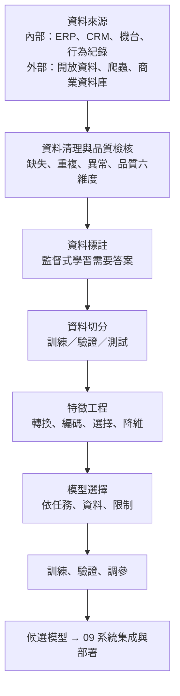
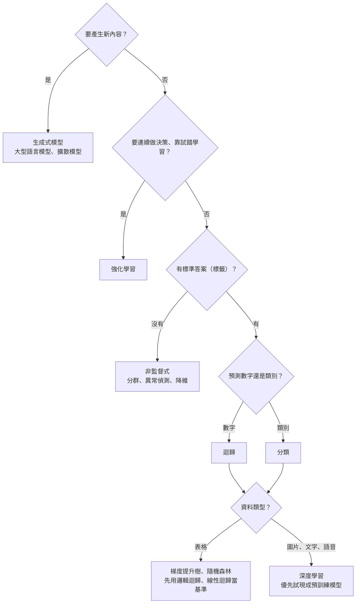
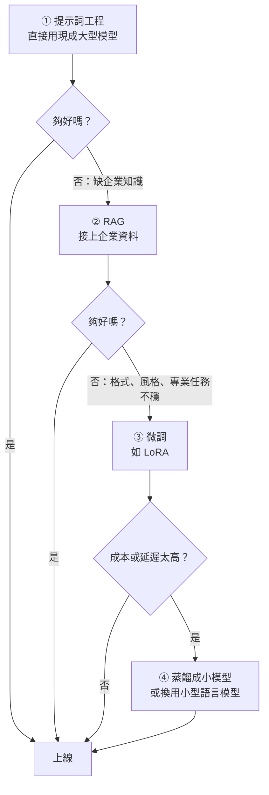

### Metadata
parent:: [[_【目錄】iPAS-AI應用規劃師(中級)：人工智慧技術應用與規劃]]
sibling:: [[09AI技術系統集成與部署]] · [[07AI風險管理]]

## Key Points
> [!summary] 一句話看懂
> **垃圾進，垃圾出（GIGO）：資料準備決定 AI 的天花板，模型只是盡量逼近它。**
> 就像做菜：**買菜**（資料收集）→ **洗菜挑菜**（清理）→ **切菜備料**（特徵工程）→ **選鍋具和料理方式**（模型選擇）。食材不新鮮，換再貴的鍋也救不回來。

#### 三步驟速記
| 步驟 | 做什麼 | 關鍵技術 |
|---|---|---|
| **① 資料收集與清理** | 找資料、處理缺失、重複、異常 | 插補法、去重、Z-score／IQR、Isolation Forest |
| **② 特徵工程** | 把原始資料變成模型看得懂的格式 | 正規化、標準化、獨熱編碼、特徵選擇、PCA |
| **③ 模型選擇** | 依任務與限制選演算法 | 迴歸、分類、分群、深度學習、強化學習、生成式 |

#### 缺失值與異常值處理
| 問題 | 方法 |
|---|---|
| **缺失值** | **插補法**（平均數、中位數、眾數）、前後值填補、內插、模型預測填補；缺太多就刪欄位 |
| **重複值** | 依主鍵（顧客編號、交易編號）去重，如 `drop_duplicates()` |
| **異常值** | 統計法：**Z-score**、**IQR**；模型法：**Isolation Forest**、**LOF** |

#### 數值縮放：正規化 vs 標準化
| 方法 | 結果 | 公式 | 適合 |
|---|---|---|---|
| **正規化** Normalization（Min-Max） | 縮到 **0～1** | （x − 最小值）÷（最大值 − 最小值） | 需要固定範圍、資料無明顯異常值 |
| **標準化** Standardization（Z-score） | **平均 0、標準差 1** | （x − 平均）÷ 標準差 | 有異常值時較穩定；SVM、KNN、邏輯迴歸、神經網路 |

- **樹模型（決策樹、隨機森林、XGBoost）不需要縮放**，因為它只看大小順序。

#### 任務類型 → 模型
| 問題 | 任務 | 常用模型 |
|---|---|---|
| 預測**數字**（銷售額、房價） | **迴歸** | 線性迴歸、隨機森林、梯度提升樹 |
| 預測**類別**（會不會流失、是不是詐欺） | **分類** | 邏輯迴歸、隨機森林、**梯度提升樹**、SVM、KNN |
| **沒有答案**，想找分群或異常 | **非監督式** | K-means、DBSCAN、階層式分群、PCA |
| 圖片、語音、文字等**非結構化**資料 | **深度學習** | CNN、RNN／LSTM、**Transformer** |
| 需要**連續做決策**、試錯學習 | **強化學習** | Q-learning、DQN、PPO |
| **產生**新內容 | **生成式** | GAN、VAE、擴散模型、大型語言模型 |

> [!warning] 陷阱題
> 1. **資料標註的目的＝讓模型辨識輸入與目標的對應關係**（監督式學習的基礎）（官方考題原題）。
> 2. **Z-score 標準化的目的＝把特徵縮放到相同尺度**，不是增加欄位或壓縮資料（官方考題原題）。
> 3. **預測顧客會不會流失＝分類任務**（是／否），不是迴歸（官方考題原題）。
> 4. **模型選擇要考慮開發成本與可部署性**，不是越複雜越好、也不是只看準確率（官方考題原題）。
> 5. **處理缺失值＝插補法**；資料增強是增加樣本、降維是減少特徵（官方考題原題）。
> 6. **獨熱編碼＝無順序類別**（顏色、城市）；**順序編碼＝有順序類別**（高中＜學士＜碩士）。
> 7. **K-means 要先指定 K、怕異常值；DBSCAN 不用指定群數、能找任意形狀、自動標出雜訊**。
> 8. **PCA＝找變異最大的方向來降維**；**t-SNE／UMAP 主要用於視覺化**。
> 9. **GAN 的缺點＝訓練不穩定、模式崩潰**；**擴散模型的缺點＝生成較慢、運算成本高**。
> 10. **PPO 是策略梯度法的改良**，限制每次更新幅度，讓訓練更穩定；也是 **RLHF** 訓練大型語言模型的經典演算法。
>
> ⚠️ **學習指引不精確或過時的地方**
> - 指引把「**年齡不應為負數**」當作**一致性**的例子：這其實屬於**有效性（Validity）**，也就是值是否落在合理範圍與格式。**一致性**是指**不同欄位或不同系統之間是否矛盾**，例如「出生日期與年齡對不上」。指引也漏掉了「有效性」這個常見維度。
> - 指引說「**標籤編碼適用於有序類別**」：嚴格來說，有序類別用的是**順序編碼（Ordinal Encoding）**，要**自己指定順序**（高中＝1、學士＝2、碩士＝3）；一般的標籤編碼常依字母排序給數字，順序不一定正確。對**無序**類別用整數編碼，線性模型會誤以為有大小關係。
> - 指引的生成模型代表是 **DALL·E 2**：已是舊版。現行主流影像生成包括 **GPT 系列內建影像生成、Midjourney、FLUX、Imagen、Stable Diffusion 3** 等；擴散模型「生成慢」的問題也已透過**蒸餾、一致性模型**等技術大幅改善。
> - 指引的模型選擇只列演算法，**沒有談大型模型時代的選型**（直接用基礎模型、提示詞、RAG、微調），本筆記已補上。

> [!tip] PM 要記住的 3 件事
> 1. **先做簡單的基準模型**（例如邏輯迴歸，甚至「永遠猜多數類別」），新模型要**明顯贏過基準**才值得複雜化。
> 2. **表格資料首選梯度提升樹**（XGBoost、LightGBM、CatBoost）；**文字、圖片、語音先試現成大型模型**。
> 3. **小心資料洩漏**：訓練時偷看到「未來」或「答案」的資訊，離線分數會好得不真實，一上線就崩。

--- 
## Notes
### 全局地圖：從原始資料到候選模型

- 資料準備通常佔 AI 專案 **50～80% 的工時**，是最容易被低估的階段。
- 大數據角度的資料處理細節見科目二 [[04數據收集與清理]]、[[06數據處理技術與工具]]。

---

### 一、資料收集與清理
#### 1. 資料來源
##### (1) 內部資料
- **ERP（企業資源規劃）**：銷售、庫存、採購、財務等核心營運資料，是公司最基礎的資料來源。
- **CRM（顧客關係管理）**：顧客互動紀錄、服務歷程與回饋，可用於客戶分群與行為預測。
- **機台資料**：生產設備的運轉狀態、操作參數、故障與維護紀錄。製造業用來做生產排程、異常偵測、良率分析與**預測保養**，是智慧製造的關鍵資產。
- **使用行為資料**：POS、網站與 App 的點擊紀錄、IoT 裝置資料，記錄使用者如何與產品互動。SaaS 業者用來追蹤產品黏著度，消費型產品用來優化功能。
- **內部報表與流程紀錄**：作業流程、稽核與法遵紀錄，在金融、醫療、政府等高度管制產業中，對風險管理與合規審查特別重要。

##### (2) 外部資料
- **開放資料與 API**：政府開放資料平台、氣象機構、社群媒體 API，可程式化擷取最新資料，用於政策分析、市場研究、風險預測。
- **網頁爬蟲**：自動擷取網站上的價格、評論、新聞，用於競品分析與輿情監測。要特別注意**網站條款、著作權與個資**。
- **商業資料庫**：如 Refinitiv（現為 LSEG Data & Analytics）、Statista、Experian，提供付費授權的市場、財務與信用資料，常用於金融投資、企業徵信與產業分析。
- **合成資料**：用生成模型或模擬產生，用來補足稀少案例或保護隱私，但要驗證是否貼近真實。

#### 2. 清理與品質檢核
##### (1) 三種常見問題的處理
###### 缺失值
常見填補方法有：平均數或中位數填補（偏態資料用中位數較穩）、前後值填補（適合時間序列）、內插法、用模型預測填補。

缺失比例過高時，可考慮直接刪除該欄位。另外要記得：**「缺失」本身可能就有意義**，例如收入欄位沒填的客戶可能有特定特徵，可以額外加一個「是否缺失」的欄位讓模型參考。

###### 重複值
依主鍵（顧客編號、交易編號）檢查並去重，例如用 pandas 或 Spark 的 `drop_duplicates()`。去重前要先確認是真的重複，還是合法的多筆紀錄（同一位客戶同一天買兩次）。

###### 異常值
- **統計方法**：**Z-score**（離平均超過幾個標準差）、**IQR**（超出四分位距的 1.5 倍）。
- **機器學習方法**：**Isolation Forest**、**LOF**，適合多維度資料。

異常值**不一定是錯誤**。在詐欺偵測中，異常正是要找的目標，不能隨便刪掉。

##### (2) 資料品質六大維度
| 維度 | 檢查什麼 | 例子 |
|---|---|---|
| **完整性** Completeness | 關鍵欄位是否缺漏 | 30% 訂單沒有顧客編號 |
| **唯一性** Uniqueness | 是否有重複 | 同一顧客有兩個編號 |
| **有效性** Validity | 值是否在合理範圍與格式 | **年齡為負數**、Email 沒有 @ |
| **一致性** Consistency | 欄位之間、系統之間是否矛盾 | 出生日期與年齡不符；CRM 與 ERP 地址不同 |
| **準確性** Accuracy | 是否反映真實世界 | 庫存系統 100 件，倉庫實際 80 件 |
| **即時性** Timeliness | 是否夠新 | 用半年前的價格資料做今天的定價 |

> ⚠️ 學習指引把「年齡不應為負數」當作**一致性**的例子，其實這屬於**有效性**；一致性指的是不同欄位或系統之間是否矛盾。

#### 3. 資料標註
##### (1) 為什麼重要
標註的目的，是讓模型知道每筆輸入對應的**正確答案**，這是監督式學習的基礎。標籤錯了，模型就學錯；標籤不一致，模型就學不好。

##### (2) 品質控管
- 寫清楚**標註指引**，讓每位標註者用同一套標準。
- **多人標註同一筆資料**並計算一致性，找出模糊的案例。
- 定期**抽樣複查**。

##### (3) 降低成本的方法
- **主動學習（Active Learning）**：讓模型挑出**最沒把握**的樣本交給人標註，用最少的標註量換最大的效能提升。
- **弱監督**：用規則、關鍵字等不完美但便宜的方式大量產生標籤，再抽樣校正。
- **大型模型輔助標註**：先用大型語言模型或視覺模型預標，人工只做檢查與修正。
- **半監督與自監督學習**：用少量標註資料，搭配大量未標註資料一起學習。

#### 4. 資料切分與防止資料洩漏
##### (1) 三種資料集
| 資料集 | 用途 | 常見比例 |
|---|---|---|
| **訓練集** | 讓模型學習 | 60～80% |
| **驗證集** | 調參數、選模型 | 10～20% |
| **測試集** | **最後一次**評估真實效能，過程中不能偷看 | 10～20% |

**時間序列資料要依時間切**：用過去的資料訓練、未來的資料測試，不能隨機打散，否則等於讓模型看到未來。

##### (2) 資料洩漏（Data Leakage）
訓練資料中混入了**預測當下其實拿不到**的資訊，模型離線分數會好得不真實，一上線就崩。

> [!example] 資料洩漏範例
> 預測「客戶下個月會不會流失」，卻放入「**退訂原因**」欄位。只有已經退訂的人才有這個欄位，模型輕鬆考 99 分，但上線時根本拿不到這個資訊。

##### (3) 類別不平衡
例如詐欺只佔 0.1% 時，模型「全部猜正常」就有 99.9% 的準確率，卻毫無用處。處理方式：
- **過採樣**（如 SMOTE）、**欠採樣**、**類別權重**。
- 評估改看 **Precision、Recall、F1、PR-AUC**，不看準確率。

---

### 二、特徵工程
> [!example] 白話比喻
> 特徵工程就像**幫模型整理考試重點**：原始資料是一整本課本，特徵工程把重點挑出來、換成模型看得懂的格式。

#### 1. 特徵轉換
##### (1) 數值特徵
- **正規化（Min-Max）**：把數值縮到 0～1，避免單位差異造成模型偏誤。
- **標準化（Z-score）**：轉成平均 0、標準差 1。SVM、KNN、邏輯迴歸、神經網路等對尺度敏感的模型需要。
- **對數轉換**：處理**右偏分佈**，例如收入、交易金額，讓少數極大值不再主導。
- **分箱（Binning）**：把連續數值切成區間，例如年齡分成青年、中年、老年。

##### (2) 類別特徵
- **獨熱編碼（One-hot）**：每個類別變成一個 0／1 欄位，適合**無順序**的類別（顏色、城市）。類別太多時欄位會爆炸。
- **順序編碼（Ordinal）**：依**自己指定的順序**轉成整數，適合**有順序**的類別（高中 < 學士 < 碩士）。
- **目標編碼（Target Encoding）**：用該類別的平均目標值取代，適合類別很多時，但**要小心資料洩漏**。

> ⚠️ 學習指引說「標籤編碼適用於有序類別」，精確來說應是**順序編碼**，並自行指定順序；一般的標籤編碼常依字母排序給數字，順序不一定正確。

##### (3) 時間特徵
- **週期特徵**：從時間戳擷取星期幾、上午或下午、平日或週末、是否節日，幫助模型捕捉週期性。
- **滯後特徵（Lag）**：例如「上週銷量」「過去 7 天平均」，是時間序列預測的關鍵。

##### (4) 文字特徵
- **TF-IDF**：在本文常出現、在其他文件少見的詞，權重較高。
- **詞向量與嵌入向量**：用 Word2Vec 或**大型模型的嵌入**，把文字轉成帶有語意的向量（詳見 [[01自然語言處理技術與應用]]）。

#### 2. 特徵選擇與降維
##### (1) 特徵選擇：挑出有用的欄位
特徵太多會讓模型變複雜、訓練變慢、容易過擬合。三類方法：

###### 過濾法（Filter）
建模**之前**，先用統計方法替每個特徵打分，例如**資訊增益**、**皮爾森相關係數**、卡方檢定。速度快、不依賴模型，但看不到特徵之間的交互作用。

###### 包裝法（Wrapper）
反覆訓練模型，依模型表現決定保留哪些特徵，例如**遞迴特徵消除（RFE）**：每次刪掉最不重要的特徵再重新訓練。能考慮交互作用，但計算成本高。

###### 嵌入法（Embedded）
在模型**訓練過程中**順便完成選擇，例如 **L1 正則化**（Lasso）會把不重要特徵的權重壓到 0，等於自動刪除；樹模型也能輸出特徵重要度。

相關係數也可以用來檢查**多重共線性**：兩個特徵高度相關（例如「身高公分」和「身高英吋」）時，留一個就好。

##### (2) 降維：壓縮成更少的維度
- **PCA（主成分分析）**：找出資料**變異最大的方向**，用少數幾個新維度保留大部分資訊，可以用於建模。
- **t-SNE、UMAP**：把高維資料畫成二維圖，**用於視覺化**觀察分群趨勢，一般不拿來當建模的輸入特徵。

#### 3. 自動特徵工程與 AutoML
##### (1) 常見工具
**Google Vertex AI AutoML**、**H2O.ai**、**AutoKeras**、**TPOT**、**AutoGluon**、Azure Automated ML。

##### (2) 自動做的事
- **自動建立特徵**：拆解日期、做數學組合、產生多項式特徵或時間序列的滯後特徵。
- **自動篩選特徵**：用隨機森林、Lasso 評估重要度，刪除冗餘或低貢獻的特徵。
- **偵測特徵交互作用**：自動測試特徵組合，找出單獨看沒用、組合起來才有用的特徵。
- **依資料自動選擇處理方法**：例如自動選擇編碼方式或缺失值填補方式。
- **依模型回饋調整**：反覆訓練與驗證，選出最佳的特徵組合。

##### (3) 優勢與限制
- **優勢**：加速資料科學流程、降低技術門檻、能快速探索大量特徵組合。
- **限制**：可解釋性較低、可能不小心產生洩漏特徵，而且**無法取代領域知識**。例如「發薪日前後」這種業務特徵，懂業務的人想得到，機器不一定。

**深度學習與大型模型**大幅減少了手工特徵工程的需求：CNN 會自己學影像特徵、Transformer 會自己學語意特徵。手工特徵工程現在主要用在**表格資料**。

---

### 三、模型選擇
#### 1. 選模型的思考順序

除了準確度，評估模型時還要一起考慮：
- **效能**：準確率、F1、誤差，有沒有明顯贏過基準模型？
- **資料量**：資料少就用簡單模型；深度學習需要大量資料。
- **可解釋性**：金融授信、醫療等要能說明原因，可選邏輯迴歸、決策樹，或搭配 SHAP 解釋。
- **推論速度與成本**：每秒要處理多少請求？延遲要求多少？
- **部署環境**：雲端、地端、手機還是邊緣設備？
- **維護難度**：團隊維護得來嗎？多久要再訓練一次？

#### 2. 監督式學習：迴歸
目的是預測**連續數值**，例如銷售量（協助庫存與生產規劃）、房價（依地段、坪數預測）。

##### (1) 線性迴歸
建立自變數與目標之間的**線性關係**。最簡單、可解釋，適合關係大致為直線的情況，常作為**基準模型**。

##### (2) 決策樹迴歸
用一連串「是／否」的條件分支做預測，能處理非線性關係、容易解釋，但**容易過擬合**。

##### (3) 隨機森林迴歸
訓練很多棵決策樹，再把預測結果**平均**，降低單一樹過擬合的風險。

##### (4) 梯度提升樹
一棵接一棵訓練，每一棵都專門**修正前一棵的錯誤**。**XGBoost、LightGBM、CatBoost** 是表格資料的常勝軍。

#### 3. 監督式學習：分類
目的是預測**離散類別**，例如垃圾郵件識別、疾病診斷、**客戶流失預測**、信用評分與詐欺偵測。

##### (1) 邏輯迴歸
用 **Sigmoid 函數**把計算結果轉成 0～1 的機率，再依門檻判斷類別。簡單、可解釋，決策邊界是線性的，信用評分常用。

##### (2) 決策樹
以條件分支分類，可解釋性佳，能處理非線性與混合型特徵，但容易過擬合。

##### (3) 隨機森林
多棵決策樹**投票**決定結果，穩定、不易過擬合，適合高維度資料。

##### (4) SVM（支持向量機）
在兩類資料之間找出**間隔最大**的分隔線。可以用**核函數**處理非線性問題，在中小型、高維度資料上表現好；資料量大時訓練較慢。

##### (5) KNN（K 最近鄰）
看離它最近的 K 個鄰居多數屬於哪一類。簡單直觀，但對**資料量與維度敏感**，且需要先做特徵縮放。

##### (6) 梯度提升樹
逐步修正錯誤，在多數表格分類問題上表現最穩定。

#### 4. 非監督式學習
目的是在**沒有標籤**的資料中，找出結構、群集或異常，常用於顧客分群、異常偵測與資料視覺化。

##### (1) K-means
把資料分成 K 群，每個點歸到最近的中心點。簡單、快速，但**必須事先指定 K**、對初始點與異常值敏感，而且偏好球形的群。

##### (2) DBSCAN
依**密度**分群：密集的區域成為一群，零散的點標記為**雜訊**。能找出**任意形狀**的群，不用事先指定群數；但各區域密度差異大時，參數不好調。

##### (3) 階層式分群
由下而上逐步合併（或由上而下逐步拆分），畫出**樹狀圖（Dendrogram）**，不用先指定群數，可以觀察不同層級的分群結構；資料量大時計算量高。

##### (4) PCA
常用的降維方法，用於資料視覺化與特徵壓縮；缺點是新維度較難用業務語言解釋。

#### 5. 深度學習
以**多層神經網路**自動學習特徵，擅長**高維、非線性、非結構化**的資料，但需要大量資料與算力。

##### (1) CNN（卷積神經網路）
擅長**影像**。透過卷積、池化萃取局部特徵，用於人臉辨識、工業檢測、自動駕駛、醫療影像（詳見 [[02電腦視覺技術與應用]]）。

##### (2) RNN、LSTM、GRU
擅長**時間序列、語音、文字**等有先後順序的資料，能記住前面的資訊。傳統 RNN 有**長期依賴問題**（記不住很久以前的資訊），所以實務上多用改良版的 LSTM、GRU，例如用 LSTM 處理交易序列做違約預測。

##### (3) Transformer
透過**自注意力**機制建立語意關聯，可平行運算，是目前文字、影像、語音與多模態的主流架構；BERT、GPT 都是 Transformer，也擴展到影像（ViT）與時間序列。

#### 6. 強化學習
> [!example] 白話比喻
> 像訓練小狗：做對給零食（**獎勵**），做錯沒零食，小狗（**智能體**）在環境中不斷嘗試，學會一套**最能拿到零食的策略**。

強化學習的要素是**智能體（Agent）、環境、狀態（State）、行動（Action）、獎勵（Reward）、策略（Policy）**。它不需要標註資料，而是靠**互動與試錯**學習。

##### (1) Q-learning
學習每一個「狀態－行動」組合的預期回報（Q 值），選擇 Q 值最大的行動。適合**離散、小規模**的環境。

##### (2) DQN（深度 Q 網路）
用神經網路來估計 Q 值，能處理圖像等高維度輸入。它讓 AI 在多款 Atari 遊戲中超越人類，是重要里程碑。

##### (3) 策略梯度
不估計 Q 值，而是直接學習「在這個狀態下，做每個動作的機率」。代表方法有 REINFORCE、Actor-Critic。

##### (4) PPO（近端策略優化）
OpenAI 提出的策略梯度改良版，**限制每次策略更新的幅度**，避免一次改太多導致學習崩潰，穩定又有效率。它也是訓練大型語言模型時 **RLHF** 的經典演算法。

##### (5) 應用
自駕車控制、倉儲機器人路徑規劃、雲端資源調度、遊戲 AI（AlphaGo、AlphaStar），以及大型語言模型的人類回饋對齊與推理能力訓練。

#### 7. 生成式模型
學習資料的**機率分佈**，再據此產生與訓練資料相似的新樣本。

##### (1) GAN（生成對抗網路）
由**生成器**負責造假、**判別器**負責抓假，兩者互相對抗、共同進步。生成的影像銳利；缺點是**訓練不穩定**，且可能發生**模式崩潰**（只會產生少數幾種樣本）。

##### (2) VAE（變分自編碼器）
把資料壓縮到一個平滑的**潛在空間**再還原。潛在空間結構好，適合**異常偵測**與資料重建；缺點是生成結果較模糊。

##### (3) 擴散模型
先學會「把影像逐步加上雜訊」，再學會「**逐步去除雜訊**」，從一團雜訊中還原出清晰影像。**影像品質最好**、多樣性高；缺點是生成步驟多、運算成本高，但已有蒸餾、一致性模型等加速技術。

##### (4) 大型語言模型
以 Transformer 預測下一個 Token，能處理文字、程式、推理與多模態任務；挑戰是幻覺、成本與需要護欄。

##### (5) 應用
影像與藝術生成、語音與文本合成，以及**合成資料**，例如模擬罕見疾病影像、極端交易情境來強化其他模型的訓練。詳見 [[03生成式AI技術與應用]]。

#### 8. 大型模型時代的選型
2026 年許多 AI 需求**不必從頭訓練模型**，選型順序通常是：

##### (1) 大型模型的選型考量
- **能力**：在**自己的評估測試集**上表現如何？公開排行榜只能參考。
- **成本**：每百萬 Token 的價格乘以每月預估用量。
- **延遲**：回應速度能否接受？需不需要串流輸出？
- **上下文長度**：一次能讀入多少內容？
- **閉源或開源**：閉源模型（GPT、Claude、Gemini）能力強、免維運；開源模型（Llama、Qwen、Mistral、Gemma 等）可地端部署、資料不外流。
- **合規**：資料會不會被拿去訓練？存放在哪個區域？

##### (2) 傳統機器學習沒有被取代
結構化表格資料的預測（流失、信用、銷量），梯度提升樹通常仍然**更準、更便宜、更好解釋**。

---

### PM 檢查清單：數據準備與模型選擇 8 問
1. **資料來源**：資料在哪裡？誰擁有？可以合法使用嗎？
2. **資料品質**：六大維度檢查過了嗎？缺失與異常怎麼處理？
3. **標註**：需要標註嗎？標註指引寫好了嗎？誰來標、成本多少？
4. **切分與洩漏**：測試集有被偷看嗎？有沒有「未來資訊」混進訓練資料？
5. **不平衡**：少數類別佔多少？評估指標選對了嗎？
6. **基準模型**：最簡單的方法能做到幾分？新模型贏多少？
7. **選型理由**：除了準確率，延遲、成本、可解釋性、部署環境都考慮了嗎？
8. **大型模型**：先試過提示詞與 RAG 了嗎？真的需要微調或自訓嗎？

---
## References
- iPAS AI應用規劃師(中級)學習指引 科目1：人工智慧技術應用與規劃 — 5.1 數據準備與模型選擇、第五章考題解析
- DAMA International. *DAMA-DMBOK: Data Management Body of Knowledge*（資料品質維度）
- Schulman et al. (2017). *Proximal Policy Optimization Algorithms*
- Grinsztajn et al. (2022). *Why do tree-based models still outperform deep learning on tabular data?*
- scikit-learn User Guide: Preprocessing data、Feature selection
![[AI應用規劃師(中級)-學習指引-科目1人工智慧技術應用規劃_20251222101833.pdf]]
