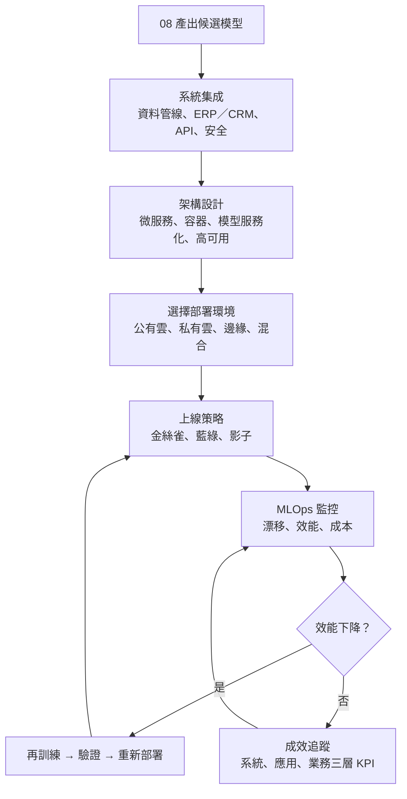
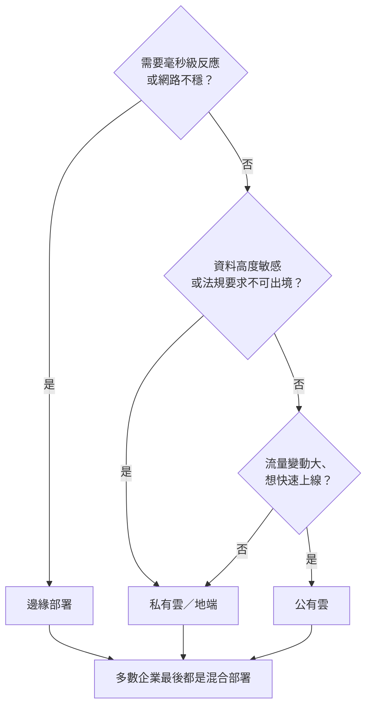
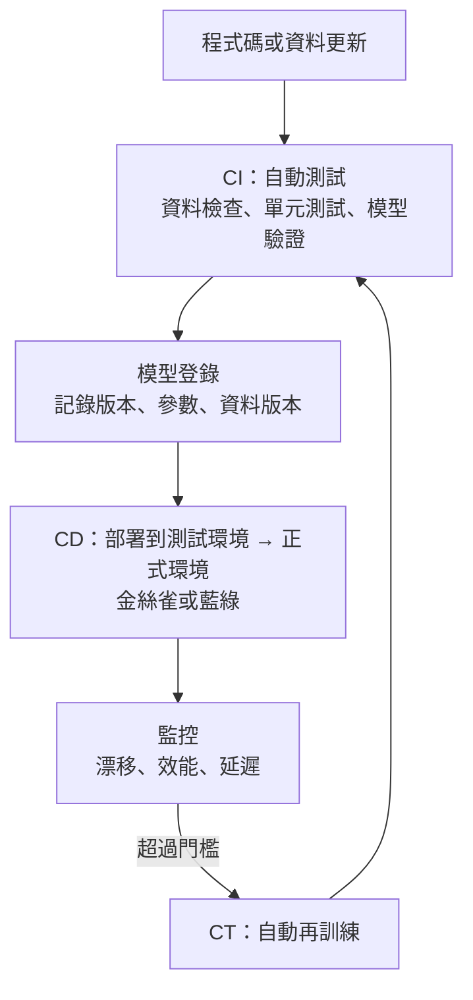

### Metadata
parent:: [[_【目錄】iPAS-AI應用規劃師(中級)：人工智慧技術應用與規劃]]
sibling:: [[08數據準備與模型選擇]] · [[07AI風險管理]] · [[驗證模型方案與檢查效能]] · [[建立完善的監控與重新訓練機制]]

## Key Points
> [!summary] 一句話看懂
> **模型只待在實驗室裡，價值是零；部署＝把模型變成「每天穩定上班的員工」。**
> 這位員工要**接上公司的系統**（系統集成）、**有固定座位與備援**（架構設計）、**選在哪裡上班**（雲端、地端、邊緣）、還要**定期考核與進修**（MLOps 監控與再訓練）。

#### AI 系統 vs 傳統 IT 系統
| 面向 | 傳統 IT | AI 系統 |
|---|---|---|
| **行為** | 程式寫好就固定 | **會隨資料變化而衰退**（漂移） |
| **版本管理** | 只管程式碼 | 程式碼＋**資料**＋**模型**＋參數 |
| **測試** | 輸出對或錯 | 輸出是**機率**，要看統計表現 |
| **上線後** | 修 Bug | 持續監控、**再訓練** |
| **合規** | 一般資安 | 另需**可解釋性、公平性、資料使用**透明 |

#### 四種部署環境
| 環境 | 優點 | 挑戰 | 適合 |
|---|---|---|---|
| **公有雲**（AWS、Azure、GCP） | 彈性擴充、快、按量付費 | 資料主權、法規、**供應商鎖定** | 新創、跨區域、GPU 密集訓練 |
| **私有雲／地端**（OpenStack、VMware） | **資料不外流**、可依法規客製 | 建置維運成本高、擴展受限 | 政府、金融、醫療 |
| **邊緣運算** | **低延遲**、省頻寬、隱私佳 | 算力有限、更新同步難 | 工廠設備、智慧城市、車聯網、手機 |
| **混合部署** | 兼顧算力、速度、資料保護 | 整合與一致性管理難 | 雲端訓練＋邊緣推論 |

#### 五種上線策略（必考）
| 策略 | 做法 | 白話 |
|---|---|---|
| **滾動更新** Rolling Update | 一台一台逐步換成新版本 | 換輪胎一顆一顆換，車不用停 |
| **藍綠部署** Blue-Green | 新舊兩套環境並存，**一次切換流量**，有問題立刻切回 | 新店裝潢好才一次搬過去，舊店先別拆 |
| **金絲雀部署** Canary | **先給一小部分使用者**（如 5%）用新版，沒問題再擴大 | 礦工帶金絲雀下礦坑，先讓少數人試水溫 |
| **影子部署** Shadow | 新模型**同步接收真實流量但不回應使用者**，只比對結果 | 新人跟在老手旁邊做一樣的事，但決定權還在老手 |
| **A/B 測試** | 隨機分流比較兩版本的**業務成效** | 兩種菜單各給一半客人，看哪個點單多 |

> [!warning] 陷阱題
> 1. **容器（Docker）的主要優點＝跨平台部署與環境一致性**，不是加快 API 或減少參數（官方考題原題）。
> 2. **MLOps 的目的＝實現模型的自動化開發、部署與持續維運**（官方考題原題）。
> 3. **邊緣運算的推論發生在終端裝置本地端**（手機、攝影機、感測器）（官方考題原題）。
> 4. **持續監控的目的＝偵測漂移與效能下降**（官方考題原題）。
> 5. **讓模型與業務流程無縫對接＝產品經理與工程人員協作**（官方考題原題）。
> 6. **Docker＝打包容器；Kubernetes＝管理大量容器**（調度、擴縮、故障恢復）。
> 7. **重視資料隱私與本地控制＝私有雲或地端部署**；**要即時、低延遲＝邊緣**。
> 8. **藍綠＝兩套環境一次切換；金絲雀＝小比例逐步放量**。
> 9. **MLflow＝實驗紀錄與模型版本管理；DVC＝資料版本控制；Prometheus＋Grafana＝監控與儀表板**。
> 10. **成效指標三層級：系統層（延遲、吞吐量、可用率）→ 應用層（準確率、F1、CTR）→ 業務層（轉換率、成本、ROI）**。
>
> ⚠️ **學習指引不完整的地方**
> - 指引的 MLOps 只談 **CI/CD**，漏了 AI 專屬的 **CT（Continuous Training，持續訓練）**：資料或效能變化時自動重新訓練、驗證、上線，這正是 MLOps 和一般 DevOps 最大的差別。
> - 指引把 CD 只寫成「持續部署」：CD 也常指**持續交付（Continuous Delivery）**，差別在於**交付＝隨時可上線但由人按下核准**；**部署＝通過測試就自動上線**。高風險 AI 系統多採「持續交付＋人工核准」。
> - 指引**沒有區分批次推論與即時推論**，這是部署設計的第一個決策，本筆記已補上。
> - 指引**沒有涵蓋大型語言模型應用的維運（LLMOps）**：提示詞版本管理、評估測試集、護欄、成本與 Token 監控等，本筆記已補上。

> [!tip] PM 要記住的 3 件事
> 1. **先決定「批次還是即時」**：每晚算一次推薦名單就夠，就不要做成毫秒級即時 API，成本可能差十倍。
> 2. **一定要有回滾計畫**：新模型上線前先想好「出事時幾分鐘內能切回舊版」，金絲雀或藍綠部署就是為此設計。
> 3. **指標要三層對齊**：工程看延遲、資料科學看 F1、老闆看營收，三者要放在同一張儀表板上，才不會各說各話。

--- 
## Notes
### 全局地圖：從候選模型到持續營運

- AI 部署**不是「模型上線」這一個動作**，而是涵蓋**開發、測試、部署、監控、回訓、優化**的完整流程。
- AI 部署比傳統 IT 複雜，因為：模型會**漂移**、推論服務對**延遲與可用性**要求高、模型**更新頻繁**、要符合**可說明性與合規**要求。

---

### 一、系統集成：讓 AI 接上公司的血管
> [!example] 白話比喻
> AI 模型像一顆新的**心臟**，再強也要接上**血管**（資料管線）、**神經**（API）、**各個器官**（ERP、CRM），而且要有**免疫系統**（安全控管），否則只是一顆放在桌上的心臟。

#### 1. 資料來源與資料管線
##### (1) 資料從哪裡來
- **資料倉儲**：整理過的結構化資料。
- **資料湖**：大量原始、非結構化資料。
- **IoT 即時資料**：感測器持續回傳的訊號。
- **第三方 API**：外部服務提供的資料。

##### (2) 資料管線（Data Pipeline）
把資料依**擷取 → 轉換 → 清理 → 入庫**的步驟自動化，讓資料持續、穩定地流入模型。

##### (3) 特徵商店（Feature Store）
集中管理模型使用的特徵，確保**訓練與線上推論用的是同一套特徵計算邏輯**。常見的失敗情境是：訓練時「近 30 天消費金額」用 A 方法算，上線時工程師用 B 方法重寫，結果模型效能莫名下降。特徵商店就是為了避免這種落差。

#### 2. 企業內部系統整合
AI 的建議或決策要**送回日常作業系統**，才能真正產生價值：
- **ERP（企業資源規劃）**：依需求預測模型的結果，自動調整採購量。
- **CRM（客戶關係管理）**：依推薦模型的結果，自動寄送個人化促銷信。
- **MES（製造執行系統）**：依瑕疵偵測結果，自動停線或把產品分流到複檢區。
- **POS（銷售點系統）**：在結帳時即時推薦加購商品。

#### 3. API 與平台接軌
模型要包裝成服務介面，網站、App、BI 工具才能取用預測結果。

##### (1) RESTful API
最常見的方式，使用 HTTP 與 JSON，簡單通用，適合網站、App、BI 工具呼叫模型。

##### (2) gRPC
以二進位格式傳輸，**速度快**，並支援雙向串流，適合內部微服務之間的高效能通訊。

##### (3) Webhook
**事件發生時主動通知**對方，而不是等對方來問。例如模型偵測到疑似詐欺交易時，立刻通知風控系統。

##### (4) 訊息佇列（Kafka、RabbitMQ）
非同步傳遞訊息，能緩衝大量事件，適合高流量的串流資料，也讓系統之間不必緊密綁在一起。

API 層還要設計**容錯、快取與負載管理**，確保服務穩定。

#### 4. 安全與權限控管
##### (1) 身分驗證與授權
使用 **OAuth 2.0** 或 **JWT**（一種帶有數位簽章的存取憑證）確認呼叫者身分與權限。

##### (2) 角色權限控管
依角色限制可以做的事，例如只有特定人員能重新訓練模型或調整參數。

##### (3) API Gateway
所有請求的統一入口，負責**存取日誌、流量控管與速率限制**，避免單一使用者把服務打爆。

##### (4) 機密管理
API 金鑰、資料庫密碼存放在專門的機密管理服務中，**不寫在程式碼裡**，避免被上傳到程式碼庫外洩。

#### 5. 跨雲與異質系統整合
實務上常是**地端訓練、雲端推論、邊緣即時判斷**混合在一起。需要一個**中介整合層**統一管理資料同步、服務呼叫與狀態追蹤，例如 **Service Mesh**（服務網格，如 Istio），避免形成資訊孤島。

#### 6. AI 代理與企業工具整合
生成式 AI 代理要「動手做事」，就必須接上企業系統，例如查訂單、開工單、寄信。

**MCP**（Model Context Protocol）已成為 AI 模型連接外部工具與資料的**開放標準**：系統只要做一次 MCP 介接，就能提供給不同的 AI 應用使用。

安全重點：**最小權限**、高風險動作需人工確認、記錄每一次工具呼叫。詳見 [[03生成式AI技術與應用]]。

---

### 二、系統架構設計
#### 1. 推論模式：批次、即時還是串流
| 模式 | 做法 | 延遲 | 成本 | 例子 |
|---|---|---|---|---|
| **批次推論** Batch | 定時一次處理大量資料，結果存起來 | 小時到天 | **最低** | 每晚算好明天的推薦名單、每月信用評分 |
| **即時推論** Online／Real-time | 收到請求立刻回應 | 毫秒到秒 | 較高 | 刷卡當下判斷詐欺、聊天機器人 |
| **串流推論** Streaming | 持續處理不斷流入的事件 | 秒級 | 中到高 | IoT 感測器異常偵測、即時輿情 |

這是部署設計的**第一個決策**。同樣是推薦，「每晚算好明天的推薦名單」用批次就夠，成本可能只有即時 API 的十分之一。

#### 2. 微服務架構
把一個大應用拆成**多個小型服務**，每個服務只負責一件事，可以**獨立部署、更新與擴展**。

| 優點 | 挑戰 |
|---|---|
| **錯誤隔離**：一個模組壞了不影響全系統 | 模組間需設計**標準 API** |
| **跨團隊並行開發** | **分散式管理**複雜度高 |
| **彈性調整資源**：推論流量大時只擴充模型 API 模組 | 除錯與監控較困難 |

#### 3. 容器化與編排
> [!example] 白話比喻
> - **Docker 容器**＝**貨櫃**：把模型和它需要的所有環境（Python 版本、套件）一起打包，搬到哪台機器都一樣能跑，解決「在我電腦上明明可以跑」的問題。
> - **Kubernetes**＝**貨櫃港的調度系統**：決定貨櫃放哪、壞了自動換、貨多時自動加開。

##### (1) 兩個核心工具
- **Docker**：建構與執行容器，確保**跨平台部署的環境一致性**。
- **Kubernetes（K8s）**：管理大量容器，負責資源調度與**故障自動恢復**。

##### (2) 常見實作原則
- **滾動更新**：逐步替換舊版本，服務不中斷。
- **自動擴縮（Autoscaling）**：依流量自動增減容器數量。
- **負載平衡**：把請求平均分給多個推論節點。

#### 4. 模型服務化與 API 封裝
把模型包成可透過 HTTP 呼叫的**推論服務**，並提供**多版本管理**、**使用者驗證與速率限制**、**推論紀錄與監控指標**。

常見工具：
- **Flask、FastAPI**：自己用 Python 寫 API，簡單快速。
- **TensorFlow Serving、TorchServe**：對應框架的專用推論服務。
- **NVIDIA Triton**：支援多種框架，GPU 高效能推論。
- **vLLM、TGI**：專為**大型語言模型**設計的高效能推論服務。
- **KServe、BentoML、雲端託管端點**：在 Kubernetes 或雲端上管理模型服務。

**ONNX** 是跨框架的模型格式，常用於「用 PyTorch 訓練、用其他引擎部署」的轉換。

#### 5. 可擴充與高可用性設計
##### (1) 冗餘部署（Redundancy）
在多個節點部署同一個服務，**避免單點故障**：一台壞了，其他台繼續服務。

##### (2) 容錯切換（Failover）
主節點故障時，**自動切換**到備援節點。

##### (3) 降級機制（Fallback）
模型失效時，改用**規則或舊版模型**維持服務。例如推薦系統掛了，就先顯示熱銷排行榜，而不是一片空白。

##### (4) 快取（Cache）
相同或相似的請求直接回傳之前的結果，降低延遲與成本。

---

### 三、部署環境選擇
#### 公有雲
- **代表**：AWS、Microsoft Azure、Google Cloud。
- **優勢**：彈性擴充、部署快、全球節點、**按量付費**，適合快速試驗與擴展。
- **適用**：新創、中大型企業、跨區域部署、**GPU 密集型訓練**。
- **挑戰**：敏感資料的**法規遵循**（如 GDPR）、**資料主權**、**供應商鎖定**。

雲端也提供**託管的大型模型服務**（Azure AI Foundry、AWS Bedrock、Google Vertex AI），可以選擇資料存放的區域。

#### 私有雲與地端
- **做法**：企業自建或專屬的雲端環境，例如用 **OpenStack、VMware** 架設在自家資料中心。
- **優勢**：**資安可控、資料不外流**，可依產業法規客製。
- **適用**：**政府、金融、醫療**等資料保護要求嚴格的領域。
- **挑戰**：建置與維運成本高、擴展彈性受限。

生成式 AI 時代的地端選項：在自有 GPU 上部署**開源大型語言模型**。

#### 邊緣運算
- **做法**：在**靠近資料來源**的裝置上推論，例如 IoT 設備、手機、車載系統、攝影機。
- **優勢**：**即時反應**、降低傳輸延遲、省頻寬，**資料不出裝置**也較保護隱私。
- **適用**：工業設備監控、智慧城市、車聯網、**手機上的 AI 功能**。
- **挑戰**：算力有限，模型更新與同步需要額外設計。

**讓模型塞進邊緣設備**的方法：**量化、剪枝、知識蒸餾**；工具如 TensorRT、OpenVINO、TensorFlow Lite、Core ML。新一代手機與筆電也內建 **NPU**（神經網路處理器）專門跑 AI。

#### 混合部署
結合公有雲、私有雲與邊緣，把**各任務放在最合適的位置**。典型做法是**雲端訓練、邊緣推論**，或**敏感資料留在地端、一般查詢上雲**。挑戰在於整合難度高，需要設計同步與一致性管理。

---

### 四、MLOps：讓模型持續健康上班
> [!example] 白話比喻
> DevOps 讓「程式」能快速、安全地上線；**MLOps 是 DevOps 加上「資料」與「模型」**。差別在於：程式不會自己變壞，**模型會因為世界改變而變壞**，所以要多一個「**持續訓練**」。

#### 1. CI／CD／CT 三個持續
| 縮寫 | 全名 | 在 AI 專案做什麼 |
|---|---|---|
| **CI** | 持續整合 | 程式碼或**資料變動**就自動觸發測試；單元測試＋**模型準確率驗證**＋與基準比較 |
| **CD** | 持續交付／持續部署 | 通過測試門檻的模型**自動部署**到測試或正式環境（交付＝需人工核准，部署＝全自動） |
| **CT** | 持續訓練 | 偵測到漂移或效能下降，**自動重新訓練並驗證** |

#### 2. 上線策略
新模型上線不應「一次全部切換」，而是用以下策略控制風險：

##### (1) 滾動更新（Rolling Update）
一台一台逐步把舊版本換成新版本，服務不中斷。就像換輪胎一顆一顆換，車不用停。

##### (2) 藍綠部署（Blue-Green）
同時準備新、舊兩套完整環境，確認新環境沒問題後，**一次把流量切過去**；有狀況就立刻切回舊環境。就像新店裝潢好才一次搬過去，舊店先別拆。

##### (3) 金絲雀部署（Canary）
**先讓一小部分使用者**（例如 5%）使用新版本，觀察沒問題再逐步擴大。名稱來自礦工帶金絲雀下礦坑偵測毒氣。

##### (4) 影子部署（Shadow）
新模型**同步接收真實流量，但不回應使用者**，只把它的結果和舊模型比對。可以在零風險下觀察新模型在真實資料上的表現。

##### (5) A/B 測試
把使用者隨機分成兩組，分別使用不同版本，比較**業務指標**（轉換率、點擊率）的差異，確認新模型真的帶來商業價值。

#### 3. 版本控管與可重現性
- **Git**：管理程式碼版本。
- **DVC（Data Version Control）**：管理**資料集**與模型檔的版本。
- **MLflow**：記錄**實驗**（參數、指標），並提供**模型登錄**與部署功能。
- **Weights & Biases** 等：實驗追蹤與視覺化。

目標是：**任何一個上線模型，都能追溯是用哪份資料、哪段程式、哪組參數訓練出來的**。出問題時才能重現、稽核與回滾。

#### 4. 監控與回饋
##### (1) 監控什麼
- **模型漂移（預測漂移）**：模型的**預測結果分佈**和訓練時不同，可能代表模型已不適用。
- **資料漂移**：**輸入資料**的統計特徵改變，例如欄位分佈、異常值比例。
- **效能指標**：錯誤率、延遲、吞吐量。
- **資料品質**：缺失值突然暴增、欄位格式改變，常是上游系統改版造成。

##### (2) 回饋與自動修正
1. 設定**觸發門檻**，例如準確率下降 5%。
2. 達到門檻時啟動**再訓練管線**。
3. 新模型驗證通過後，透過**熱更新**（Hot Swap）或**滾動更新**替換。

##### (3) 可視化與預警
- **Prometheus** 收集指標、**Grafana** 呈現儀表板。
- 異常時**自動通知**工程人員。
- AI 專用監控工具：**Evidently、Arize、WhyLabs**，以及各雲端平台內建的模型監控。

#### 5. MLOps 成熟度三級（Google 定義）
| 等級 | 特徵 |
|---|---|
| **Level 0 手動** | 資料科學家手動訓練、手動交給工程師部署，很久才更新一次 |
| **Level 1 管線自動化** | **訓練流程自動化**，可依新資料持續訓練（CT） |
| **Level 2 CI/CD 自動化** | 連**管線本身**的修改都能自動測試與部署，可快速大量迭代 |

#### 6. LLMOps：大型語言模型應用的維運
生成式 AI 應用多半**不自己訓練模型**，維運重點和傳統 MLOps 不同：

##### (1) 提示詞版本管理
提示詞也是「程式」，要做版本控管，每次修改都要測試。一個字的改動可能讓回答品質大幅變化。

##### (2) 評估測試集
建立一組固定題庫，每次更換提示詞、模型或 RAG 設定時都跑一次，比較正確率與幻覺率是否退步。

##### (3) 護欄（Guardrails）
在輸入端過濾提示詞注入，在輸出端檢查個資與有害內容。

##### (4) 可觀測性
記錄每次請求的輸入、輸出、檢索到的內容、工具呼叫與延遲，出問題時才能追查原因。常用工具如 Langfuse、LangSmith。

##### (5) 成本控管
監控 **Token 用量**；用**快取**重複問題、用**模型路由**把簡單問題交給便宜的小模型，降低成本。

##### (6) 供應商模型變動
API 模型升版可能改變輸出行為。對策是**鎖定模型版本**，換版前先用評估測試集做回歸測試。

---

### 五、上線後的成效追蹤與組織協作
#### 1. 三層 KPI
| 層級 | 指標 | 誰關心 |
|---|---|---|
| **系統層** | **推論延遲**、**吞吐量**、**服務可用率**、GPU 記憶體使用率 | 工程、維運 |
| **應用層** | **準確率**、**F1**、推薦**點擊率（CTR）**、異常偵測精確度 | 資料科學 |
| **業務層** | **轉換率**、成本節省、**客戶留存率**、**ROI** | 業務、高階主管 |

單看一層指標容易各說各話，建議採「**技術指標＋業務指標**」雙軌制，讓工程與業務有共同語言。

#### 2. 回饋週期
- **每日**：監控推論效能與使用情況。
- **每週**：收集錯誤樣本與業務回饋。
- **每月**：重新評估模型，確認是否需要再訓練。

#### 3. 持續優化
##### (1) 版本管理與漸進上線
用滾動更新、藍綠部署、金絲雀部署降低新模型不穩定的風險。

##### (2) 再訓練與再標註
資料漂移超過門檻時自動觸發再訓練，並同步檢查、更新標註品質。

##### (3) 人在迴路中（Human-in-the-Loop）
把客服、業務回報的錯誤案例，以及使用者的行為紀錄，轉成新的訓練素材。

##### (4) 線上學習（Online Learning）
資料變化極快時，讓模型隨新資料**持續小幅更新**。

⚠️ 風險是可能被**惡意資料帶偏**（資料投毒），需搭配監控與回滾機制。

#### 4. 跨部門角色與治理
##### (1) 各部門的角色
- **業務與行銷**：提供需求情境與績效指標，運用 AI 的輸出並回饋效果。
- **客服與營運**：最接近客戶，負責**回收實際案例與異常反應**，用於持續優化模型。
- **法務與風險**：審查隱私、公平性與風險揭露，建立合規的使用框架。
- **資訊部門**：負責部署、權限管理、API 整合與維運。
- **AI 產品經理**：**技術與業務之間的橋樑**，對齊需求、驗證情境、協調任務。

##### (2) 常態溝通與治理
- 定期召開 **AI 專案工作小組**，協調各部門的目標與需求。
- 推動**共用績效指標**，作為跨部門合作的共同目標。
- 建立模型調整、資料異常、需求變更的**快速決策通道**。
- 設立 **AI 治理委員會**、**AI 產品經理**與**跨部門 AI 培訓**（詳見 [[07AI風險管理]]）。

---

### PM 檢查清單：AI 系統部署 10 問
1. **推論模式**：批次、即時還是串流？延遲要求多少？
2. **整合點**：AI 結果要送回哪個系統（ERP、CRM、MES）？誰來接？
3. **介面**：REST、gRPC、Webhook 還是訊息佇列？
4. **安全**：身分驗證、權限、API Gateway、機密管理做了嗎？
5. **部署環境**：公有雲、私有雲、邊緣還是混合？資料能不能出境？
6. **高可用**：有冗餘、容錯切換、降級方案嗎？
7. **上線策略**：金絲雀、藍綠還是影子部署？**回滾要幾分鐘？**
8. **版本**：資料、程式、模型、提示詞都有版本紀錄嗎？
9. **監控**：漂移與效能門檻多少？誰收警報？再訓練誰核准？
10. **成效**：系統、應用、業務三層 KPI 放在同一張儀表板了嗎？

---
## References
- iPAS AI應用規劃師(中級)學習指引 科目1：人工智慧技術應用與規劃 — 5.2 AI 技術系統集成與部署、第五章考題解析
- Google Cloud. *MLOps: Continuous delivery and automation pipelines in machine learning*
- Sculley et al. (2015). *Hidden Technical Debt in Machine Learning Systems*
- Kubernetes Documentation: Deployments、Horizontal Pod Autoscaling
- MLflow Documentation；DVC Documentation
- Model Context Protocol Specification
![[AI應用規劃師(中級)-學習指引-科目1人工智慧技術應用規劃_20251222101833.pdf]]
