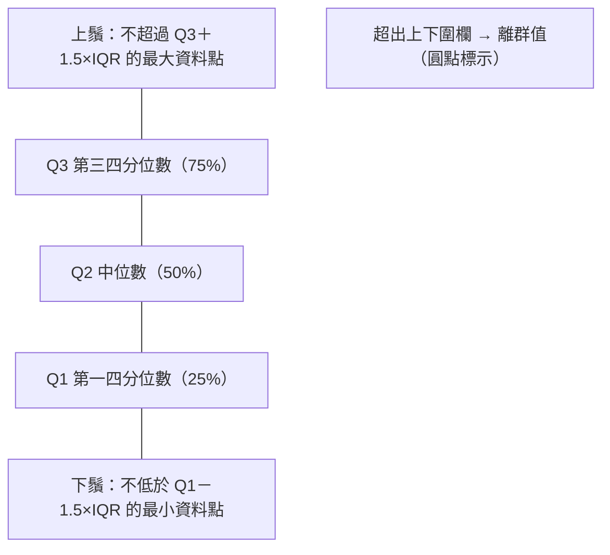
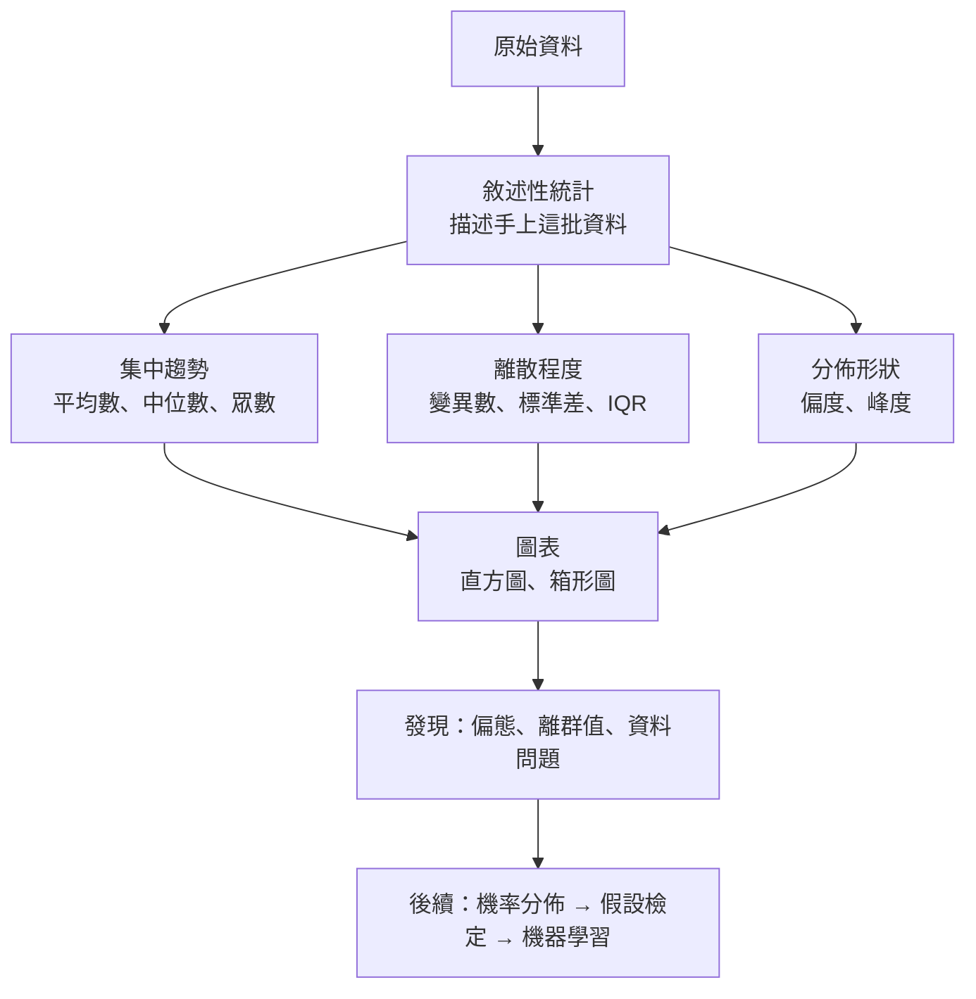

### Metadata
parent:: [[_【目錄】iPAS-AI應用規劃師(中級)：大數據處理分析與應用]]
sibling:: [[02機率分佈與資料分佈模型]] · [[03假設檢定與統計推論]]

## Key Points
> [!summary] 一句話看懂
> **敘述性統計＝用幾個數字和一張圖，把一大堆資料「濃縮成重點」。**
> 就像幫全班成績寫摘要：**平均幾分**（集中趨勢）、**分數差多大**（離散程度）、**是不是多數人考很好、少數人很差**（分佈形狀）。
> 它只**描述手上的資料**，不推論母體；推論是 [[03假設檢定與統計推論]] 的工作。

#### 三大面向速記
| 面向 | 回答的問題 | 指標 |
|---|---|---|
| **集中趨勢** | 資料的「中心」在哪？ | 平均數、中位數、眾數（及幾何、調和平均） |
| **離散程度** | 資料有多分散？ | 全距、變異數、標準差、**IQR**、變異係數 |
| **分佈形狀** | 對稱嗎？尾巴多厚？ | **偏度**、**峰度**；直方圖、箱形圖 |

#### 三種平均數怎麼選
| 平均數 | 公式概念 | 適合 | 例子 |
|---|---|---|---|
| **算術平均** | 加總 ÷ 個數 | 對稱、無極端值的一般資料 | 平均銷售額 |
| **幾何平均** | 連乘後開 n 次方根 | **成長率、報酬率**（乘法效應） | 三年營收成長率 +10%、+50%、−20% 的平均 |
| **調和平均** | 個數 ÷（倒數和） | **速率、比率**（同距離不同速度） | 去程時速 60、回程 40，平均時速是 48 不是 50 |

- 三者關係（資料皆為正數時）：**算術平均 ≥ 幾何平均 ≥ 調和平均**。
- **F1 分數就是 Precision 與 Recall 的調和平均**。

#### 偏態時平均數、中位數、眾數的位置
| 分佈 | 偏度 | 尾巴 | 大小關係 | 例子 |
|---|---|---|---|---|
| **右偏**（正偏） | > 0 | 右側長 | **平均數 > 中位數 > 眾數** | 收入、房價 |
| **對稱** | ≈ 0 | 兩側相同 | 三者約相等 | 產品重量 |
| **左偏**（負偏） | < 0 | 左側長 | **平均數 < 中位數 < 眾數** | 考題太簡單時的考試成績 |

- 記法：**平均數會被長尾巴「拉過去」**。

#### 箱形圖五數摘要

> [!warning] 陷阱題
> 1. **平均數、標準差、最大值等統計量＝敘述統計**，不是推論統計（官方考題原題）。
> 2. **極端值多、或資料明顯偏態（左偏或右偏）→ 用中位數代表集中趨勢**（官方考題原題）。
> 3. **標準差＝資料平均偏離平均數的程度**，不是最大與最小值的距離（那是全距）（官方考題原題）。
> 4. **右偏＝平均數 > 中位數**；**左偏＝平均數 < 中位數**。
> 5. **IQR＝Q3 − Q1**，涵蓋中間 50% 的資料，**不受極端值影響**。
> 6. **離群值判斷（Tukey 法）＝小於 Q1 − 1.5×IQR 或大於 Q3 + 1.5×IQR**。
> 7. **幾何平均與調和平均都不能有 0 或負數**。
> 8. **眾數是唯一能用在類別資料的集中趨勢指標**。
> 9. **標準差與原資料同單位；變異數是單位的平方**。
> 10. **峰度看的是「尾巴厚不厚」（極端值多寡）**；常態分佈的峰度＝3，**超額峰度＝0**。
>
> ⚠️ **學習指引不精確的地方**
> - 指引只列了**母體變異數**（除以 N）。實務上手上多是**樣本**，**樣本變異數要除以 n − 1**（貝塞爾校正），才不會低估真實變異。Excel 的 `VAR.S`、pandas 的 `.var()` 預設都是除以 n − 1。
> - 指引寫「上鬚＝Q3 + 1.5×IQR」：Q3 + 1.5×IQR 是**圍欄（fence）**，**鬚實際畫到圍欄內最遠的那個資料點**，所以鬚的長度常常比 1.5×IQR 短。
> - 指引用「峰度 > 3」判斷高峰：這是 **Pearson 定義**。但多數軟體（Excel `KURT`、pandas `.kurt()`、SciPy 預設）回傳的是**超額峰度（Fisher 定義）＝峰度 − 3**，常態分佈＝**0**。看到軟體輸出 0.5 不代表「扁平」，而是**比常態稍微重尾**。
> - 指引把高峰度描述為「更集中於中心」：現代統計學認為峰度**主要反映尾部的極端值**，與峰頂尖不尖關係不大。判斷重點放在「**極端值是否比常態多**」。

> [!tip] PM 要記住的 3 件事
> 1. **看報表先問「平均數還是中位數？」**：平均客單價 2,000 元，可能是多數人買 500 元、少數大客戶買 5 萬元。
> 2. **只看平均一定會被騙**：兩個方案平均交期都是 5 天，一個穩定在 4～6 天，一個在 1～15 天跳動，**標準差**才看得出風險。
> 3. **分析前先畫圖**：直方圖看形狀、箱形圖找離群值，比任何單一數字都可靠。

--- 
## Notes
### 全局地圖：敘述性統計在資料分析中的位置

- 敘述性統計是**探索性資料分析**（EDA）的第一步，目的是**快速掌握大局、找出潛在問題**，為特徵選擇、異常偵測與模型設計打基礎。
- **敘述統計 vs 推論統計**：

| | 敘述統計 | 推論統計 |
|---|---|---|
| **目的** | 描述**手上的資料** | 用樣本**推論母體** |
| **例子** | 這 1,000 位顧客的平均年齡是 35 歲 | 全體顧客平均年齡有 95% 機率落在 34～36 歲 |
| **工具** | 平均數、標準差、圖表 | 信賴區間、假設檢定 |

---

### 一、集中趨勢：資料的中心在哪？
#### 算術平均（Mean）
$$\bar{x} = \frac{x_1 + x_2 + \cdots + x_n}{n}$$

- **優點**：計算容易、最直覺、最常用（平均銷售額、平均月薪）。
- **限制**：
  - **對極端值敏感**：少數離群值就能大幅拉高或拉低。
  - **看不出分散程度**：要搭配標準差或 IQR。

> [!example] 平均數被拉走
> 10 位員工月薪：9 人各 4 萬元，老闆 100 萬元。
> - 平均數＝（36 ＋ 100）÷ 10＝**13.6 萬元** → 沒有任何一位員工領這個數字
> - 中位數＝**4 萬元** → 更能代表「一般員工」

#### 幾何平均（Geometric Mean）
$$G = \left(\prod_{i=1}^{n} x_i\right)^{1/n}$$

- **適合**：**成長率、報酬率、人口成長**等「乘法累積」的資料。
- **限制**：資料必須**全為正數**；解釋上不如算術平均直覺。

> [!example] 為什麼成長率要用幾何平均？
> 投資第一年 +100%（100 元 → 200 元），第二年 −50%（200 元 → 100 元），**實際上沒賺沒賠**。
> - 算術平均：（100% − 50%）÷ 2＝**+25%** ❌ 誤導
> - 幾何平均：√（2.0 × 0.5）− 1＝**0%** ✅ 正確
> 實務上常見的 **CAGR**（年複合成長率）就是幾何平均的應用。

#### 調和平均（Harmonic Mean）
$$H = \frac{n}{\sum_{i=1}^{n} \frac{1}{x_i}}$$

- **適合**：**速率、效率**類資料（速度、油耗、單位成本），在需要「倒數加權」時比算術平均準確。
- **限制**：不能有 0 或負數；非速率情境意義不大。
- **AI 中的應用**：**F1 分數＝Precision 與 Recall 的調和平均**，任一個很低，F1 就會被拉低。

#### 眾數（Mode）
- **出現次數最多**的值。
- **優點**：**唯一能用在類別資料**的集中趨勢指標（最常被購買的產品類別）。
- **限制**：連續資料要先**分組（分箱）**；可能有多個眾數（多峰分佈）。

#### 中位數（Median）
- 排序後**正中間**的值。
  - n 為奇數：第（n＋1）/ 2 個值。
  - n 為偶數：中間兩個值的平均。
- **優點**：**不受極端值影響**，適合收入、房價等**長尾**資料。
- **限制**：看不出分散程度。

---

### 二、離散程度：資料有多分散？
#### 1. 變異數與標準差
**母體**（有全部資料時）：

$$\sigma^2 = \frac{1}{N}\sum_{i=1}^{N}(x_i - \mu)^2 \qquad \sigma = \sqrt{\sigma^2}$$

**樣本**（只有一部分資料時，實務上最常見）：

$$s^2 = \frac{1}{n-1}\sum_{i=1}^{n}(x_i - \bar{x})^2 \qquad s = \sqrt{s^2}$$

- **變異數**：每筆資料與平均數差距的**平方**的平均；單位是原單位的平方。
- **標準差**：變異數開根號，**單位與原資料相同**，比較好解釋。
- 標準差**大＝資料分散、波動大**；**小＝集中、穩定**。
- **限制**：**對極端值非常敏感**（因為差距有平方）；偏態資料要搭配其他指標。

> [!example] 為什麼樣本要除以 n − 1？
> 樣本平均數本身就是從同一批資料算出來的，會「剛好」比較靠近這批資料，使得偏差平方和偏小。除以 n − 1 是在**補償這個低估**。樣本越大，兩者差異越小。

#### 2. 變異係數（Coefficient of Variation, CV）
$$CV = \frac{\text{標準差}}{\text{平均數}} \times 100\%$$

- 用來**比較單位或規模不同**的資料哪個比較穩定。
- 例：A 商品日銷量平均 1,000、標準差 100（CV＝10%）；B 商品平均 50、標準差 20（CV＝40%）→ **B 的波動相對更大**，雖然它的標準差比較小。

#### 3. 全距與四分位數
| 指標 | 計算 | 特色 |
|---|---|---|
| **全距** Range | 最大值 − 最小值 | 最簡單，但**只要一個極端值就失真** |
| **Q1** 第一四分位數 | 25% 的資料小於它 | 下四分位數 |
| **Q2** 第二四分位數 | 50% 的資料小於它 | 就是**中位數** |
| **Q3** 第三四分位數 | 75% 的資料小於它 | 上四分位數 |
| **IQR** 四分位距 | **Q3 − Q1** | 中間 50% 的資料範圍，**不受極端值影響** |

- **百分位數**（Percentile）是更一般的形式，例如 **P95 回應時間**：95% 的請求在這個時間內完成。系統效能監控常用 **P95、P99** 而不是平均值，因為平均值會掩蓋少數極慢的請求。

#### 4. 箱形圖（Box Plot）
##### (1) 組成
| 元素 | 意義 |
|---|---|
| **箱中間的線** | **中位數**（Q2） |
| **箱子下緣／上緣** | **Q1**／**Q3** |
| **箱子高度** | **IQR**，中間 50% 的資料；越長代表越分散 |
| **鬚** Whiskers | 延伸到**圍欄內最遠的資料點**；圍欄＝Q1 − 1.5×IQR、Q3 + 1.5×IQR |
| **圓點或星號** | **離群值**：超出圍欄的資料 |

- 注意：箱形圖的「最大值」「最小值」通常指**排除離群值後**的最大與最小，不一定是整個資料集的極值。

##### (2) 如何從箱形圖看偏態
- 中位數線**偏向箱子下方**、上鬚較長 → **右偏**。
- 中位數線**偏向箱子上方**、下鬚較長 → **左偏**。

##### (3) 應用
- 快速檢視分佈、集中度、變異性。
- **異常值偵測**。
- **並排比較多組資料**（例如各門市的客單價分佈）。

##### (4) 限制
- **看不出多峰分佈**（兩群資料混在一起時，箱形圖看起來可能很正常），要搭配**直方圖**或**小提琴圖**。

> [!example] 計算範例
> 資料：2, 4, 5, 6, 7, 8, 9, 30
> - Q1＝4.5、Q2＝6.5、Q3＝8.5（不同軟體的四分位數算法略有差異）
> - IQR＝8.5 − 4.5＝4
> - 上圍欄＝8.5 ＋ 1.5 × 4＝14.5 → **30 是離群值**
> - 下圍欄＝4.5 − 6＝−1.5 → 沒有下方離群值
> - 上鬚畫到 **9**（圍欄內最大的資料點）

---

### 三、分佈形狀：對稱嗎？尾巴多厚？
#### 偏度（Skewness）
> [!example] 白話比喻
> 把資料想成一座溜滑梯：**長長的滑道在右邊＝右偏**，在左邊＝左偏。偏度看的是**長尾巴在哪一側**。

| 類型 | 偏度 | 特徵 | 例子 |
|---|---|---|---|
| **右偏**（正偏） | > 0 | 主體在左、**右側尾巴長**；少數極大值拉高平均 | 收入、房價、等待時間；某城市房價偏度 2.5，少數豪宅拉高整體 |
| **左偏**（負偏） | < 0 | 主體在右、**左側尾巴長**；少數極小值拉低平均 | 設備壽命（少數早期故障）偏度 −1.8；簡單考試的成績 |
| **近似對稱** | ≈ 0 | 接近常態分佈 | 產品重量偏度 0.1 |

- 經驗法則：|偏度| < 0.5 約對稱；0.5～1 中度偏態；> 1 高度偏態。
- **對機器學習的影響**：高度右偏的特徵（如交易金額）常先做**對數轉換**，讓分佈較對稱（見 [[08數據準備與模型選擇]]）。

#### 峰度（Kurtosis）
- 衡量分佈**尾部的厚度**，也就是**極端值出現的頻率**是否比常態分佈高。
- 有兩種定義，**考試和讀軟體輸出時一定要分清楚**：

| 定義 | 常態分佈的值 | 誰在用 |
|---|---|---|
| **Pearson 峰度** | **3** | 學習指引、統計理論 |
| **超額峰度**（Fisher）＝峰度 − 3 | **0** | Excel、pandas、SciPy 等多數軟體預設 |

| 類型 | Pearson 峰度 | 超額峰度 | 特徵 |
|---|---|---|---|
| **高狹峰** Leptokurtic | > 3 | > 0 | **厚尾**，極端值比常態多；例如金融報酬率 |
| **常態峰** Mesokurtic | ≈ 3 | ≈ 0 | 接近常態分佈，作為比較基準 |
| **低闊峰** Platykurtic | < 3 | < 0 | **薄尾**，極端值比常態少；例如均勻分佈 |

- **實務意義**：高峰度＝**黑天鵝事件比你以為的多**。在風險管理、異常偵測、模型外推時要特別小心；用常態分佈假設去估計風險，會**低估極端損失**。

---

### 四、大數據情境下的敘述性統計
- **快速摘要**：pandas 的 `describe()` 或 Spark 的 `summary()` 一次輸出筆數、平均、標準差、最小值、四分位數、最大值。
- **資料量太大時**：精確計算中位數與四分位數需要排序全部資料，成本很高，大數據平台常用**近似演算法**（如 Spark 的 `approxQuantile`、t-digest），以極小誤差換取速度。
- **串流資料**：平均數與變異數可以**逐筆更新**，不必存下全部資料；中位數則要用近似方法。
- **分組摘要**：只看整體數字可能誤導，要**依地區、通路、客群分組**比較。
- **別只看數字**：經典的**安斯庫姆四重奏**（Anscombe's Quartet）顯示，四組資料的平均數、變異數、相關係數幾乎一模一樣，但畫出圖來形狀完全不同。**先畫圖**才能看到數字藏起來的東西。

---

### PM 檢查清單：看任何數據報表前的 6 個問題
1. **用的是平均數還是中位數？** 資料有沒有偏態或極端值？
2. **離散程度呢？** 有沒有附上標準差、IQR 或 P95？
3. **有沒有畫分佈圖？** 是單峰還是多峰（可能混了兩種客群）？
4. **離群值怎麼處理？** 是資料錯誤，還是真實的重要案例（大客戶、詐欺）？
5. **有沒有分組看？** 整體平均是否掩蓋了不同群體的差異？
6. **這是樣本還是全部？** 若是樣本，結論只能描述樣本，推論母體要用 [[03假設檢定與統計推論]]。

---
## References
- iPAS AI應用規劃師(中級)學習指引 科目2：大數據處理分析與應用 — 3.1 敘述性統計與資料摘要技術、第三章考題解析
- Tukey, J. W. (1977). *Exploratory Data Analysis*
- Westfall, P. H. (2014). *Kurtosis as Peakedness, 1905–2014. R.I.P.* The American Statistician
- Anscombe, F. J. (1973). *Graphs in Statistical Analysis*
![[AI應用規劃師(中級)-學習指引-科目2大數據處理分析與應用_20251222101850.pdf]]
