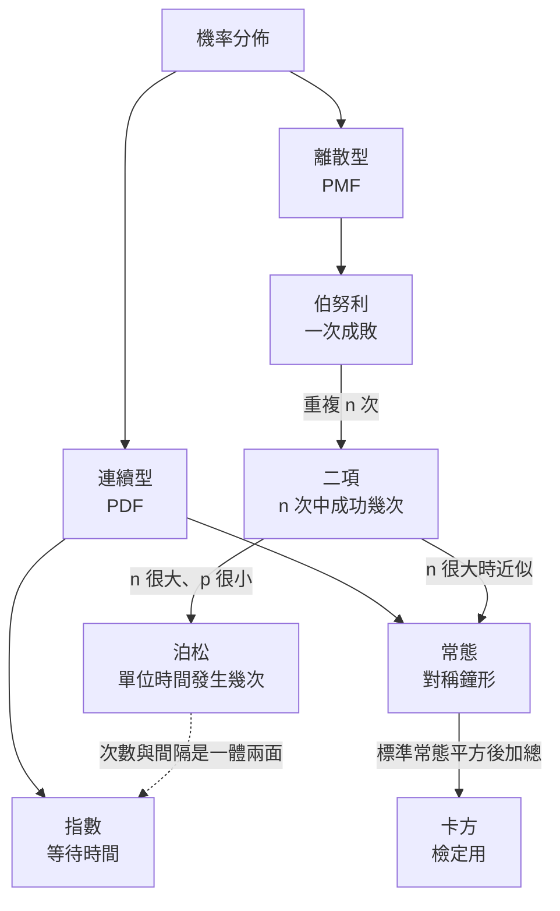
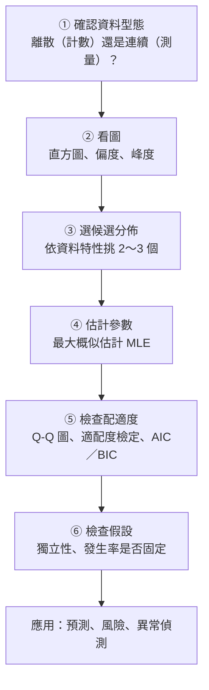

### Metadata
parent:: [[_【目錄】iPAS-AI應用規劃師(中級)：大數據處理分析與應用]]
sibling:: [[01敘述性統計與資料摘要技術]] · [[03假設檢定與統計推論]]

## Key Points
> [!summary] 一句話看懂
> **機率分佈＝描述「某件事各種結果出現機率」的模板。**
> 認出資料像哪個模板，就能**預測未來、估算風險、判斷異常**。
> 就像氣象預報：知道「颱風路徑通常是這種形狀」，就能估計明天各地被掃到的機率。

#### 離散型 vs 連續型
| | 離散型 | 連續型 |
|---|---|---|
| **值的特性** | 可數（0、1、2…） | 任意實數（5.3、5.31…） |
| **描述函數** | **PMF** 機率質量函數：每個值的機率 | **PDF** 機率密度函數：**區間**的機率＝曲線下面積 |
| **單點機率** | P(X＝3) 有意義 | **P(X＝某一點)＝0**，只能算區間 |
| **例子** | 訂單數、故障次數、點擊與否 | 身高、等待時間、溫度 |

#### 常見分佈速記
| 分佈 | 類型 | 描述什麼 | 期望值 | 變異數 | 例子 |
|---|---|---|---|---|---|
| **伯努利** | 離散 | **一次**試驗成功或失敗 | p | p(1−p) | 使用者點不點廣告 |
| **二項** | 離散 | **n 次**獨立試驗的成功**次數** | np | np(1−p) | 100 人看廣告有幾人點 |
| **泊松** Poisson | 離散 | 固定時間或空間內事件**發生次數** | **λ** | **λ** | 每小時客服來電數 |
| **常態** | 連續 | 對稱鐘形 | μ | σ² | 身高、測量誤差 |
| **指數** | 連續 | 事件之間的**等待時間** | 1/λ | 1/λ² | 來電間隔、故障間隔 |
| **卡方** χ² | 連續 | **標準常態變數的平方和** | k | 2k | 適配度、獨立性檢定 |

- **泊松的期望值＝變異數＝λ**，這是它的招牌特徵。
- **泊松（次數）與指數（間隔時間）是一體兩面**：每小時平均來電 λ＝6 通 → 平均間隔 1/6 小時＝10 分鐘。

#### 常態分佈的 68-95-99.7 法則
| 範圍 | 涵蓋資料比例 |
|---|---|
| μ ± 1σ | 約 **68%** |
| μ ± 2σ | 約 **95%** |
| μ ± 3σ | 約 **99.7%** |

- 超出 ±3σ 的資料只佔約 0.3%，所以常被當作**異常值**的判斷門檻（**3σ 法則**）。

> [!warning] 陷阱題
> 1. **二項分佈＝多次伯努利試驗中成功的次數**，是典型**離散型**分佈（官方考題原題）。
> 2. **「任何資料在樣本數夠大時都會變成常態分佈」是錯的**：中央極限定理說的是**樣本平均數的分佈**趨近常態，**原始資料本身的分佈不會改變**（官方考題原題）。
> 3. **伯努利＝二項分佈 n＝1 的特例**。
> 4. **泊松：期望值＝變異數＝λ**；**指數分佈：期望值＝1/λ**。
> 5. **指數分佈具有「無記憶性」**：已經等了 10 分鐘，再等 5 分鐘的機率和剛開始等 5 分鐘一樣。
> 6. **卡方分佈是右偏的，自由度越大越接近常態**；只取非負值。
> 7. **連續型分佈的單點機率＝0**，只能算區間機率。
> 8. **二項與泊松的前提＝試驗獨立、機率或發生率固定**，條件不成立就不適用。
> 9. **常態分佈由兩個參數決定：平均數 μ（中心）與標準差 σ（寬度）**；標準常態分佈 μ＝0、σ＝1。
> 10. **自由度＝計算統計量時可以自由變動的資料數**；用樣本平均算樣本變異數會用掉 1 個自由度，所以除以 n − 1。
>
> ⚠️ **學習指引錯誤或不精確的地方**
> - 指引寫指數分佈的特徵是「**記憶性（Memoryless）**」：中文應為「**無記憶性**」，意思正是「未來與過去已等待的時間無關」。寫成「記憶性」意思完全相反。
> - 指引寫「卡方分佈是**常態分佈的平方和**」：精確說法是 **k 個獨立「標準常態」變數的平方和**，k 就是自由度。
> - 指引說**股票價格波動近似常態**：股價本身較接近**對數常態**（不會是負的）；**日報酬率**雖常被近似為常態，但實際上是**厚尾**的，極端漲跌比常態預測的多很多。用常態假設估風險會**低估崩盤機率**。
> - 指引說偏態長尾的資料可考慮 **t 分佈**：t 分佈是**對稱**的厚尾分佈，適合「對稱但極端值多」的資料；**右偏**的資料（如收入）應考慮**對數常態、Gamma、Pareto** 等分佈。
> - 指引舉「網站點擊量符合常態分佈」：點擊量是**計數**資料，通常先考慮**泊松**或**負二項分佈**；只有數量很大時才可用常態近似。

> [!tip] PM 要記住的 3 件事
> 1. **先判斷資料類型**：是「有沒有」（伯努利）、「幾次」（二項、泊松）、「多久」（指數）、還是「量多少」（常態、對數常態）？選錯分佈，預測就會系統性出錯。
> 2. **真實世界很多是長尾**：營收、使用者活躍度、商品銷量常呈**冪律**分佈，少數頭部佔大部分，「平均使用者」可能根本不存在。
> 3. **A/B 測試、異常偵測、需求預測背後都是機率分佈**：知道分佈，才知道「這次的數字算不算異常」。

--- 
## Notes
### 全局地圖：機率分佈家族

- 機率分佈是**敘述統計**（[[01敘述性統計與資料摘要技術]]）與**假設檢定**（[[03假設檢定與統計推論]]）之間的橋樑：先描述資料、再辨識分佈、最後做推論。

---

### 一、機率分佈的基本概念
#### 1. 期望值與變異數
**期望值 E(X)**：隨機變數的**長期平均**，也就是「重複很多次，平均會得到多少」。

$$\text{離散：} E(X) = \sum x_i P(x_i) \qquad \text{連續：} E(X) = \int_{-\infty}^{\infty} x f(x)\,dx$$

**變異數 Var(X)**：取值**偏離期望值的程度**。

$$\text{離散：} Var(X) = \sum (x_i - E(X))^2 P(x_i) \qquad \text{連續：} Var(X) = \int (x - E(X))^2 f(x)\,dx$$

- **標準差**＝變異數開根號，單位與原資料相同。

> [!example] 期望值的商業用法
> 一個行銷活動：20% 機率帶來 100 萬營收、80% 機率帶來 10 萬營收。
> 期望營收＝0.2 × 100 ＋ 0.8 × 10＝**28 萬元**。
> 如果活動成本 30 萬元，**期望上是虧錢的**，除非還有其他策略價值。

#### 2. 離散型與連續型
##### (1) 離散型
- 值是**有限或可數**的，如擲骰子 1～6、每日訂單數 0、1、2…
- 用 **PMF** 描述每一個值的機率，**所有機率加總＝1**。

##### (2) 連續型
- 值是**連續的實數**，如身高、等待時間 5.3 或 5.31 分鐘。
- 用 **PDF** 描述，**區間 [a, b] 的機率＝PDF 曲線在 a 到 b 之間的面積**：

$$P(a \le X \le b) = \int_a^b f(x)\,dx$$

- PDF 的值**不是機率**，可以大於 1；**曲線下總面積＝1**。

#### 3. 應用領域
| 領域 | 應用 |
|---|---|
| **風險管理** | 依資產報酬的分佈估算風險與報酬，進行資產配置（如風險值 VaR） |
| **品質控制** | 用常態分佈描述產品尺寸，設定管制界限（如**六標準差**） |
| **預測分析** | 銷售預測、需求預測、庫存安全量 |
| **機器學習** | 邏輯迴歸假設輸出是伯努利分佈；**分類模型輸出的就是各類別的機率分佈** |

---

### 二、離散型分佈
#### 伯努利分佈（Bernoulli）
- **一次**試驗、只有**兩種結果**：成功（1）或失敗（0）。

$$P(X=1) = p, \quad P(X=0) = 1-p$$

- **E(X)＝p**；**Var(X)＝p(1−p)**。
- 例：單一產品合不合格、使用者點不點廣告、客戶會不會流失。
- 限制：只描述**單次**試驗。

#### 二項分佈（Binomial）
- **n 次獨立**試驗，每次成功機率都是 **p**，記錄**成功次數 k**。

$$P(X=k) = \binom{n}{k} p^k (1-p)^{n-k}, \quad \binom{n}{k} = \frac{n!}{k!(n-k)!}$$

- **E(X)＝np**；**Var(X)＝np(1−p)**。
- 例：投放 1,000 則廣告，點擊率 2%，預期點擊 **20 次**；檢驗 n 個產品中的合格數。
- **前提**：試驗**獨立**、成功機率 **p 固定**。
  - 反例：促銷期間轉換率改變，或同一位顧客重複被計算（不獨立），就不適用。

#### 泊松分佈（Poisson）
- **固定時間或空間**內，事件**發生次數**的分佈；λ＝平均發生次數。

$$P(X=k) = \frac{\lambda^k e^{-\lambda}}{k!}, \quad k = 0, 1, 2, \ldots$$

- **E(X)＝Var(X)＝λ**。
- 例：客服中心每小時來電數、網站每分鐘訪問數、每月設備故障次數、**稀少事件**（車禍、重大異常）。
- **前提**：事件**獨立**、平均發生率 **λ 固定**。
- **實務延伸**：
  - 若資料的**變異數遠大於平均數**（過度離散，例如有少數「重度使用者」），改用**負二項分佈**。
  - 二項分佈在 **n 很大、p 很小**時，可以用泊松近似（λ＝np）。

> [!example] 用泊松做排班
> 客服每小時平均來電 λ＝6 通。
> - 一小時內**沒有來電**的機率＝e⁻⁶ ≈ 0.25%
> - 一小時內**超過 10 通**的機率約 4%
> → 若一位客服每小時最多處理 5 通，至少要排 2 人，並為尖峰時段準備備援。

---

### 三、連續型分佈
#### 1. 常態分佈（Normal Distribution）
- **對稱鐘形**，由**平均數 μ**（中心）與**標準差 σ**（寬度）決定。

$$f(x) = \frac{1}{\sigma\sqrt{2\pi}} \exp\left(-\frac{(x-\mu)^2}{2\sigma^2}\right)$$

- **E(X)＝μ**；**Var(X)＝σ²**。
- **標準常態分佈**：μ＝0、σ＝1。任何常態資料都能用 **Z 分數**轉換：

$$Z = \frac{x - \mu}{\sigma}$$

- Z＝2 代表「比平均高 2 個標準差」，大約贏過 97.7% 的資料。

##### (1) 中央極限定理（CLT）
> [!example] 白話比喻
> 一顆骰子擲出來是**均勻分佈**（1～6 機率一樣）。但如果每次擲 30 顆、算平均，重複很多次，**這些「平均值」會排成鐘形**。
> → **原始資料不會變常態，是「樣本平均數」會變常態。**

- 只要樣本夠大（經驗上 n ≥ 30），**樣本平均數的分佈**就會趨近常態，不論原始資料是什麼分佈。
- 這就是為什麼**信賴區間、t 檢定、A/B 測試**在大樣本下都能用常態近似。

##### (2) 應用
- 身高、體重、測量誤差。
- **假設檢定**（z 檢定、t 檢定）的基礎。
- **異常偵測**：超出 ±3σ 視為異常。
- **品質管制**：管制圖的上下限。

##### (3) 限制
- 資料**偏態**或**厚尾**時不適用。
- **極端值多**時，常態假設會**低估風險**（例如金融市場崩盤、伺服器流量暴增）。

#### 2. 指數分佈（Exponential Distribution）
- 描述**事件之間的等待時間**或**存活時間**。

$$f(x) = \lambda e^{-\lambda x}, \quad x \ge 0$$

- **E(X)＝1/λ**；**Var(X)＝1/λ²**。
- **無記憶性**：已經等了多久，不影響「再等多久」的機率。
  - 例：燈泡若壽命服從指數分佈，用了 1,000 小時的燈泡和全新燈泡，接下來壞掉的機率一樣。
- 例：客服來電間隔、零件故障時間、**排隊理論**的基礎模型。
- **限制**：假設發生率固定。現實中設備常有「**早期故障多、中期穩定、晚期老化**」的**浴缸曲線**，此時改用 **Weibull 分佈**。

#### 3. 卡方分佈（Chi-square, χ²）
- **k 個獨立標準常態變數的平方和**；k＝**自由度**。

$$\chi^2 = Z_1^2 + Z_2^2 + \cdots + Z_k^2$$

- **E(X)＝k**；**Var(X)＝2k**。
- 只取**非負值**、**右偏**；**自由度越大越接近常態**。
- **用途**：**適配度檢定**（資料是否符合某分佈）、**獨立性檢定**（兩個類別變數是否有關）、**齊一性檢定**、變異數檢定。詳見 [[03假設檢定與統計推論]]。

##### 自由度（Degrees of Freedom, df）
- 計算統計量時**可以自由變動的資料數量**。
- 例：5 個數字平均是 10，前 4 個可以隨便填，**第 5 個就被決定了** → 自由度＝4。
- 這也是樣本變異數除以 **n − 1** 的原因。

#### 4. 其他實務常見分佈
| 分佈 | 特色 | 應用 |
|---|---|---|
| **均勻分佈** | 範圍內每個值機率相同 | 隨機抽樣、模擬、權重初始化 |
| **t 分佈** | 對稱、**比常態厚尾**；自由度越大越接近常態 | **小樣本**的平均數檢定（t 檢定） |
| **F 分佈** | 兩個卡方分佈的比值 | **變異數分析（ANOVA）** |
| **對數常態** | 取對數後是常態；**右偏、不為負** | 收入、房價、股價、交易金額 |
| **Weibull** | 可描述遞增或遞減的故障率 | 設備壽命、**預測保養** |
| **Pareto／冪律** | 極度右偏，「**80/20 法則**」 | 營收集中度、熱門商品、社群影響力 |
| **Beta** | 0～1 之間的分佈，描述「**機率的不確定性**」 | **貝氏 A/B 測試**、推薦系統探索策略（Thompson Sampling） |

---

### 四、分佈擬合與資料建模
#### 分佈擬合：找出最像的模板
- **分佈擬合**：選一個分佈來描述資料，並估計它的參數（最常用**最大概似估計 MLE**：找出「最可能產生這批資料」的參數）。
- **資料建模**：把擬合好的分佈拿來**預測、估算風險、判斷異常**。
  - 例：知道每日訂單量的分佈，就能算出「明天超過 5,000 筆的機率」，提前調度物流。

#### 選分佈的判斷方式
| 資料特性 | 候選分佈 |
|---|---|
| 是／否 | 伯努利 |
| 固定次數中成功幾次 | 二項 |
| 單位時間發生幾次、稀少事件 | 泊松；變異數遠大於平均 → **負二項** |
| 等待時間、壽命 | 指數；故障率會變 → **Weibull** |
| 對稱、無明顯極端值 | 常態 |
| 對稱但極端值多 | **t 分佈** |
| 右偏、不為負（金額、收入） | **對數常態**、Gamma |
| 極度集中於頭部 | **Pareto**（冪律） |

#### 如何檢查擬合得好不好
| 方法 | 說明 |
|---|---|
| **Q-Q 圖** | 資料分位數 vs 理論分位數；**點落在對角線上＝符合** |
| **Shapiro-Wilk 檢定** | 專門檢定是否為**常態**，小樣本較常用 |
| **Kolmogorov-Smirnov（KS）檢定** | 比較資料與理論分佈的**累積分佈差距** |
| **卡方適配度檢定** | 比較各區間的**觀察次數與期望次數** |
| **AIC／BIC** | 比較多個候選分佈，**數值越小越好**（同時考量配適度與模型複雜度） |

- **大數據的陷阱**：資料量非常大時，常態性檢定幾乎**一定會拒絕**（再小的偏差都變得「顯著」），所以要**搭配 Q-Q 圖看實際偏離程度**。

#### 假設的檢查
- **二項與泊松都假設獨立、機率或發生率固定**。
  - 例：零售企業分析購買行為，若促銷改變了成功率，二項分佈就失效，需改用**動態模型**。
- 檢查**獨立性**：**自相關（Autocorrelation）分析**，看今天的值是否和昨天有關。
- 時間序列資料常有**趨勢與季節性**，不能直接套用固定參數的分佈。

---

### PM 檢查清單：遇到數據預測需求時的 5 個問題
1. **這是哪種資料？** 是否、次數、時間、還是金額？
2. **分佈長什麼樣？** 畫直方圖了嗎？對稱、右偏、還是長尾？
3. **假設成立嗎？** 事件之間獨立嗎？發生率會隨促銷、季節改變嗎？
4. **極端情況估計了嗎？** 用常態假設會不會低估尖峰流量或重大損失？
5. **「平均」有意義嗎？** 冪律分佈下，平均值可能被少數極端值主導。

---
## References
- iPAS AI應用規劃師(中級)學習指引 科目2：大數據處理分析與應用 — 3.2 機率分佈與資料分佈模型、第三章考題解析
- Wasserman, L. (2004). *All of Statistics*
- Taleb, N. N. (2007). *The Black Swan*（厚尾與極端事件）
- SciPy Documentation: `scipy.stats` 機率分佈
![[AI應用規劃師(中級)-學習指引-科目2大數據處理分析與應用_20251222101850.pdf]]
