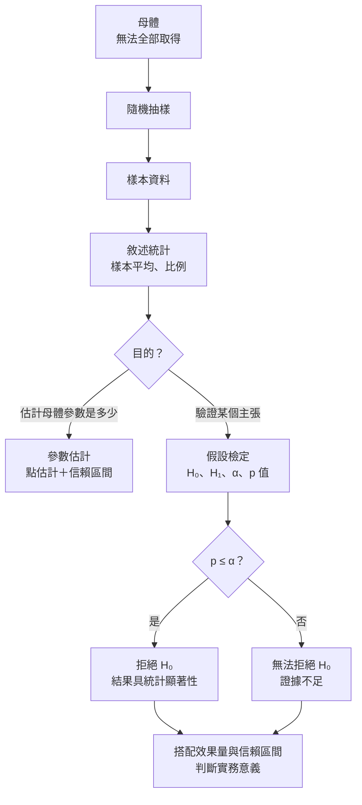
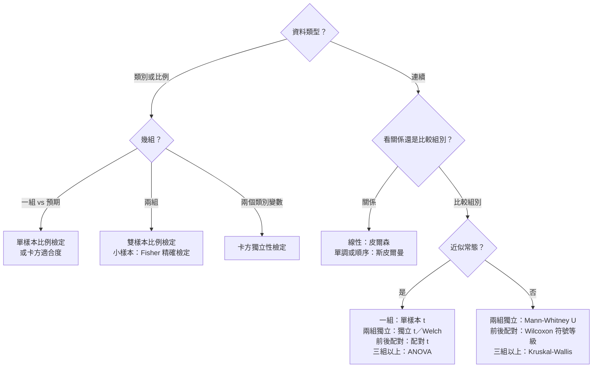

### Metadata
parent:: [[_【目錄】iPAS-AI應用規劃師(中級)：大數據處理分析與應用]]
sibling:: [[01敘述性統計與資料摘要技術]] · [[02機率分佈與資料分佈模型]]

## Key Points
> [!summary] 一句話看懂
> **假設檢定＝法庭審判：先假設被告無罪（虛無假設），除非證據強到「無罪的話幾乎不可能出現這種證據」，才判有罪（拒絕虛無假設）。**
> - **p 值**＝「如果被告真的無罪，出現這麼強（或更強）證據的機率」。
> - **證據不足判無罪 ≠ 證明他清白**：「無法拒絕 H₀」不等於「H₀ 為真」。

#### 統計推論兩大分支
| | 參數估計 | 假設檢定 |
|---|---|---|
| **問什麼** | 母體參數**大約是多少**？ | 某個**主張成立嗎**？ |
| **輸出** | 點估計＋**信賴區間**（如 95% CI） | **檢定統計量＋p 值** → 拒絕或不拒絕 H₀ |
| **例子** | 平均體重 68 公斤，95% CI [66, 70] | 新課程能減重嗎？p＝0.03 < 0.05 → 拒絕 H₀ |

#### 假設檢定五步驟
| 步驟 | 做什麼 |
|---|---|
| **① 設定假設** | **H₀**＝現狀、無差異、無效果；**H₁**＝想證明的新主張 |
| **② 選檢定方法** | 依資料類型、組數、是否常態選擇（見下表） |
| **③ 定顯著水準 α** | **事前**設定，常用 0.05；嚴格 0.01；探索 0.10 |
| **④ 算統計量與 p 值** | t 值、z 值、χ² 值、F 值 → 對照分佈算 p 值 |
| **⑤ 下結論** | **p ≤ α → 拒絕 H₀**；**p > α → 無法拒絕 H₀** |

#### 兩類錯誤
| | **H₀ 實際為真** | **H₀ 實際為假** |
|---|---|---|
| **拒絕 H₀** | ❌ **型一錯誤**（誤報、假陽性）機率＝**α** | ✅ 正確，機率＝**1 − β（檢定力）** |
| **不拒絕 H₀** | ✅ 正確，機率＝1 − α | ❌ **型二錯誤**（漏報、假陰性）機率＝**β** |

- **型一＝冤枉好人**（狼沒來卻喊狼來了）；**型二＝放走壞人**（狼來了卻沒喊）。

#### 檢定方法選擇總表
| 問題 | 資料 | 參數檢定 | 非參數替代 |
|---|---|---|---|
| 一組平均數 vs 已知值 | 連續 | **單樣本 t 檢定** | Wilcoxon 符號等級檢定 |
| **兩組獨立**的平均數 | 連續 | **獨立樣本 t 檢定**（變異數不等用 **Welch**） | **Mann-Whitney U** |
| **同一批人前後**比較 | 連續 | **配對樣本 t 檢定** | Wilcoxon 符號等級檢定 |
| **三組以上**的平均數 | 連續 | **單因子 ANOVA**（F 檢定） | **Kruskal-Wallis** |
| 一個比例 vs 預期值 | 二元 | **單樣本比例檢定**（Z） | 二項精確檢定 |
| 兩組比例（**A/B 測試**） | 二元 | **雙樣本比例檢定**（Z）或卡方 | **Fisher 精確檢定** |
| 兩個類別變數有無關聯 | 類別 | **卡方獨立性檢定** | Fisher 精確檢定 |
| 觀察分佈 vs 預期分佈 | 類別 | **卡方適合度檢定** | — |
| 兩個連續變數的**線性**關係 | 連續 | **皮爾森相關** | **斯皮爾曼等級相關**（單調關係） |

> [!warning] 陷阱題
> 1. **p 值 < 0.05 → 拒絕虛無假設**（官方考題原題）。
> 2. **判斷顯著性用 p 值**（與顯著水準 α 比較）（官方考題原題）。
> 3. **一組樣本平均 vs 既定值 → 單樣本 t 檢定**（官方考題原題）。
> 4. **p 值 > α → 「無法拒絕 H₀」，不能說「接受 H₀」或「證明 H₀ 為真」**。
> 5. **α 是事前設定的門檻；p 值是事後由資料算出的**。兩者不同。
> 6. **型一錯誤機率＝α；型二錯誤機率＝β；檢定力＝1 − β**。降低 α 會讓 β 上升（固定樣本數下）。
> 7. **同一批人前後測 → 配對 t 檢定**，誤用獨立樣本 t 檢定會失去檢定力。
> 8. **三組以上用 ANOVA，不要做好幾次 t 檢定**（會累積型一錯誤）；ANOVA 顯著後要做**事後檢定**（如 **Tukey HSD**）才知道是哪組不同。
> 9. **卡方檢定要用原始次數**，不能用百分比；**期望次數 < 5 → 合併類別或用 Fisher 精確檢定**。
> 10. **相關 ≠ 因果**；皮爾森只看**線性**、對離群值敏感；斯皮爾曼看**單調**、用排名。
> 11. **單尾或雙尾要事前決定**，不能看到結果再改。
> 12. **多重比較要校正**（如 **Bonferroni**：α ÷ 檢定次數）。
>
> ⚠️ **學習指引不精確的地方**
> - 第三章第 6 題解析把 p 值解釋成「觀察到現有樣本結果的機率」：漏了關鍵字。正確定義是「**在 H₀ 為真時，觀察到與現有結果相同或更極端的結果的機率**」（指引正文寫對了，解析寫錯）。p 值也**不是**「H₀ 為真的機率」。
> - 指引的雙樣本比例檢定表格中，雙尾對立假設寫成「p₁ **=** p₂」：應為「p₁ **≠** p₂」。
> - 指引寫單樣本 t 檢定「通常在**樣本數較小**（n < 30）時採用」：只要**母體標準差未知**（實務上幾乎都是），不論樣本大小都用 t 檢定；n 大時 t 分佈本來就趨近常態，結果與 z 檢定幾乎相同。
> - 指引寫 Mann-Whitney U 與 Kruskal-Wallis「比較**中位數**」：嚴格來說它們比較的是**整體分佈位置**（一組是否傾向比另一組大），只有在**各組分佈形狀相同**時，才能解釋為中位數差異（指引在注意事項中有提到，但開頭的定義容易誤導）。

> [!tip] PM 要記住的 3 件事
> 1. **顯著 ≠ 重要**：大數據下，轉換率從 3.00% 變 3.01% 也可能「顯著」，但值不值得做要看**效果量**與商業價值。
> 2. **A/B 測試不要「偷看」**：每天看結果、一顯著就停，型一錯誤會大幅膨脹。**先算好樣本數、跑完預定時間再看**。
> 3. **事前寫下假設與指標**：先決定主要指標、α、樣本數與單雙尾，避免事後挑對自己有利的結果（**p-hacking**）。

--- 
## Notes
### 全局地圖：從樣本到結論

- 統計推論是**根據部分推論整體**的科學方法，也是**機器學習與大數據分析的邏輯支柱**（例如：判斷新模型是否真的比舊模型好）。
- 前置知識：[[01敘述性統計與資料摘要技術]]、[[02機率分佈與資料分佈模型]]。

---

### 一、參數估計
#### 1. 點估計與區間估計
| 類型 | 說明 | 例子 |
|---|---|---|
| **點估計** | 用一個數字估計母體參數 | 樣本平均滿意度 4.2 分 |
| **區間估計** | 給出一個範圍，表達不確定性 | 95% 信賴區間 [4.0, 4.4] |

- 點估計**看不出不確定性**，所以實務上要搭配區間估計。

#### 2. 信賴區間的正確解讀
> [!example] 白話比喻
> 想像你用同一種方法**撒網抓魚 100 次**，每次撒出的網位置都不同。「95% 信賴區間」的意思是：**這種撒網方法，100 次中大約有 95 次網子會罩住真正的魚**。
> 至於**這一次**的網有沒有罩到，要嘛有、要嘛沒有，不是 95% 機率。

- ✅ 正確：若用相同方法重複抽樣並建立區間，約 **95% 的區間會包含真實母體參數**。
- ❌ 錯誤：「母體平均數有 95% 機率落在 [4.0, 4.4]」。

##### 影響信賴區間寬度的因素
| 因素 | 區間變窄（更精確） |
|---|---|
| **樣本數** | 越大 → 越窄（寬度約與 √n 成反比，樣本加 4 倍，寬度減半） |
| **資料變異** | 越小 → 越窄 |
| **信心水準** | 越低（如 90%）→ 越窄，但較不保險 |

- **信賴區間與假設檢定的關係**：若 95% 信賴區間**不包含 H₀ 的值**（例如差異的區間不包含 0），等同於在 α＝0.05 下拒絕 H₀。信賴區間**同時告訴你顯著與否和差異大小**，所以比單看 p 值更有資訊。

---

### 二、假設檢定的五個步驟
#### 1. ① 設定虛無假設與對立假設
| | 虛無假設 H₀ | 對立假設 H₁ |
|---|---|---|
| **定義** | 現狀、**無差異、無效果** | 想驗證的**新主張**：有差異、有效果 |
| **角色** | 檢定的**基準起點**，先假設它成立 | H₀ 被拒絕時才獲得支持 |
| **藥物例子** | 新藥與安慰劑效果相同 | 新藥效果不同於安慰劑 |
| **廣告例子** | 新舊廣告轉換率無差異 | 新廣告轉換率不同於舊廣告 |

##### 單尾與雙尾
| 類型 | H₁ | 使用時機 | 例子 |
|---|---|---|---|
| **雙尾** | μ ≠ μ₀ | 只想知道**有沒有差異**，不論方向 | 食品含鈉量是否與標準不同 |
| **左尾** | μ < μ₀ | 關注是否**變小、變差** | 藥物是否讓血壓下降 |
| **右尾** | μ > μ₀ | 關注是否**變大、改善** | 新版頁面是否提升轉換率 |

- 方向**必須事前決定**；不確定時用**雙尾**較保守。

#### 2. ② 選擇檢定方法
- 依據：**變數類型**（連續、類別）、**組數**（一組、兩組、三組以上）、**樣本是否獨立或配對**、**是否符合常態與變異數齊一**。
- 對照 Key Points 的「檢定方法選擇總表」。

#### 3. ③ 決定顯著水準 α
| α | 意義 | 適用 |
|---|---|---|
| **0.05** | H₀ 為真時，最多 5% 機率誤判 | **最普遍** |
| **0.01** | 更嚴格 | 藥物療效、安全風險、高金額決策 |
| **0.10** | 較寬鬆 | 初步探索、產生假說 |

- **多重比較問題**：做 20 次檢定、每次 α＝0.05，即使全部 H₀ 都為真，**至少一次誤判的機率約 64%**。
  - **Bonferroni 校正**：每次檢定的 α 改為 0.05 ÷ 檢定次數；簡單但較保守。
  - **Benjamini-Hochberg（控制 FDR）**：控制「宣稱顯著的結果中，誤判的比例」，大數據、大量指標分析時較常用。

#### 4. ④ 計算檢定統計量與 p 值
- **檢定統計量**：衡量「觀察結果離 H₀ 的預期有多遠」，例如 t 值、z 值、χ² 值、F 值。
- **p 值**：**在 H₀ 為真時，觀察到與樣本結果相同或更極端的結果的機率**。
  - p 值越小 → 在 H₀ 下越難出現這種結果 → 越有理由拒絕 H₀。

> [!warning] p 值的常見誤解（美國統計學會 2016 年聲明）
> - ❌ p 值是「H₀ 為真的機率」
> - ❌ p 值是「結果是巧合的機率」
> - ❌ p < 0.05 代表效果很大或很重要
> - ❌ p > 0.05 代表沒有效果
> - ✅ p 值只說明「資料與 H₀ 有多不相容」，**不能單獨作為決策依據**

#### 5. ⑤ 作出結論
- **p ≤ α**：拒絕 H₀，資料提供足夠證據支持 H₁。
- **p > α**：無法拒絕 H₀，**目前證據不足**。
  - 例：比較兩種教學法，p＝0.18 > 0.05 → 無法證明兩者有顯著差異，但**不代表兩者完全一樣**，可能只是樣本太少。

---

### 三、型一錯誤、型二錯誤與檢定力
#### 生活中的兩類錯誤
| 情境 | H₀ | 型一錯誤（誤報） | 型二錯誤（漏報） |
|---|---|---|---|
| **地震預警** | 沒有強震 | 沒地震卻發警報 | 有強震卻沒發警報 |
| **銀行防詐** | 交易正常 | 正常交易被擋 | 詐騙交易被放行 |
| **製造品管** | 產品合格 | 良品被判不合格，浪費 | 瑕疵品流入市場 |
| **入學篩選** | 考生不具資格 | 錄取不夠格的考生 | 錯失優秀考生 |
| **評論過濾** | 評論正常 | 正常評論被刪除 | 違規內容沒被抓到 |
| **藥品審查** | 新藥無效 | 無效藥被核准上市 | 有效藥被埋沒 |

- 與機器學習的對應：**型一錯誤＝偽陽性（FP）**、**型二錯誤＝偽陰性（FN）**；**檢定力＝召回率（Recall）的概念**。

#### 兩者的取捨
- 樣本數固定時，**降低 α → β 上升**，兩者無法同時降到極低。
- 怎麼選：

| 哪種錯誤代價高 | 策略 |
|---|---|
| **誤報代價高**（無效藥上市、錯誤指控） | 降低 α（如 0.01） |
| **漏報代價高**（錯過詐騙、錯過重大疾病） | 提高檢定力：**增加樣本數**、放寬 α |

#### 檢定力分析（Power Analysis）
- **檢定力 1 − β**：H₁ 為真時，能正確拒絕 H₀ 的機率；業界常要求 **≥ 80%**。
- 影響檢定力的四個因素：

| 因素 | 檢定力提高 |
|---|---|
| **樣本數** | 越大 |
| **效果量** | 真實差異越大 |
| **資料變異** | 越小 |
| **α** | 越寬鬆 |

- **事前用檢定力分析算出需要的樣本數**，是 A/B 測試設計的第一步。

> [!example] A/B 測試要多少樣本？
> 目前轉換率 5%，希望偵測到**提升到 5.5%**（相對提升 10%），α＝0.05、檢定力 80%，**每組大約需要 3 萬名使用者**。
> 想偵測更小的差異（如 5% → 5.1%），樣本數要多上**約 25 倍**。
> → **想偵測的差異越小，需要的樣本越多**，這直接決定測試要跑幾天。

---

### 四、常見檢定方法
#### 1. 平均數的差異檢定
適用：**連續變數**，資料近似常態（樣本大時可依中央極限定理放寬）。

##### (1) 單樣本 t 檢定
- **一組樣本的平均數 vs 已知值 μ₀**。
- 例：學生成績是否達標、產品平均重量是否符合規格、某食品含鈉量是否符合法規。
- **H₀：μ＝μ₀**。
- 前提：連續變數、隨機獨立抽樣、**母體標準差未知**、近似常態。
- 注意：
  - **母體標準差已知**（少見）→ 用 **Z 檢定**。
  - **不適用**比例、名目或順序資料。
  - 小樣本又明顯偏態 → 改用非參數的 **Wilcoxon 符號等級檢定**。

##### (2) 獨立樣本 t 檢定
- **兩組不同個體**的平均數比較。
- 例：兩種教學法的成效、兩種產品的滿意度、男女平均工時。
- **H₀：μ₁＝μ₂**。
- 前提：兩組獨立、連續變數、各組近似常態、**變異數相等**（用 **Levene 檢定**檢查）。
- 注意：
  - **變異數不相等或樣本數差很多 → 用 Welch t 檢定**（許多統計軟體已將它設為預設，實務上直接用 Welch 較保險）。
  - **同一批人的前後測不能用**，要用配對 t 檢定。

##### (3) 配對樣本 t 檢定
- **同一個體兩種情況**的比較，檢定的是「**差值**」的平均 μd。
- 例：治療前後血壓、產品改善前後性能、雙胞胎配對實驗。
- **H₀：μd＝0**。
- 前提：連續變數、成對資料、**差值**近似常態、各對之間獨立。
- 優點：控制了**個體間差異**，檢定力通常比獨立樣本 t 檢定高。

##### (4) 單因子變異數分析（One-way ANOVA）
- **三組以上**獨立樣本的平均數比較；用 **F 檢定**。
- 例：三種促銷方案的平均客單價、四個門市的平均滿意度。
- **H₀：μ₁＝μ₂＝…＝μk**；**H₁：至少有一組不同**。
- 原理：比較「**組間變異**」與「**組內變異**」的比值（F 值），組間差異遠大於組內波動時 F 值大。
- 前提：獨立樣本、應變數連續、自變數為類別、各組近似常態、**變異數齊一**。
- 注意：
  - **只告訴你「至少一組不同」**，要用**事後檢定**（**Tukey HSD**、Bonferroni）找出是哪幾組。
  - 只有兩組時用 t 檢定即可。
  - 變異數不齊 → **Welch ANOVA**；不符合常態 → **Kruskal-Wallis**。

#### 2. 比例與類別變數的比較
##### (1) 單樣本比例檢定
- **一個比例 vs 預期值 p₀**。
- 例：不良率是否超過標準、支持率是否過半、**模型準確率是否高於 90%**。
- **H₀：p＝p₀**。
- 前提：二元資料、獨立觀測、**常態近似條件 n×p₀ ≥ 5 且 n×(1−p₀) ≥ 5**；不符合時用**二項精確檢定**。
- 注意：p₀ 要有依據（歷史資料、業界標準、法規），不能隨意設定。

##### (2) 雙樣本比例檢定
- **兩組比例**的比較，**A/B 測試最常用**。
- 例：兩種廣告的點擊率、兩種藥物的治癒率。
- **H₀：p₁＝p₂**；雙尾 **H₁：p₁ ≠ p₂**。
- 前提：兩組獨立、二元資料、符合常態近似條件；事件太少時用 **Fisher 精確檢定**。
- 注意：
  - **前後測**等配對資料要用 **McNemar 檢定**。
  - 「**成功**」的定義兩組要一致（例如「點擊」是否包含誤觸）。

##### (3) 卡方檢定（χ²）
| 類型 | 問題 | H₀ | 例子 |
|---|---|---|---|
| **獨立性檢定** | 兩個類別變數有沒有關聯？ | 兩變數獨立 | 地區與偏好品牌是否有關 |
| **適合度檢定** | 觀察分佈是否符合預期？ | 觀察分佈＝預期分佈 | 骰子是否公平；各時段來客是否平均 |

- 原理：比較**觀察次數**與**期望次數**的差距：

$$\chi^2 = \sum \frac{(\text{觀察} - \text{期望})^2}{\text{期望}}$$

- 前提：類別資料、獨立觀測、**每格期望次數 ≥ 5**（不足時合併類別或用 Fisher 精確檢定）。
- 注意：
  - 要用**原始次數**，不能用百分比。
  - **顯著不等於關聯強**，要搭配 **Cramér's V** 或 **Phi 係數**評估關聯強度。
  - **樣本很大時，微小差異也會顯著**。

#### 3. 相關性分析
##### (1) 皮爾森相關檢定
- 衡量兩個**連續變數**的**線性**相關；r 介於 **−1 到 +1**。

| r 值 | 意義 |
|---|---|
| **r > 0** | 正相關：一個上升、另一個也上升 |
| **r < 0** | 負相關：一個上升、另一個下降 |
| **r ≈ 0** | **沒有線性關係**（但可能有曲線關係） |

- 經驗法則：|r| < 0.3 弱、0.3～0.7 中等、> 0.7 強。
- **H₀：ρ＝0**。
- 前提：連續變數、**線性關係**、近似常態、**無重大離群值**、獨立觀測。
- 注意：
  - **相關 ≠ 因果**：冰淇淋銷量與溺水人數正相關，真正原因是**天氣熱**（**干擾變數**）。
  - 只抓**線性**：拋物線關係的 r 可能接近 0。
  - **一個離群值就能大幅改變 r**，要先畫散佈圖。

##### (2) 斯皮爾曼等級相關檢定
- **非參數**，把資料轉成**排名**後計算相關；衡量**單調關係**（一起變大或一起變小，不必是直線）。
- 適用：**順序資料**（滿意度等級、排名）、**偏態或有離群值**的連續資料。
- 例：滿意度等級與推薦意願、社群活躍度與評價星等。
- 注意：不能用在無法排序的**名目資料**；非單調關係（先升後降）也偵測不到。

#### 4. 非參數檢定
- **不假設資料符合特定分佈**，多以**排名**為基礎。
- 適用：**不符合常態、有極端值、順序資料、小樣本**。
- 代價：資料若真的符合常態，非參數檢定的**檢定力較低**。

##### (1) Mann-Whitney U 檢定
- **兩組獨立樣本**，取代**獨立樣本 t 檢定**。
- 做法：兩組合併排名，比較各組的排名總和。
- **H₀：兩組來自相同分佈**；分佈形狀相似時可解釋為**中位數**有差異。
- 例：兩地區的購買意願評分、兩產品的星等評分。
- 注意：配對資料要改用 **Wilcoxon 符號等級檢定**；搭配效果量（如 rank-biserial 相關）解釋。

##### (2) Kruskal-Wallis 檢定
- **三組以上獨立樣本**，取代**單因子 ANOVA**。
- **H₀：所有組來自同一分佈**。
- 例：不同治療組的疼痛評分、不同廣告版本的偏好程度。
- 注意：顯著後要用 **Dunn 檢定**做事後比較；配對或重複測量設計要用 **Friedman 檢定**。

---

### 五、大數據與 A/B 測試實務
#### 1. 統計顯著 vs 實質重要
- **樣本數極大時，幾乎任何微小差異都會顯著**。
- 例：1,000 萬名使用者的 A/B 測試，轉換率 3.00% vs 3.02%，p 值可能小於 0.001，但實際差異可能**不足以支付改版成本**。
- 所以要報告**效果量**：

| 效果量 | 用途 |
|---|---|
| **差異值與信賴區間** | 最直覺：提升 0.02 個百分點，95% CI [0.01, 0.03] |
| **相對提升** | 轉換率提升 0.7% |
| **Cohen's d** | 平均數差異 ÷ 標準差；0.2 小、0.5 中、0.8 大 |
| **Cramér's V** | 卡方檢定的關聯強度 |

#### 2. A/B 測試常見陷阱
##### (1) 偷看結果（Peeking）
每天檢查結果，一出現顯著就停止測試。因為隨機波動有時會短暫「看起來顯著」，這樣做會讓**型一錯誤大幅膨脹**。

**對策**：事先算好需要的樣本數，跑完預定期間再看結果；如果業務上真的需要提早判斷，改用專門設計的**序列檢定**方法。

##### (2) 多重指標
同時看 20 個指標，就算新版本完全沒效果，也很可能有一個指標「剛好顯著」。

**對策**：事先決定**一個主要指標**作為成敗依據，其他指標當作輔助觀察，並做多重比較校正。

##### (3) 樣本比例不符（SRM）
設定 50/50 分流，實際卻是 52/48。這通常代表分流程式、資料記錄或使用者篩選出了問題，後面的結果都不可信。

**對策**：分析前先用**卡方適合度檢定**檢查分流比例，異常就先修正實驗設計。

##### (4) 新奇效應
新版本剛上線，使用者因為好奇而多點擊，過幾週就退燒，造成「短期很有效」的假象。

**對策**：測試至少涵蓋**完整的一到兩週**（包含平日與週末），並觀察效果是否隨時間衰退。

##### (5) 網路效應
使用者之間會互相影響，例如社群平台的分享、雙邊平台的買賣家，A 組的行為會影響 B 組，兩組不再獨立。

**對策**：改用依地區、群組或時間分流，而不是依個別使用者分流。

#### 3. 其他現代推論方法
##### (1) Bootstrap 重抽樣
從手上的樣本中**重複有放回地抽樣**數千次，每次都計算一次統計量，直接得到統計量的分佈與信賴區間。

適合**不想做分佈假設**，或指標比較複雜（例如中位數、兩個比例的比值）、沒有現成公式的情況。

##### (2) 貝氏 A/B 測試
不回答「p 值是多少」，而是直接回答「**B 比 A 好的機率是多少**」，以及「選 B 預期會損失多少」。結果更貼近商業決策的語言，主管比較容易理解。

##### (3) CUPED 等變異縮減技術
利用使用者**實驗前的行為資料**（例如過去一個月的消費金額）校正實驗結果，扣除個人原本就存在的差異，降低變異。大型平台用它來**以更少的樣本、更短的時間**得到可靠結論。

#### 4. 在 AI 專案中的應用
- **比較兩個模型**：在同一測試集上比較兩個分類模型，可用 **McNemar 檢定**；多次交叉驗證的分數可用**配對 t 檢定**。
- **上線後驗證**：新模型上線用 **A/B 測試**確認**業務指標**真的改善，而不只是離線分數變好。
- **漂移偵測**：用 **KS 檢定**、**卡方檢定**比較新資料與訓練資料的分佈（見 [[07AI風險管理]]）。

---

### PM 檢查清單：做 A/B 測試或解讀檢定結果的 8 個問題
1. **假設是什麼？** H₀ 與 H₁ 寫清楚了嗎？單尾還是雙尾？
2. **主要指標是哪一個？** 事前決定了嗎？
3. **樣本數夠嗎？** 做過檢定力分析嗎？要跑幾天？
4. **用對檢定了嗎？** 資料類型、組數、獨立或配對、是否常態？
5. **有沒有偷看或多重比較？** 需要校正嗎？
6. **分流比例正常嗎？** 有沒有 SRM？
7. **效果有多大？** 除了 p 值，信賴區間與效果量是多少？值得上線嗎？
8. **結果能推論到誰？** 測試期間與對象能代表全體使用者嗎？

---
## References
- iPAS AI應用規劃師(中級)學習指引 科目2：大數據處理分析與應用 — 3.3 假設檢定與統計推論、第三章考題解析
- Wasserstein, R. L. & Lazar, N. A. (2016). *The ASA Statement on p-Values: Context, Process, and Purpose*. The American Statistician
- Kohavi, R., Tang, D. & Xu, Y. (2020). *Trustworthy Online Controlled Experiments: A Practical Guide to A/B Testing*
- Benjamini, Y. & Hochberg, Y. (1995). *Controlling the False Discovery Rate*
- Cohen, J. (1988). *Statistical Power Analysis for the Behavioral Sciences*
![[AI應用規劃師(中級)-學習指引-科目2大數據處理分析與應用_20251222101850.pdf]]
