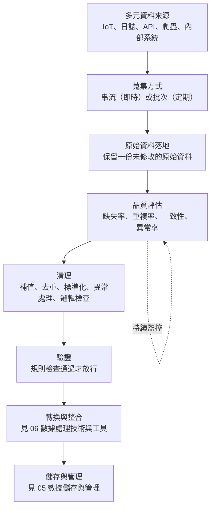
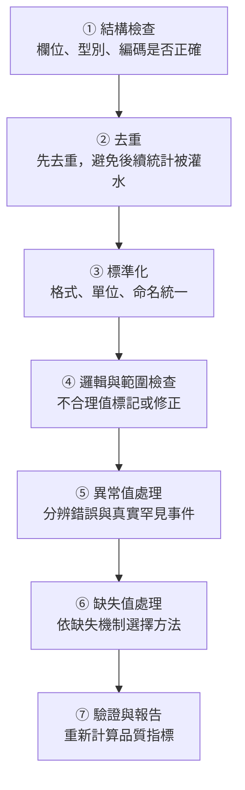

### Metadata
parent:: [[_【目錄】iPAS-AI應用規劃師(中級)：大數據處理分析與應用]]
sibling:: [[05數據儲存與管理]] · [[06數據處理技術與工具]]

## Key Points
> [!summary] 一句話看懂
> **資料收集與清理＝把四面八方送來、品質參差不齊的「原料」，整理成可以安心下鍋的「食材」。**
> 大數據的難處不是資料少，而是**來源多、格式雜、量大、來得快**；人工一筆一筆檢查行不通，必須靠**系統化的規則、指標與自動化管線**。

#### 五類資料來源速記
| 來源 | 資料型態 | 特性 | 蒐集工具 |
|---|---|---|---|
| **感測器與 IoT** | 結構化時間序列 | **高頻、連續、串流** | **MQTT**、**Kafka**、邊緣運算 |
| **系統日誌與行為紀錄** | 半結構化 | 量大、格式不一 | Logstash、Flume、NiFi、Fluentd |
| **API 與外部交換** | 半結構化（**JSON、XML**） | 有速率限制、格式會變 | REST API ＋ Airflow 排程 |
| **網路爬蟲與開放資料** | 各種 | 品質參差、有反爬機制 | Scrapy、BeautifulSoup、Playwright |
| **企業內部系統** | 結構化 | 品質較穩、更新較慢 | SQL 匯出、CDC、資料倉儲 |

#### 五種資料品質問題
| 問題 | 一句話 | 例子 |
|---|---|---|
| **缺失值** | 該有的值沒有 | 問卷年齡沒填、感測器斷線 |
| **異常值** | 偏離主體的極端值 | 單筆訂單數億元 |
| **重複值** | 同一筆出現多次 | 系統重試寫入兩次 |
| **一致性錯誤** | 格式、單位、命名不統一 | 「臺北市」vs「台北市」、公斤 vs 磅 |
| **邏輯錯誤** | 格式對但不合理 | 出生年 1890、體溫 43°C |

#### 缺失值三種機制（必考）
| 類型 | 缺失與什麼有關 | 例子 | 刪除缺失資料會不會有偏誤 |
|---|---|---|---|
| **MCAR** 完全隨機缺失 | **跟任何東西都無關** | 問卷頁面偶發當機 | 不會（只損失樣本數） |
| **MAR** 隨機缺失 | 跟**其他已觀察到的欄位**有關 | **年輕人**比較常不填收入（年齡有記錄） | 可能會；可用其他欄位輔助填補 |
| **MNAR** 非隨機缺失 | 跟**缺失的那個值本身**有關 | **高收入者**比較不願意填收入 | **會**，最難處理 |

> [!warning] 陷阱題
> 1. **感測器與機台資料＝高頻率、串流型資料**（官方考題原題）。
> 2. **處理缺失值＝遺漏值補全（Imputation）**（官方考題原題）。
> 3. **IoT 資料處理架構的關鍵＝即時串流處理與低延遲反應**（Kafka、Spark Streaming）（官方考題原題）。
> 4. **把文字欄位統一格式（如「臺／台」）＝資料轉換**，不是正規化或資料結構規劃（官方考題原題）。
> 5. **資料驗證＝檢查資料格式與邏輯是否正確**（官方考題原題）。
> 6. **JSON、XML＝半結構化**；表格＝結構化；文字、影像、影片＝非結構化。
> 7. **MAR 與 MNAR 的差別**：缺失原因是「**別的欄位**」→ MAR；是「**它自己的值**」→ MNAR。
> 8. **異常值不一定要刪**：可能是輸入錯誤，也可能是真實的罕見事件（詐欺、設備故障），要靠領域知識判斷。
> 9. **重複值會高估次數與總量**，讓卡方檢定、銷售統計失真。
> 10. **缺失率低（如 < 5%）且屬 MCAR 時**，直接刪除影響較小；其他情況刪除可能造成偏誤。
>
> ⚠️ **學習指引錯誤的地方**
> - 指引把「**高收入者較不填寫**」當作 **MAR** 的例子：這是 **MNAR**，因為缺不缺跟「收入」這個值本身有關。MAR 的正確例子是「**年輕人較常不填收入**」，缺失與已記錄的年齡有關。
> - 指引把「**特定族群不回應**」當作 MNAR：如果「族群」是資料中已記錄的欄位，這其實是 **MAR**；只有當缺失取決於未被記錄的值本身時才是 MNAR。
> - 指引說可「**使用可處理缺失值的演算法（如隨機森林）**」：傳統隨機森林實作多數**不能直接吃缺失值**；原生支援缺失值的代表是 **XGBoost、LightGBM、CatBoost** 等梯度提升樹（新版 scikit-learn 的部分樹模型也開始支援）。

> [!tip] PM 要記住的 3 件事
> 1. **資料品質問題要追到源頭**：清理只是止血；同一個錯誤每天出現，就要回頭修**表單設計、系統介接或感測器**。
> 2. **清理規則要寫成文件、可以重跑**：「把負數金額刪掉」這種決定會影響分析結果，要記錄、要版本控管，不能只存在某位工程師的電腦裡。
> 3. **品質指標要上儀表板**：缺失率、重複率、異常率每天自動檢查，超過門檻就通知，比等模型壞掉再查快得多。

--- 
## Notes
### 全局地圖：從資料來源到可用資料

- 這一階段的決策會**直接影響後續的儲存架構、清理成本與分析模型設計**。
- 機器學習角度的資料準備（特徵工程、資料切分、資料洩漏）見 [[08數據準備與模型選擇]]。

---

### 一、資料來源與蒐集方式
#### 1. 大數據的資料型態
傳統系統主要處理**結構化資料**（關聯式資料庫的表格），大數據環境則同時面對三種型態，每一種的蒐集、儲存與清理方式都不同：

- **結構化資料**：有固定欄位與型別的表格，例如交易紀錄、庫存表。最好處理，用 SQL 就能查詢。
- **半結構化資料**：有標籤或鍵值結構，但**欄位不固定**，例如 **JSON、XML**、網站日誌。今天的 API 回傳可能多一個欄位、明天少一個，處理時要能容忍結構變動。
- **非結構化資料**：沒有預先定義的結構，例如**文字、影像、影片、音訊**。需要 NLP、電腦視覺等技術才能萃取出可分析的資訊。

#### 2. 五類常見資料來源
##### (1) 感測器與物聯網（IoT）設備
這類資料最大的特性是**高頻率、連續、以時間序列為主**，例如每秒回傳一次溫度與震動數值的工廠機台、車流感測器、智慧電錶、氣象站。單一設備的資料量不大，但成千上萬台設備加起來，就是持續不斷的資料洪流。

蒐集時通常用**輕量的串流協定**：
- **MQTT**：專為 IoT 設計的輕量訊息協定，適合頻寬有限、連線不穩的裝置。
- **Apache Kafka**：高吞吐量的分散式訊息平台，負責把大量即時資料可靠地送進後端系統。

常搭配**邊緣運算**先在現場做初步處理（過濾雜訊、彙總成每分鐘平均），再上傳雲端，減少頻寬與儲存壓力。

主要挑戰是**傳輸穩定與低延遲**：網路一斷，資料就可能遺漏或重複送出；**高併發**的資料流也考驗後端承載能力。

##### (2) 系統日誌與使用者行為紀錄
伺服器日誌（Web Log）、App 點擊事件、設備操作軌跡等，由系統**自動產生**，能反映**使用者行為模式**與**系統效能**。多屬半結構化資料。

蒐集工具：
- **Logstash、Fluentd、Flume**：收集、解析並轉送日誌。
- **Apache NiFi**：以視覺化方式設計資料流。
- 常存放於 **Elasticsearch**（方便搜尋）或資料湖。

產品分析常用的**事件追蹤**（如 Google Analytics、Mixpanel、Amplitude）也屬於這一類。

主要挑戰：**不同系統的日誌格式不一致**，需要先標準化；高頻日誌會帶來**儲存壓力**，要規劃保存期限與壓縮。

##### (3) API 與外部資料交換
透過 API 從第三方平台取得資料，例如金融市場報價、社群媒體、地圖服務、天氣資料，多以 **JSON 或 XML** 傳輸。

蒐集方式通常是**程式定期或即時呼叫 RESTful API**，再用 **Apache Airflow** 等工具排程與整合。

主要挑戰：
- **速率限制**：每分鐘只能呼叫幾次，大量擷取需要排隊與重試機制。
- **認證與授權**：API 金鑰需要安全保管。
- **格式變動**：對方改版時欄位可能改名或消失，解析程式要能偵測並發出警告，而不是默默寫入錯誤資料。

##### (4) 網路爬蟲與開放資料
- **網路爬蟲**：用 **Scrapy、BeautifulSoup**，或能操作瀏覽器的 **Playwright、Selenium**，自動擷取網頁上的價格、評論、新聞。
- **開放資料平台**：政府資料開放平臺（**data.gov.tw**）、美國 data.gov、Kaggle 資料集等。

主要挑戰：
- 網站的**反爬機制**（驗證碼、封鎖 IP）。
- **法律與合規**：要遵守網站服務條款與 robots.txt，注意**著作權**與**個資**；爬取個人資料可能違反個資法。
- 開放資料**品質參差不齊**，要額外驗證。

##### (5) 企業內部營運系統
**ERP、CRM、POS** 等系統的交易、客戶、庫存資料，屬於**結構化資料**，品質相對穩定。

蒐集方式：
- **批次匯出**：每天晚上用 SQL 查詢或 CSV 匯出。
- **CDC（Change Data Capture，異動資料擷取）**：只擷取**有變動的資料**，不必每次全量匯出，接近即時又省資源，是現代資料整合的主流做法。
- 集中到**雲端資料倉儲**（如 Snowflake、Google BigQuery）。

主要挑戰：**跨部門整合**時，同一個概念在不同系統的欄位名稱與定義不同（業務的「客戶」和財務的「客戶」可能不是同一群人）；歷史資料可能有遺漏或不一致。

#### 3. 串流與批次：怎麼選蒐集方式
- **批次（Batch）**：定期收集一大批資料一次處理。成本低、架構簡單，適合每日報表、月結分析。
- **串流（Streaming）**：資料一產生就即時處理。適合**即時推薦、詐欺偵測、設備異常警報**等「晚幾分鐘就沒價值」的情境。

決策時要一起考慮五個因素：**更新頻率、格式轉換需求、即時性要求、資料品質、隱私與合規**（GDPR、CCPA、台灣個資法）。

> [!example] 智慧零售的多來源整合
> 一家連鎖零售同時蒐集：
> - **POS 交易**（結構化）→ 每晚批次匯入資料倉儲
> - **線上行為日誌**（半結構化）→ 即時串流，用於即時推薦
> - **社群評論**（非結構化）→ 定期爬取，做情感分析
>
> 三種資料最後依「顧客 ID」與「商品 ID」整合，才能拼出完整的顧客輪廓。

---

### 二、資料品質問題與評估
#### 1. 為什麼大數據的資料品質更難管
資料品質是所有分析、統計推論與模型的基礎，**低品質資料會讓統計檢定得出錯誤結論、讓模型學到偏差**。大數據環境讓問題放大：
- **量大**：不可能人工逐筆檢查。
- **來源多**：每個來源各有各的問題。
- **結構異質**：結構化、半結構化、非結構化的檢查方法都不同。
- **持續流入**：今天乾淨，明天上游系統一改版就壞了。

所以要**系統性地辨識問題類型**，並用**量化指標**持續監控。

#### 2. 五種常見資料品質問題
##### (1) 缺失值（Missing Data）
**是什麼**：該有值的欄位是空的。原因可能是使用者沒填、感測器故障、系統錯誤、傳輸中斷。

**為什麼要區分缺失機制**：同樣是「空白」，背後原因不同，處理方式就不同。處理錯了，分析結果會**系統性偏差**。

- **MCAR（完全隨機缺失）**：缺失與任何因素都無關，例如問卷系統偶發當機。這種情況直接刪除只會減少樣本數，**不會造成偏差**。
- **MAR（隨機缺失）**：缺失與**其他已觀察到的欄位**有關，例如年輕人比較常不填收入，而年齡有被記錄。可以**利用年齡等其他欄位來推估填補**，降低偏差。
- **MNAR（非隨機缺失）**：缺失與**該值本身**有關，例如高收入者因為收入高而不願填。這時不論刪除或用平均數填補，都會**低估平均收入**，是最難處理的情況，通常需要額外蒐集資料或用領域知識建模。

> [!example] 缺失值如何誤導決策
> 滿意度問卷中，**非常不滿意的顧客往往直接不回覆**（MNAR）。只看有回覆的人，平均滿意度 4.5 分，看起來很好；但實際上沉默的那群人才是流失風險最高的客群。

**影響**：造成樣本偏差，讓平均數估計失準（例如 t 檢定的平均數偏高）；許多模型（如線性迴歸）**無法直接處理空值**。

**處理策略**：
- **刪除**：缺失比例低且屬 MCAR 時可以直接刪除整筆紀錄；某欄缺失比例過高時，可考慮刪除整個欄位。
- **簡單填補**：平均數、中位數（偏態資料較穩）、眾數（類別資料）。快速但會**低估變異**。
- **時間序列填補**：用前一個或後一個值（前後值填補）、內插法，適合感測器資料。
- **模型填補**：**KNN 填補**（找相似的資料借值）、迴歸預測、**多重插補（Multiple Imputation）**，較準確但較耗時。
- **保留並標記**：新增一個「是否缺失」的欄位，因為**缺失本身可能就是有用的訊號**；並使用能原生處理缺失值的模型（如 XGBoost、LightGBM）。

##### (2) 異常值（Outliers）
**是什麼**：明顯偏離資料主體分佈的極端值。來源有兩種，處理方式完全相反：
- **錯誤造成的**：輸入錯誤（多打三個零）、設備故障、單位錯誤 → 應**修正或移除**。
- **真實但罕見的**：大客戶的超大訂單、詐欺交易、設備即將故障的訊號 → 應**保留**，甚至它就是分析的重點。

**影響**：扭曲平均數與標準差，影響 t 檢定與迴歸的結果。

**偵測方法**：
- **Z 分數**：離平均數超過 3 個標準差。適合近似常態的資料。
- **IQR 法**：小於 Q1 − 1.5×IQR 或大於 Q3 + 1.5×IQR。不受極端值本身影響，適合偏態資料（詳見 [[01敘述性統計與資料摘要技術]]）。
- **孤立森林（Isolation Forest）**：用機器學習找出「很容易被孤立」的點，適合**多維度**資料。

**處理方式**：依領域知識決定**保留、修正、移除**，或用**截尾**（Winsorizing）把極端值壓到某個上下限（如第 1 與第 99 百分位數）。

> [!example] 同樣是異常，處理不同
> - 醫療系統記錄某患者心率 250 下／分鐘 → 先與醫護確認，可能是儀器錯誤，也可能是真正的緊急狀況。
> - 電商記錄單筆訂單 3 億元 → 幾乎確定是輸入錯誤，應修正。
> - 信用卡凌晨在海外連續刷 20 筆 → 這正是詐欺模型要抓的目標，**絕對不能刪**。

##### (3) 重複值（Duplicates）
**是什麼**：同一個觀察單位在資料中出現多次。常見原因：
- 系統**重試機制**重複寫入同一事件。
- **多來源整合**時，同一位客戶在 CRM 與電商系統各有一筆。
- 缺少**唯一識別碼**。

**影響**：**高估次數與總量**（銷售額灌水）、扭曲卡方檢定的頻次分佈、讓模型過度重視某些樣本。

**處理策略**：
- **偵測**：用唯一 ID 或關鍵欄位組合（如「姓名＋生日＋手機」）找重複。
- **移除**：完全相同的紀錄保留一筆（第一筆或最新一筆）。
- **合併**：不同來源的紀錄各有部分資訊時，要**整合後再去重**。這在實務上稱為**實體解析（Entity Resolution）**，例如「王小明，0912-345-678」與「王曉明，0912345678」可能是同一人，需要模糊比對。

##### (4) 一致性錯誤（Inconsistency）
**是什麼**：同一種資訊在**單位、命名或格式**上不統一，常見於多來源整合與人工輸入：
- 「臺北市」與「台北市」
- 日期「2023/01/01」與「Jan-1-2023」
- 重量混用公斤與磅
- 性別欄位同時出現「男、M、1、Male」

**影響**：無法正確**彙總與比較**。例如依縣市統計時，台北市被拆成兩組；ANOVA 比較各組平均時，單位混用讓結果完全錯誤。

**處理策略**：**標準化**，建立統一規則並寫成對照表：日期一律 **ISO 8601（YYYY-MM-DD）**、單位一律公制、類別值統一代碼。

##### (5) 邏輯錯誤與不合理資料（Logical Errors）
**是什麼**：格式完全正確，但**違反常識或領域知識**：
- 出生年份 1890 → 客戶 136 歲。
- 交易金額為負數 → 除非是退貨，否則不合理。
- 體溫 43°C → 生理上幾乎不可能。
- 出貨日期早於下單日期。

**為什麼特別麻煩**：格式檢查抓不到，要靠**業務規則**。

**處理策略**：
- **定義規則**：年齡 0～120、金額 ≥ 0（退貨除外）、出貨日 ≥ 下單日。
- **與領域專家合作**：什麼算「不合理」，往往只有業務單位知道。
- 這類檢查就是考題中的**資料驗證（Data Validation）**：確認資料符合預期的**格式與邏輯規則**。

#### 3. 資料品質的量化指標
面對大規模資料，必須用**可計算、可追蹤**的指標，才能找出問題、排優先順序、評估改善成效：

- **缺失率**：各欄位空值的比例。缺失率突然升高，常代表**收集流程出問題**（例如 App 改版後某個欄位沒送出）。
- **唯一值比率**：主鍵（用戶 ID、交易編號）是否重複。主鍵重複會**破壞整合與關聯分析**。
- **一致性比率**：格式、單位、命名符合標準的比例。
- **異常值比率**：超出合理範圍或統計門檻的比例，需搭配領域知識判讀。
- **完整性比率**：一個觀察對象是否具備足夠的描述資料，例如用戶同時有基本資料與行為紀錄的比例。

這些指標不只用於一次性檢查，更應**內嵌到資料管線**中：每批資料進來就自動計算，超過門檻就暫停並通知，避免壞資料一路流進報表與模型。

---

### 三、資料清理的策略與實務
#### 清理的基本原則
- **永遠保留原始資料**：清理後的資料另存一份，原始資料不覆蓋。萬一清理規則有誤，還能重來。
- **規則化、可重現**：清理步驟寫成程式或設定檔，並做版本控管，任何人重跑都得到相同結果。
- **記錄每一個決策**：例如「刪除了 2.3% 金額為負的紀錄，因為確認是測試資料」，讓後續分析者知道資料經過什麼處理。
- **先診斷、再處理**：先算品質指標、畫分佈圖，搞清楚問題的規模與原因，再決定處理方式。
- **與業務單位確認**：異常值與邏輯錯誤的判斷標準，要由懂業務的人參與。

#### 建議的清理順序

- **為什麼缺失值放在後面**：先把重複、錯誤格式、不合理值處理掉，算出來的平均數、中位數才可靠，用來填補缺失值才不會被污染。

#### 自動化品質檢查工具
在大數據環境中，品質檢查要自動化，業界常見做法：
- **Great Expectations**、**Soda**、**dbt tests**：把品質規則寫成「預期」，例如「訂單金額必須 ≥ 0」「客戶 ID 不可重複」，每次資料更新自動檢查。
- **資料契約（Data Contract）**：資料提供方與使用方事先約定欄位、格式與品質標準，上游改版前必須通知，減少「上游一改、下游全壞」的情況。
- **資料可觀測性（Data Observability）**：持續監控資料的**新鮮度、量、分佈、結構變化**，像監控系統健康一樣監控資料健康。

#### AI 輔助資料清理
大型語言模型也開始用在清理工作上，特別適合過去靠人工的部分：
- **非結構化資料萃取**：從客服對話、PDF、掃描文件中抽出結構化欄位。
- **文字標準化**：把五花八門的地址、公司名稱、產品名稱統一。
- **實體解析**：判斷兩筆名稱略有不同的紀錄是否為同一對象。

但要注意：大型模型可能**出錯或幻覺**，需抽樣人工驗證；處理個資時要確認是否符合隱私規範。

---

### PM 檢查清單：資料收集與清理 8 問
1. **資料從哪來？** 每個來源的擁有者、更新頻率、格式是什麼？
2. **需要即時嗎？** 批次就夠，還是必須串流？
3. **能合法使用嗎？** 爬蟲、第三方 API、個資的授權與合規確認了嗎？
4. **品質現況如何？** 缺失率、重複率、異常率各是多少？
5. **缺失是怎麼發生的？** MCAR、MAR 還是 MNAR？刪除會造成偏差嗎？
6. **異常值是錯誤還是訊號？** 業務單位確認過了嗎？
7. **清理規則有文件、可重跑嗎？** 原始資料有保留嗎？
8. **有沒有持續監控？** 上游改版時，誰會第一個知道？

---
## References
- iPAS AI應用規劃師(中級)學習指引 科目2：大數據處理分析與應用 — 4.1 數據收集與清理、第四章考題解析
- Little, R. J. A. & Rubin, D. B. (2019). *Statistical Analysis with Missing Data* (3rd ed.)
- DAMA International. *DAMA-DMBOK: Data Management Body of Knowledge*
- Great Expectations Documentation
![[AI應用規劃師(中級)-學習指引-科目2大數據處理分析與應用_20251222101850.pdf]]
