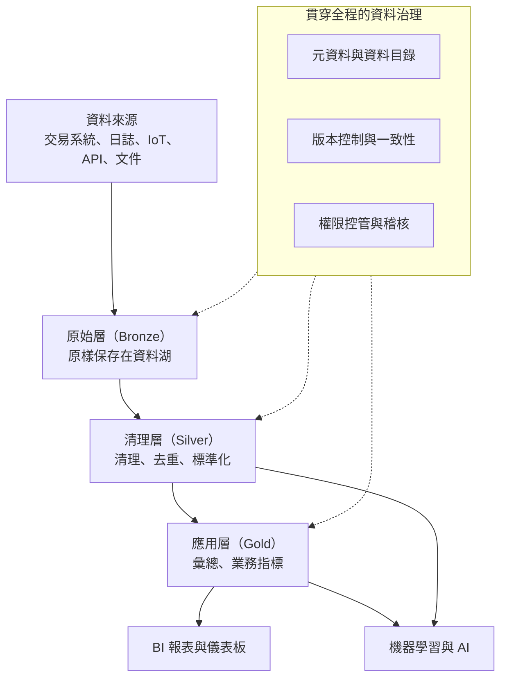
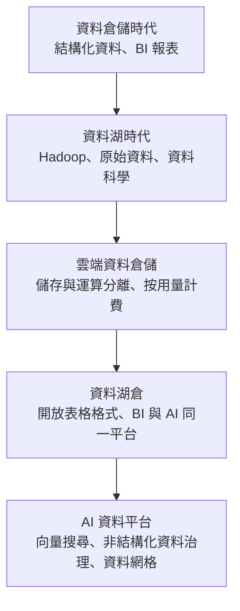

### Metadata
parent:: [[_【目錄】iPAS-AI應用規劃師(中級)：大數據處理分析與應用]]
sibling:: [[04數據收集與清理]] · [[06數據處理技術與工具]]

## Key Points
> [!summary] 一句話看懂
> **資料儲存與管理＝替公司蓋一座「圖書館」：不只要放得下（儲存），還要找得到（查詢效能）、版本對得上（一致性與版本控制）、不該看的人看不到（治理與權限）。**
> 資料量從 GB 長到 PB 之後，一台主機撐不住，必須改用**分散式儲存**；資料型態變多之後，一種資料庫也撐不住，要**依資料型態選儲存方式**。

#### 三種資料型態 → 儲存方式
| 型態 | 例子 | 主要儲存方式 | 優勢 | 限制 |
|---|---|---|---|---|
| **結構化** | ERP、CRM、POS 交易 | **關聯式資料庫**（MySQL、PostgreSQL、Oracle） | SQL、**ACID** | 結構固定，改欄位麻煩 |
| **半結構化** | **JSON、XML、YAML**、API 回應 | **文件型 NoSQL**（MongoDB）、Elasticsearch、資料湖 | 欄位彈性 | 驗證與查詢邏輯要自訂 |
| **非結構化** | 文字、圖片、影片、PDF | **物件儲存**（Amazon S3、MinIO）、HDFS | 便宜、無限擴充 | 難直接搜尋，要靠元資料與索引 |

#### 資料倉儲 vs 資料湖 vs 資料湖倉
| | 資料倉儲 | 資料湖 | 資料湖倉 |
|---|---|---|---|
| **存什麼** | 清理過的結構化資料 | **原始格式**的各種資料 | 兩者皆可 |
| **結構定義** | **寫入時定義**（Schema-on-Write） | **讀取時定義**（Schema-on-Read） | 開放表格格式管理結構 |
| **ACID** | 有 | 傳統沒有 | **有** |
| **擅長** | BI 報表 | 資料科學、機器學習、探索 | 一個平台兼顧 BI 與 AI |
| **代表** | Snowflake、BigQuery、Redshift | HDFS＋Hive、S3 | **Delta Lake、Iceberg、Hudi**、Databricks |

#### 一致性模型
| 模型 | 意思 | 適合 |
|---|---|---|
| **強一致性** | 寫入後，**所有人立刻讀到最新值** | 金融交易、帳務、庫存扣減 |
| **最終一致性** | 短時間內各節點可能不同步，**最後會一致** | 社群按讚數、商品瀏覽數、快取 |

#### 四種存取控制模型
| 模型 | 依據 | 適合 |
|---|---|---|
| **RBAC** 角色 | 使用者的**角色**（分析師、主管） | 中小企業、部門制，最常見 |
| **ABAC** 屬性 | 使用者、資料、環境的**屬性**（部門、地點、時間、裝置） | 大型企業、高安全需求 |
| **PBAC** 策略 | 預先定義的**複合策略規則**（如 OPA） | 雲端、跨系統統一控管 |
| **DAC** 自主 | 資料**擁有者自己決定**給誰 | 研發環境、小團隊 |

> [!warning] 陷阱題
> 1. **結構不固定的 JSON／XML → 文件型 NoSQL 資料庫**（如 MongoDB）（官方考題原題）。
> 2. **分散式儲存的核心＝跨節點資料切分與冗餘備援**，提高可用性與容錯（官方考題原題）。
> 3. **資料湖的特色＝支援多樣資料型態，且不需預先定義結構**（官方考題原題）。
> 4. **Schema-on-Read＝讀的時候才套結構（資料湖）**；**Schema-on-Write＝寫入前就要符合結構（資料倉儲、關聯式資料庫）**。
> 5. **ACID＝原子性、一致性、隔離性、持久性**；原子性＝「全做或全不做」。
> 6. **資料湖倉＝資料湖的彈性＋資料倉儲的 ACID 與治理**；代表技術 Delta Lake、Apache Iceberg、Apache Hudi。
> 7. **欄式儲存（Columnar，指引稱「列式儲存」，如 Parquet、ORC）適合分析查詢**：只讀需要的欄位、壓縮率高。
> 8. **分區（Partitioning）＝依時間、地區等切分資料，縮小查詢掃描範圍**。
> 9. **物化檢視＝預先算好並存起來的查詢結果**，適合重複的報表查詢。
> 10. **零信任＝不預設信任任何人與裝置**，即使在內部網路也要持續驗證、最小權限。
> 11. **元資料＝描述資料的資料**；**資料血緣＝資料從來源到使用的流向**。
>
> ⚠️ **學習指引錯誤或過時的地方**
> - 指引把 **Amazon S3 與 HDFS** 列為**最終一致性**的例子：**Amazon S3 自 2020 年 12 月起已提供強一致性**（寫入後立即讀到最新內容）；**HDFS 由單一 NameNode 管理中繼資料，本身也是強一致**。最終一致性的典型例子是 **Cassandra、DynamoDB（預設讀取模式）、DNS、跨區域複寫**。
> - 指引把 **Delta Lake、Iceberg** 當作「**金融交易、帳務處理**」的強一致性技術：它們提供的是**分析資料平台上的 ACID**，確保批次寫入不會讀到一半的結果；真正的**線上交易與帳務**仍由**關聯式資料庫**（OLTP）處理。

> [!tip] PM 要記住的 3 件事
> 1. **先問「這份資料要怎麼被用」再選儲存**：要即時交易用關聯式資料庫；要做報表用資料倉儲；要給 AI 訓練或存原始檔用資料湖；要做語意搜尋用向量資料庫。
> 2. **資料湖沒有治理就會變成「資料沼澤」**：一堆檔案沒人知道是什麼、能不能用。**資料目錄、負責人、權限**從第一天就要建。
> 3. **儲存很便宜，掃描很貴**：雲端資料倉儲多依「掃描量」計費，**分區、欄式格式、只查需要的欄位**能直接省下大筆費用。

--- 
## Notes
### 全局地圖：現代資料平台

- 圖中的**分層設計**（原始 → 清理 → 應用）在業界常稱為**獎章架構（Medallion Architecture）**：資料逐層提煉，每一層都保留，出錯時可以從前一層重做。
- 前一步的資料蒐集與清理見 [[04數據收集與清理]]；資料如何被處理與轉換見 [[06數據處理技術與工具]]。

---

### 一、為什麼大數據需要新的儲存方式
#### 傳統單機資料庫的極限
傳統做法是一台主機配一個關聯式資料庫。資料量來到 **TB、PB 甚至 EB 級**之後，會遇到三個問題：

- **容量**：一台主機的硬碟再大也有上限。
- **效能**：大量使用者同時讀寫，單機處理不過來。
- **可用性**：這台主機一壞，整個服務就停擺。

解法是**橫向擴充（Scale Out）**：與其買一台更大的主機（**垂直擴充**，Scale Up），不如用很多台普通主機組成叢集，資料分散存放，壞一台還有其他台頂著。

#### 資料管理的範圍也變大了
資料管理不再只是「把資料存好」，而是整個平台的**生命週期治理**：
- **一致性控制**：多個系統同時寫入時，資料不能打架。
- **版本紀錄**：能查到資料過去的樣子。
- **存取權限**：誰能看、誰能改。
- **合規稽核**：誰在什麼時候看了什麼，要能查得到。

---

### 二、資料型態與對應的儲存技術
#### 結構化資料：關聯式資料庫
**特性**：有**明確欄位定義與固定資料型別**，像 Excel 表格一樣整齊，資料之間的關聯清楚（例如「訂單」關聯到「客戶」）。主要來自 **ERP、CRM、POS** 等核心營運系統。

**儲存方式**：**關聯式資料庫管理系統（RDBMS）**，如 MySQL、PostgreSQL、Oracle。資料以**表格**組織，欄位型別嚴格，可建立**索引**加速查詢。

**優勢**：
- 用 **SQL** 查詢，人才多、工具成熟。
- 支援**完整性約束**（例如訂單一定要對應到存在的客戶）。
- 支援 **ACID 交易**，確保資料正確（詳見第五部分）。

**限制**：**結構固定**，要新增或修改欄位需要調整資料表結構（Schema），對頻繁變動的資料不夠靈活；也比較難水平擴充到極大規模。

#### 半結構化資料：NoSQL 與搜尋引擎
**特性**：沒有固定欄位，但有**層次與標記**，如 **JSON、XML、YAML**。常見於 API 回應、網頁擷取、IoT 資料封包。同一類資料，這筆可能有 5 個欄位、那筆有 8 個。

**儲存方式**：
- **文件型 NoSQL 資料庫**（如 **MongoDB**）：每筆資料就是一份 JSON 文件，欄位可以不同。
- **全文搜尋引擎**（如 **Elasticsearch**）：擅長關鍵字搜尋與日誌分析。
- **資料湖**：直接以檔案保存。

**優勢**：格式彈性高，適合整合**異質資料**、欄位常變動的情境。

**限制**：缺少結構約束，**資料驗證與查詢邏輯要自己寫**；欄位亂寫也不會報錯，品質更依賴治理。

#### 非結構化資料：物件儲存
**特性**：沒有明確格式，例如**文字、圖片、音訊、影片、PDF**。來源包括社群貼文、客服紀錄、監視影像、通話錄音。

**儲存方式**：
- **物件儲存**（如 **Amazon S3**、Google Cloud Storage、開源的 **MinIO**）：每個檔案是一個「物件」，搭配一組元資料，容量幾乎無限、成本低。
- **分散式檔案系統**（如 **HDFS**）。

**管理方式**：檔案本身無法直接搜尋，要依賴**元資料（Metadata）、標籤與內容索引**。例如替每張商品圖記錄「商品 ID、拍攝日期、類別」，才找得到。

**挑戰**：檔案量大、難以比對，需要搭配**標註**與 **AI 處理**（如影像辨識、語音轉文字）把內容轉成可搜尋的資訊。

> [!example] 一家電商的三種資料
> - **訂單紀錄** → 結構化 → 關聯式資料庫
> - **商品描述**（規格欄位因商品類別而不同）→ 半結構化 → 文件型資料庫
> - **商品圖片與顧客留言** → 非結構化 → 物件儲存
>
> 三者要靠「商品 ID」串起來，並放進統一的資料湖架構管理。

#### NoSQL 的四種類型
NoSQL 不是一種資料庫，而是「**非關聯式**」資料庫的統稱，依資料模型分成四類，各有擅長：

- **鍵值型（Key-Value）**：像一個超大的字典，用鍵快速取值。例：**Redis**、DynamoDB。適合**快取**、購物車、登入狀態。
- **文件型（Document）**：存 JSON 文件，欄位彈性。例：**MongoDB**。適合商品目錄、內容管理、使用者設定。
- **寬欄型（Wide-Column）**：依欄族存放，適合**超大量寫入**。例：**Cassandra**、HBase。適合 IoT 時間序列、訊息紀錄。
- **圖形型（Graph）**：存「節點」與「關係」。例：**Neo4j**。適合**社群關係、詐騙網絡分析、推薦系統、知識圖譜**。

#### AI 時代的新成員：向量資料庫
生成式 AI 的 **RAG**（檢索增強生成）需要「**找出語意最相近的內容**」，傳統資料庫的關鍵字比對做不到，因此出現**向量資料庫**：

- 先用嵌入模型把文件、圖片轉成**向量**（一串數字），語意相近的內容向量也相近。
- 查詢時把問題也轉成向量，找出**距離最近**的幾筆。
- 代表：**Pinecone、Milvus、Weaviate、Qdrant**；PostgreSQL 的 **pgvector** 擴充；Elasticsearch、MongoDB 等也已內建向量搜尋。

詳見 [[03生成式AI技術與應用]] 與 [[12大數據在生成式AI中的應用]]。

---

### 三、分散式儲存與資料湖
#### 分散式儲存
**原理**：把資料切成多個**區塊（Chunk）**，分散存在多台**節點**上，由叢集管理器統一調度。每個區塊會存**多份副本**（HDFS 預設 3 份），某台節點壞了，系統自動改讀其他副本。

> [!example] 白話比喻
> 一本 1,000 頁的書，拆成 10 份、每份影印 3 本，放在 10 個不同的書櫃。
> - 某個書櫃倒了，其他書櫃還有副本 → **容錯**
> - 10 個人可以同時讀不同章節 → **平行存取**
> - 書變厚了，多買幾個書櫃就好 → **橫向擴充**

**四個關鍵特性**：

- **橫向擴充（Scalability）**：增加節點就能擴充容量與效能，不必重構架構或換更大的主機。
- **容錯與災難復原（Fault Tolerance）**：透過**多副本**、**分散式一致性協定**（如 **Paxos、Raft**，讓多台機器對「資料現在是什麼」達成共識）、錯誤偵測與自動修復。
- **高並行存取**：多個應用同時讀寫，資料分區後可平行查詢，提高吞吐量。
- **資料本地性（Data Locality）**：**把運算送到資料所在的節點**，而不是把大量資料搬來搬去。這是 Hadoop MapReduce 的核心設計，因為搬資料往往比算資料還慢。

**常見平台**：

- **HDFS**：Hadoop 的分散式檔案系統，最早的大規模分散式儲存之一，搭配 MapReduce 運算。
- **Amazon S3**：最普及的雲端物件儲存，可跨區域備援，能與 Athena、EMR 等分析服務整合。
- **Google Cloud Storage、Azure Blob Storage**：其他雲端的對應服務，支援版本控制與權限管理。
- **Ceph、GlusterFS**：開源分散式儲存，常用於**私有雲與地端**。

目前趨勢是**雲端物件儲存逐漸取代 HDFS**：儲存與運算分離，儲存便宜、運算需要時再開，彈性更大。

#### 資料湖（Data Lake）
**定義**：以**原始格式**集中儲存所有類型資料（結構化、半結構化、非結構化）的平台，目標是建立一個**統一、彈性**的儲存基礎，支援日後各種分析。

**核心特性**：
- **保留原始資料**：未轉換、未清理的資料也先存起來，未來有新用途時還能重新處理。
- **支援多種格式**：CSV、JSON、Avro、**Parquet**、影像、影片、語音。
- **Schema-on-Read**：存的時候不強制結構，**讀取使用時才套用結構**，彈性很高。

> [!example] Schema-on-Write vs Schema-on-Read
> - **Schema-on-Write（資料倉儲）**：像**正式的檔案櫃**，每份文件歸檔前要先填好標準表單、放進正確資料夾。找的時候很快，但新類型文件來了要先設計新表單。
> - **Schema-on-Read（資料湖）**：像**大倉庫**，東西先搬進去再說，要用時才整理。進貨很快，但沒管理就會變成找不到東西的**資料沼澤（Data Swamp）**。

**常見實作**：
- **Hadoop＋HDFS＋Hive**：早期資料湖的典型組合，Hive 讓使用者用類似 SQL 的語法查詢。
- **雲端資料湖**：AWS Lake Formation、Azure Data Lake Storage、Google Cloud BigLake，提供整合的治理與權限控管。

#### 資料湖倉（Data Lakehouse）
**為什麼出現**：企業過去常同時維護「資料湖（給資料科學）」與「資料倉儲（給 BI 報表）」兩套系統，資料要搬來搬去、容易不一致、成本高。

**做法**：在資料湖的檔案之上，加一層**開放表格格式**，讓資料湖也具備資料倉儲的能力：
- **ACID 交易**：寫入到一半失敗不會留下半套資料。
- **結構管理與演進**：可以安全地新增欄位。
- **版本控制與時光回溯**：查詢過去某個時間點的資料。
- **高效查詢**：搭配欄式儲存與統計資訊。

**代表技術**：**Delta Lake**（Databricks 主導）、**Apache Iceberg**（目前跨平台支援最廣）、**Apache Hudi**（擅長增量更新）。Snowflake、BigQuery、Databricks 等主流平台都已支援這些格式。

---

### 四、儲存效能優化與查詢加速
#### 1. 欄式儲存：分析查詢的關鍵
傳統資料庫是**以一筆一筆資料為單位**（Row-based）儲存：一筆資料的所有欄位存在一起，適合「查某一筆訂單的全部資訊」這種**交易型**操作。

分析查詢常常是「**全部訂單的金額總和**」，只需要一個欄位，卻要讀過每一列的所有欄位，非常浪費。**欄式（Columnar）儲存**把**同一欄的資料存在一起**，只讀需要的欄位，而且同一欄資料型別相同、重複值多，**壓縮率很高**。

代表格式：**Parquet**（最普及）、**ORC**。這也是資料湖與資料倉儲的標準儲存格式。

> [!warning] 用語注意
> 台灣慣用「列＝Row、欄＝Column」，但**學習指引沿用中國大陸用語，把 Parquet、ORC 稱為「列式儲存」**（大陸的「列」指 Column）。考試看到「列式儲存（Parquet、ORC）」指的就是 **Columnar 欄式儲存**，以英文為準。

#### 2. 四種儲存效能優化策略
##### (1) 分區儲存（Partitioning）
依時間、地區、使用者類型等欄位，把資料**切成多個子目錄**。例如以「年月」分區，查詢「2026 年 9 月的訂單」時，系統**只讀 9 月那一區**，其他月份完全不碰。特別適合**時間序列資料與週期報表**。要注意分區不能切太細，否則會產生大量小檔案，反而變慢。

##### (2) 壓縮技術（Compression）
欄式格式搭配壓縮演算法（如 **Snappy** 速度快、**ZSTD** 壓縮率高），降低磁碟用量與傳輸成本。適合**讀多寫少**的分析資料，例如行為紀錄、設備監測資料。

##### (3) 儲存分層（Storage Tiering）
依資料**熱度**分層存放：
- **熱資料**（近期、常查）→ SSD 或高效能儲存
- **溫資料**（偶爾查）→ 一般硬碟或標準雲端儲存
- **冷資料**（歷史、幾乎不查但要保存）→ 封存儲存（如 S3 Glacier），成本可低到十分之一以下

搭配**生命週期規則**自動移轉，例如「90 天後轉為冷儲存、7 年後刪除」。

##### (4) 欄位裁剪與投影（Column Pruning）
查詢時**只載入需要的欄位**，避免 `SELECT *`。在欄式儲存上效果最明顯，能大幅減少讀取量與運算資源。

#### 3. 四種查詢加速技術
##### (1) 預計算與物化檢視（Materialized View）
對**重複執行的查詢**（日報表、排行榜），預先算好結果並存起來，查詢時直接讀結果。適合 BI 報表與儀表板。代價是資料更新時要重新計算。

##### (2) 索引（Indexing）
像書末的索引，讓系統不必翻遍整本書。在 NoSQL 與搜尋引擎中常用**倒排索引（Inverted Index）**：記錄「每個關鍵字出現在哪些文件」，這也是搜尋引擎能瞬間找到結果的原理。

##### (3) 查詢引擎最佳化（Query Optimization）
查詢引擎會自動決定最有效率的執行方式，例如先篩選再合併資料表。代表：**Spark 的 Catalyst Optimizer**、Presto／Trino 的**成本導向最佳化器（CBO）**。

##### (4) 資源管控與查詢隔離（Query Throttling）
在多人共用的平台（Databricks、AWS Athena、BigQuery）上，設定查詢優先順序與資源上限，避免某個人跑一個超大查詢拖垮所有人。

---

### 五、資料一致性、版本控制與治理
#### 1. 資料一致性
##### (1) ACID：交易的四大保證
ACID 是資料庫交易設計的四大特性，確保多人同時操作或系統當機時，資料不會錯亂。用**銀行轉帳**來理解最清楚：A 轉 1,000 元給 B。

- **原子性（Atomicity）**：「從 A 扣款」與「替 B 入帳」**要嘛都成功、要嘛都不做**。不能出現 A 被扣了錢、B 卻沒收到的情況。
- **一致性（Consistency）**：交易前後資料都要符合規則，例如**總金額不變**、餘額不能為負。
- **隔離性（Isolation）**：多筆交易同時進行時互不干擾。A 同時轉帳給 B 和 C，兩筆交易的結果要像依序執行一樣正確。
- **持久性（Durability）**：交易一旦完成（commit），即使系統下一秒當機，結果也不會消失。

**誰支援 ACID**：
- **關聯式資料庫**（PostgreSQL、MySQL、Oracle）：線上交易系統的標準。
- **資料湖倉格式**（Delta Lake、Iceberg、Hudi）：透過**交易日誌與元資料版本**，在資料湖上實現 ACID，確保**批次寫入不會被讀到一半**、多個作業同時寫入不會互相覆蓋。

##### (2) 強一致性與最終一致性
**強一致性（Strong Consistency）**：資料寫入後，**任何人、從任何節點讀取，都立刻拿到最新值**。代價是節點之間要先同步完成才能回應，**速度較慢、可用性較低**。適合**金融交易、帳務、庫存扣減**，「讀到舊資料」會造成實際損失的情境。

**最終一致性（Eventual Consistency）**：允許各節點**短時間內不同步**，但**最後會趨於一致**。換來**高可用與高吞吐**。適合**社群按讚數、商品瀏覽次數、快取**這類短暫不準也無妨的情境。

> [!example] 最終一致性的日常體驗
> 你在社群上按讚後，自己看到 101 個讚，朋友那邊幾秒內可能還顯示 100 個。幾秒後大家都會看到 101，這就是最終一致性。如果是銀行餘額這樣顯示，就不能接受了。

**CAP 定理**：分散式系統在**發生網路分區**（節點之間斷線）時，**一致性（C）與可用性（A）只能優先選一個**：
- 選 **C**：寧可暫停服務，也不回傳可能過時的資料（銀行系統）。
- 選 **A**：繼續服務，但資料可能暫時不一致（社群平台）。

##### (3) 寫入順序控制與鎖定
多個來源同時寫入同一份資料時，要避免互相覆蓋：
- **版本號或時間戳記**：寫入時檢查資料是否已被別人改過（**樂觀鎖**）。
- **鎖定機制**：寫入期間鎖住資料或分區，其他人要等待（**悲觀鎖**）。
- **單一寫入者原則**：同一份資料只允許一個作業寫入。

#### 2. 資料版本控制
**為什麼重要**：資料會不斷被更新、修正、覆蓋。如果沒有版本紀錄：
- 有人誤刪或寫錯資料，**無法復原**。
- 模型上個月訓練得很好，這個月**重訓卻重現不出來**，因為資料已經變了。
- 稽核時被問「三個月前的報表是根據什麼資料算的」，答不出來。

**做法**：

- **版本標記與變更紀錄**：每次匯入或修改都留下版本與變更內容。
  - **Delta Lake 的時光回溯（Time Travel）**：直接查詢「某個版本」或「某個時間點」的資料。
  - **Apache Hudi 的增量查詢（Incremental Query）**：只取出某個時間點之後的變動資料。
- **資料快照與回溯**：定期建立快照，支援**誤寫復原、資料還原、模型重新訓練**。
- **機器學習的可重現性**：記錄每個模型是用**哪個版本的資料**訓練的（可搭配 **DVC**，見 [[09AI技術系統集成與部署]]），確保實驗結果**可驗證、可複製**。

#### 3. 資料治理與存取控管
##### (1) 元資料管理
**元資料**（Metadata）是「**描述資料的資料**」：資料的來源、格式、欄位定義、建立與更新時間、用途、負責人、與其他表格和模型的關聯。

把元資料整理成**資料目錄（Data Catalog）**，就像圖書館的館藏查詢系統，能做到：
- **資料血緣追蹤（Data Lineage）**：知道某份報表的數字是從哪些來源、經過哪些處理而來。上游出錯時，能立刻知道哪些下游報表和模型受影響。
- **自動化資料探索**：分析師能自己搜尋「有沒有客戶流失相關的資料」，不必到處問人。
- **欄位定義對齊**：跨部門共用時，確保大家說的「活躍用戶」是同一個定義。

常見工具：**Unity Catalog**（Databricks）、**AWS Glue Data Catalog**、**DataHub**、**OpenMetadata**、Collibra。

##### (2) 存取控制模型
**RBAC（基於角色）**：依使用者的**角色**授權，例如「分析師可以讀銷售資料、不能讀薪資資料」。設定邏輯清楚、實作簡單，是**最普遍**的做法，適合部門制組織。缺點是角色一多容易失控（角色爆炸）。

**ABAC（基於屬性）**：依**使用者屬性**（部門、職級）、**資料屬性**（敏感等級、所屬地區）、**環境條件**（時間、地點、裝置）綜合判斷。例如「台灣區業務只能在上班時間、用公司裝置，查看台灣區客戶資料」。彈性高、能細緻控管，適合大型企業與高安全需求。

**PBAC（基於策略）**：把授權規則寫成**集中管理的策略**，統一套用到多個系統。常用工具是 **OPA（Open Policy Agent）**，以 **Rego** 語言撰寫策略。適合雲端與跨系統整合環境。

**DAC（自主存取控制）**：由**資料擁有者自己決定**分享給誰，就像在 Google Drive 分享檔案。彈性高，適合研發與小團隊，但規模大時容易失控。

除了「誰能看這張表」，現代平台也支援更細的控制：
- **列層級安全**：同一張表，台北業務只看到台北的資料列。
- **欄位遮罩**：客服看得到客戶資料，但身分證字號只顯示後四碼。

##### (3) 存取稽核與合規紀錄
為符合法規（GDPR、CCPA、台灣個資法）與內部資安政策，系統要完整記錄：
- **操作日誌**：查詢、修改、刪除。
- **存取者資訊**：身分、角色、時間戳記、來源裝置。
- **可匯出的稽核報告**：供合規部門檢查。

#### 4. 零信任架構下的資料控管
**傳統觀念**：「城堡與護城河」，只要進了公司內網，就被信任、可以存取大量資源。問題是一旦有人入侵內網或內部人員濫權，損害就非常大。

**零信任（Zero Trust）**：「**永不信任，始終驗證**」，不論在內部或外部，每一次存取都要驗證。應用到資料治理有四個原則：

- **最小權限（Least Privilege）**：只給完成工作所需的最小資料範圍。行銷分析不需要看到完整的身分證字號。
- **即時授權（Just-In-Time Access）**：權限**需要時才開、用完就收**，依使用者行為、時間、裝置與網路位置動態調整，避免權限長期累積。
- **持續驗證（Continuous Authentication）**：搭配**多因素驗證**與**行為分析**，例如某帳號突然在深夜大量下載資料，就要重新驗證或阻擋。
- **微分段（Microsegmentation）**：把資料資源切成小區塊分別保護，**一個區塊被入侵，攻擊者也無法橫向擴散**到其他區塊。

---

### 六、架構演進趨勢

- **儲存與運算分離**：資料放在便宜的物件儲存，運算資源依需求開啟與關閉。
- **開放表格格式**：Iceberg、Delta Lake 讓不同引擎讀同一份資料，降低供應商鎖定。
- **資料網格（Data Mesh）**：大型組織不再由單一中央團隊管理所有資料，而是**由各業務領域負責自己的資料產品**，中央提供平台與治理標準。
- **非結構化資料治理**：生成式 AI 讓文件、圖片、對話紀錄的價值大增，這些資料的權限、版本與品質也需要納入治理。

---

### PM 檢查清單：資料儲存與管理 8 問
1. **資料型態是什麼？** 結構化、半結構化還是非結構化？選對儲存方式了嗎？
2. **用途是什麼？** 線上交易、BI 報表、機器學習，還是語意搜尋？
3. **一致性要求多高？** 讀到幾秒前的舊資料能接受嗎？
4. **查詢成本控制了嗎？** 有分區、欄式格式、只查需要的欄位嗎？
5. **冷熱資料分層了嗎？** 歷史資料要保存多久？
6. **有版本紀錄嗎？** 誤刪能復原嗎？模型能重現訓練資料嗎？
7. **找得到、看得懂嗎？** 有資料目錄、欄位定義、負責人、血緣嗎？
8. **權限夠細嗎？** 最小權限、敏感欄位遮罩、存取稽核做了嗎？

---
## References
- iPAS AI應用規劃師(中級)學習指引 科目2：大數據處理分析與應用 — 4.2 數據儲存與管理、第四章考題解析
- Armbrust, M. et al. (2021). *Lakehouse: A New Generation of Open Platforms that Unify Data Warehousing and Advanced Analytics*. CIDR
- AWS (2020). *Amazon S3 Update – Strong Read-After-Write Consistency*
- Brewer, E. (2012). *CAP Twelve Years Later: How the "Rules" Have Changed*
- NIST SP 800-207 (2020). *Zero Trust Architecture*
- Dehghani, Z. (2022). *Data Mesh*
![[AI應用規劃師(中級)-學習指引-科目2大數據處理分析與應用_20251222101850.pdf]]
