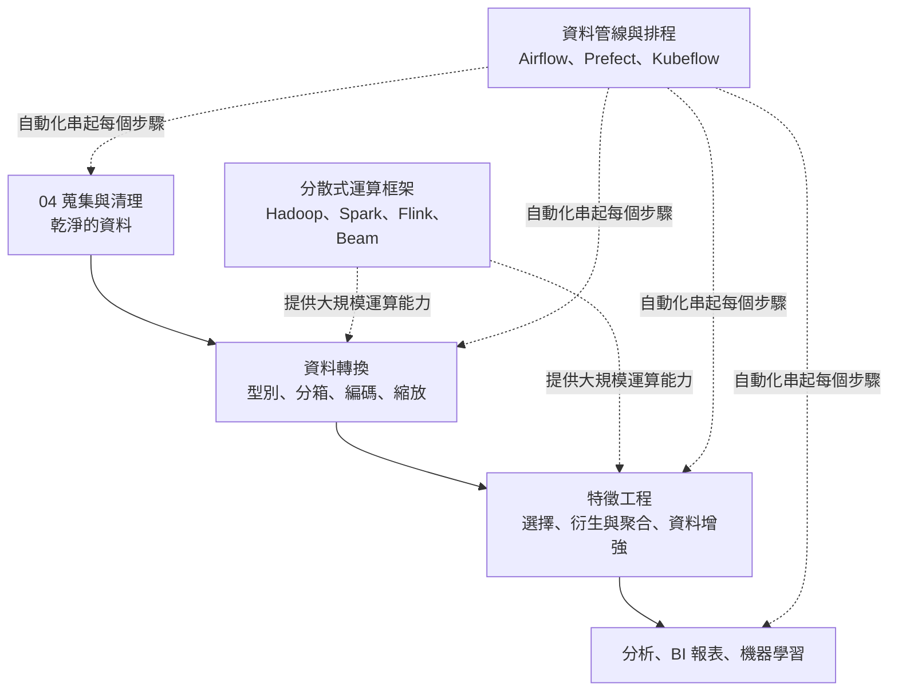
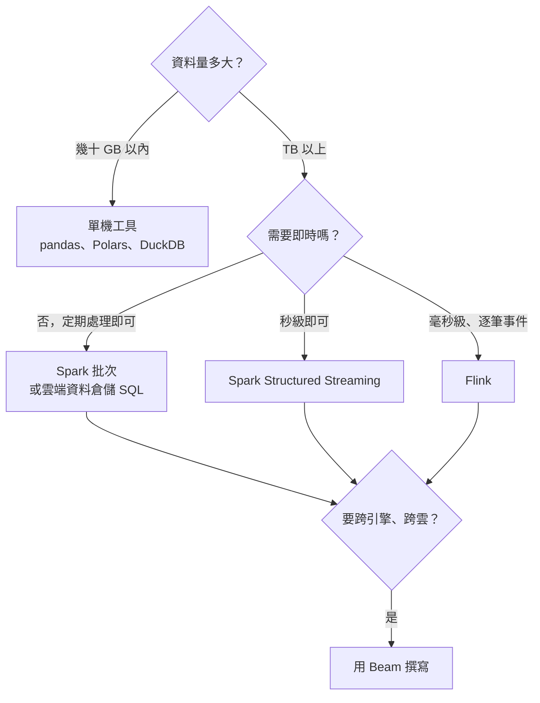
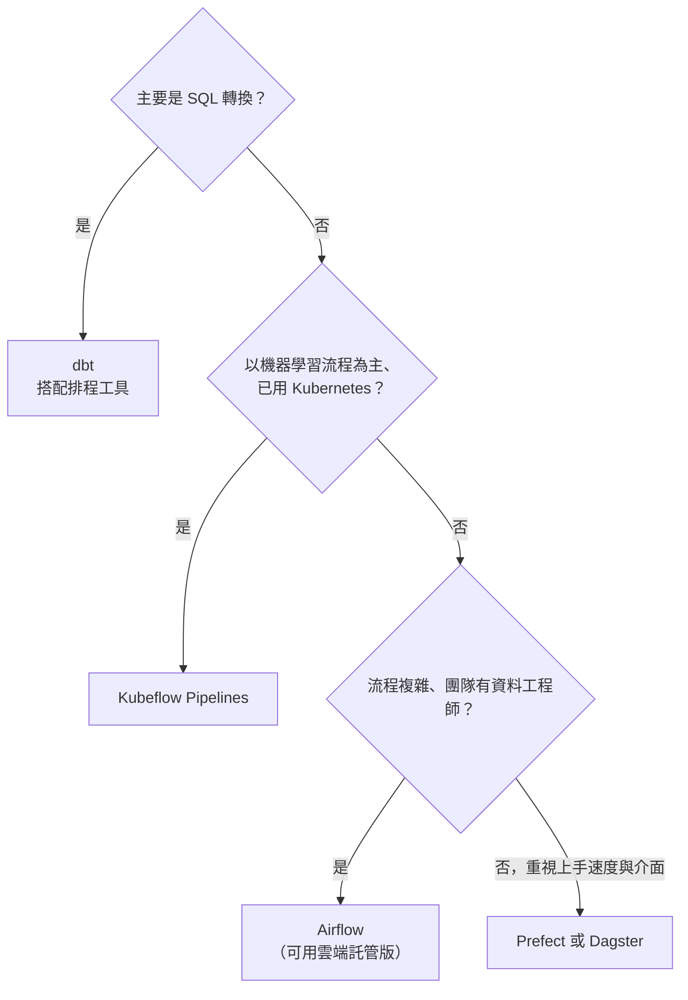

### Metadata
parent:: [[_【目錄】iPAS-AI應用規劃師(中級)：大數據處理分析與應用]]
sibling:: [[04數據收集與清理]] · [[05數據儲存與管理]]

## Key Points
> [!summary] 一句話看懂
> **資料處理＝把「乾淨的資料」變成「模型和報表能直接用的資料」，再用分散式運算與自動化管線，讓這件事每天穩定、大規模地自動發生。**
> 清理（[[04數據收集與清理]]）是把菜洗乾淨；處理是**切好、調味、分裝**；資料管線則是讓整個廚房**每天自動出餐的生產線**。

#### 類別編碼三選一
| 方法 | 做法 | 適合 | 風險 |
|---|---|---|---|
| **標籤／順序編碼** | 類別 → 整數 | **有順序**（小學 < 高中 < 大學） | 用在無序類別會被誤解為有大小 |
| **獨熱編碼** | 每個類別一個 0／1 欄位 | **無順序**、類別數少 | 類別多時**維度爆炸** |
| **目標編碼** | 類別 → 該類別的目標平均值 | **高基數**且與目標相關 | **資料洩漏**、過擬合 |

#### 數值縮放三選一
| 方法 | 結果 | 對極端值 | 適合 |
|---|---|---|---|
| **Min-Max 正規化** | 0～1 | **敏感** | 需固定範圍、無明顯極端值 |
| **Z 分數標準化** | 平均 0、標準差 1 | 敏感 | 一般情況、梯度下降類模型 |
| **穩健縮放** Robust | 用**中位數與 IQR** | **抵抗力高** | 偏態、有離群值 |

#### 特徵選擇三類方法
| 方法 | 做法 | 優點 | 缺點 |
|---|---|---|---|
| **過濾法** Filter | 統計量打分（相關係數、卡方、ANOVA） | **快**、不依賴模型 | 看不到特徵交互作用 |
| **包裝法** Wrapper | 反覆用模型表現篩選（**RFE**、前向／後向） | 考慮交互作用 | **計算成本高**、可能過擬合 |
| **嵌入法** Embedded | 訓練時順便選（**Lasso**、樹模型重要度） | 一次完成 | 依賴特定模型 |

#### 四大分散式運算框架
| 框架 | 處理模式 | 一句話 | 適合 |
|---|---|---|---|
| **Hadoop MapReduce** | **批次**，讀寫磁碟 | 穩但慢的老將 | 大量離線作業、歷史資料 |
| **Apache Spark** | **記憶體內運算**，批次＋微批次串流 | 目前最通用的主力 | 大規模批次、分析、機器學習 |
| **Apache Flink** | **原生串流**（逐筆事件） | 真正即時 | 詐欺偵測、即時推薦、IoT |
| **Apache Beam** | **統一的程式模型**，可跑在不同引擎上 | 寫一次、到處跑 | 跨平台、多雲 |

> [!warning] 陷阱題
> 1. **特徵衍生的目的＝建立對預測更有意義或更可解釋的變數**（如時間差、組合變數），不是增加模型自由度或壓縮資料（官方考題原題）。
> 2. **把文字欄位轉成一致格式＝資料轉換**（官方考題原題）。
> 3. **即時異常偵測 → 串流處理系統**（Kafka、Spark Streaming、Flink）（官方考題原題）。
> 4. **Spark 比 MapReduce 快的關鍵＝記憶體內運算**，中間結果不必反覆寫入磁碟。
> 5. **Flink＝原生逐筆串流；Spark Streaming＝微批次**（把串流切成很小的批次處理）。
> 6. **Beam 不是運算引擎**，而是統一批次與串流的程式模型，實際執行要靠 Flink、Spark 或 Google Dataflow。
> 7. **等寬分箱＝每區範圍相同；等頻分箱＝每區樣本數相同**。
> 8. **Robust Scaling 用中位數與 IQR**，最不怕離群值。
> 9. **SMOTE＝為少數類別合成新樣本**，處理不平衡資料。
> 10. **Airflow＝最主流的工作流程排程工具**（用 Python 定義 DAG）；**Kubeflow Pipelines＝專注機器學習流程**。
> 11. **管線設計四原則：可重現、容錯、可擴充、可監控**。
>
> ⚠️ **學習指引錯誤或不精確的地方**
> - 指引說 Z 分數標準化會把數值「**轉換為平均 0、標準差 1 的常態分佈**」：錯誤。標準化**只改變位置與尺度，不改變分佈形狀**；原本右偏的資料標準化後**仍然右偏**。要讓資料更接近常態，要用**對數轉換、Box-Cox、Yeo-Johnson** 等方法。（指引同段又說「保留資料的原始形狀」，前後矛盾。）
> - 指引說**標籤編碼適用於有順序類別**：有順序時應使用**順序編碼（Ordinal Encoding）並自行指定順序**；一般標籤編碼常依字母排序給數字，順序不一定正確。
> - 指引列出目標編碼時**只講優點、沒講風險**：目標編碼直接使用答案資訊，若用全部資料計算，會造成嚴重的**資料洩漏**，必須用**交叉驗證式計算**（Out-of-Fold）或加入平滑。
> - 指引未提醒 **SMOTE 只能用在訓練集**：若在切分訓練與測試集之前做，合成樣本會「洩漏」到測試集，評估結果會過度樂觀。

> [!tip] PM 要記住的 3 件事
> 1. **不是每個專案都需要 Spark**：資料在幾十 GB 以內，單機工具（如 DuckDB、Polars）往往更快、更便宜、更好維護。**先估資料量，再選工具**。
> 2. **即時比批次貴很多**：先確認「晚一小時」到底有沒有損失。多數報表批次就夠，只有詐欺、警報、即時推薦才真正需要串流。
> 3. **管線失敗是常態**：要問的是「失敗時誰會收到通知？能不能自動重試？重跑會不會重複寫入？」，而不是「會不會失敗」。

--- 
## Notes
### 全局地圖：資料處理在整個流程中的位置

- 本筆記偏重**大數據平台與工具**；機器學習角度的特徵工程與模型選擇，見 [[08數據準備與模型選擇]]。

---

### 一、資料轉換：從「乾淨」到「可運算」
清理完的資料只代表「沒有錯」，還不代表「能直接用」。這一步要把資料整理成**模型與分析工具能理解的格式**。

#### 1. 資料型別轉換與欄位整理
清理過程中常見的問題是**型別錯了**：數字被存成文字、日期格式不一致。型別不對，計算就會出錯，例如文字型態的「10」和「9」排序時，「10」會排在「9」前面。

常見工作：
- **數值轉型**：把「年齡」從文字轉成整數，避免無法計算平均。
- **時間轉換**：統一轉成日期時間格式，建議用國際標準 **ISO 8601**（如 `2024-03-01T13:00:00Z`，Z 代表 UTC 時區）。跨國資料一定要注意**時區**，否則同一筆交易可能被算到不同天。
- **欄位重新命名**：把 `cust_id` 改成 `customer_id`，讓其他人一看就懂。
- **欄位重組**：把「縣市＋鄉鎮＋路段」合併成完整地址，或把「姓名」拆成「姓」與「名」。

#### 2. 分箱與類別重組
##### (1) 分箱（Binning）
**是什麼**：把**連續數值切成幾個區間**，變成類別。例如年齡 0～100 歲切成「青年、中年、老年」。

**為什麼要做**：
- **更好解釋**：「30～39 歲族群轉換率最高」比「年齡係數 0.03」好溝通。
- **降低雜訊**：年齡 34 歲和 35 歲的差異通常沒有意義，分箱後模型更穩定。
- **捕捉非線性關係**：例如保險風險在年輕與年長兩端都高，分箱後線性模型也能表達。

**三種分箱方法**：
- **等寬分箱**：每個區間**範圍相同**。例如 0～100 分成 5 區、每區寬 20。簡單直覺，但資料偏態時，某些區間會幾乎沒有樣本。
- **等頻分箱（分位數分箱）**：每個區間**樣本數大致相同**，例如用四分位數切成 4 區。適合偏態資料，但區間寬度不一，邊界可能不直覺。
- **K-means 分箱**：用分群演算法找出資料自然聚集的位置作為切點。

##### (2) 類別重組
類別變數也常需要整理：
- **合併稀有類別**：出現次數太少的類別合併為「其他」，避免模型從極少數樣本中學到雜訊。
- **整併為大類**：把上百種細分職稱整併為「白領、藍領、自營」等大類。
- **處理高基數欄位**：像「郵遞區號」「商品編號」這種有上千種值的欄位，直接獨熱編碼會產生上千個欄位，需要先降維或改用目標編碼。

#### 3. 類別編碼（Encoding）
多數演算法只能處理數字，所以**類別變數要先轉成數字**。選錯編碼方式，可能讓模型誤解資料、或讓欄位數暴增。選擇時看四件事：**類別有沒有順序、類別有多少種、用什麼模型、資料量多大**。

##### (1) 標籤編碼與順序編碼
**做法**：每個類別對應一個整數，例如「小學 → 0、高中 → 1、大學 → 2」。

**適合**：**有明確順序**的類別，例如教育程度、會員等級（Basic < Premium < VIP）、滿意度（不滿意 < 普通 < 滿意）。

**風險**：用在**無順序**的類別上，例如「台北 → 0、台中 → 1、高雄 → 2」，線性模型會以為「高雄 > 台中 > 台北」，甚至「台北＋高雄＝2 個台中」，完全沒有意義。

**實務提醒**：有順序時要**自己指定順序**（順序編碼），不要讓程式依字母排序自動編號。樹模型對整數編碼比較不敏感，但線性模型與神經網路一定要注意。

##### (2) 獨熱編碼（One-hot Encoding）
**做法**：每個類別變成一個欄位，屬於該類別為 1、否則為 0。例如顏色「紅、藍、綠」變成 `is_red`、`is_blue`、`is_green` 三欄。

**適合**：**無順序**、**類別數不多**的變數，例如城市、產品類型、付款方式。

**優點**：不會引入錯誤的順序關係，保留完整資訊。

**限制**：類別數量一多（**高基數**），欄位會爆炸。1,000 種商品就會多出 1,000 個欄位，大部分都是 0，耗記憶體、拖慢訓練。

##### (3) 目標編碼（Target Encoding）
**做法**：用該類別在**目標變數上的平均值**取代類別。例如預測轉換率時，「廣告來源 A」的平均轉換率是 5%，就用 0.05 代表 A。

**適合**：**高基數**、而且與目標**高度相關**的類別變數。

**優點**：只產生一個欄位，不會維度爆炸，且直接帶有預測資訊。

**風險（很重要）**：
- **資料洩漏**：如果用包含該筆資料本身的全部資料計算平均，模型等於「偷看答案」，訓練分數會好得不真實。
- **小類別不穩定**：某類別只有 2 筆資料，平均值極不可靠。

**正確做法**：用**交叉驗證方式計算**（每筆資料的編碼值只用「其他折」的資料算），並加入**平滑**（樣本少的類別往整體平均靠攏）。

##### (4) 其他編碼方式
- **頻率編碼**：用類別出現的次數或比例取代。簡單且不會洩漏答案。
- **嵌入（Embedding）**：用神經網路為每個類別學出一組向量，常用於推薦系統（使用者 ID、商品 ID）。
- **模型原生支援**：**CatBoost、LightGBM** 可直接處理類別特徵，省去手動編碼。

#### 4. 數值標準化與正規化
**為什麼需要**：不同欄位的尺度差很多，例如年齡是幾十、收入是幾萬、交易筆數可能上百萬。直接丟進模型，**數值大的欄位會主導結果**，模型也可能難以收斂。

**哪些模型特別需要**：
- **以距離計算的模型**：KNN、K-means、SVM。收入差 1 萬元和年齡差 10 歲，如果不縮放，收入會完全壓過年齡。
- **用梯度下降訓練的模型**：線性迴歸、邏輯迴歸、神經網路。尺度不一會讓訓練繞遠路、收斂很慢。
- **有正則化的模型**：Lasso、Ridge。懲罰會不公平地落在尺度小的特徵上。
- **不需要的**：決策樹、隨機森林、梯度提升樹，因為它們只看大小順序。

##### (1) Min-Max 正規化
$$x' = \frac{x - \min}{\max - \min}$$

- 把數值線性縮放到 **0～1**。
- **優點**：保留原始分佈比例，直觀好解釋；適合影像像素（0～255 → 0～1）等有明確上下限的資料。
- **限制**：**對極端值非常敏感**。只要有一個超大值，其他數值就會被擠在 0 附近。

##### (2) Z 分數標準化
$$z = \frac{x - \mu}{\sigma}$$

- 轉換後**平均為 0、標準差為 1**。
- **優點**：最通用的做法，保留資料的相對位置與分佈形狀。
- **限制**：仍受極端值影響（平均數與標準差都會被極端值拉動）。
- ⚠️ **不會把資料變成常態分佈**：形狀不變，偏態依舊。

##### (3) 穩健縮放（Robust Scaling）
$$x' = \frac{x - \text{中位數}}{IQR}$$

- 使用**中位數與四分位距**，兩者都不受極端值影響。
- **適合**：**偏態、有離群值**的資料，例如交易金額、網站停留時間。
- **限制**：轉換後沒有固定範圍。

##### (4) 讓分佈更接近常態的轉換
如果目的是**改變分佈形狀**（例如讓右偏資料變對稱），要用：
- **對數轉換**：最常用，適合收入、金額等右偏且為正的資料。
- **Box-Cox**（資料須為正）、**Yeo-Johnson**（可處理 0 與負值）：自動尋找最合適的轉換。

> [!warning] 縮放的資料洩漏陷阱
> 縮放用的平均數、標準差、最大最小值，**只能用訓練集計算**，再套用到驗證集與測試集。若用全部資料計算，測試集的資訊就混進了訓練過程。

---

### 二、特徵工程
特徵工程是透過**選擇、衍生、增強**資料中的特徵，讓模型更容易抓到規律。三個共同提醒：
- **避免資料洩漏**：聚合特徵、目標編碼最容易出問題，要搭配交叉驗證或依**時間窗口**切分。
- **不是越多越好**：特徵與處理步驟要在模型效能與運算成本之間取得平衡。
- **增強要適度**：過度變形的資料反而會誤導模型。

#### 1. 特徵選擇
##### (1) 為什麼要選
特徵太多會帶來三個問題：**模型變複雜、訓練變慢、容易過擬合**（模型記住了雜訊）。特徵選擇的目標是保留**最有價值**的特徵，同時提升**效能與可解釋性**。

##### (2) 過濾法（Filter）
**做法**：在建模**之前**，用統計方法替每個特徵打分，挑分數高的。
- **皮爾森相關係數**：數值特徵與數值目標的線性相關。
- **卡方檢定**：類別特徵與類別目標是否有關聯。
- **ANOVA**：數值特徵在不同目標類別之間的平均是否有差異。

**優點**：速度快、不依賴特定模型，適合特徵數量極多時先做粗篩。

**限制**：每個特徵**單獨評估**，看不到「兩個特徵單獨都沒用、組合起來卻很有用」的情況。

##### (3) 包裝法（Wrapper）
**做法**：把特徵選擇當成搜尋問題，**反覆訓練模型**，依模型表現（準確率、F1）決定保留哪些特徵。
- **遞迴特徵消除（RFE）**：先用全部特徵訓練，刪掉最不重要的，再訓練、再刪，直到剩下目標數量。
- **前向選擇**：從零開始，每次加入讓模型進步最多的特徵。
- **後向選擇**：從全部開始，每次刪掉影響最小的特徵。

**優點**：能考慮特徵之間的交互作用，選出的組合通常效果較好。

**限制**：要訓練很多次模型，**計算成本高**；在小資料上也可能過度配合驗證集而**過擬合**。

##### (4) 嵌入法（Embedded）
**做法**：在模型**訓練過程中**同時完成特徵選擇。
- **Lasso（L1 正則化）**：會把不重要特徵的權重**壓到剛好為 0**，等於自動刪除。
- **Ridge（L2 正則化）**：會把權重縮小，但**不會變成 0**，所以嚴格來說不刪特徵，主要用於處理共線性。
- **樹模型的特徵重要度**：依每個特徵對分裂的貢獻排序。

**優點**：效率介於過濾法與包裝法之間，一次完成。

**限制**：結果依賴特定模型與超參數；樹模型的重要度對高基數特徵有偏好，可搭配 **SHAP** 或**排列重要度**交叉確認。

#### 2. 特徵衍生與聚合
**特徵衍生**是從現有資料中**創造出更有預測力或更好解釋**的新變數，這往往是讓模型大幅進步的關鍵，也最需要**業務知識**。

##### (1) 交互特徵（Interaction Features）
透過特徵之間的**數學運算**（乘、除、加、減）產生新特徵，捕捉單一特徵看不出來的關係。
- 「購買頻率 × 平均消費金額」＝**年度消費總額**
- 「負債 ÷ 收入」＝**負債比**，信用評分中比單獨的負債或收入更有預測力
- 「點擊數 ÷ 曝光數」＝**點擊率**

##### (2) 時間特徵（Temporal Features）
從時間資料拆出有意義的資訊：
- **週期特徵**：星期幾、月份、是否假日、是否發薪日前後。
- **距今時間（Recency）**：距離上次購買幾天，是預測流失最重要的特徵之一。
- **時間差**：下單到付款間隔、註冊到首購間隔。
- **滯後與滾動特徵**：上週銷量、過去 7 天平均，時間序列預測的核心。

##### (3) 聚合特徵（Aggregate Features）
把明細資料依群組**彙總統計**，例如：
- 顧客**最近三個月**平均交易額、交易次數、最大單筆金額。
- 商品的**月銷售排名**、退貨率。
- 門市的**同期成長率**。

行銷常用的 **RFM 模型**就是經典的聚合特徵：**R（Recency）最近一次購買、F（Frequency）購買頻率、M（Monetary）消費金額**。

> [!warning] 聚合特徵的時間陷阱
> 計算「最近三個月平均消費」時，必須以**預測當下**為基準往前算。如果不小心把預測時間點之後的交易也算進去，就是資料洩漏，模型在離線評估時會表現得異常好。

#### 3. 資料增強（Data Augmentation）
**目的**：產生新樣本或對現有樣本做合理變形，**增加資料量、改善類別不平衡、提升泛化能力**。

##### (1) 影像資料增強
隨機**翻轉、旋轉、裁剪、縮放、調整亮度與色彩**。原理是「貓的照片翻轉後還是貓」，讓模型學會不受拍攝角度與光線影響。用於人臉辨識、醫學影像、瑕疵檢測。

注意變形要合理：辨識數字時，「6」旋轉 180 度就變成「9」了；醫學影像左右翻轉可能改變解剖意義。

##### (2) 文字資料增強
傳統方法：**同義詞替換、隨機插入、隨機刪除、隨機交換字詞位置**。
現代方法：**回譯**（中翻英再翻回中）、**用大型語言模型改寫**同一句話的多種說法，品質通常比傳統方法好得多。
用於情感分析、主題分類、對話與意圖辨識模型。

##### (3) 時間序列資料增強
**加入雜訊（Jittering）**、**縮放幅度（Scaling）**、**視窗裁切**、時間扭曲。用於設備故障預測、感測器分析。注意不能破壞時間順序與因果關係。

##### (4) 表格資料增強
**SMOTE（合成少數類別過採樣）**：在少數類別的樣本之間**內插產生新樣本**，例如在兩筆詐欺交易之間合成一筆「介於兩者之間」的詐欺交易。用於**詐欺偵測、疾病診斷**等嚴重不平衡的問題。

注意事項：
- **只能對訓練集做**，測試集要保持真實分佈。
- 合成樣本可能落在不合理的位置（例如類別欄位被內插成小數）。
- 對梯度提升樹而言，**調整類別權重**往往和 SMOTE 一樣有效，且更簡單。
- **生成式 AI 合成資料**是新興做法，可用於隱私保護與罕見案例模擬，但要驗證合成資料是否貼近真實。

---

### 三、分散式運算框架
#### 為什麼需要分散式運算
資料大到一台電腦**放不下或算不完**時，就要把工作**切開，分給很多台機器同時處理**，最後再合併結果。分散式框架負責處理切分、分派、容錯、合併這些複雜細節，讓工程師專注在處理邏輯上。

> [!example] 白話比喻
> 要統計全台灣所有選票：一個人數要好幾年。改成每個投票所**各自計票（Map）**，再把結果**加總（Reduce）**，一個晚上就完成。這就是 **MapReduce** 的概念。

#### Apache Hadoop MapReduce
- **處理模式**：**批次處理**。分成 **Map**（各節點分別處理自己那份資料）與 **Reduce**（彙整結果）兩階段，**每一步的中間結果都寫回磁碟**。
- **適合**：大量**離線**作業，例如每晚的日誌彙總、歷史資料分析。
- **優點**：成熟穩定、容錯強（搭配 HDFS 多副本）、易於水平擴充。
- **缺點**：**頻繁讀寫磁碟，速度慢**；不適合即時運算與需要反覆迭代的機器學習。
- **現況**：新專案已很少直接寫 MapReduce，多由 Spark 取代，但 Hadoop 的概念仍是理解分散式運算的基礎。

#### Apache Spark
- **處理模式**：**記憶體內運算**，中間結果盡量留在記憶體，不必反覆寫入磁碟。支援**批次處理、串流處理**（Structured Streaming，預設以**微批次**方式運作）、**互動式 SQL 查詢**與**機器學習**（Spark MLlib）。
- **為什麼快**：機器學習需要對同一份資料反覆計算幾十次，MapReduce 每次都要讀寫磁碟，Spark 讀一次就放在記憶體裡重複使用，速度可快**數十倍以上**。
- **適合**：大規模資料的快速批次處理、ETL、資料分析、特徵工程、機器學習訓練。
- **優點**：速度快、函式庫豐富（SQL、串流、機器學習、圖運算）、支援 Python（PySpark）、社群最大。
- **缺點**：**記憶體需求高**，調校與維運需要經驗。
- **現況**：目前**最主流**的大數據處理引擎，Databricks、各大雲端平台都以它為核心。

#### Apache Flink
- **處理模式**：**原生串流**，資料**逐筆**進來就逐筆處理，延遲可達毫秒級；也能以「把批次視為有限的串流」的方式處理批次資料。
- **與 Spark 串流的差別**：Spark 是把串流切成很小的批次（像每隔一秒收一次信），Flink 是信一到就處理（即時推播）。
- **適合**：**高頻即時事件處理**，例如信用卡詐欺偵測、即時推薦、IoT 異常警報、即時風控。
- **優點**：真正即時、高吞吐、**狀態管理**能力強（例如持續記錄每位使用者過去 10 分鐘的行為），並保證資料**恰好處理一次**。
- **缺點**：生態系比 Spark 小，維運需投入較多資源。

#### Apache Beam
- **定位**：**不是運算引擎**，而是一套**統一批次與串流的程式模型**。用 Beam 寫好處理邏輯後，可以選擇在 **Flink、Spark 或 Google Cloud Dataflow** 上執行。
- **適合**：需要**跨平台、多雲**部署，或希望未來能更換底層引擎的團隊。
- **優點**：可移植性強，避免綁定特定引擎。
- **缺點**：抽象層較高，需理解 **Dataflow Model**（視窗、浮水印、觸發器等串流概念），上手門檻較高。

#### 相關的重要工具
- **Apache Kafka**：**分散式訊息佇列與事件串流平台**，負責「**接收並暫存**」大量即時資料，讓 Flink、Spark 等引擎來讀取處理。Kafka 本身主要是**傳遞**資料，不是分析引擎；它常是即時架構的資料入口。
- **雲端託管服務**：AWS EMR、Google Dataproc、Azure HDInsight 提供託管的 Spark 與 Hadoop；**Databricks** 是以 Spark 為核心的資料與 AI 平台；**Snowflake、BigQuery** 則讓使用者直接用 SQL 處理大量資料，不必自己管叢集。
- **單機高效能工具**：**DuckDB、Polars** 在單台電腦上就能快速處理數十 GB 的資料，近年大量取代「其實不需要分散式」的 Spark 作業。

#### 怎麼選框架

---

### 四、資料處理管線（Data Pipeline）
**資料管線**把擷取、清理、轉換、特徵工程、輸出等步驟**串成一條自動化的流程**，讓資料每天穩定地從來源流到報表與模型。沒有管線，每個步驟靠人工執行，容易出錯、無法重現、也無法擴展。

#### 1. 設計四原則
- **可重現性（Reproducibility）**：同樣的輸入，每次執行都得到同樣的結果。做法是**版本控制**（程式碼、設定、資料版本）與**容器化**（執行環境固定）。
- **容錯與回復（Fault Tolerance）**：任務失敗時**自動重試**並**發出警示**。更重要的是設計成**冪等（Idempotent）**：同一個任務重跑多次，結果和只跑一次一樣，不會重複寫入資料。
- **擴充性與彈性（Scalability）**：資料量成長或處理變複雜時，能輕鬆加入新節點與新任務。
- **監控與可觀測性（Observability）**：能看到每次執行的狀態、耗時、處理筆數，出問題時能回溯原因並調校效能。

#### 2. 三種管線架構
- **批次管線**：定期啟動（每小時、每天、每週），處理一段時間累積的資料。適合**歷史分析、定期報表**。架構簡單、成本低。
- **即時管線**：持續運作、低延遲，資料一進來就處理。適合**監控、預警、即時推薦**。架構複雜、成本高。
- **混合管線**：批次與即時並行。例如**即時儀表板**顯示今天的即時數字，**每晚批次**再用完整資料校正並做歷史分析。過去常見的 **Lambda 架構**就是這種設計；後來也有只用串流處理一切的 **Kappa 架構**。

#### 3. ETL 與 ELT
- **ETL（擷取 → 轉換 → 載入）**：先在處理伺服器上轉換好，再載入資料倉儲。傳統做法，適合資料倉儲運算能力有限的年代。
- **ELT（擷取 → 載入 → 轉換）**：先把原始資料**直接載入**雲端資料倉儲或資料湖，再**用倉儲本身的運算能力轉換**。雲端資料倉儲運算強大且可擴充，**ELT 已成為現代主流**。
- 代表工具：擷取載入用 **Fivetran、Airbyte**；轉換用 **dbt**（用 SQL 撰寫轉換邏輯，並內建測試與文件）。

#### 4. 常見管線與排程工具
##### (1) Apache Airflow
- 用 **Python** 撰寫管線，以 **DAG**（有向無環圖）描述任務之間的先後關係。
- 運算子（Operators）豐富，排程功能完整，**是目前最主流的工作流程排程工具**。
- 適合大規模、結構複雜、需要協調多個任務的管線。
- 優點：開源、靈活、社群活躍，各大雲端都有託管版本（如 Google Cloud Composer、Amazon MWAA）。
- 缺點：自行維護與部署較複雜。

##### (2) Luigi
- Spotify 開發的開源 Python 模組，架構清楚、上手快。
- 適合中小型、流程簡單的任務。
- 缺點：功能較單純、監控與圖形介面較弱，社群活躍度已明顯下降。

##### (3) Prefect
- 現代化設計，**錯誤處理與即時監控**強，介面友善。
- 適合重視開發體驗與視覺化的資料科學團隊。
- 缺點：部分進階功能需使用其雲端服務。

##### (4) Kubeflow Pipelines
- 建立在 **Kubernetes** 上，專注於**機器學習流程**（資料準備 → 訓練 → 評估 → 部署）。
- 適合以機器學習為主、已使用容器環境的團隊。
- 缺點：安裝設定複雜，學習曲線陡。

**其他常見選擇**：**Dagster**（以「資料資產」為中心設計，重視資料品質與血緣）、**dbt**（專注 SQL 轉換）、雲端原生的 **AWS Step Functions、Azure Data Factory**。

#### 5. 管線自動化的建構要點
- **任務拆解與模組化**：把管線拆成**小而單一功能**的任務，例如「擷取訂單」「清理訂單」「計算日報」分開。好處是容易測試、更新，失敗時只需重跑出錯的那一步。
- **版本控制與 CI/CD**：管線程式碼放在 **Git**，透過 **GitHub Actions、Jenkins** 等工具自動測試與部署，每次修改都可追蹤、可回滾。
- **監控與警示**：用 **Prometheus、Grafana** 監控執行狀態，異常時透過 **Slack、Teams、Email** 通知。除了「任務有沒有失敗」，也要監控「**資料對不對**」，例如今天的筆數突然只有平常的一半。
- **容器化與彈性擴充**：用 **Docker** 固定執行環境、用 **Kubernetes** 依負載自動擴充，提高可靠性。
- **資料品質關卡**：在關鍵步驟之間加入自動品質檢查（見 [[04數據收集與清理]]），**不合格的資料不往下游傳**。

---

### PM 檢查清單：資料處理與管線 8 問
1. **轉換規則一致嗎？** 型別、時區、單位、命名都統一了嗎？
2. **編碼選對了嗎？** 有順序的類別用順序編碼、無順序用獨熱、高基數小心目標編碼洩漏？
3. **縮放參數只用訓練集算嗎？** SMOTE 只做在訓練集嗎？
4. **衍生特徵有業務意義嗎？** 時間窗口有沒有偷看到未來？
5. **資料量真的需要分散式嗎？** 還是單機工具就夠？
6. **需要即時嗎？** 晚一小時有沒有實際損失？
7. **管線失敗會怎樣？** 有自動重試、警示、冪等設計嗎？
8. **誰負責維運？** 半夜管線失敗，誰收到通知、誰處理？

---
## References
- iPAS AI應用規劃師(中級)學習指引 科目2：大數據處理分析與應用 — 4.3 數據處理技術與工具、第四章考題解析
- Zaharia, M. et al. (2016). *Apache Spark: A Unified Engine for Big Data Processing*. Communications of the ACM
- Akidau, T. et al. (2015). *The Dataflow Model*. VLDB
- Chawla, N. V. et al. (2002). *SMOTE: Synthetic Minority Over-sampling Technique*
- Kleppmann, M. (2017). *Designing Data-Intensive Applications*
- scikit-learn User Guide: Preprocessing data、Feature selection
![[AI應用規劃師(中級)-學習指引-科目2大數據處理分析與應用_20251222101850.pdf]]
