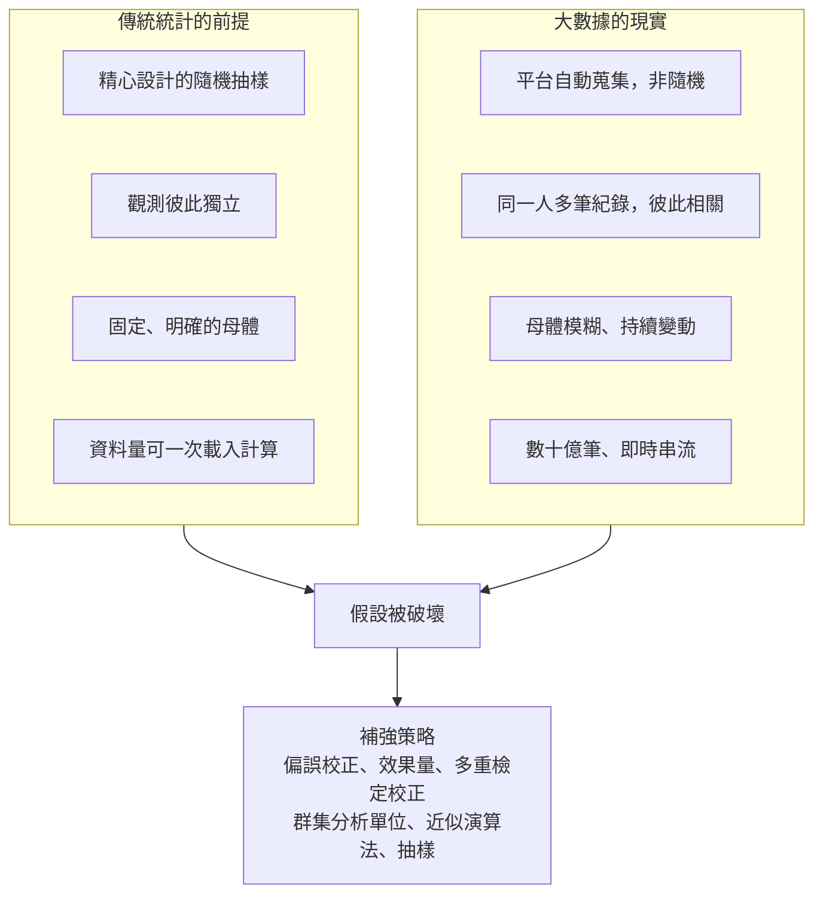

### Metadata
parent:: [[_【目錄】iPAS-AI應用規劃師(中級)：大數據處理分析與應用]]
sibling:: [[08常見的大數據分析方法]] · [[09數據可視化工具]]

## Key Points
> [!summary] 一句話看懂
> **資料多 ≠ 結論準。大數據讓「隨機誤差」變小，卻讓「系統性偏誤」更隱形、更理直氣壯。**
> 就像用 100 萬份**只發給上班族**的問卷推估全台灣的意見：樣本再大，也代表不了學生和退休族。資料量只會讓這個錯誤的答案看起來**更精確、更可信**。

#### 敘述統計在大數據下的五個挑戰
| 挑戰 | 問題 | 對策 |
|---|---|---|
| **運算與即時性** | 資料放不進記憶體、串流資料不斷進來 | **增量計算**、**近似演算法**、分散式彙總 |
| **長尾與偏態** | 平均數被極端值拉走 | 改用**中位數、分位數**、對數轉換 |
| **多型態資料** | 文字、影像無法直接算平均 | 先轉成數值特徵（嵌入、標籤、計數） |
| **離群值被稀釋** | 0.01% 的詐欺幾乎不影響整體平均 | **分群監控**、專門的異常偵測 |
| **動態變化** | 靜態快照看不出趨勢 | **滑動視窗**統計、即時監控 |

#### 統計推論在大數據下的六個風險
| 風險 | 一句話 | 對策 |
|---|---|---|
| **樣本非隨機** | 資料只來自特定族群，偏誤**不會因量大而消失** | 確認資料來源、**加權校正**、補隨機樣本 |
| **p 值過度敏感** | 樣本大，微小差異也「顯著」 | 看**效果量、信賴區間、實務意義** |
| **多重檢定** | 做 1,000 次檢定，約 50 次是假警報 | **Bonferroni**、**FDR（Benjamini-Hochberg）** |
| **樣本不獨立** | 同一人的多筆紀錄高度相關 | 以**使用者**為分析單位、**群集標準誤** |
| **母體不明** | 不知道資料能代表誰 | 先定義母體與推論範圍 |
| **運算資源限制** | Bootstrap、模擬太耗算力 | 先抽樣再推論、分散式平行模擬 |

#### 大數據常用的近似演算法
| 要算什麼 | 精確做法的問題 | 近似演算法 |
|---|---|---|
| **不重複數量**（不重複訪客數） | 要記住所有出現過的 ID | **HyperLogLog**：幾 KB 記憶體估算數十億筆，誤差約 1～2% |
| **分位數**（中位數、P95） | 要排序全部資料 | **t-digest**、Spark `approxQuantile` |
| **頻率**（熱門商品） | 要為每個項目計數 | **Count-Min Sketch** |
| **隨機抽樣**（串流中） | 不知道總共會有幾筆 | **蓄水池抽樣（Reservoir Sampling）** |

> [!warning] 陷阱題
> 1. **大數據的樣本偏誤不會因樣本數增加而消失**，反而讓錯誤結論看起來更穩定、更可信。
> 2. **樣本很大時，極小的差異也會有極小的 p 值** → 一定要搭配**效果量**與**信賴區間**判斷實務意義。
> 3. **同時做 1,000 次檢定、α＝0.05、全部其實無差異 → 預期約 50 次誤判為顯著**（偽陽性）。
> 4. **Bonferroni 較嚴格**（α ÷ 檢定次數），控制「至少一次誤判」的機率；**FDR（Benjamini-Hochberg）較寬鬆**，控制「顯著結果中誤判的比例」，大量檢定時較常用。
> 5. **同一使用者的多筆點擊不是獨立樣本**；忽略這點會讓**信賴區間過窄**、結果虛假地「顯著」。
> 6. **平均數對長尾資料失真** → 用中位數或分位數。
> 7. **MAD**（中位數絕對離差）是不受極端值影響的離散度指標，適合偵測感測器異常。
> 8. **統計製程管制**（SPC）用**管制圖**監控品質變異；**生存分析**（Kaplan-Meier、Cox 迴歸）分析「到事件發生前的時間」。
> 9. **蒙地卡羅模擬**＝用大量隨機模擬估計風險或機率分佈。
>
> ⚠️ **學習指引錯誤或不精確的地方**
> - 指引舉例「**每組 50 萬人、點擊率差 0.05%，p 值可能小於 0.0001**」：算起來並不成立。若點擊率約 2%、差距 0.05 個百分點，每組 50 萬人時 z 值約 1.8、**p 值約 0.07，連 0.05 都不到**；要讓 p < 0.0001，每組大約需要 **240 萬人**。概念（樣本越大越容易顯著）是對的，但數字示範錯誤。
> - 指引用「**p 值膨脹（p-value inflation）**」描述大樣本下 p 值變得極小：這個用語容易混淆。學術上的「膨脹」通常指**型一錯誤率膨脹**（例如多重檢定、偷看結果造成假陽性變多）。大樣本下 p 值變小是**檢定力極高**的正常現象，問題在於**統計顯著不等於實務重要**。考試可沿用指引用語，但要理解實際意思。
> - 指引說 Bootstrap 等模擬方法在 Spark 等平台上**難以實施**：Bootstrap 的每次重抽樣彼此獨立，其實**很適合平行化**；大數據上也有專門的做法，如**泊松 Bootstrap**、**Bag of Little Bootstraps**。真正的建議通常是「**先抽一個夠大的隨機樣本再做推論**」，不必每次動用全部資料。
> - 指引舉例用 **ARIMA 預測資產價格趨勢**：金融價格接近**隨機漫步**，ARIMA 很難有效預測價格本身；金融上較常用 ARIMA 類模型分析**報酬率**，並用 **GARCH** 類模型預測**波動度**。

> [!tip] PM 要記住的 3 件事
> 1. **先問「資料是從誰身上來的」**：App 的行為資料只代表**會用 App 的人**，而且是**活躍使用者的比重特別高**。拿它推論「所有顧客」前，先想想沒被記錄到的人是誰。
> 2. **A/B 測試看「差多少」而不只看「有沒有差」**：設定**最小值得行動的差異**（例如轉換率至少 +0.3 個百分點），未達到就算顯著也不必上線。
> 3. **儀表板上的指標越多，越容易看到「假趨勢」**：一次盯 50 個指標，總會有幾個「異常」，只是隨機波動。先定義**少數主要指標**。

--- 
## Notes
### 全局地圖：傳統統計 vs 大數據統計

- 統計學在大數據時代仍是核心：它提供**邏輯清楚、可解釋、能量化不確定性**的方法。問題不在統計失效，而在於**傳統假設不再自動成立**，必須主動檢查與補強。
- 基礎統計概念見 [[01敘述性統計與資料摘要技術]]、[[02機率分佈與資料分佈模型]]、[[03假設檢定與統計推論]]。

---

### 一、大數據下敘述統計的挑戰
#### 運算資源與即時計算的限制
傳統計算平均數、標準差的方式，是把**全部資料讀進記憶體**一次算完。資料大到數十億筆時，記憶體放不下；面對**感測器、點擊流**這類持續流入的串流資料，也不可能每來一筆就從頭重算。

**解決方式**：
- **分散式彙總**：每台機器先算自己那份的「總和、筆數、平方和」，最後合併就能得到整體平均與變異數。
- **增量計算**：每來一筆新資料，只**更新**統計量，不重算全部。例如平均數可以逐筆更新，變異數可用 **Welford 演算法**逐筆更新。
- **近似演算法**：中位數、分位數、不重複數量無法簡單地增量計算，就用**近似演算法**以極小誤差換取大量運算（見 Key Points 表格）。

> [!example] HyperLogLog 的威力
> 要計算一個網站一年內有多少**不重複訪客**，精確做法要記住每一個出現過的訪客 ID，可能需要數十 GB 記憶體。HyperLogLog 只需要**約 12 KB**，就能估算到誤差 1～2% 以內。Redis、BigQuery、Spark 都內建這個功能。

#### 長尾分佈與偏態造成的失真
大數據中的**收入、消費金額、商品銷量、使用時長**，常常是**極度右偏的長尾分佈**：少數人貢獻了大部分的量。這時**平均數會被極端值拉高**，無法代表一般情況。

例如一個 App 的「平均每日使用時間 45 分鐘」，可能是 80% 的人用不到 10 分鐘，加上少數重度使用者每天用好幾小時。

**解決方式**：搭配**中位數**與**分位數**（P25、P50、P75、P95），或先做**對數轉換**再分析；並依使用者分群（輕度、中度、重度）分別描述。

#### 多型態資料難以統一計算
文字、圖片、影音、感測器訊號、JSON 日誌**沒有現成的數值欄位**，無法直接算平均或變異數。

**解決方式**：先把它們**轉成可計算的特徵**，例如：
- 文字 → 字數、情感分數、主題類別、**嵌入向量**
- 圖片 → 偵測到的物件數量、類別標籤
- 日誌 → 事件次數、時間間隔、錯誤率

轉換方法見 [[08常見的大數據分析方法]]。

#### 離群值被稀釋
在數千萬筆交易中，詐欺可能只佔 **0.01%**。就算這些詐欺金額特別高，對**整體平均數與變異數**的影響也微乎其微，看整體統計量根本看不出異常。

**解決方式**：
- **分群監控**：依商家、地區、時段分開看，異常在小群體中會更明顯。
- **使用穩健統計量**：例如以 **MAD（中位數絕對離差）** 取代標準差來定義異常門檻，不會被異常值本身拉偏。
- **專門的異常偵測方法**：孤立森林、規則引擎、監督式詐欺模型。

#### 資料動態變化與時間敏感性
串流資料下，「上個月的平均」可能已經不代表現在。靜態快照**看不出趨勢與即時異常**。

**解決方式**：**滑動視窗統計**，例如持續計算「過去 5 分鐘的平均交易量」「過去 1 小時的錯誤率」，並與歷史同期比較，用於即時監控與警示。

---

### 二、大數據下統計推論的限制與風險
#### 樣本非隨機，偏誤被放大
**問題本質**：統計推論的核心前提是**隨機抽樣**。但大數據多半是**系統自動蒐集**的，只記錄到「**有出現在系統裡的人與行為**」，這種**結構性偏誤**無法靠增加資料量消除。

**常見的偏誤類型**：
- **選擇偏誤**：新聞平台的點擊資料只來自**主動點擊**的使用者，不代表所有讀者。
- **自我選擇偏誤**：線上評論多半來自**特別滿意或特別不滿**的人，中間大多數人不留言。
- **倖存者偏誤**：只分析「還留著的顧客」，看不到已經流失的人為什麼離開。
- **覆蓋偏誤**：App 資料自然排除不使用智慧型手機的族群。

> [!example] 大數據悖論
> 統計學家孟曉犁（Xiao-Li Meng）在 2018 年的研究指出：一個**有偏差**的大樣本，準確度可能**不如一個小得多的隨機樣本**。他分析 2016 年美國大選的大型調查資料，發現**約 230 萬份**帶有輕微回應偏差的樣本，估計誤差只相當於**約 400 人**的簡單隨機樣本。
> → **資料品質與代表性，比資料量更重要。**

**對策**：
- 先問「**誰沒有被記錄到？**」
- 用已知的母體結構（如人口普查的年齡、地區比例）**加權校正**。
- 必要時**補一組小規模隨機樣本**（如隨機問卷）作為校準。

#### 樣本數大，p 值過度敏感
**問題本質**：p 值衡量的是「差異是不是隨機誤差造成的」。樣本越大，隨機誤差越小，**再微小的差異都會變得「顯著」**。p 值只回答「有沒有差」，不回答「**差多少、值不值得**」。

> [!example] 實際算一次
> 兩版廣告點擊率約 2%，差距 0.05 個百分點（2.00% vs 2.05%）：
> - 每組 **50 萬人**：p ≈ 0.07，**不顯著**
> - 每組 **240 萬人**：p ≈ 0.0001，**非常顯著**
>
> 真實差異完全一樣，只是樣本變大。這 0.05 個百分點值不值得投入資源改版，要看**商業價值**，不是看 p 值。

**對策**：
- 報告**效果量**（差異大小、相對提升、Cohen's d）與**信賴區間**。
- 事前設定**最小值得行動的效果**，並依此規劃樣本數。
- 詳見 [[03假設檢定與統計推論]]。

#### 多重檢定增加偽陽性
**問題本質**：每次檢定都有 α（如 5%）的機率誤判。同時做大量檢定，誤判就會累積：

$$P(\text{至少一次誤判}) = 1 - (1-\alpha)^m$$

- 做 20 次 → 約 64%
- 做 1,000 次 → 幾乎確定會有誤判，**預期約 50 次**

大數據分析常常同時比較**數百種商品、數千個廣告版本、上萬個特徵**，很容易「發現」一堆其實只是巧合的結果。

**對策**：
- **Bonferroni 校正**：每次檢定的門檻改為 α ÷ m。最簡單、最嚴格，能幾乎杜絕假警報，但也容易**錯過真正的效果**。
- **FDR 控制（Benjamini-Hochberg）**：控制「被宣稱顯著的結果中，誤判所佔的比例」（例如不超過 5%）。在**大量檢定**時兼顧發現能力與可靠性，是基因研究、大規模實驗平台的常用方法。
- **事前定義主要假設**，其他探索性發現當作「線索」，需要再用新資料驗證。

> [!example] 白話比喻
> - **Bonferroni**：保全規定「寧可錯放一百、不可錯抓一個」，誤抓率極低，但小偷也常溜走。
> - **FDR**：規定「抓到的人裡，冤枉的不超過 5%」，抓得比較多，代價是偶爾冤枉人。

#### 樣本非獨立性
**問題本質**：t 檢定、迴歸、卡方檢定都假設**觀測彼此獨立**。但大數據中，**同一位使用者**在一天內可能產生數百筆點擊；**同一台感測器**的連續讀值高度相關。這些紀錄不是數百個獨立證據，而更接近「同一個人說了數百次同一句話」。

**後果**：分析時若把每筆紀錄都當成獨立樣本，會**高估有效樣本數**，使**信賴區間過窄**，原本不顯著的結果變得「顯著」。

**對策**：
- **以使用者為分析單位**：先把每個人的行為彙總成一筆（例如每人的轉換率），再做檢定。
- **群集標準誤**（Cluster-robust Standard Errors）或**混合效應模型**：在模型中考慮同一群體內的相關性。
- 時間序列資料使用專門的**時間序列模型**。
- A/B 測試的**分流單位**與**分析單位**要一致：依使用者分流，就要以使用者為單位分析。

#### 母體定義不清
**問題本質**：推論是「從樣本推到母體」，但大數據常說不清楚**資料代表的是誰**。

例如分析某電商 2023 年交易資料，要先回答：
- 只包含**有下單**的人，還是所有造訪者？
- 活躍與非活躍使用者都包含嗎？
- 能推論到 **2024 年的新客戶**嗎？市場、產品、行銷策略都變了。

跨國平台、IoT 裝置、使用者生成內容（UGC）特別容易有這個問題。忽略它會導致**外推錯誤、過度一般化**，甚至**合規風險**（例如把某國資料的結論套用到另一國）。

**對策**：分析開始前，先寫清楚「**這份結論適用於誰、哪段期間、哪些情境**」。

#### 系統與資源限制
Bootstrap、排列檢定（Permutation Test）、貝氏估計、蒙地卡羅模擬等方法，需要**大量重複計算**。在數十億筆資料上直接執行，成本可能非常高。

**實務做法**：
- **先抽樣再推論**：從全部資料中抽一個**夠大的隨機樣本**（例如 100 萬筆），推論的精確度通常已經足夠，計算成本卻低得多。
- **平行化**：Bootstrap 每次重抽樣彼此獨立，很適合用 Spark 分散到多台機器同時算。
- **大數據專用方法**：泊松 Bootstrap、Bag of Little Bootstraps 等，適合分散式環境。

---

### 三、大數據時代的統計補強工具
#### 抽樣：不必每次都用全部資料
大數據**不代表一定要分析全部資料**。好的抽樣能大幅降低成本，結果幾乎不變：

- **簡單隨機抽樣**：每筆資料被選中的機率相同。
- **分層抽樣**：先依重要屬性（地區、客群）分層，再在各層內抽樣，確保**小群體也有足夠樣本**。
- **蓄水池抽樣**：在**串流資料**中，不知道總共會有幾筆的情況下，仍能維持一個大小固定的均勻隨機樣本。
- **依使用者抽樣**：抽「人」而不是抽「事件」，保留每個人完整的行為紀錄，也避免非獨立問題。

#### 辛普森悖論：分組與整體結論相反
> [!example] 辛普森悖論
> 某電商比較兩種推薦演算法：
> - **整體**：演算法 A 轉換率較高
> - 分開看**新客**與**舊客**：**兩群中都是 B 比較高**
>
> 原因是 A 被分配到較多「本來就容易購買」的舊客。只看整體會選錯演算法。
> → 大數據中有大量分群維度，**整體趨勢與分群趨勢不一致**的情況並不少見，看到驚人結論時，要拆開關鍵維度確認。

#### 相關不等於因果：因果推論方法
大數據很容易找到**相關**，但決策需要的是**因果**：「做了這件事，結果會不會改變？」

- **A/B 測試（隨機對照實驗）**：因果推論的黃金標準，隨機分派排除了其他干擾。
- 無法做實驗時，常用的**觀察資料因果推論**方法：
  - **差異中的差異（DiD）**：比較「有實施政策的地區」與「沒實施的地區」在政策前後的變化差。
  - **傾向分數配對（PSM）**：替每個「有接受行銷」的顧客，找一個條件相似但「沒接受」的顧客比較。
  - **斷點迴歸**：利用門檻規則（如消費滿 1,000 元升級會員）比較門檻兩側的人。

---

### 四、統計學在各領域的大數據應用
#### 市場行銷與顧客行為分析
企業用顧客的**點擊、瀏覽、購買紀錄**評估行銷成效、預測顧客價值。要注意的是**大樣本造成的**「過度顯著」與**非隨機抽樣**造成的結構偏誤。

- **邏輯迴歸**：依瀏覽紀錄、過去購買預測某位使用者是否會下單。
- **t 檢定或卡方檢定**：比較廣告 A 與 B 在不同年齡、地區群體的效果，並**搭配 Cohen's d 等效果量**，避免被極小 p 值誤導。
- **K-means 分群**：依行為模式把顧客分成高價值、潛力、低活躍等群體，進行精準行銷。

#### 金融風險管理與信貸模型
金融業依賴統計模型處理**機率分佈與不確定性**，資料來源偏差（例如只有「過去被核准的申請人」才有還款紀錄）會影響模型準確度。

- **時間序列分析**：ARIMA 類模型分析報酬率的序列相關，**GARCH** 類模型預測**波動度**。
- **蒙地卡羅模擬**：模擬 10 萬次市場情境，估算投資組合的潛在損失分佈（如 **VaR 風險值**）。
- **邏輯迴歸**：依信用分數、收入、負債比預測**違約機率**，因其**可解釋性高**，仍是信用評分的主流方法之一。

> 💡 **拒絕推論（Reject Inference）**：信貸模型只看得到「被核准者」的還款表現，被拒絕的人從未有機會證明自己，這是典型的樣本選擇偏誤。

#### 健康醫療資料分析
醫療資料量大、結構複雜（基因資料、電子病歷、影像），常有**類別失衡**與**非隨機分派**的問題（例如較嚴重的病患才接受新療法）。

- **生存分析**：**Kaplan-Meier 曲線**描述「隨時間存活的比例」，**Cox 比例風險迴歸**分析哪些因素影響存活時間。例如分析癌症治療的長期效果。
- **假設檢定**：比較藥物 A 與 B 的療效，同時檢定大量基因或指標時以 **FDR** 校正。

#### 製造業品質管理與預測性維護
製造業依賴**連續感測資料**監控品質與設備狀態，但感測器偏差與異常值可能造成系統性誤差。

- **統計製程管制（SPC）**：用**管制圖**（如 **X-bar 圖**）監控產品平均值，設定上下管制界限（通常為平均 ± 3σ），超出界限或出現連續異常趨勢就即時警示。
- **時間序列模型**：分析設備運轉資料，預測維修需求。
- **MAD 異常檢測**：以中位數與 MAD 定義異常，篩除感測器錯誤讀值，不會被異常值本身干擾。

#### 網路安全與異常行為偵測
需要**即時監控**流量與使用者行為，挑戰在於**串流資料**與**高維度**。

- **行為基準模型**：建立每位使用者的正常行為分佈（登入時段、地點、頻率），用 **Z 分數**或分位數找出偏離者。登入次數這類計數資料多為偏態，使用分位數門檻通常比常態假設可靠。
- **核密度估計**：不假設特定分佈，直接從資料估計流量的分佈形狀，找出 **DDoS 攻擊**等異常模式。
- **滑動視窗統計**：持續計算移動平均，設計即時警示。

#### 社會科學與政策分析
人口普查、社會調查是政策評估的基礎，**抽樣偏差**會影響推論能否一般化。

- **多變量迴歸**：分析收入、教育等社經變數與投票率等行為的關係。
- **抽樣加權與信賴區間**：校正非隨機抽樣，推估全國性結論。

#### 智慧城市與物聯網
IoT 與城市感測器產生**高頻率、即時、具時空特性**的資料。

- **近似分位數（t-digest）**：快速估計交通流量的分佈。
- **時空統計模型**（如**空間自迴歸**）：考慮「鄰近地區會互相影響」，預測壅塞熱點。
- **區間估計與趨勢檢定**：作為調整號誌、分配能源的依據。

---

### PM 檢查清單：用大數據下結論前的 8 個問題
1. **資料代表誰？** 誰沒有被記錄到？有沒有選擇偏誤或倖存者偏誤？
2. **母體與期間清楚嗎？** 結論能推論到哪些人、哪段時間？
3. **分析單位對嗎？** 是以「人」還是「事件」計算？有沒有非獨立問題？
4. **差異有多大？** 除了 p 值，效果量與信賴區間是多少？值得行動嗎？
5. **同時看了多少指標？** 需要做多重檢定校正嗎？
6. **分組後結論一樣嗎？** 有沒有辛普森悖論？
7. **是相關還是因果？** 有做實驗嗎？如果沒有，可能有哪些干擾因素？
8. **需要全部資料嗎？** 抽樣或近似演算法是否就夠用、更省成本？

---
## References
- iPAS AI應用規劃師(中級)學習指引 科目2：大數據處理分析與應用 — 5.1 統計學在大數據中的應用、第五章考題解析
- Meng, X.-L. (2018). *Statistical Paradises and Paradoxes in Big Data (I)*. Annals of Applied Statistics
- Benjamini, Y. & Hochberg, Y. (1995). *Controlling the False Discovery Rate*
- Flajolet, P. et al. (2007). *HyperLogLog: the analysis of a near-optimal cardinality estimation algorithm*
- Kleiner, A. et al. (2014). *A Scalable Bootstrap for Massive Data*
- Kohavi, R., Tang, D. & Xu, Y. (2020). *Trustworthy Online Controlled Experiments*
![[AI應用規劃師(中級)-學習指引-科目2大數據處理分析與應用_20251222101850.pdf]]
