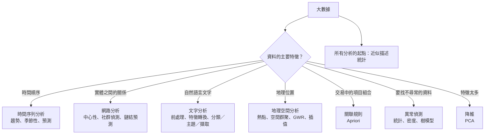
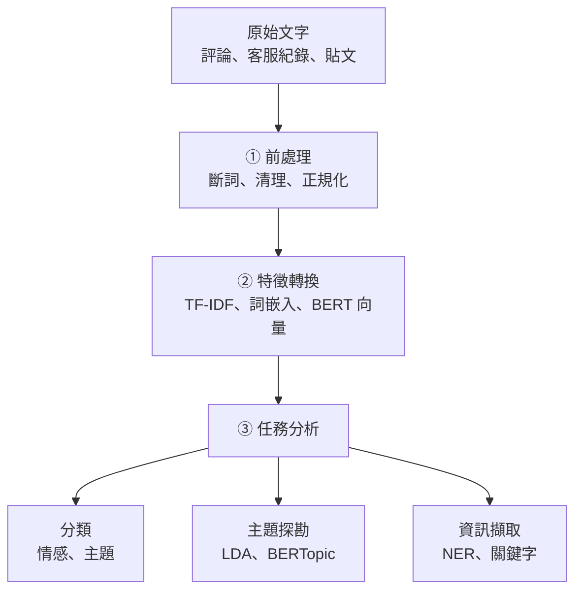

### Metadata
parent:: [[_【目錄】iPAS-AI應用規劃師(中級)：大數據處理分析與應用]]
sibling:: [[07統計學在大數據中的應用]] · [[09數據可視化工具]]

## Key Points
> [!summary] 一句話看懂
> **不同形狀的資料，要用不同的「鏡頭」看：**
> - 有**時間順序** → 時間序列分析（看趨勢與季節）
> - 有**關係連結** → 網路分析（看誰最重要、誰跟誰一群）
> - 是**文字** → 文字分析（看在說什麼、情緒如何）
> - 有**位置** → 地理空間分析（看哪裡熱、哪裡冷）
> - 找**不尋常** → 異常偵測（看誰不一樣）
> - 找**一起出現** → 關聯規則（看什麼常被一起買）

#### 大數據分析的四個特性
| 特性 | 意思 |
|---|---|
| **可擴展性** | 能處理數百 GB、TB 以上的資料 |
| **異質性** | 同時處理結構化、半結構化、非結構化資料 |
| **即時性** | 支援串流處理與即時回饋 |
| **近似性** | 為了效率，接受可容忍誤差的估算 |

#### 分析方法速查
| 方法 | 回答的問題 | 代表技術 | 代表工具 |
|---|---|---|---|
| **近似描述統計** | 超大資料的中位數、熱門項目？ | **t-digest、Count-Min Sketch、Welford** | Spark、BigQuery |
| **時間序列** | 趨勢、季節性、未來多少？ | **移動平均、指數平滑、ARIMA／SARIMA、Prophet、LSTM** | Prophet、TimescaleDB |
| **網路分析** | 誰最有影響力？誰跟誰同一群？ | **中心性、PageRank、Louvain** | **Neo4j**、GraphFrames、NetworkX |
| **文字分析** | 在說什麼？情緒如何？ | **TF-IDF、詞嵌入、BERT、NER、LDA** | spaCy、Hugging Face |
| **地理空間** | 哪裡是熱點？ | **KDE、Getis-Ord Gi\*、GWR、空間插值** | PostGIS、Sedona、QGIS |
| **異常偵測** | 哪些資料不正常？ | **Z-score／IQR、LOF、Isolation Forest** | PyOD、Elasticsearch |
| **關聯規則** | 哪些東西常一起出現？ | **Apriori**、FP-Growth；支持度、信賴度、增益 | Spark MLlib |
| **降維** | 特徵太多怎麼濃縮？ | **PCA**、t-SNE、UMAP | scikit-learn |

#### 網路中心性四指標
| 指標 | 衡量什麼 | 生活例子 |
|---|---|---|
| **度中心性** Degree | **直接連結數** | 粉絲最多的人 |
| **中介中心性** Betweenness | 是否位在別人之間的**橋樑**位置 | 兩個部門之間唯一的溝通窗口 |
| **接近中心性** Closeness | 到其他所有人的**平均距離有多短** | 消息傳到他手上最快的人 |
| **PageRank** | 被**重要的人**連結，自己也重要 | 被大咖推薦的新人 |

> [!warning] 陷阱題
> 1. **衡量兩變數線性關聯 → 相關係數**（官方考題原題）。
> 2. **建構節點與邊的關係網路（社群、推薦）→ 圖論分析**（官方考題原題）。
> 3. **TF-IDF＝凸顯具辨識性的關鍵詞、抑制到處都出現的常見詞**（官方考題原題）。
> 4. **信用卡詐騙識別 → 異常偵測**的典型應用（官方考題原題）。
> 5. **常見的線性降維方法 → PCA**，保留資料最大變異（官方考題原題）。
> 6. **找出「買牛奶常搭配買麵包」→ 關聯規則分析（Apriori）**（官方考題原題）。
> 7. **從文字中辨識品牌、人名、地點 → 命名實體識別（NER）**（官方考題原題）。
> 8. **ARIMA 適合線性、穩定的序列；SARIMA 多了季節性**；**Prophet 擅長節慶效應與缺失值**。
> 9. **詞形還原（Lemmatization）依字典與詞性還原，ran → run**；**詞幹提取（Stemming）用規則砍字尾**，速度快但結果不一定是真正的字。
> 10. **Isolation Forest：異常點容易被「隔離」，切幾刀就分出來**；**LOF：比較局部密度**。
> 11. **Getis-Ord Gi\* 找統計顯著的熱點與冷點；GWR 讓迴歸係數因地點而不同**（空間異質性）。
> 12. **關聯規則看增益（Lift）**：Lift > 1 才代表兩者真的有正向關聯。
>
> ⚠️ **學習指引錯誤或不精確的地方**
> - 指引說 Welford 方法「**特別適合偏態或含異常值的資料**」：錯誤。Welford 的優點是**逐筆更新、數值計算穩定**（避免大數相減造成的誤差），但它算出的仍是**平均數與變異數，一樣會被極端值拉動**。偏態或有異常值時應改看**中位數、分位數或 MAD**。
> - 指引的詞幹提取例子寫「**running、runner、ran 都截斷為 run**」：詞幹提取只會依規則砍掉字尾，**無法把不規則變化的 ran 變回 run**（這需要查字典的詞形還原），runner 通常也不會被還原成 run。
> - 指引說 Spark `approxQuantile()` 與 BigQuery `APPROX_QUANTILES()` 是「**基於 t-digest**」：兩者都是近似分位數演算法，但**並非 t-digest**（Spark 使用 Greenwald-Khanna 類演算法）。重點是知道它們以**可控誤差換取速度**即可。
> - 指引把 **Louvain 演算法**與**模組度最大化**（Modularity Maximization）並列為不同方法：Louvain **本身就是一種模組度最大化**的方法，是後者的快速近似解法。
> - 指引說可用 **LSTM、Transformer 預測股票價格**：金融價格接近隨機漫步，任何模型都很難穩定預測價格本身；這類模型在金融上較常用於**交易量、波動度、風險訊號**等。

> [!tip] PM 要記住的 3 件事
> 1. **先決定問題，再選方法**：「想知道下個月賣多少」是時間序列；「想知道誰會帶動別人購買」是網路分析；不要因為某個技術流行就硬套。
> 2. **2026 年的文字分析，大型語言模型常是第一選擇**：情感分析、主題分類、資訊擷取可以先用大型模型做原型，資料量大、成本敏感時再訓練小模型。
> 3. **異常偵測的價值取決於「誤報成本」**：每天 1,000 則警報沒人看得完，等於沒有警報。上線前要和營運團隊一起決定**可承受的誤報量**。

--- 
## Notes
### 全局地圖：依資料形狀選擇分析方法

- 統計觀念的補強見 [[07統計學在大數據中的應用]]；分析結果如何呈現見 [[09數據可視化工具]]。

---

### 一、近似描述統計
#### 1. 為什麼要「近似」
資料從幾十萬筆變成幾億筆、甚至持續串流時，傳統「把資料全部讀進來、排序、再計算」的方式會遇到**記憶體與時間的瓶頸**。**近似統計**的想法是：**在可容忍的誤差內，用極少的記憶體與一次掃描，快速得到夠用的答案**。

> [!example] 白話比喻
> 想知道全台灣成年人的身高中位數，不必真的量 2,000 萬人再排序。精心設計的方法只要記住一份「濃縮摘要」，就能算出誤差在 0.1 公分以內的答案。對決策來說，這已經完全足夠。

近似統計的三個常見目標：
- 用**一次掃描**或**分散式彙總**估算中位數與分位數。
- 在**串流**中持續更新平均數與變異數。
- 快速找出**熱門項目、集中區域、尾端行為**。

#### 2. 四種常用近似技術
##### (1) t-digest：估算分位數
t-digest 把資料濃縮成一組「質心」摘要，在**分佈兩端（如 P1、P99）特別精確**，正好是監控與異常偵測最在意的位置。它支援**逐筆增量更新**，也能把多台機器各自的摘要**合併**，非常適合分散式與串流環境。

應用：電商估算訂單金額的中位數與 P90；網路監控即時計算流量或回應時間的 **P99**，識別 DDoS 等異常。

##### (2) Histogram Sketch：近似直方圖
把資料分到多個區間，用少量記憶體近似整體分佈形狀，快速看出**偏態、峰度、集中區域**。適合大規模資料的初步探索與視覺化。

應用：社群平台快速畫出使用者活躍時段分佈；製造業檢視感測器數值分佈，發現品質變異。

##### (3) Count-Min Sketch：估算出現頻率
用幾個小型雜湊表記錄項目出現次數，**記憶體固定且極小**，即使項目種類多達數億也能運作。代價是估計值**可能偏高、但不會偏低**。

應用：即時找出**熱門商品**、**熱門搜尋詞**；偵測**高頻存取的 IP**，識別潛在攻擊來源。

##### (4) Welford 方法：線上平均數與變異數
每來一筆新資料就更新平均數與變異數，**不需要儲存歷史資料**。它的重點是**數值穩定**：傳統公式在資料量大、數值接近時，容易因大數相減而產生明顯誤差，Welford 避開了這個問題。

應用：IoT 即時監控感測器的平均值與變異；金融交易即時追蹤金額波動。

> ⚠️ Welford 算出的仍是平均數與變異數，**對極端值同樣敏感**。

**其他常見近似技術**：
- **HyperLogLog**：估算**不重複數量**（如不重複訪客數），幾 KB 記憶體可處理數十億筆。
- **蓄水池抽樣**：在串流中維持一份固定大小的隨機樣本。

#### 3. 平台內建支援
- **Apache Spark**：`approxQuantile()` 以指定誤差估算分位數；`summary()` 快速產生筆數、平均、標準差、最小值、四分位數、最大值，不需把資料全部載入單機記憶體。可與 Spark Streaming、MLlib 整合。
- **Google BigQuery**：`APPROX_QUANTILES()` 估算分位數、`APPROX_COUNT_DISTINCT()` 估算不重複數量（HyperLogLog），可大幅降低查詢成本。
- **PostgreSQL＋擴充套件**：安裝 `tdigest` 擴充後可在資料庫內直接計算近似分位數；內建 `percentile_cont` 可算精確分位數。適合中小規模或想**減少資料搬移**的情境。

---

### 二、時間序列分析
#### 1. 時間序列的組成
**時間序列資料**是依時間順序記錄的資料，例如股價、用電量、網站流量、感測器訊號、每日銷售額。分析前先理解它通常由四個部分組成：

- **趨勢（Trend）**：長期往上或往下的方向，例如營收逐年成長。
- **季節性（Seasonality）**：**固定週期**重複的模式，例如週末流量高、夏天用電多、年底購物季。
- **週期性（Cycle）**：**不固定長度**的起伏，例如景氣循環。
- **雜訊（Noise）**：無法解釋的隨機波動。

分析目標通常是：**識別趨勢、消除短期波動、捕捉季節模式、預測未來**。

#### 2. 趨勢與平滑方法
##### (1) 移動平均（Moving Average）
計算**固定時間窗口內的平均值**，例如「過去 7 天平均銷售額」，把每日的隨機起伏抹平，讓長期方向浮現。7 天窗口剛好也能消除「週一低、週六高」的週內循環。缺點是對最新變化**反應較慢**。

##### (2) 指數平滑（Exponential Smoothing）
同樣是平均，但**越近期的資料權重越高**，對變化反應更快，適合**短期預測**，例如預測下週的網站流量。進階版本 **Holt-Winters** 同時考慮趨勢與季節性。

這兩種方法計算簡單、記憶體需求低，**非常適合串流資料**與快速探索。

#### 3. 統計建模方法
##### (1) ARIMA（自迴歸整合移動平均）
由三個部分組成：
- **AR（自迴歸）**：用**過去的數值**預測現在，例如今天的銷量跟昨天、前天有關。
- **I（差分）**：把有趨勢的序列做相減（今天減昨天），讓它變得**平穩**（平均與變異不隨時間改變），這是 ARIMA 的前提。
- **MA（移動平均）**：用**過去的預測誤差**修正預測。

適合**線性、經差分後平穩**的序列，例如月度銷售額。

##### (2) SARIMA（季節性 ARIMA）
在 ARIMA 上**加入季節性成分**，適合有明確週期的資料，例如每月用電量、季度零售額。

統計模型的優點是**可解釋性強**，能說明「上個月的影響有多大」；缺點是需要較多手動調整，且難以處理大量序列與複雜的非線性關係。

#### 4. 進階預測模型
##### (1) Prophet
Meta（原 Facebook）開源的預測工具，把序列拆成**趨勢＋季節性＋節慶效應**。能自動處理**缺失值、節慶與趨勢轉折**，介面簡單，適合業務人員快速建立預測，例如網站流量、銷售高峰。

##### (2) 梯度提升樹（LightGBM、XGBoost）
把時間序列轉成表格特徵（滯後值、移動平均、星期幾、是否促銷），再用樹模型預測。在大型零售預測競賽（如 **M5 競賽**）中表現頂尖，是**業界預測大量商品需求**的主流方法之一。

##### (3) 深度學習（LSTM、Transformer）
擅長捕捉**長期依賴與非線性模式**，適合高頻、多變數的複雜序列，例如大量感測器資料。缺點是需要大量資料與運算資源，可解釋性較低。

##### (4) 時間序列基礎模型
2024 年起出現**預訓練好的時間序列大模型**（如 Google **TimesFM**、Amazon **Chronos**），概念類似大型語言模型：不必針對每條序列重新訓練，就能直接做**零樣本預測**，適合序列數量多、歷史資料短的情境。

> [!tip] 選擇建議
> 先用**簡單基準**（如「跟上週同一天一樣」）設底線，再試 Prophet 或指數平滑；大量商品的需求預測考慮梯度提升樹；只有在資料量大且複雜時才上深度學習。**複雜模型不一定比簡單模型準**。

#### 5. 時序資料平台
- **Spark＋MLlib**：分散式處理大量時間戳記資料，做時間分區查詢、滑動視窗統計，並可平行訓練大量序列的模型。
- **TimescaleDB**：PostgreSQL 的**時序資料庫擴充**，支援時間窗格查詢、統計聚合、高效壓縮，適合高頻資料，直接在資料庫層分析。其他常見時序資料庫還有 **InfluxDB**。
- **Prophet**：可與 pandas、Spark 整合。
- **Kats**：Meta 開源的時序分析框架，整合預測、**變化點偵測**與異常分析（近年維護較少，業界也常用 **Darts、sktime、StatsForecast** 等工具）。

#### 6. 應用情境
- **金融市場**：分析交易量、波動度與風險訊號（價格本身難以預測）。
- **能源與設備管理**：結合天氣資料預測**用電尖峰**（如夏季冷氣需求）；監控設備運轉資料，預測維護需求。
- **智慧製造與供應鏈**：預測訂單量、找出產能瓶頸、優化庫存與物流排程。
- **電商與行銷**：預測**雙 11** 等活動期間的流量與轉換率，提前擴充伺服器與客服人力。

---

### 三、網路分析（圖分析）
#### 1. 核心概念
許多資料的價值不在個體本身，而在**個體之間的關係**：社群上的人際互動、顧客與商品的購買關係、網頁之間的連結、帳戶之間的轉帳。這類資料可以表示成**網路（Network）**，也稱為**圖（Graph）**。

**基本元素**：
- **節點（Node）**：個體，例如使用者、商品、網頁、帳戶。
- **邊（Edge）**：節點之間的連結或互動，例如朋友關係、購買紀錄、超連結、轉帳。

**圖的屬性**：
- **有向或無向**：Instagram 的「追蹤」是**有向**的（A 追蹤 B 不代表 B 追蹤 A）；Facebook 的「朋友」是**無向**的。
- **加權**：邊帶有強度，例如購買次數、互動頻率、轉帳金額。
- **動態**：關係隨時間新增或消失。

**三大分析目標**：
- **節點重要性排序**：誰是意見領袖？哪個商品最能帶動其他商品？
- **社群結構辨識**：哪些人或商品自然形成一群？
- **路徑與鄰近關係**：資訊會怎麼擴散？誰可能認識誰？

#### 2. 中心性分析：誰最重要
##### (1) 度中心性（Degree Centrality）
計算節點的**直接連結數**，例如粉絲數。最直觀，但只看「認識多少人」，不看「認識的是誰」。

##### (2) 中介中心性（Betweenness Centrality）
計算一個節點**出現在其他節點之間最短路徑上的次數**。數值高代表他是**資訊的橋樑或守門人**，例如兩個部門之間唯一的溝通窗口。這種人一離開，資訊流就可能斷掉；在詐騙網絡中，中介中心性高的帳戶常是**洗錢的中轉站**。

##### (3) 接近中心性（Closeness Centrality）
根據節點到所有其他節點的**平均最短距離**計算，**距離越短、接近中心性越高**。數值高代表他能**最快把訊息傳給所有人**，適合找出資訊散播的最佳起點。

##### (4) PageRank
Google 早期用來排序網頁的演算法。核心概念是「**被重要的節點連結，自己也比較重要**」：一個網頁被 100 個沒人看的網頁連結，不如被 1 個權威網站連結。應用於**意見領袖偵測、推薦系統**。

> [!example] 同一個社群，不同的「重要」
> - **度中心性最高**：粉絲 50 萬的網紅
> - **中介中心性最高**：同時活躍在「登山社群」與「攝影社群」的人，兩群的資訊都要經過他
> - **PageRank 最高**：粉絲不多，但被多位大網紅追蹤與推薦的專家
>
> 行銷要找哪一種人合作，取決於目標是「曝光」「跨圈擴散」還是「專業背書」。

#### 3. 社群偵測：誰跟誰同一群
找出網路中**內部連結緊密、對外連結稀疏**的群體。

- **模組度（Modularity）**：衡量分群品質的指標，**群內連結比隨機情況多得越多，模組度越高**。
- **Louvain 演算法**：以**模組度最大化**為目標的快速分群方法，能處理數百萬節點，是最常用的社群偵測演算法（改良版 **Leiden** 演算法品質更穩定）。
- **標籤傳播（Label Propagation）**：每個節點反覆採用「多數鄰居的標籤」，最後收斂成群體。速度非常快，適合超大規模網路。

#### 4. 鏈結預測：誰可能產生新關係
預測**未來可能出現的連結**，例如「你可能認識的人」「你可能喜歡的商品」。
- **共同鄰居**：兩人共同朋友越多，越可能認識。
- **Jaccard 係數**：共同鄰居數 ÷ 兩人鄰居的聯集數，避免朋友多的人分數虛高。
- **圖神經網路（GNN）**：用深度學習同時考慮網路結構與節點屬性，是推薦系統與詐欺偵測的進階方法。

#### 5. 工具與框架
- **Apache Spark GraphX／GraphFrames**：在 Spark 上做**分散式圖計算**，處理**億級**節點與邊，並能整合進資料管線。
- **Neo4j**：最普及的**圖資料庫**，使用直觀的 **Cypher** 查詢語言，擅長即時路徑查詢；內建 **GDS**（Graph Data Science）函式庫，可做中心性、社群偵測等分析。
- **NetworkX／igraph**（Python）：完整的圖論函式，適合中小規模、原型開發與教學。
- **Gephi**：網路**視覺化**工具，適合探索性分析與呈現網路結構。

#### 6. 應用情境
- **社群媒體與意見擴散**：找出高影響力帳號、預測資訊傳播路徑，輔助行銷或危機管理。
- **推薦系統**：建構「使用者－商品」雙向網路，依共同點擊或購買行為推薦。
- **客戶關係管理**：找出能帶動其他顧客的**關鍵顧客**（例如推薦最多新客的人）。
- **詐欺偵測**：個別交易看起來都正常，但連成網路後會出現**共用裝置、共用地址、資金循環**等可疑結構，這是網路分析在金融業最重要的應用之一。
- **知識圖譜**：把實體與關係組成網路，作為搜尋、問答與 **GraphRAG** 的知識基礎。

---

### 四、文字分析
文字資料（顧客評論、客服對話、社群貼文、新聞、問卷開放題）是大數據中佔比極高的**非結構化資料**。文字分析的目的，是把自然語言轉成**可計算的結構資料**，支援分類、預測、情感分析與主題理解。NLP 技術細節見 [[01自然語言處理技術與應用]]。

#### 1. 第一步：文字前處理
##### (1) 斷詞（Tokenization）
把句子切成詞或詞組。英文有空格比較容易，**中文沒有空格**，斷詞本身就是挑戰。例如「我愛這款手機」→「我／愛／這款／手機」。中文常用 **jieba**、中研院 **CKIP** 等工具。

##### (2) 清理與正規化
- **去除標點符號**與無意義符號。
- **轉小寫**：讓「Phone」與「phone」被視為同一個詞。
- **繁簡、全半形統一**。

##### (3) 停用詞過濾（Stopword Removal）
移除「的、是、了、the、is」等出現頻率極高、但對主題判斷幫助不大的詞，降低資料維度。
⚠️ 情感分析時要小心：「**不**」常被列為停用詞，刪掉後「不好用」就變成「好用」。

##### (4) 詞形還原（Lemmatization）
依據**字典與詞性**，把詞還原成標準形式。例如 running、ran、runs 都還原成 **run**；better 還原成 **good**。結果是**真正存在的字**，語意保留較好，但速度較慢。

##### (5) 詞幹提取（Stemming）
依**規則砍掉字尾**，例如 running → run、connection → connect。速度快，但不查字典，所以可能產生不是真正單字的結果（如 happiness → happi），也**無法處理不規則變化**（ran 不會變成 run）。

> 詞形還原與詞幹提取主要用於**英文等有字形變化的語言**；中文沒有詞形變化，通常不需要。使用大型語言模型時，這些前處理多半也**不必再做**，模型能直接理解原始文字。

#### 2. 第二步：特徵轉換
##### (1) 詞頻（TF）
計算詞在單一文件中出現的頻率。簡單，但「的」「我們」這種詞到處都是，頻率高卻沒有辨識度。

##### (2) TF-IDF（詞頻－逆文件頻率）
核心想法：**在這篇文章常出現、但在其他文章很少出現的詞，才是這篇文章的關鍵詞。**

$$\text{TF}(t, d) = \frac{\text{詞 } t \text{ 在文件 } d \text{ 出現的次數}}{\text{文件 } d \text{ 的總詞數}}$$

$$\text{IDF}(t) = \log \frac{\text{文件總數}}{\text{含有詞 } t \text{ 的文件數}}$$

$$\text{TF-IDF} = \text{TF} \times \text{IDF}$$

> [!example] 計算範例
> 語料庫共有 1,000 篇評論，「電池」只出現在其中 10 篇；某篇評論共 100 個詞，「電池」出現 3 次。
> 1. TF＝3 ÷ 100＝**0.03**
> 2. IDF＝log₁₀（1,000 ÷ 10）＝log₁₀ 100＝**2**
> 3. TF-IDF＝0.03 × 2＝**0.06**
>
> 相比之下，「的」出現在 1,000 篇中的每一篇，IDF＝log 1＝**0**，TF-IDF 也就是 0，自動被排除。

TF-IDF 的優點是**簡單、可解釋**，在**文件檢索、文本分類**上表現穩定；缺點是**不懂語意**，「手機」和「行動電話」被當成完全不同的詞，也無法處理一詞多義。

##### (3) 詞嵌入（Word Embedding）
把每個詞轉成一個**向量**，語意相近的詞向量也相近，例如「手機」與「平板」距離很近。
- **Word2Vec**：從上下文學習詞向量。
- **GloVe**：根據**整體語料的詞共現統計**學習詞向量。
- **FastText**：考慮**字詞的組成片段（子詞）**，能處理拼錯字與沒看過的新詞。

##### (4) 深度語意嵌入
**BERT、RoBERTa** 等 Transformer 模型會依**上下文**產生向量，同一個詞在不同句子中有不同向量，能區分「蘋果很好吃」與「蘋果發表新手機」。現代的**文字嵌入模型**（如各大廠的 embedding API）更進一步把整句或整段轉成向量，用於語意搜尋與 RAG。

#### 3. 第三步：任務分析
**分類**：情感分析（正面、負面、中立）、主題分類（這則評論在講品質、物流還是服務）、意圖辨識（客戶想退貨還是查訂單）。

**主題探勘（Topic Modeling）**：在**沒有標籤**的情況下，自動找出大量文件中的主題。
- **LDA（潛在狄利克雷分配）**：經典方法，假設每篇文件由多個主題混合而成、每個主題由一組詞組成，例如找出「價格」「品質」「客服」等主題。
- **BERTopic**：結合 BERT 嵌入與分群，主題更貼近語意，是目前常用的現代方法。

**資訊擷取**：
- **命名實體識別（NER）**：自動標出**人名、地名、品牌、產品、日期、金額**等實體。例如從評論中抓出被提到的品牌，或從合約中抓出金額與日期。
- **關鍵字抽取**：找出最能代表文件的詞。

#### 4. 大型語言模型帶來的改變
傳統流程需要前處理、特徵轉換、訓練分類器；現在**大型語言模型可以直接讀原始文字完成任務**：
- **零樣本分類**：只要描述類別，不需標註資料就能分類評論。
- **摘要與主題歸納**：把數千則評論濃縮成主要抱怨與建議。
- **結構化擷取**：從自由文字中抽出指定欄位，輸出成表格。

實務上常見的組合是：**用大型模型快速做原型與少量標註 → 資料量大、成本敏感時，再訓練小型模型**處理大量資料。

#### 5. 工具與框架
- **Spark NLP**：在 Spark 上做大規模文字處理（斷詞、詞性標註、NER）。
- **spaCy**：輕量、高效的 NLP 框架，適合商業應用。
- **Hugging Face Transformers**：大量預訓練模型（BERT 等），支援微調與多語言。
- **Gensim**：Word2Vec、LDA 等經典模型。

#### 6. 應用情境
- **顧客評論分析**：分類正負評，找出特定品類的關鍵抱怨（如「電池壽命」「價格」）。
- **社群與輿情監控**：分析 PTT、Facebook、Threads、X 等平台的公開發文，追蹤品牌聲量與熱門話題。
- **客服紀錄分類**：自動辨識問題類型（物流、退貨、帳號），支援**智慧路由**與知識庫建置。
- **多語言處理**：處理中英混雜評論，分析跨境客戶意見。

---

### 五、地理空間分析
#### 1. 地理空間資料的特性與挑戰
**地理空間資料**記錄與位置相關的資訊，來源包括 GPS、手機定位、氣象監測、物流追蹤、城市感測器。它能回答「**事件在哪裡發生**」「**不同地點有何差異**」「**鄰近區域如何互相影響**」。

**三種資料型態**：
- **點資料**：一個座標，例如商店位置、事故地點。
- **線資料**：連續路徑，例如道路、鐵路、管線。
- **面資料**：一個範圍，例如行政區、土地使用分區。

**四個挑戰**：
- **空間異質性**：不同地區的特性差異很大（都市與鄉村的消費行為完全不同），**一個全域模型無法概括**所有地方。
- **空間自相關**：地理學第一定律說「**所有事物都相關，但近的事物比遠的更相關**」。相鄰商店的業績會互相影響，這**違反統計的獨立性假設**，忽略它會讓推論出錯。
- **資料規模龐大**：高頻 GPS 與連續感測器產生**億級資料點**。
- **座標與精度**：不同系統使用不同座標系統，定位也有誤差，整合前要先統一。

#### 2. 常見分析方法
##### (1) 熱點分析（Hotspot Detection）
找出事件**特別密集**的區域，例如高犯罪區、高銷售區。
- **核密度估計（KDE）**：把每個事件點想像成一個「熱源」，加總後形成平滑的**熱力圖**。直觀好懂，但只顯示密度，**不判斷是否統計顯著**。
- **Getis-Ord Gi\***：檢定某區域及其鄰近區域的數值，是否**顯著高於或低於**整體平均，找出**統計上顯著的熱點與冷點**。

##### (2) 空間群聚（Spatial Clustering）
依位置（加上屬性）把資料分群。
- **K-means（含座標）**：適合分佈較均勻、群體形狀接近圓形的情況。
- **DBSCAN**：依密度分群，能找出**任意形狀**的群體並排除零散點，適合真實世界不規則的分佈（如沿著道路分佈的店家）。

##### (3) 地理加權迴歸（GWR）
一般迴歸假設「每個變數的影響在各地都一樣」；GWR 讓**迴歸係數隨地點變化**。例如「捷運站距離」對房價的影響，在台北市可能很大、在郊區可能很小。GWR 能明確呈現這種**空間異質性**。

##### (4) 空間插值（Spatial Interpolation）
用**已知測站**的數值推估**未知地點**的數值，產生連續分佈圖。例如只有幾十個空氣品質測站，要推估全市每個街區的 PM2.5。常用方法有**反距離加權**（IDW）與**克利金法（Kriging）**。

#### 3. 工具與框架
- **GeoPandas**（Python）：讓 pandas 處理地理資料，支援座標運算、空間交集、緩衝區分析，適合中小規模與原型。
- **ArcGIS／QGIS**：圖形化 GIS 平台（ArcGIS 為商用、QGIS 為開源），適合視覺化、熱點分析與報告。
- **Apache Sedona**：在 Spark 上做**分散式空間運算**，處理億級資料。
- **PostGIS**：PostgreSQL 的**空間資料庫擴充**，支援距離計算、空間交集、**空間索引**，適合即時查詢與儲存。
- 雲端資料倉儲（如 **BigQuery GIS**）也內建空間函式。
- **H3**：Uber 開源的**六角形網格系統**，把地球切成大小一致的六角格，方便彙總與比較不同區域，廣泛用於外送、叫車與物流。

#### 4. 應用情境
- **商業選址**：結合消費熱點、人流、交通便利度與競品位置，選擇最佳展店位置。
- **物流最佳化**：分析配送點、交通流量與距離，規劃車隊路線與動態調度。
- **環境與公共安全**：結合氣象與感測資料，預測空氣品質、噪音或災害熱區。
- **智慧城市**：觀察人口活動熱點，規劃交通與公共資源。

---

### 六、關聯規則分析
#### 核心概念
**關聯規則分析**從大量交易中找出「**哪些項目常常一起出現**」，最經典的應用是**購物籃分析**：「買牛奶的人，也常買麵包」。規則寫成 **{牛奶} → {麵包}**。

**三個關鍵指標**：

**支持度（Support）**：這個組合在所有交易中**出現的比例**，代表規則有多常見。

$$\text{Support}(A \rightarrow B) = \frac{\text{同時含 A 和 B 的交易數}}{\text{總交易數}}$$

**信賴度（Confidence）**：買了 A 的人中，**也買 B 的比例**，代表規則有多可靠。

$$\text{Confidence}(A \rightarrow B) = \frac{\text{同時含 A 和 B 的交易數}}{\text{含 A 的交易數}}$$

**增益（Lift）**：買了 A 之後，買 B 的機率**比平常提高了幾倍**，代表關聯是否真實。

$$\text{Lift}(A \rightarrow B) = \frac{\text{Confidence}(A \rightarrow B)}{\text{Support}(B)}$$

- **Lift > 1**：正相關，A 會帶動 B。
- **Lift ＝ 1**：互相獨立，沒有關係。
- **Lift < 1**：負相關，買 A 的人反而較少買 B。

> [!example] 為什麼一定要看 Lift
> 1,000 筆交易中，800 筆有買**塑膠袋**。規則 {牛奶} → {塑膠袋} 的信賴度高達 80%，看起來很強。
> 但塑膠袋本來就有 80% 的人買，Lift＝0.8 ÷ 0.8＝**1**，**牛奶根本沒有帶動塑膠袋**。
> 只看信賴度會被「本來就很熱門的商品」誤導。

#### 演算法
- **Apriori**：核心原則是「**如果一個組合不常見，包含它的更大組合也一定不常見**」，藉此大量刪減要檢查的組合。概念簡單，但資料大時需要多次掃描。
- **FP-Growth**：把交易壓縮成一棵樹，**只需掃描兩次資料**，速度比 Apriori 快很多，Spark MLlib 內建支援。

#### 應用情境
- **零售**：商品陳列、組合促銷、「常一起購買」推薦。
- **電商**：購物車加購推薦。
- **醫療**：找出常同時出現的症狀或用藥組合。
- **網站分析**：找出常一起瀏覽的頁面，優化導覽動線。

---

### 七、異常偵測
#### 1. 為什麼重要、為什麼難
**異常**往往代表**風險、錯誤或可疑行為**：金融詐騙、系統錯誤、設備故障、惡意流量。它們**發生頻率極低，但後果可能極大**。異常偵測的目標，是從大量正常資料中自動找出偏離預期的觀測值。

**大數據下的四個挑戰**：
- **極度不平衡**：詐欺可能只佔 0.1%，模型很容易「全部猜正常」就得到 99.9% 準確率，但毫無用處。
- **即時性**：信用卡授權要在**毫秒級**完成判斷。
- **多型態資料**：異常可能藏在數值（金額）、文字（日誌）、影像（監控畫面）或時間序列（感測器）中。
- **可解釋性**：業務人員需要知道「**為什麼這筆被標記為異常**」，才能決定是否攔截、如何向客戶說明。

#### 2. 常見方法
##### (1) 統計方法
- **Z-score／IQR 閾值法**：偏離平均超過 3 個標準差（Z > 3），或超出 Q1 − 1.5×IQR、Q3 + 1.5×IQR 即標記。簡單快速，適合**單一變數**。
- **滑動視窗指標**：在時間序列中持續計算近期的平均與標準差，偵測突然的偏離，例如某台伺服器的錯誤率突然飆升。

##### (2) 密度與距離方法
- **LOF（局部離群因子）**：比較一個點與其**鄰居的局部密度**。周圍很稀疏、而鄰居周圍很密集的點，就是異常。優點是能處理**不同區域密度不同**的資料。
- **KNN 異常分數**：計算與最近 k 個鄰居的平均距離，距離越遠越異常。

##### (3) 樹模型
- **孤立森林（Isolation Forest）**：用隨機切割的方式把資料一刀一刀分開。**異常點通常很孤立，切幾刀就被單獨分出來**；正常點擠在一起，要切很多刀才分得開。速度快、適合高維度大資料，是最常用的方法之一。
- **隨機切割森林（Random Cut Forest）**：Amazon 改良的版本，特別適合**串流資料**，AWS 的多項服務內建此演算法。

##### (4) 其他常見方法
- **自編碼器（Autoencoder）**：用正常資料訓練神經網路「壓縮再還原」，遇到異常資料時**還原誤差特別大**，適合影像與複雜感測資料。
- **監督式模型**：如果有足夠的歷史異常標籤（如已確認的詐欺案例），用梯度提升樹等分類模型通常效果最好。
- **規則引擎**：業務規則（如「同一張卡 10 分鐘內在兩個國家刷卡」）仍是金融風控的重要一環，常與模型搭配。

#### 3. 工具與框架
- **PyOD**：整合數十種異常偵測演算法，適合快速比較與原型開發。
- **Spark MLlib＋Structured Streaming**：分散式、即時的異常偵測。
- **Elasticsearch 機器學習模組**：針對日誌與時間序列做即時異常監測。
- **雲端平台**（AWS SageMaker、Azure Machine Learning）：提供訓練、部署與自動化流程。

#### 4. 應用情境
- **金融詐欺偵測**：即時分析信用卡交易的金額、地點、裝置組合。
- **設備故障預警**：從振動、溫度、耗電的時間序列中找出異常模式，做**預測性維護**。
- **網路安全**：偵測異常登入、惡意掃描、資料外洩行為。
- **客戶行為**：偵測帳號異常使用或流失風險突增。
- **資料品質監控**：資料管線中某欄位的缺失率或分佈突然改變（見 [[04數據收集與清理]]）。

---

### 八、降維：主成分分析（PCA）
#### 為什麼需要降維
大數據常有**數百甚至數千個特徵**，帶來幾個問題：
- **運算慢**、需要更多記憶體。
- **維度災難**：維度越高，資料點之間越稀疏，距離計算越失去意義，KNN、分群等方法效果變差。
- **共線性**：許多特徵高度相關，提供重複的資訊。
- **無法視覺化**：人只能看懂二維或三維的圖。

#### PCA 的原理
> [!example] 白話比喻
> 拍一張團體照，要選一個角度讓**每個人都看得最清楚、最不重疊**。PCA 就是在高維空間中找出「**資料分佈最開的方向**」，把資料投影過去。

- PCA 找出一組新的座標軸（**主成分**），第一主成分是**資料變異最大的方向**，第二主成分是與第一主成分**垂直**、變異次大的方向，依此類推。
- 只保留前幾個主成分，就能用**少數維度保留大部分資訊**，例如用 10 個主成分保留原本 200 個特徵 90% 的變異。
- PCA 是**線性**方法；使用前通常要先**標準化**，否則數值大的特徵會主導結果。
- 缺點：新的主成分是原始特徵的組合，**較難用業務語言解釋**。

#### 其他降維方法
- **t-SNE、UMAP**：非線性降維，擅長把高維資料畫成**二維散佈圖**，看出分群結構，主要用於**視覺化探索**。
- **自編碼器**：用神經網路學習壓縮表示。
- **特徵選擇**（見 [[06數據處理技術與工具]]）：直接挑出重要的原始特徵，保留可解釋性。

---

### PM 檢查清單：選擇分析方法的 6 個問題
1. **要回答什麼商業問題？** 預測多少、找出誰、了解為什麼，還是發現異常？
2. **資料是什麼形狀？** 時間序列、網路、文字、地理位置，還是交易組合？
3. **需要多即時？** 每天一次、每小時，還是每筆交易當下？
4. **需要精確值嗎？** 近似統計的誤差能否接受？
5. **結果要給誰用？** 業務人員需要可解釋的結果，還是系統自動執行？
6. **怎麼衡量成效？** 預測誤差、誤報率、找到的詐欺金額，還是轉換率提升？

---
## References
- iPAS AI應用規劃師(中級)學習指引 科目2：大數據處理分析與應用 — 5.2 常見的大數據分析方法、第五章考題解析
- Dunning, T. & Ertl, O. (2019). *Computing Extremely Accurate Quantiles Using t-Digests*
- Cormode, G. & Muthukrishnan, S. (2005). *An Improved Data Stream Summary: The Count-Min Sketch*
- Hyndman, R. J. & Athanasopoulos, G. *Forecasting: Principles and Practice* (3rd ed.)
- Blondel, V. D. et al. (2008). *Fast unfolding of communities in large networks*（Louvain）
- Liu, F. T., Ting, K. M. & Zhou, Z.-H. (2008). *Isolation Forest*
- Agrawal, R. & Srikant, R. (1994). *Fast Algorithms for Mining Association Rules*（Apriori）
- Ord, J. K. & Getis, A. (1995). *Local Spatial Autocorrelation Statistics*
![[AI應用規劃師(中級)-學習指引-科目2大數據處理分析與應用_20251222101850.pdf]]
