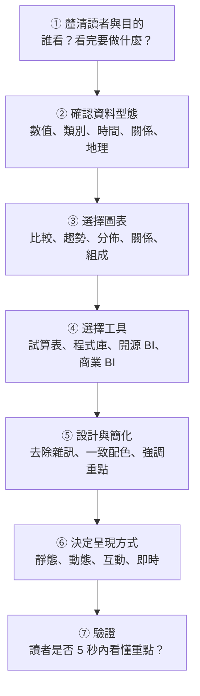
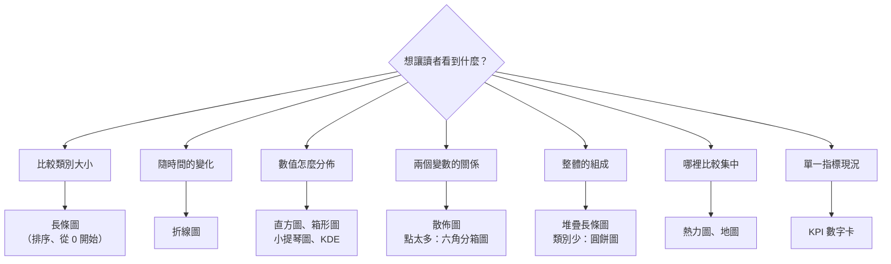

### Metadata
parent:: [[_【目錄】iPAS-AI應用規劃師(中級)：大數據處理分析與應用]]
sibling:: [[07統計學在大數據中的應用]] · [[08常見的大數據分析方法]]

## Key Points
> [!summary] 一句話看懂
> **視覺化是資料與人之間的翻譯：目的不是「好看」，而是讓對的人在幾秒內看懂、看對、並採取行動。**
> 選圖表的關鍵只有一句：**先想清楚你要讓讀者「比較什麼」**——比大小、看趨勢、看分佈、看關係、還是看組成。

#### 依目的選圖表（必考）
| 想表達 | 首選圖表 | 例子 |
|---|---|---|
| **類別比較** | **長條圖** | 各商品銷量、各通路營收 |
| **時間趨勢** | **折線圖** | 每日訪客數、月營收 |
| **數值分佈** | **直方圖**、**箱形圖**、KDE 曲線、小提琴圖 | 消費金額分佈、各地區銷售額比較 |
| **兩變數關係** | **散佈圖** | 廣告花費 vs 轉換數 |
| **多變數相關** | **相關係數矩陣（熱力圖）** | 模型特徵的共線性檢查 |
| **組成比例** | **堆疊長條圖**；類別少時可用圓餅圖 | 各地區會員等級結構、市占率 |
| **強度或密度** | **熱力圖** | 網站點擊熱區、時段 × 星期的流量 |
| **地理分佈** | **地圖**、地理熱力圖 | 門市業績、交通壅塞 |
| **單一 KPI 現況** | **KPI 數字卡**、儀表圖 | 本月達成率 |

#### 視覺化工具四大類
| 類型 | 代表 | 適合 |
|---|---|---|
| **試算表內建** | Excel、Google Sheets | 小資料、快速原型、非技術人員 |
| **程式函式庫** | Python：**Matplotlib、Seaborn、Plotly**、Altair；R：**ggplot2、Shiny**；JS：**D3.js**、Vega-Lite、Chart.js、ECharts | 資料科學家、高度客製 |
| **開源／輕量 BI** | **Metabase、Apache Superset、Grafana**、Redash | 中小企業、自建、即時監控（Grafana） |
| **商業 BI** | **Tableau、Power BI、Looker**、Qlik Sense | 企業級報表、權限管理、跨部門 |

#### 四種呈現方式
| 方式 | 特性 | 適合 |
|---|---|---|
| **靜態** | 固定圖片、PDF | 正式報告、簡報、出版 |
| **動態（動畫）** | 用動畫呈現變化 | 展示排名變動、長期趨勢 |
| **互動式** | 可篩選、點擊、下鑽 | 多角色儀表板、深入探索 |
| **即時** | 資料持續更新 | 監控設備、流量、詐欺 |

> [!warning] 陷阱題
> 1. **呈現類別變數分佈 → 長條圖**（官方考題原題）。
> 2. **網站每日訪客數的趨勢 → 折線圖**（官方考題原題）。
> 3. **箱形圖用點或星號單獨標記異常值**（官方考題原題）。
> 4. **直方圖用於「連續數值」的分佈；長條圖用於「類別」的比較**。直方圖的柱子相連，長條圖的柱子分開。
> 5. **圓餅圖只適合少數類別（約 5 類以內）**，且不適合精細比較。
> 6. **散佈圖點太多會重疊** → 用透明度、抽樣、六角分箱圖或密度圖。
> 7. **相關係數矩陣只看得到線性相關**。
> 8. **KDE 曲線受頻寬（bandwidth）影響；直方圖受分組數（bins）影響**。
> 9. **Grafana＝時間序列與即時監控**；**Kibana＝搭配 Elasticsearch 做日誌分析**。
> 10. **箱形圖看不出多峰分佈** → 搭配直方圖或小提琴圖。
>
> ⚠️ **學習指引錯誤或過時的地方**
> - 指引說箱形圖的缺點是「**對異常值敏感**」：錯誤。箱形圖由**中位數與四分位數**構成，正是**不受異常值影響**的穩健圖表，異常值會被**獨立標示**而不會拉動箱子。它真正的缺點是**看不出分佈形狀**（如多峰）。
> - 指引把 **SAP Lumira** 列為商業視覺化平台：SAP Lumira 已**停止發展與主流維護**，SAP 的現行產品是 **SAP Analytics Cloud**。
> - 指引的顏色原則寫「**綠＝成長、紅＝下降**」：這是**歐美股市慣例**。**台灣、中國大陸、日本股市是「紅漲綠跌」**，給台灣讀者看的財務圖表若照歐美配色，很容易被看反。配色要**依讀者的文化習慣**決定，並在圖例中明確標示。
> - 指引未提到 **Google Looker 與 Looker Studio 是兩個不同產品**：Looker 是企業級 BI 與資料建模平台；**Looker Studio**（原 Google Data Studio）是免費、輕量的報表工具。

> [!tip] PM 要記住的 3 件事
> 1. **一張圖只講一件事**：圖表標題直接寫結論，例如「**Q3 新客轉換率下滑 15%，主因是行動版結帳流程**」，而不是「Q3 轉換率趨勢」。
> 2. **儀表板先問「誰看、看完要做什麼決定」**：主管要看 3～5 個 KPI 與異常；分析師要能篩選與下鑽。同一份儀表板很難同時滿足兩者。
> 3. **小心「說謊的圖表」**：縱軸不從 0 開始、雙縱軸、3D 圓餅圖，都可能讓小差異看起來很大。看別人的圖時也要檢查。

--- 
## Notes
### 全局地圖：從資料到決策的視覺化流程

- 大數據讓視覺化面臨新挑戰：**資料量極大、更新頻繁、讀者角色多樣（從分析師到決策者）、需跨裝置即時呈現**。所以除了圖表知識，還需要**平台整合、互動設計與可解釋性**的能力。
- 統計圖表的基礎（箱形圖、偏態）見 [[01敘述性統計與資料摘要技術]]。

---

### 一、依資料型態選擇圖表
#### 1. 人眼怎麼看圖：為什麼有些圖比較好懂
選圖表不只是習慣，背後有**視覺感知研究**支持。Cleveland 與 McGill 的經典研究發現，人眼判斷數值的準確度大致是：

**位置（同一基準線上） > 長度 > 角度 > 面積 > 顏色深淺**

這解釋了幾件事：
- **長條圖**用「同一基準線上的長度」表達數值，最容易比較。
- **圓餅圖**用「角度與面積」，人眼很難分辨 23% 和 27% 的扇形差異。
- **熱力圖**用「顏色深淺」，適合看整體模式，不適合讀精確數值。

#### 2. 數值資料：看分佈與集中趨勢
##### (1) 直方圖（Histogram）
把連續數值切成多個區間（bins），用柱子高度表示每個區間的**資料筆數**，呈現分佈形狀。
- **用途**：看資料集中在哪、是否偏態、有沒有多個高峰或異常值。例如顧客消費金額、網站停留時間。
- **優點**：直觀看出分佈形狀，容易發現**多峰**（可能混了兩種客群）。
- **注意**：**分組數會影響結果**。分太少看不出細節，分太多變得破碎；資料太少時不適用。

##### (2) 箱形圖（Box Plot）
用**中位數、Q1、Q3、鬚與離群值**摘要分佈（構造詳見 [[01敘述性統計與資料摘要技術]]）。
- **用途**：**並排比較多組資料**的分佈差異，例如各地區的銷售額、各產品類別的評分。
- **優點**：一眼看出中心、離散程度與異常值；**不受極端值影響**；適合多組比較。
- **注意**：**看不出分佈形狀**，兩組形狀完全不同的資料可能畫出一樣的箱形圖。

##### (3) 小提琴圖（Violin Plot）
箱形圖加上兩側的密度曲線，**同時看到摘要統計與分佈形狀**，可以補足箱形圖看不出多峰的缺點。

##### (4) KDE 曲線（核密度估計）
用平滑曲線估計資料的機率密度，像是「平滑版的直方圖」。
- **用途**：觀察分佈輪廓，特別適合把**多個群體疊在一起比較**，例如不同年齡層的消費分佈。
- **優點**：平滑、容易看出多峰與偏態。
- **注意**：**頻寬**（bandwidth）設太大會抹平細節、太小會出現假的高峰；也不會直接顯示異常值。

#### 3. 關係資料：看變數之間的關聯
##### (1) 散佈圖（Scatter Plot）
用二維座標畫出兩個變數，每個點代表一筆資料，可加上**趨勢線**。
- **用途**：看兩個變數的關係（正相關、負相關、非線性）、找群聚與異常點。例如價格與銷量、廣告花費與轉換數。
- **注意**：資料量大時點會**互相重疊**，看起來一團黑。解法：調整**透明度**、**抽樣**、改用**六角分箱圖**（Hexbin）或**密度圖**。

##### (2) 相關係數矩陣（Correlation Matrix）
計算多個變數兩兩之間的皮爾森相關係數（−1 到 +1），用**熱力圖**的顏色表示強弱與正負。
- **用途**：快速檢查**共線性**，例如建模前看哪些特徵高度相關。
- **注意**：只反映**線性**關係；非線性關係要用其他方法（如互資訊）。

##### (3) 熱力圖（Heatmap）
用**顏色深淺**表示數值大小或密度。
- **用途**：網站點擊熱區、「星期 × 時段」的流量分佈、各區域銷售表現。
- **優點**：一眼看出強弱模式與集中區域。
- **注意**：配色很關鍵；類別太多會變得混亂。

#### 4. 類別資料：比較群體與組成
##### (1) 長條圖（Bar Chart）
用柱子長度表示各類別的數值，是**最常用、最容易比較**的圖表。
- **用途**：各商品銷量、各通路營收、問卷選項次數。
- **設計提醒**：**依數值排序**最容易閱讀；類別名稱很長時改用**橫向長條圖**；類別太多時只顯示前幾名，其餘合併為「其他」；**縱軸一定要從 0 開始**，否則長度比例會失真。

##### (2) 堆疊長條圖（Stacked Bar Chart）
把每根長條再細分成子類別，**同時呈現總量與組成**。
- **用途**：各地區會員等級的組成、各產品線的營收結構。
- **注意**：只有**最底下那一段**有共同基準線，上面幾段很難比較；子類別太多時不易辨識。要比較「比例」時，可用**百分比堆疊長條圖**（每根都是 100%）。

##### (3) 圓餅圖（Pie Chart）
用扇形面積表示各部分占整體的比例。
- **用途**：只想表達「**誰占大部分**」，例如某品牌市占率過半。
- **限制**：適合**5 類以內**；扇形之間差距不大時幾乎無法比較；**絕對不要用 3D 圓餅圖**，透視會讓前面的扇形看起來比較大。
- 多數情況下，**長條圖比圓餅圖更容易精確比較**。

#### 5. 時間序列資料：看趨勢與變化
##### (1) 折線圖（Line Chart）
用連續線條表示數值隨時間的變化，是呈現**趨勢、週期、轉折**的首選。
- **用途**：每日銷售額、每月活躍用戶、網站流量。
- **設計提醒**：
  - 線條太多會糾纏在一起，**建議 5 條以內**；更多時可用**小倍數圖**（每個類別各畫一張小圖並排）或互動式篩選。
  - 在圖上**標註重要事件**（促銷開始、系統改版），讀者才知道轉折的原因。
  - 雜訊太大時，加上**移動平均線**呈現趨勢。

##### (2) 其他時間相關圖表
- **面積圖**：強調累積量。
- **時間軸圖（Timeline）**：呈現事件發生順序，例如病患的診療歷程。
- **甘特圖**：呈現任務的時程與重疊。

#### 6. 地理資料與其他常見圖表
- **分層設色地圖（Choropleth）**：依行政區上色，例如各縣市營收。注意**面積大的區域會看起來比較重要**，人口少但面積大的縣市容易誤導。
- **點地圖與地理熱力圖**：呈現門市、事故、交通壅塞的位置與密度。
- **KPI 數字卡**：直接顯示關鍵數字與前期比較（如「營收 1,250 萬，↑ 8% vs 上月」），是儀表板最上方最常見的元素。
- **儀表圖（Gauge）**：呈現目標達成率，直觀但佔空間，數量不宜多。
- **網路圖**：呈現節點與關係（見 [[08常見的大數據分析方法]]）。
- **桑基圖（Sankey）**：呈現流量的去向，例如使用者從首頁到結帳的流失路徑。

---

### 二、視覺化工具與平台
#### 1. 試算表內建工具
**Excel、Google Sheets** 內建的圖表功能。
- **優點**：不必寫程式，人人會用；Google Sheets 支援雲端多人協作。
- **限制**：圖表種類與客製化有限；資料量一大就變慢，**不適合大數據**。
- **適合**：小型資料的快速分析與原型，例如銷售小報表、問卷結果。

#### 2. 程式函式庫：高度客製化
適合資料科學家與工程師，用程式碼控制圖表的每個細節，並能整合資料處理與機器學習流程。

##### (1) Python
- **Matplotlib**：最基礎的繪圖函式庫，幾乎能畫任何靜態圖，但語法較繁瑣。
- **Seaborn**：建立在 Matplotlib 上，**一行程式**就能畫出統計圖表（熱力圖、KDE、小提琴圖），適合資料探索。
- **Plotly**：**互動式**圖表（可縮放、滑鼠移過顯示數值），適合網頁與儀表板。
- **Altair**：以 Vega-Lite 為基礎的**宣告式**語法，「描述你要什麼」而不是「一步步畫出來」，適合快速原型。
- **Streamlit、Dash**：用 Python **快速做出互動式網頁應用與儀表板**，資料團隊很常用。

##### (2) R
- **ggplot2**：以「**圖層語法**」為核心，產出高品質統計圖表，學術與統計界廣泛使用。
- **Shiny**：建立互動式網頁應用與儀表板。

##### (3) JavaScript
- **D3.js**：彈性最高，可做出任何客製化互動視覺化（如網路圖），但學習曲線陡。
- **Vega-Lite**：宣告式框架，比直接寫 D3 簡單。
- **Chart.js**：輕量，適合在網頁中嵌入簡單圖表。
- **Apache ECharts**：功能完整、效能好，支援大量資料點，在華語圈非常普及。

#### 3. 開源與輕量 BI 平台
提供**網頁介面與 SQL 查詢**，兼顧易用性與彈性。常見商業模式是「**開源版免費自建**，雲端託管或進階功能付費」，適合中小企業或分析團隊。

- **Metabase**：介面直觀，不懂 SQL 的人也能用點選方式查詢與建立儀表板。
- **Apache Superset**：功能豐富、圖表多樣，可直接連接 BigQuery、Snowflake 等大型資料倉儲。
- **Grafana**：專注**時間序列與即時監控**，常搭配 Prometheus、InfluxDB，是系統與 IoT 監控的標準工具。
- **Redash**：以 SQL 查詢與視覺化為主；2020 年被 Databricks 收購後，開源版發展已明顯放緩。
- **Kibana**：搭配 Elasticsearch，擅長**日誌搜尋與分析**。

#### 4. 商業 BI 平台
為企業設計，提供**拖拉式操作、權限管理、多資料來源整合、企業級穩定性與技術支援**，多需付費。

- **Tableau**（Salesforce 旗下）：視覺化能力最強、互動分析靈活，適合複雜儀表板。
- **Power BI**（Microsoft）：與 Excel、Teams、Azure 深度整合，**成本較低**，在企業普及率很高；目前已整合進 **Microsoft Fabric** 資料平台。
- **Looker**（Google）：強調**語意層**（統一定義指標，例如全公司的「營收」只有一種算法），適合重視資料治理的企業。另有免費的輕量工具 **Looker Studio**。
- **Qlik Sense**：以**關聯式引擎**著稱，點選任何資料都會即時連動其他圖表，適合探索性分析。
- **SAP Analytics Cloud**：SAP 生態系的分析與規劃平台（取代已停止發展的 SAP Lumira）。

#### 5. AI 輔助的視覺化
2024 年起，主流 BI 平台都整合了生成式 AI：
- **自然語言查詢**：直接問「上季各區營收前五名是誰」，系統自動產生圖表。例如 **Power BI Copilot**、**Tableau 的 AI 功能**、Looker 的 Gemini 整合。
- **自動洞察**：系統主動指出異常與趨勢變化，並用文字摘要說明。
- **大型語言模型直接作圖**：上傳資料給 AI 助理，請它分析並產生圖表。

**注意**：AI 產生的圖表與解讀仍可能出錯（例如指標定義錯誤、計算口徑不同），**重要決策前要核對數字**；也要確認資料上傳是否符合公司資安規範。

#### 6. 四種呈現方式
**靜態圖表**：固定的圖片、PDF 或報表。製作簡單、方便套版，適合**正式報告、簡報、印刷**。

**動態圖表（動畫）**：用動畫呈現資料隨時間的變化，例如「歷年各國 GDP 排名競賽」。吸引注意力，適合**說故事與展示趨勢**；但不適合需要仔細比較數值的情境。

**互動式儀表板**：使用者可以**篩選、點擊、下鑽**（從全國點進縣市、再點進門市），圖表之間互相連動。適合**多種角色**依需要探索資料。

**即時視覺化**：資料持續串流更新，用於**設備監控、網站流量、詐欺警示**等需要立即反應的情境。

#### 7. 大數據視覺化的技術挑戰
- **資料量太大，前端畫不動**：在資料庫或伺服器端先**彙總**（例如依日、依區域），只把彙總結果送到前端；或用**抽樣**、**資料分箱**（如 Datashader、六角分箱圖）呈現大量資料點。
- **查詢太慢**：使用**物化檢視**或**預先彙總的資料表**（見 [[05數據儲存與管理]]）。
- **指標定義不一致**：不同儀表板對「活躍用戶」算法不同，導致數字對不上。解法是建立**語意層**或**指標層**，統一定義。

---

### 三、實務應用與設計原則
#### 1. 各產業的視覺化應用
##### (1) 零售與電商：銷售監控與顧客洞察
- **目的**：即時掌握銷售、庫存與顧客行為，優化定價、庫存與行銷。
- **內容**：各品類每日與每週銷售趨勢、庫存水位、退貨率、顧客分群、地區銷售差異。
- **常用圖表**：**折線圖**看銷售趨勢與異常；**長條圖**比較商品或地區表現；**地圖或熱力圖**找銷售熱區，輔助選址與廣告投放。
- **工具**：Power BI、Tableau 拖拉式儀表板；Plotly、Seaborn 做客製分析；Google Sheets 快速原型。

##### (2) 製造業：產能與設備即時監控
- **目的**：監控設備狀態與產能，提前發現故障徵兆，減少停機。
- **內容**：IoT 感測器的振動、溫度即時數值，產能達成率，預測維修警示；歷史故障模式分析。
- **常用圖表**：**折線圖**監看感測數值的突增；**儀表圖**顯示產能達成率；**熱力圖**呈現各設備的故障風險，排定維護優先順序。
- **工具**：**Grafana** 串接時序資料庫（如 InfluxDB）做即時監控；**Kibana** 搭配 Elasticsearch 分析設備日誌。

##### (3) 金融與詐欺偵測：異常事件即時預警
- **目的**：即時發現詐欺交易與異常行為，降低損失。
- **內容**：交易密度異常、客戶活動突變（如異地登入）、自動化風險評分。
- **常用圖表**：**散佈圖**呈現金額與頻次的關係，突顯異常點；**熱力圖**呈現風險評分分佈；**折線圖**監看客戶活動變化。
- **互動設計**：時間篩選器、點選後**下鑽查看交易歷程**，讓分析師快速調查。
- **工具**：Tableau、Power BI 互動儀表板；Metabase 快速原型；Superset 支援 SQL 查詢。

##### (4) 健康與醫療：病歷視覺化與診療路徑
- **目的**：整合病歷資料、追蹤診療過程，優化治療方案與資源分配。
- **內容**：把多種資料整合在單一畫面，用顏色區分事件類型與風險等級。
- **常用圖表**：**折線圖**呈現生理指標變化；**堆疊長條圖**呈現各疾病類別的治療次數；**時間軸圖**追蹤診療事件順序。
- **工具**：Shiny 互動儀表板；Tableau 整合多來源；Matplotlib 製作靜態報表。

##### (5) 智慧城市與物聯網：空間與時間的混合視覺化
- **目的**：監控交通、環境與公共設施，支援城市規劃。
- **內容**：GPS 資料找壅塞熱點、空氣品質空間分佈、公園或充電站使用熱區。
- **常用圖表**：**地理熱力圖**呈現空間分佈；**折線圖**呈現時間趨勢；**互動式地圖**支援縮放與篩選。
- **工具**：GeoPandas 處理地理資料；**Mapbox**、Kepler.gl 繪製互動地圖；Grafana 呈現時序資料。

#### 2. 五大設計原則
##### (1) 以讀者為中心
依讀者（工程師、業務主管、高階決策者）的需求設計，聚焦他們關心的指標，符合他們的閱讀習慣。給決策者的圖要**突出趨勢與異常**，避免細節過載；給分析師的則要能深入探索。

##### (2) 圖表類型符合資料型態與目的
比較用長條圖、趨勢用折線圖、組成用堆疊圖、關係用散佈圖、分佈用直方圖或箱形圖（見第一部分）。

##### (3) 簡化資訊、去除冗餘
一張圖不要塞太多維度、顏色或標籤。移除不必要的**格線、陰影、3D 效果、裝飾**。資訊設計大師 Tufte 稱之為提高「**資料墨水比**」：圖上的每一筆墨水都應該用來表達資料。

##### (4) 合理使用顏色與標示
- 顏色要**一致且有意義**，同一個類別在所有圖表中用同一種顏色。
- **依讀者文化決定漲跌配色**：台灣股市習慣**紅漲綠跌**，與歐美相反。
- **關鍵資訊要強化**：例如 KPI 未達標用醒目顏色或警示符號，其他用灰色淡化。
- 考慮**色盲友善**：約 8% 的男性有紅綠色覺異常，不要只靠紅綠區分，可搭配形狀、圖示或文字。

##### (5) 支援互動與探索
需要深入了解時，提供**點擊、篩選、下鑽、時間滑桿**等互動功能。儀表板可依角色切換內容（業務看區域、行銷看活動）。

#### 3. 常見的誤導圖表
> [!warning] 會說謊的圖表
> - **縱軸不從 0 開始的長條圖**：營收從 100 億到 102 億，看起來像翻倍成長。
> - **雙縱軸**：左右兩個刻度可以任意調整，讓任何兩條線看起來高度相關。
> - **3D 圓餅圖**：透視效果讓靠近讀者的扇形看起來比較大。
> - **選擇性的時間範圍**：只截取對自己有利的一段期間。
> - **只顯示比例、不顯示基數**：「成長 200%」可能只是從 1 筆變成 3 筆。
> - **累積圖掩蓋衰退**：累積營收永遠往上，看不出單月已經下滑。

#### 4. 儀表板設計實務
- **5 秒原則**：讀者打開後 5 秒內應該能看出「**現在好不好、哪裡有問題**」。
- **由上而下、由總而細**：最上方放 **3～5 個核心 KPI 數字卡**，中間放趨勢，下方放明細與下鑽。人的視線多從**左上角**開始。
- **每個指標都要有比較基準**：與目標、上期、去年同期比較，單一數字沒有意義。
- **註明資料更新時間與定義**：避免讀者用過期或定義不同的數字做決策。
- **定期檢視使用率**：沒人看的儀表板就下架，避免「儀表板氾濫」。

---

### PM 檢查清單：做一張圖或一個儀表板前的 8 個問題
1. **讀者是誰？** 看完要做什麼決定？
2. **一句話結論是什麼？** 能直接寫在圖表標題嗎？
3. **圖表類型對嗎？** 比較、趨勢、分佈、關係、組成，選對了嗎？
4. **有沒有誤導？** 縱軸從 0 開始嗎？時間範圍公平嗎？
5. **顏色有意義嗎？** 符合讀者習慣（紅漲綠跌）、色盲友善嗎？
6. **有比較基準嗎？** 目標、上期、去年同期？
7. **資料量撐得住嗎？** 需要預先彙總或抽樣嗎？
8. **指標定義清楚嗎？** 和其他報表的數字對得起來嗎？

---
## References
- iPAS AI應用規劃師(中級)學習指引 科目2：大數據處理分析與應用 — 5.3 數據可視化工具、第五章考題解析
- Cleveland, W. S. & McGill, R. (1984). *Graphical Perception*. Journal of the American Statistical Association
- Tufte, E. R. (2001). *The Visual Display of Quantitative Information* (2nd ed.)
- Knaflic, C. N. (2015). *Storytelling with Data*
- Few, S. (2013). *Information Dashboard Design* (2nd ed.)
![[AI應用規劃師(中級)-學習指引-科目2大數據處理分析與應用_20251222101850.pdf]]
