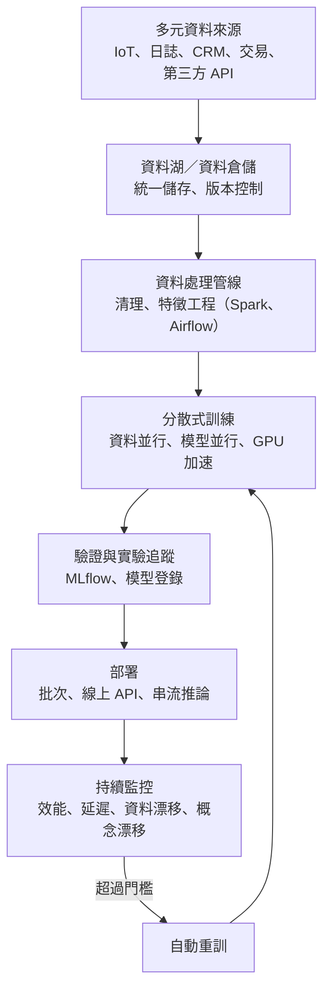

### Metadata
parent:: [[_【目錄】iPAS-AI應用規劃師(中級)：大數據處理分析與應用]]
sibling:: [[11大數據在鑑別式AI中的應用]] · [[12大數據在生成式AI中的應用]] · [[13大數據隱私保護、安全與合規]]

## Key Points
> [!summary] 一句話看懂
> **傳統機器學習假設「資料放得進一台電腦、一次算完」；大數據把這個前提打破了，所以從資料載入、訓練、評估到部署，每一步都要重新設計成「分散、分批、持續」的模式。**
> 就像從家庭廚房升級成中央廚房：食材量大到冰箱放不下（**分批與分散儲存**）、要好幾位廚師同時做（**分散式訓練**）、訂單源源不絕（**串流與增量學習**）、還要有標準作業流程（**MLOps**）。

#### 大數據 5V 對機器學習的影響
| 特性 | 對機器學習的挑戰 | 主要對策 |
|---|---|---|
| **Volume 量大** | 資料放不進記憶體、訓練太久 | **分批載入、抽樣、分散式訓練**、Parquet |
| **Variety 多樣** | 文字、影像、感測器、JSON 混在一起 | **多模態特徵轉換**（嵌入、CNN）、資料湖整合 |
| **Velocity 快速** | 資料持續湧入，模型要即時反應 | **串流處理、增量學習**、近即時更新 |
| **Veracity 真實性** | 來源不一、品質參差、會漂移 | **資料目錄、血緣、版本控制、漂移偵測** |
| **Value 價值密度低** | 有用資訊被大量雜訊淹沒 | **特徵選擇、降維、主動學習**、自動化 EDA |

- 指引另外把「**資料品質與偏態**」獨立成一項：類別不平衡、標註錯誤、重複樣本，對策是**類別加權、重新抽樣（SMOTE）、主動學習**，評估改用 **F1、Balanced Accuracy、Macro AUC**。

#### 分散式訓練三種模式
| 模式 | 切什麼 | 適合 |
|---|---|---|
| **資料並行** | 把**資料**分給多台機器，每台都有**完整模型副本**，最後合併梯度 | 資料量大、模型放得進單張 GPU（**最常用**） |
| **模型並行** | 把**模型本身**切開放在不同機器 | 模型大到**單張 GPU 放不下**（如大型語言模型） |
| **混合並行** | 兩者結合 | 超大模型＋超大資料 |

#### 訓練加速技巧
| 技巧 | 一句話 |
|---|---|
| **GPU／TPU 硬體加速** | 大量矩陣運算交給專用硬體 |
| **混合精度訓練** | 部分計算用 16 位元，**更快、更省記憶體** |
| **梯度累積** | 記憶體不夠時，多個小批次累積梯度後再更新，**模擬大批次** |
| **梯度壓縮** | 分散式訓練時減少節點之間傳輸的梯度量 |
| **早停（Early Stopping）** | 驗證表現不再進步就停止，**防過擬合、省資源** |
| **檢查點（Checkpointing）** | 定期存檔，中斷後可**接續訓練** |

> [!warning] 陷阱題
> 1. **混合使用 16 位元與 32 位元運算、減少訓練時間與記憶體 → 混合精度訓練**（官方考題原題）。
> 2. **面對龐大資料與高計算需求 → 分散式訓練＋GPU／TPU 硬體加速**（官方考題原題）。
> 3. **大數據 5V＝Volume、Variety、Velocity、Veracity、Value**（量、多樣、速度、真實性、價值）。
> 4. **資料並行＝每台機器有完整模型、分不同資料**；**模型並行＝模型切開分到不同機器**。
> 5. **模型大到單張 GPU 放不下 → 模型並行**；資料量大但模型不大 → 資料並行。
> 6. **類別不平衡時不要只看準確率（Accuracy）**，改看 F1、Balanced Accuracy、Macro AUC、PR-AUC。
> 7. **資料漂移＝輸入分佈改變**；**概念漂移＝輸入與標籤的關係改變**（如詐騙手法改變）。
> 8. **漂移偵測方法**：KS 檢定、KL 散度、PSI；搭配 Evidently、WhyLabs 等監控工具。
> 9. **增量學習／線上學習＝資料一到就更新模型**；最大挑戰是**災難性遺忘**（學了新的、忘了舊的）。
> 10. **預訓練＋微調**：先在大量資料學通用特徵，再針對任務調整，**降低成本、提升效能**。
> 11. **部署三模式**：**批次推論**（定期產出）、**線上推論**（REST／gRPC 即時回應）、**串流推論**（Kafka、Flink 事件驅動）。
> 12. **早停＝驗證集表現不再提升就停止**；**檢查點＝定期存檔、可中斷續訓**。
>
> ⚠️ **學習指引不精確或過時的地方**
> - 指引說模型並行「**適合 GPT、BERT 等超大模型訓練**」：**BERT（最大約 3.4 億參數）通常一張 GPU 就放得下**，一般用資料並行即可；真正需要模型並行的是**數十億參數以上**的大型語言模型。
> - 指引介紹的分散式訓練工具以 **Horovod** 為主：Horovod 現已較少用於新專案，目前主流是 **PyTorch DDP**（資料並行）、**FSDP／DeepSpeed ZeRO**（把模型參數與優化器狀態**切片分散**，兼具資料並行的簡單與模型並行的省記憶體），以及大型模型訓練框架 **Megatron-LM**。
> - 指引的混合精度只提到 **FP16**：目前大型模型訓練主流是 **BF16**（數值範圍與 FP32 相同，訓練更穩定），最新的 GPU 也支援 **FP8**。
> - 指引提到的 **Pandas Profiling** 已更名為 **ydata-profiling**。

> [!tip] PM 要記住的 3 件事
> 1. **資料多不等於模型好**：大型語言模型的經驗顯示，**經過篩選的高品質資料**常比更多但雜亂的資料有效。先投資資料品質，再擴大資料量。
> 2. **訓練成本主要是 GPU 時數**：分散式訓練能縮短時間，但不一定省錢。估預算時要問「需要幾張 GPU、跑幾小時、要重訓幾次」。
> 3. **模型上線才是開始**：資料持續變化，沒有**監控與自動重訓**的模型，效能會逐漸下滑而沒人發現。

--- 
## Notes
### 全局地圖：大數據環境下的端對端機器學習流程

- 這整套流程稱為**端對端機器學習管線（End-to-End ML Pipeline）**，是 **MLOps** 的核心。部署與 MLOps 的細節見 [[09AI技術系統集成與部署]]。
- 資料處理工具見 [[06數據處理技術與工具]]；儲存架構見 [[05數據儲存與管理]]。

---

### 一、大數據特性如何改變機器學習
#### 資料規模大（Volume）
**問題**：資料從 GB 長到 TB、PB，遠超過單機記憶體。傳統「把整份資料讀進 pandas 再訓練」的方式行不通。

**資料處理階段的對策**：
- **分批載入（Mini-Batch Loading）**：每次只讀一小批資料進記憶體訓練，深度學習本來就是這樣運作。
- **抽樣（Sampling）**：先用具代表性的樣本開發與調參，確定方向後再用全量資料訓練，能大幅節省時間。
- **分散式儲存＋欄式格式**：資料放在 HDFS 或雲端物件儲存，以 **Parquet** 等欄式壓縮格式存放，降低讀取負擔。

**模型訓練階段的對策**：演算法與運算架構要能**跨節點平行計算**。
- **Spark MLlib**：在 Spark 叢集上分散訓練迴歸、分類、分群等傳統機器學習模型。
- **深度學習分散式訓練**：PyTorch DDP、TensorFlow MultiWorkerMirroredStrategy、Horovod 等（見第二部分）。

**模型評估階段的對策**：驗證資料也很大，評估指標要能**分批累積計算**，例如串流方式累積混淆矩陣、逐批更新 AUC，而不是一次把所有預測結果載入記憶體。

#### 資料型態多樣（Variety）
**問題**：資料不再只是表格，而是**文字、影像、影音、穿戴裝置感測值、網站日誌、JSON／XML** 混在一起。不同型態要先轉成數值特徵，模型才能學習。

**各型態的特徵轉換**：
- **文字**：用詞嵌入（Word2Vec、GloVe）或 **BERT 等語言模型**轉成語意向量。
- **影像**：用 **CNN** 或 Vision Transformer 萃取影像特徵。
- **音訊與感測器**：轉成**頻譜圖（Spectrogram）**，或用 RNN、Transformer 學習時間特徵。
- **多模態組合**（如商品描述＋商品圖片）：要再透過**對齊與融合**整合不同模態的特徵（詳見 [[04多模態人工智慧應用]]）。

**資料架構的對策**：異質資料若管理不當，容易發生**欄位錯置、資料遺失、語意對錯**。主流做法是：
- 用**資料湖**收納各種型態的資料，搭配 **Apache Iceberg、Delta Lake** 做版本控制與結構管理。
- 已有資料倉儲的企業可採**混合架構**：倉儲管結構化核心資料、資料湖收半結構與非結構資料，再透過中介層整合成統一的訓練資料集。

**對團隊的影響**：AI 團隊需要同時具備 **NLP、電腦視覺、IoT 資料處理**等跨領域能力。

#### 資料品質與偏態
**問題**：「樣本多」不代表「品質好」。常見問題有：
- **類別不平衡**：詐欺只佔 0.1%，模型只學會預測「正常」。
- **標註錯誤（Label Noise）**：人工或規則標錯，模型學到錯的答案。
- **資料冗餘與重複樣本**：讓模型過度重視某些樣本。
- **高比例雜訊**。

在**分類與預測**這類鑑別式任務中，不平衡會讓模型**過度學習多數類別、忽略少數類別**，造成系統性誤判與不公平。

**處理策略**：
- **類別加權（Class Weighting）**：在損失函數中提高少數類別的權重，讓模型「錯判少數類別時被罰得更重」。實作簡單，常是第一選擇。
- **欠採樣與過採樣**：刪減多數類別樣本，或用 **SMOTE** 合成少數類別樣本（只能在訓練集上做）。
- **弱標註與主動學習**：用規則或模型先做大量預標註，再讓模型挑出**最沒把握**的樣本交給人工確認，用最少人力提升標註品質。
- **資料清理與品質控制**：建立標準化清理管線，移除異常、合併重複、處理高雜訊欄位。

**評估指標也要調整**：
- 不要只看**準確率**，改用 **F1**、**Balanced Accuracy**（各類別召回率的平均）、**Macro AUC**（各類別平等計算），極度不平衡時看 **PR-AUC**。
- 在金融核貸、醫療風險評估等**公平性敏感**的情境，加入**公平性指標**，如 **Demographic Parity**（各群體獲得正面結果的比例相近）、**Equalized Odds**（各群體的真陽性率與偽陽性率相近）。詳見 [[07AI風險管理]]。

#### 資料流動快速（Velocity）
**問題**：IoT、金融交易、即時推薦、社群互動的資料是**持續高速產生的資料流**，系統要在**毫秒到秒級**內預測與反應。傳統「每週重訓一次、批次預測」的方式跟不上。

**系統層面需要三種能力**：
- **串流處理架構**：資料一進來就接收、處理。
- **近即時模型更新**：模型能持續吸收新樣本，維持對當下環境的準確度。
- **快速部署與回應**：預測結果能立即送到應用端。

**模型層面的三種更新方式**：
- **資料切片更新**：把資料流切成小段逐步處理。
- **微調（Fine-tuning）**：在既有模型上，用新資料小幅調整，快速適應新的資料分佈（例如消費行為改變），不必從頭訓練。
- **增量學習／線上學習**：資料一到就更新模型權重。適合的演算法如 **感知器、單純貝氏、SGDClassifier**；專門框架如 **Vowpal Wabbit、River**。

**常見串流平台**：
- **Apache Kafka**：高吞吐量的**訊息中介**，可靠地接收與暫存即時資料。
- **Apache Flink、Spark Streaming**：串流處理引擎，支援**視窗計算**、**狀態管理**、**複雜事件處理（CEP）**。
- **雲端串流服務**：AWS **Kinesis**、Google **Pub/Sub**、Azure **Event Hubs**。

**實務部署**：為了避免頻繁全量重訓造成風險，常用**模型切換或輪換**策略，搭配 **A/B 測試**或**金絲雀發布**逐步導入新模型。

> [!example] 即時詐欺偵測的架構
> 刷卡交易 → **Kafka** 接收 → **Flink** 即時計算特徵（這張卡過去 10 分鐘刷了幾次、在幾個國家）→ 呼叫**線上模型 API** 評分 → 50 毫秒內回傳「核准」或「攔截」→ 每天用新確認的詐欺案例**微調模型**，新版本先以金絲雀方式給 5% 流量驗證。

#### 資料真實性與來源異質（Veracity）
**問題**：資料來自 IoT、網站日誌、CRM、第三方 API、社群平台、使用者裝置，**格式、更新頻率、可信度、語意標準**都不一致。這讓資料整合與一致性管理成為機器學習的**前期核心工作**。

**整合前要先標準化與對齊**：不同來源的命名規則、單位、編碼、時間戳記標準要統一，建立**欄位對應規則（Schema Mapping）**，並記錄轉換過程。

**提升可信度與可管理性的機制**：
- **資料目錄（Data Catalog）**：全公司的資料清單，記錄名稱、來源、格式、擁有者、用途。
- **資料血緣（Data Lineage）**：記錄資料從產生、傳輸、處理到使用的每個步驟，出問題時能追溯。
- **資料版本控制與元資料管理**：如 **Delta Lake、lakeFS** 記錄資料版本與差異；**Apache Atlas、Amundsen、DataHub** 管理欄位屬性與權限。

這些機制能釐清**資料責任歸屬**（哪個部門提供、第三方 API 的授權範圍），並及早發現異常變化。

**漂移偵測**：來源異質且持續變動時，很容易發生：
- **資料漂移（Data Drift）**：**輸入資料的分佈**隨時間改變，例如疫情後消費行為改變。
- **概念漂移（Concept Drift）**：**輸入與答案的關係**改變，例如詐騙集團換了新手法，過去的特徵組合不再代表詐騙。

常用偵測方法：
- **KS 檢定**：比較兩組資料的累積分佈是否不同。
- **KL 散度**：衡量兩個分佈的差異程度。
- **PSI（母體穩定性指標）**：金融業最常用，經驗上 **PSI < 0.1 穩定、0.1～0.25 需注意、> 0.25 明顯漂移**。
- 搭配監控工具 **Evidently、WhyLabs** 等，形成持續的資料品質與模型穩定性管理。

#### 資料價值密度低（Value）
**問題**：資料雖然多，但真正對決策或模型有用的資訊比例很低：
- 大量與任務**無關的欄位或樣本**，讓學習過程冗餘、不穩定。
- **特徵冗餘、重複資料、不具代表性的樣本**增加過擬合風險。
- **有價值的長尾樣本**（異常行為、少數事件）被主流資料淹沒。

**對策**：
- **特徵選擇與降維**：用 Lasso、PCA 等方法濃縮有效資訊（見 [[06數據處理技術與工具]]、[[08常見的大數據分析方法]]）。
- **高資訊量抽樣**：依資訊增益或對模型的貢獻度挑選樣本。
- **自動化探索式分析（Automated EDA）**：用 **ydata-profiling**（原 Pandas Profiling）、**Sweetviz** 快速產生資料概況報告，找出有價值的區段。
- **主動學習**：把人工標註集中在**最具代表性或最不確定**的資料點。

---

### 二、大數據下的模型訓練加速
#### 1. 為什麼需要分散式訓練
當模型與資料大到**單機記憶體放不下、訓練要好幾週**時，就要把工作分給多張 GPU 或多台機器同時處理。分散式訓練有三種切法。

#### 2. 資料並行（Data Parallelism）
> [!example] 白話比喻
> 一份 1 萬題的考古題，請 4 位同學**各做 2,500 題**，每人手上都有**同一本參考書**（完整模型）。做完後大家**交換心得**（合併梯度），一起修正參考書，再做下一輪。

- **做法**：每台機器都有**一份完整的模型副本**，各自處理不同批次的資料，算出梯度後**彙總平均**，再更新所有副本的參數。
- **適合**：資料量大、模型**放得進單張 GPU** 的情況，例如影像分類、一般 NLP 模型。
- **特點**：最簡單、**最常用**；瓶頸在於節點之間**同步梯度**的通訊量。
- **常用工具**：**PyTorch DDP**、TensorFlow MultiWorkerMirroredStrategy、Horovod。

#### 3. 模型並行（Model Parallelism）
> [!example] 白話比喻
> 一本參考書厚到一個人的書包裝不下，只好**拆成 4 冊分給 4 個人保管**。每題都要依序經過 4 個人，各自處理自己負責的章節。

- **做法**：把**模型本身切開**，不同部分放在不同 GPU 上。
  - **管線並行（Pipeline Parallelism）**：依層切，第 1～10 層放 GPU 1、第 11～20 層放 GPU 2。
  - **張量並行（Tensor Parallelism）**：把同一層的大矩陣切開，由多張 GPU 一起算。
- **適合**：模型大到**單張 GPU 記憶體放不下**，例如數十億到數千億參數的大型語言模型。
- **特點**：實作複雜，GPU 之間需要**高速互連**（如 NVLink）。

#### 4. 混合並行與分片技術
- **混合並行**：同時使用資料並行與模型並行，兼顧擴展資料量與放大模型。大型語言模型訓練通常是**資料、管線、張量三種並行一起用**。
- **分片資料並行（ZeRO、FSDP）**：目前非常主流的做法。表面上是資料並行，但把**模型參數、梯度、優化器狀態切片**分散到各 GPU，需要時再臨時組合。既保留資料並行的簡單，又**大幅節省每張 GPU 的記憶體**。代表工具是 **DeepSpeed ZeRO** 與 **PyTorch FSDP**。

#### 5. 訓練效能最佳化策略
##### (1) 硬體加速
- **GPU／TPU** 專為大規模矩陣運算設計，是深度學習的標準配備。
- **雲端平台**（AWS SageMaker、Google Vertex AI、Azure Machine Learning）可依需求彈性租用運算資源，不必自己採購硬體。

##### (2) 混合精度訓練（Mixed Precision Training）
- 把部分計算改用 **16 位元**（FP16 或 **BF16**）而不是 32 位元，**速度更快、記憶體用量約減半**，關鍵步驟仍保留 32 位元確保精度。
- 現代 GPU 都有專門加速低精度運算的硬體，幾乎所有深度學習訓練都會開啟。**BF16** 數值範圍較大、訓練較穩定，是大型模型的主流選擇。

##### (3) 梯度累積（Gradient Accumulation）
- GPU 記憶體不夠，無法使用大批次時，可以**連續算幾個小批次的梯度、累加起來，再一次更新參數**，效果近似大批次訓練，讓訓練更穩定。
- 代價是每次更新所需時間變長。

##### (4) 梯度壓縮與延遲同步
- 分散式訓練中，節點之間頻繁傳送梯度會**塞住網路**。
- **梯度壓縮**：只傳最重要的部分（Top-k 稀疏化）或降低數值精度（量化）。
- **延遲同步**：不必每一步都同步，降低通訊頻率。

##### (5) 早停（Early Stopping）
- 持續監看**驗證集**表現，**連續幾輪都沒有進步就停止訓練**。
- 好處：**避免過擬合**（模型開始死背訓練資料），並**節省運算資源**。

##### (6) 檢查點（Checkpointing）
- **定期儲存**模型權重、優化器狀態與訓練進度。
- 好處：訓練中斷（硬體故障、雲端搶占式機器被收回）時可**從最近的檢查點接續**，不必從頭再來；也能回頭選擇表現最好的版本。大型模型訓練動輒數週，檢查點是必備機制。

#### 6. 進階應用與挑戰
##### (1) 資料讀取瓶頸
- GPU 算得很快，但如果資料讀取與前處理跟不上，GPU 就會閒置等待。
- 對策：使用高效資料格式（**TFRecord、Parquet、WebDataset**）、**預先讀取與快取**（如 TensorFlow 的 `tf.data`、PyTorch 的 `DataLoader` 多執行緒載入），讓**資料準備與模型計算同時進行**。

##### (2) 預訓練與微調（兩階段訓練）
- **預訓練**：在大規模通用資料上學習通用特徵，例如語言模型先讀大量文本。
- **微調**：再用特定任務的少量資料調整，例如用公司的客服紀錄微調。
- 好處：**大幅降低訓練成本與資料需求**，效能通常也更好。這是現代 AI 的標準做法，大型語言模型與 **LoRA** 等高效微調方法都建立在這個概念上（見 [[03生成式AI技術與應用]]）。

##### (3) 持續學習（Continual Learning）與線上學習
- 資料隨時間變化時，靜態模型會逐漸失效。持續學習讓模型**不斷吸收新資料**，常用於**推薦系統、金融交易預測、詐欺偵測**。
- 最大挑戰是**災難性遺忘（Catastrophic Forgetting）**：模型學了新模式，卻忘記舊知識。例如詐欺模型學會新手法後，對舊手法的偵測能力下降。
- 常見做法：保留部分舊資料一起訓練（**重播**）、限制重要參數的變動幅度、或定期以完整資料重訓。

---

### 三、從資料到上線：端對端機器學習管線
在企業級環境中，模型不是一次性的實驗成果，而是要**與資料流、業務邏輯、平台架構緊密整合**的服務。端對端管線把整個流程自動化、可追蹤、可重現。

#### 資料整合與處理
- **整合來源**：把 IoT、網站日誌、CRM、交易系統等資料匯入**資料湖或資料倉儲**，作為統一的資料基礎。
- **自動化前處理**：用 **Spark、Airflow、Kubeflow** 等工具自動執行欄位轉換、缺失值處理、清理與特徵萃取，支援批次與串流。
- **特徵商店（Feature Store）**：集中管理特徵，確保**訓練與線上推論用同一套特徵計算邏輯**，避免「訓練時算法 A、上線時算法 B」導致效能落差。代表工具如 **Feast**、Databricks Feature Store。
- **版本與追蹤**：用 **Delta Lake** 管理資料版本、**MLflow Tracking** 記錄實驗，確保每個模型都能追溯是用哪份資料、哪段程式訓練的。

#### 模型訓練與驗證
- **自動化訓練管線**：用 **SageMaker Pipelines、Vertex AI Pipelines、Kubeflow Pipelines** 串起訓練、調參、交叉驗證與評估。
- **實驗追蹤與模型版本管理**：用 **MLflow、Weights & Biases** 記錄模型架構、參數、指標與訓練資料版本，並透過**模型登錄**（Model Registry）管理哪個版本在測試、哪個在正式環境。
- **多模型與多階段流程**：例如先用分類模型判斷顧客類型，再依結果串接不同的推薦模型（條件分支）。

#### 模型部署與上線
**三種部署模式**：
- **批次推論（Batch Serving）**：定期產出預測結果存起來，例如每天凌晨算好所有客戶的風險分數，供隔天報表與行銷使用。成本最低。
- **線上推論（Online／API Serving）**：以 **REST API 或 gRPC** 提供即時預測，例如使用者開啟 App 時即時推薦商品。
- **串流推論（Streaming Inference）**：結合 **Kafka、Flink、Spark Streaming**，資料事件一發生就推論，例如每筆刷卡即時評估詐欺風險。

**容器化與安全上線**：用 **Docker** 封裝模型、**Kubernetes** 管理部署與自動擴充；搭配 **A/B 測試、藍綠部署、金絲雀發布**降低更新風險。細節見 [[09AI技術系統集成與部署]]。

#### 持續監控與模型維運
- **監控項目**：預測準確率、延遲、錯誤率、系統可用性，以及**資料漂移與概念漂移**。
- **自動重訓與更新**：設定門檻（例如精確度低於標準）自動觸發重訓，通過驗證後經 **CI/CD** 流程部署。
- **MLOps 整合**：讓資料工程、模型開發與平台維運使用同一套流程與工具，實現**標準化、可監管、可持續運行**。

---

### PM 檢查清單：大數據機器學習專案 8 問
1. **資料有多大？** 需要分散式處理，還是抽樣就能開發？
2. **資料型態有哪些？** 需要多模態處理嗎？團隊有對應能力嗎？
3. **類別平衡嗎？** 評估指標選對了嗎（不是只看準確率）？
4. **需要多即時？** 批次、線上還是串流推論？
5. **訓練成本多少？** 需要幾張 GPU、訓練多久、多久重訓一次？
6. **能用預訓練模型嗎？** 微調是否比從頭訓練更划算？
7. **資料可追溯嗎？** 有資料目錄、血緣、版本控制嗎？
8. **上線後誰監控？** 漂移門檻與重訓流程定了嗎？

---
## References
- iPAS AI應用規劃師(中級)學習指引 科目2：大數據處理分析與應用 — 6.1 大數據與機器學習、第六章考題解析
- Rajbhandari, S. et al. (2020). *ZeRO: Memory Optimizations Toward Training Trillion Parameter Models*
- Shoeybi, M. et al. (2019). *Megatron-LM: Training Multi-Billion Parameter Language Models Using Model Parallelism*
- Micikevicius, P. et al. (2018). *Mixed Precision Training*
- Gama, J. et al. (2014). *A Survey on Concept Drift Adaptation*
- Google Cloud. *MLOps: Continuous delivery and automation pipelines in machine learning*
![[AI應用規劃師(中級)-學習指引-科目2大數據處理分析與應用_20251222101850.pdf]]
