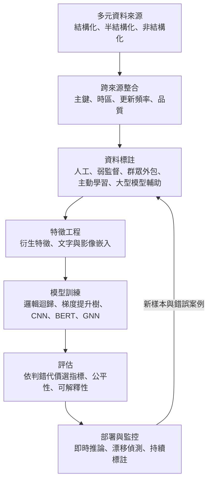
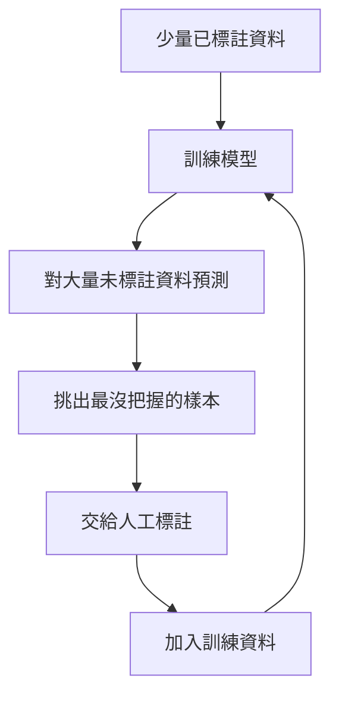
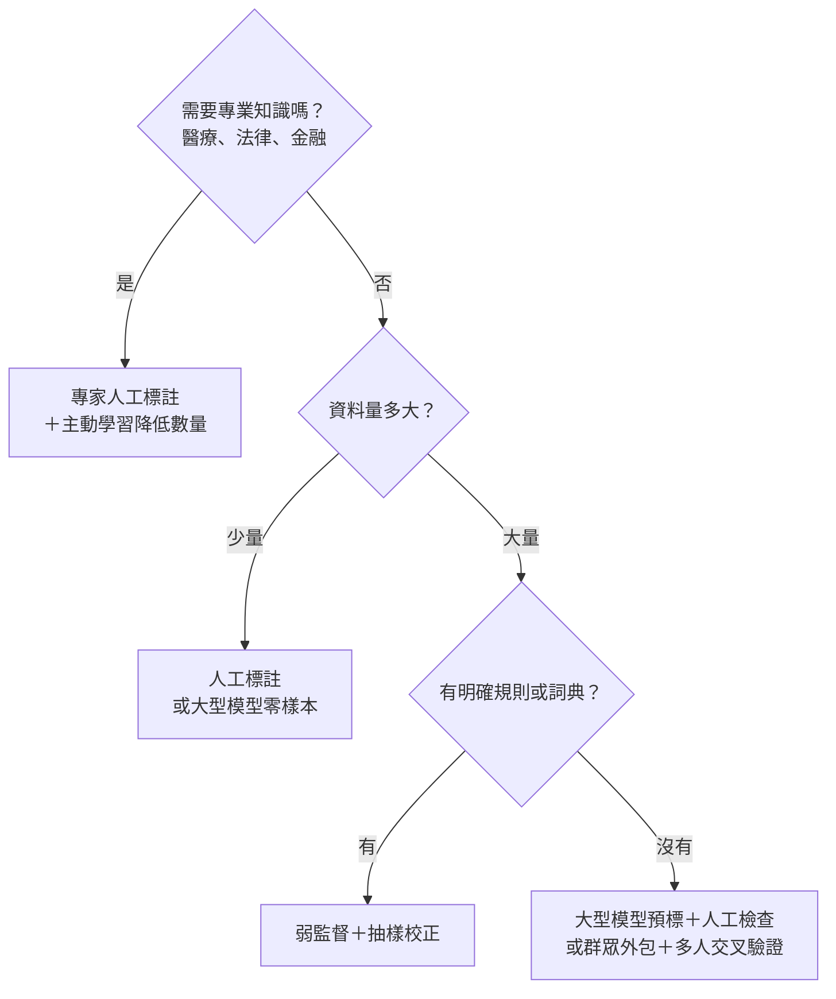

### Metadata
parent:: [[_【目錄】iPAS-AI應用規劃師(中級)：大數據處理分析與應用]]
sibling:: [[10大數據與機器學習]] · [[12大數據在生成式AI中的應用]] · [[13大數據隱私保護、安全與合規]]

## Key Points
> [!summary] 一句話看懂
> **鑑別式 AI＝「判斷題專家」：給它一筆資料，它回答「這是哪一類」或「會不會發生」。**
> 信用評分、詐欺偵測、流失預測、評論情感、疾病診斷，背後都是鑑別式 AI。大數據讓它看過更多例子、判斷更準；但**資料品質、標註成本、樣本偏差、跨系統整合**才是真正決定成敗的地方。

#### 鑑別式 vs 生成式
| | 鑑別式 AI | 生成式 AI |
|---|---|---|
| **核心任務** | **區分、分類、預測** | **產生新內容** |
| **學什麼** | 給定輸入，答案是什麼（類別之間的**邊界**） | 資料本身長什麼樣（資料的**分佈**） |
| **輸出** | 類別、機率、分數、數值 | 文字、影像、聲音、程式碼 |
| **代表模型** | 邏輯迴歸、隨機森林、XGBoost、SVM、BERT 分類器 | GPT、擴散模型、GAN |
| **例子** | 這筆交易是不是詐欺？ | 寫一封催收信 |

#### 五大應用領域速記
| 領域 | 典型任務 | 常用模型 | 主要挑戰 |
|---|---|---|---|
| **金融與風險** | 信用評分、詐欺偵測、**反洗錢（AML）** | **邏輯迴歸**（可解釋）、**XGBoost／LightGBM**、**GNN**（關係網路） | 極度不平衡、可解釋性、個資 |
| **零售與電商** | 流失預測、客戶分群、商品分類 | 隨機森林、梯度提升樹、**CLIP**（圖文分類） | 多來源格式不一、標註成本、即時性 |
| **客服與文本** | 對話分類、情感分析、內容審查 | Naive Bayes、SVM、**BERT**、規則 | 標註一致性、在地用語 |
| **醫療健康** | 疾病預測、影像診斷、理賠異常 | **CNN（ResNet）**、XGBoost、多模態模型 | 隱私、**專家標註昂貴** |
| **資安** | 異常登入、惡意流量、釣魚郵件 | **孤立森林**、LSTM、BERT、規則 | 不平衡、低延遲、日誌重複 |

#### 四種資料標註策略
| 策略 | 做法 | 優點 | 缺點 | 適合 |
|---|---|---|---|---|
| **人工標註** | 由人（常為專家）逐筆標註 | **最準確** | **最貴、最慢** | 醫療影像、法律文件 |
| **弱監督** | 用規則、關鍵字、詞典自動產生標籤 | **快、便宜** | 誤標多、需清理 | 大量社群貼文情感 |
| **群眾外包** | 分散給大量非專業人員（MTurk、Appen） | 便宜、快 | 品質參差，需多人交叉檢查 | 簡單圖片或文字分類 |
| **主動學習** | 模型挑**最沒把握**的樣本給人標 | **用最少標註換最大提升** | 需初始資料與迭代流程 | 標註昂貴、資料量大 |

> [!warning] 陷阱題
> 1. **鑑別式 AI＝專注於資料分類與預測的決策邊界**（如邏輯迴歸、SVM）；生成式 AI 著重「產生新內容」（官方考題原題）。
> 2. **信用評分常用邏輯迴歸**，因為**可解釋**，能說明拒貸原因。
> 3. **反洗錢分析人際與資金網路 → 圖神經網路（GNN）**。
> 4. **XGBoost／LightGBM 是處理表格資料與不平衡資料的主力**。
> 5. **醫療影像分類 → CNN**（如 ResNet、VGG）；**醫師筆記 → BERT**；兩者結合是多模態。
> 6. **主動學習＝優先標註模型最不確定（低信心）的樣本**。
> 7. **弱監督＝用規則或詞典自動標註**，快但誤標風險高。
> 8. **群眾外包要靠多人標註、一致性檢查控制品質**。
> 9. **半結構化資料（JSON）需要解析與展平**才能變成表格特徵。
> 10. **跨來源整合四大挑戰：主鍵不一致、時區與時間戳記、更新頻率不同、品質不均**。
>
> ⚠️ **學習指引不精確的地方**
> - 指引的信用評分案例以「**準確率提升至 85%**」作為成效：違約通常只佔少數（例如 5%），**全部猜「不會違約」就有 95% 準確率**，所以準確率在這類問題幾乎沒有意義。信用評分業界常用 **AUC、KS 值、Gini 係數**，以及實際的**壞帳率與核准率**。
> - 指引在多處挑戰中把資料問題連結到「**影響 t 檢定、ANOVA、卡方檢定的結果**」：這些連結是為了呼應前面章節，但在實務上，這些資料品質問題**直接影響的是模型的訓練與預測**，不是事後的統計檢定。理解為「資料品質差，任何下游分析都會受影響」即可。
> - 指引的標註策略**沒有提到大型語言模型輔助標註**：這已是 2024 年後的主流做法之一（見下方說明）。

> [!tip] PM 要記住的 3 件事
> 1. **先問「判錯的代價」再選指標**：漏抓詐欺（偽陰性）和誤擋正常交易（偽陽性）的成本完全不同，門檻與指標要依此設定。
> 2. **金融、醫療、招募要能解釋**：被拒絕的客戶有權知道原因，模型要能產出**理由代碼**（例如「負債比過高」），可用 **SHAP** 等工具輔助。
> 3. **標註是持續的成本**：上線後還會有新類別、新詐騙手法，要規劃**長期的標註與回饋機制**，不是一次性預算。

--- 
## Notes
### 全局地圖：大數據支撐鑑別式 AI 的流程

- 鑑別式 AI 的成功**不只靠模型選擇**，更取決於**資料品質、資料型態、標註方式**。資料品質指標見 [[04數據收集與清理]]；大數據下的機器學習流程見 [[10大數據與機器學習]]。

---

### 一、鑑別式 AI 是什麼
#### 定義與核心概念
**鑑別式模型**直接學習「**給定輸入 X，答案 Y 是什麼**」，也就是學習**不同類別之間的分界線**。

**生成式模型**學習的是「**資料本身是怎麼產生的**」，因此能創造出新的樣本。

> [!example] 白話比喻
> 要分辨貓和狗的照片：
> - **鑑別式**：只學「耳朵尖、臉型短就是貓」這種**區分重點**，不必知道貓的全部長相。
> - **生成式**：要學會「貓長什麼樣、狗長什麼樣」，所以**能畫出一隻新的貓**。

鑑別式 AI 是目前**企業最常導入**的 AI 類型，因為它直接對應商業決策：要不要核貸、要不要攔截、要不要挽留、要不要轉人工。

#### 大數據帶來的好處與挑戰
**好處**：
- **更多樣本**：看過更多例子，模型更能涵蓋各種情況，**泛化能力**更好。
- **更豐富的特徵**：除了基本資料，還能加入行為紀錄、文字、影像、關係網路。
- **更細緻的模式**：能發現少數但重要的行為模式，例如特定的詐騙手法。

**挑戰**：資料品質、來源多樣、標註成本、樣本偏差，都會直接影響模型的表現與可信度。

#### 大型語言模型也能做鑑別式任務
2024 年後的新做法：
- **零樣本／少樣本分類**：直接請大型語言模型判斷「這則評論是正面還是負面」「這封信是不是釣魚郵件」，**不需要訓練資料**。
- **嵌入＋分類器**：先用大型模型把文字轉成向量，再訓練一個簡單的分類器，成本低、效果好。

**怎麼選**：資料量少、需求多變時，先用大型語言模型快速上線；**資料量大、要求低延遲與低成本**時（如每秒數千筆的詐欺偵測），傳統模型仍是主力。

---

### 二、五大應用領域
#### 金融與風險管理
**任務**：
- **信用評分**：預測申請人是否會違約。
- **詐欺偵測**：從交易中找出可疑行為。
- **反洗錢（AML）**：分析交易模式與**資金往來網路**，找出可疑的資金流動。

**資料**：
- **結構化**：客戶屬性（年齡、收入、信用紀錄）、交易紀錄（金額、時間、地點）。
- **半結構化**：API 交易日誌。
- **關係網路**：帳戶之間的轉帳關係、共用裝置或地址。

**常用模型**：
- **邏輯迴歸**：簡單、**可解釋**，信用評分的傳統主力，容易向主管機關與客戶說明。
- **隨機森林**：能處理大量特徵，穩健。
- **XGBoost／LightGBM**：表格資料上效能最好的模型之一，支援**類別加權**處理不平衡，是詐欺與違約預測的主流。
- **圖神經網路（GNN）**：同時考慮帳戶本身的特徵與**它跟誰往來**，擅長找出**洗錢集團、人頭帳戶網絡**。

**操作流程**：
1. 用 SQL 擷取交易與信用資料，清理缺失值與異常值。
2. **特徵工程**：衍生交易頻率、金額變異、近期與過去的變化等特徵。
3. 用**交叉驗證**訓練與調整參數。
4. 部署後持續監控 **AUC、KS 值、F1**，以及實際的壞帳率與攔截率。

**挑戰**：
- **極度不平衡**：詐欺比例極低，需類別加權、過採樣（如 SMOTE）。
- **可解釋性**：拒貸要能說明理由，深度模型要搭配 **SHAP** 等解釋工具。
- **隱私**：遵守《個人資料保護法》，身分證字號等欄位要**去識別化**。
- **對抗性**：詐騙集團會改變手法，模型要持續更新（**概念漂移**）。

#### 零售與電商
**任務**：
- **顧客流失預測**：找出可能停止購買或取消訂閱的顧客，提前挽留。
- **客戶分群與精準行銷**：依特徵分群，推送個人化內容。
- **商品分類**：自動把新上架商品歸到正確類別。

**資料**：
- **結構化**：購買紀錄、會員屬性。
- **半結構化**：點擊日誌（JSON）、瀏覽行為。
- **非結構化**：商品評論、商品圖片。

**常用模型**：
- **決策樹、隨機森林、梯度提升樹**：流失預測的主力，穩健且可解釋特徵重要度。
- **LSTM 或 Transformer**：處理有時間順序的行為資料。
- **CLIP 等圖文模型**：同時看商品圖片與描述來分類，甚至**不需訓練**就能做零樣本分類。

**案例**：電商用隨機森林結合購買與點擊資料預測流失，找出高風險顧客後進行挽留，行銷回應率提升 12%。

**挑戰**：
- **資料一致性**：多來源的日期、編碼格式不同。
- **標註成本**：商品分類需要大量人工標註，可用弱監督或大型模型預標。
- **即時性**：推薦與即時挽留需要處理串流資料（如 Kafka）。
- **流失的定義**：訂閱制很清楚（取消訂閱），但一般電商要先定義「多久沒買算流失」，定義不同，模型完全不同。

#### 客服與文本分類
**任務**：
- **對話分類**：自動判斷客服問題類型（帳號、物流、退貨），分派給對的人。
- **情感分析**：判斷評論是正面、中立還是負面。
- **內容審查**：偵測仇恨言論、詐騙廣告、違規內容。

**常用模型**：
- **Naive Bayes、SVM**：傳統文字分類，搭配 TF-IDF，速度快、資料少時也能用。
- **BERT、RoBERTa**：理解上下文，準確度高，適合情感分析與對話分類。
- **規則（正規表示式）**：處理簡單、明確的違規樣式（例如抓出電話號碼或特定網址）。
- **大型語言模型**：處理少量資料、類別經常變動，或需要理解細微語氣的情境。

**案例**：電信公司用 BERT 分類客服對話，自動識別 95% 的物流問題，減少 30% 人工處理時間。

**挑戰**：
- **標註一致性**：「普通」算中立還是負面？標註指引不清楚，模型就學不好。
- **在地化語言**：台灣用語、注音文、中英夾雜、網路流行語，需要在地資料訓練或微調。
- **反諷**：「這服務真是太『好』了」，表面正面、實際負面。

#### 醫療與健康科技
**任務**：
- **疾病預測與診斷**：依病歷、影像、生理訊號預測疾病風險。
- **保險理賠異常分析**：找出可疑的理賠申請。
- **臨床決策支援**：協助醫師選擇治療方案。

**資料**：
- **結構化**：病歷欄位（年齡、性別、檢驗數值）。
- **非結構化**：醫療影像（X 光、MRI）、醫師筆記。
- **多模態**：病歷＋影像＋筆記。

**常用模型**：
- **CNN**（ResNet、VGG）與 Vision Transformer：醫療影像分類。
- **隨機森林、XGBoost**：結構化病歷預測。
- **多模態模型**：結合 CNN 與 BERT 同時處理影像與文字（見 [[04多模態人工智慧應用]]）。

**案例**：醫院用 ResNet 分析 X 光片診斷肺炎，準確率 92%，誤診率降低 25%。

**挑戰**：
- **隱私**：病歷屬於**特種個人資料**，依個資法受到更嚴格保護，要加密與去識別化。
- **標註成本**：影像需要**專科醫師**標註，非常昂貴，適合用**主動學習**集中標註最有價值的樣本。
- **法規**：作為診斷用途的 AI 屬於**醫療器材**，需經衛福部食藥署審查。
- **資料偏差**：只用單一醫院資料訓練，換到其他醫院（不同機型、不同病患族群）效果可能下降。

#### 資安與異常偵測
**任務**：
- **異常登入辨識**：可疑裝置、異常地點、不尋常時段的登入。
- **惡意流量分類**：依封包特徵識別 DDoS 等攻擊。
- **釣魚郵件分類**：判斷郵件是否具詐騙特徵。

**常用模型**：
- **孤立森林**：不需要攻擊標籤，就能找出與眾不同的登入或流量。
- **LSTM**：分析流量的時間序列模式。
- **BERT 或大型語言模型**：分析郵件內容。
- **規則**：已知的攻擊特徵與黑名單。

**案例**：企業用孤立森林分析登入日誌，識別 98% 的異常登入，安全事件減少 40%。

**挑戰**：
- **不平衡**：攻擊事件比例極低。
- **低延遲**：攻擊要在發生當下攔截，需要串流處理。
- **日誌重複**：系統重試造成重複紀錄，會扭曲統計與模型訓練。
- **攻擊者會調整**：模型與規則要持續更新。

---

### 三、輸入資料型態
#### 結構化資料
- **來源**：關聯式資料庫，如 ERP、CRM、POS 的交易紀錄、用戶屬性、設備資訊。
- **特性**：欄位明確、格式規範，可以**直接轉成表格特徵**。
- **應用**：信用評分（收入、貸款紀錄）、客戶分群（購買歷史、人口屬性）、設備預測維修（溫度、振動感測值）。
- **最適合的模型**：梯度提升樹（XGBoost、LightGBM、CatBoost）在表格資料上通常表現最好。

#### 半結構化資料
- **來源**：**JSON、XML** 格式的 API 回應、伺服器日誌、點擊流。
- **特性**：有層次結構（例如 JSON 裡面又包一層 JSON），欄位可能動態變化，需要**解析**（Parsing）與**展平**（Flattening）成表格。
- **應用**：從點擊日誌萃取瀏覽路徑與停留時間；把天氣 API 的 JSON 資料轉成特徵，預測銷售量。

> [!example] 展平是什麼
> 原始 JSON：`{"user": {"id": 123, "city": "台北"}, "items": [{"sku": "A"}, {"sku": "B"}]}`
> 展平後：`user_id = 123`、`user_city = 台北`、`item_count = 2`
> 巢狀的資料被拆成一欄一欄，模型才能使用。

#### 非結構化資料
- **來源與類型**：
  - **文字**：客服對話、產品評論、社群貼文、電子郵件。
  - **影像**：醫療影像、商品照片、監控畫面。
  - **聲音**：客服錄音、語音指令、環境聲音。
- **特性**：沒有固定結構，要先**萃取特徵**轉成數值。
- **應用**：
  - 文字 → NLP 情感分析
  - 影像 → CNN 影像分類
  - 聲音 → **語音辨識**（ASR）轉成文字後再分析
- 現代做法常是用**預訓練模型產生嵌入向量**，再接上分類器。

#### 多模態資料
- **來源**：結合多種型態，例如「會員資料（結構化）＋評論文字＋商品圖片」。
- **特性**：需要**融合**多種特徵，模型要支援多個輸入或在特徵層級合併。
- **應用**：
  - **電商推薦**：結合購買紀錄、評論與商品圖片。
  - **醫療診斷**：整合病歷、醫師筆記與 CT 影像。

---

### 四、資料標註策略
**為什麼標註這麼重要**：鑑別式 AI 多屬**監督式學習**，需要「正確答案」才能學習。標籤錯了，模型就學錯；標籤不一致，模型就學不好。**標註的成本、品質、效率**是實務上最大的挑戰之一。

#### 人工標註
- **做法**：由人逐筆判斷並標上答案，專業任務由**領域專家**負責。
- **優點**：**準確度最高**，適合需要專業知識的任務，例如醫療影像判讀、法律文件分類。
- **限制**：**成本高、速度慢**，大規模資料難以擴展；專家時間有限。
- **例子**：醫療團隊標註 X 光片是否有病灶。

#### 弱監督式標註（Weak Supervision）
- **做法**：用**規則、關鍵字、詞典、既有系統的結果**自動產生「不完美但大量」的標籤。例如評論中出現「推、讚、好用」就標為正面。
- **優點**：**速度快、成本低**，適合大規模資料。
- **限制**：**誤標率高**、品質不穩定，需要後續清理。
- **進階做法**：同時使用多個規則，用統計方法估計每個規則的可信度並整合（如 **Snorkel** 框架）。
- **例子**：用情緒詞典自動標註社群貼文的情感，再抽樣人工校正。

#### 群眾外包標註（Crowdsourcing）
- **做法**：透過平台（**Amazon Mechanical Turk、Appen**、Scale AI 等）把標註工作分給大量非專業人員。
- **優點**：**成本低、速度快**，適合不需專業知識的簡單任務，例如判斷圖片中有沒有鞋子。
- **限制**：**品質參差不齊**。
- **品質控制方法**：
  - **同一筆讓多人標註**，以多數決決定答案。
  - 混入**已知答案的測試題**，篩選不認真的標註者。
  - 計算**標註者之間的一致性**（如 Cohen's Kappa）。

#### 主動學習（Active Learning）
- **做法**：先用少量標註資料訓練初始模型，再讓模型**挑出它最沒把握的樣本**（例如信心度在 0.4～0.6 之間）交給人工標註，標完再訓練，反覆循環。
- **為什麼有效**：模型已經很有把握的樣本（明顯的正常交易），再標也學不到新東西；**邊界上的模糊案例**才最有學習價值。
- **優點**：**用最少的標註量換最大的效能提升**，適合標註昂貴、資料量大的情境。
- **限制**：需要初始標註資料與反覆訓練的流程，技術門檻較高。
- **例子**：詐欺偵測模型把信心度低於 0.6 的交易交給專家審查，降低總標註成本。

#### 大型語言模型輔助標註
2024 年後已成為主流做法之一：
- **預標註**：先讓大型語言模型或視覺模型標註，人工只需**檢查與修正**，速度可提升數倍。
- **處理模糊案例**：模型可同時提供判斷理由，幫助標註者決策。
- **合成訓練資料**：讓大型模型產生少數類別的範例，例如各種釣魚郵件寫法。

**注意事項**：
- 大型模型也會出錯或帶有偏見，**必須抽樣人工驗證**。
- **測試集**最好仍由人工標註，避免「用模型的答案評估模型」。
- 涉及個資的資料，要確認送到外部模型是否符合隱私規範。

#### 怎麼選標註策略

---

### 五、跨來源資料整合的挑戰
鑑別式 AI 常需要整合 ERP、CRM、API、日誌等多個系統的資料，以下四個問題最常見。

#### 主鍵不一致
**問題**：不同系統的用戶 ID、裝置 ID、訂單編號定義不同，無法直接合併。例如 CRM 的會員編號與 POS 的顧客編號不同，同一位顧客在兩邊各有一筆。

**解法**：
- 建立**主資料管理（MDM）**，給每位顧客一個全公司統一的 ID。
- 用**實體解析（Entity Resolution）**，依姓名、電話、Email 等欄位進行模糊比對，把同一人的紀錄連起來。

#### 時間戳記與時區對齊
**問題**：網站日誌用 **UTC**、門市 POS 用**台北時間**，相差 8 小時。晚上 11 點的門市交易在日誌裡會變成隔天，行為分析的時序就錯了。系統之間還可能有延遲與格式差異。

**解法**：統一轉成 **UTC 儲存**，顯示時再轉當地時間；所有時間欄位**明確標示時區**。

#### 資料更新頻率不一致
**問題**：點擊流是**即時串流**，庫存資料是**每日批次**更新。推薦系統可能推薦了「其實已經賣完」的商品。

**解法**：
- 明確定義每個特徵的**更新頻率與延遲**。
- 對時間敏感的資料改用即時或更頻繁的同步。
- **時間點正確的合併（Point-in-time Join）**：訓練模型時，每筆樣本只能使用「**當時已經存在**」的資料，避免把未來才更新的資訊混進去，造成**資料洩漏**。特徵商店多半內建這項功能。

#### 資料品質不均
**問題**：不同來源的品質差異很大，例如 API 缺少關鍵欄位、ERP 的單位不統一（「1,000 克」與「1 公斤」）。

**解法**：在整合前做**品質檢查與標準化**（見 [[04數據收集與清理]]），並與資料提供方訂定**資料契約**。

---

### 六、資料品質如何影響模型
指引把資料品質問題與前面章節的統計方法連結起來，核心觀念是：**資料品質差，任何下游分析（統計檢定或機器學習）都會受影響**。

- **缺失值**：特徵不完整，模型無法學到完整模式；若缺失不是隨機的，還會造成偏差。
- **異常值**：未處理的錯誤數值會**扭曲決策邊界**，讓模型在正常資料上判斷失準。
- **重複值**：重複樣本被**加重計算**，讓模型過度學習某些案例，也讓評估結果虛高（同一筆資料同時出現在訓練集與測試集）。
- **一致性錯誤**：格式不統一導致**特徵無法正確彙總**，例如同一城市被拆成兩個類別。
- **邏輯錯誤與錯誤標籤**：**標籤錯了，模型就學錯**。研究顯示，常用的公開資料集也有數個百分點的標籤錯誤，清理標籤往往比換模型更能提升效能。

---

### PM 檢查清單：鑑別式 AI 專案 8 問
1. **要判斷什麼？** 類別或目標（例如「流失」）定義清楚了嗎？
2. **判錯的代價？** 偽陽性與偽陰性哪個比較貴？門檻怎麼設？
3. **評估指標對嗎？** 不平衡問題不看準確率，看 AUC、F1、PR-AUC 或業務指標。
4. **需要解釋嗎？** 金融、醫療、招募能提供拒絕理由嗎？
5. **標籤從哪來？** 誰標註、怎麼控制品質、成本多少？能用主動學習或大型模型輔助嗎？
6. **資料能整合嗎？** 主鍵、時區、更新頻率、品質都處理了嗎？有沒有時間洩漏？
7. **公平嗎？** 不同群體的表現有分開檢查嗎？
8. **上線後怎麼更新？** 新的詐騙手法、新類別出現時，標註與重訓流程是什麼？

---
## References
- iPAS AI應用規劃師(中級)學習指引 科目2：大數據處理分析與應用 — 6.2 大數據在鑑別式 AI 中的應用、第六章考題解析
- Ng, A. Y. & Jordan, M. I. (2001). *On Discriminative vs. Generative Classifiers*
- Ratner, A. et al. (2017). *Snorkel: Rapid Training Data Creation with Weak Supervision*
- Settles, B. (2009). *Active Learning Literature Survey*
- Northcutt, C. G. et al. (2021). *Pervasive Label Errors in Test Sets Destabilize Machine Learning Benchmarks*
- Lundberg, S. M. & Lee, S.-I. (2017). *A Unified Approach to Interpreting Model Predictions*（SHAP）
![[AI應用規劃師(中級)-學習指引-科目2大數據處理分析與應用_20251222101850.pdf]]
