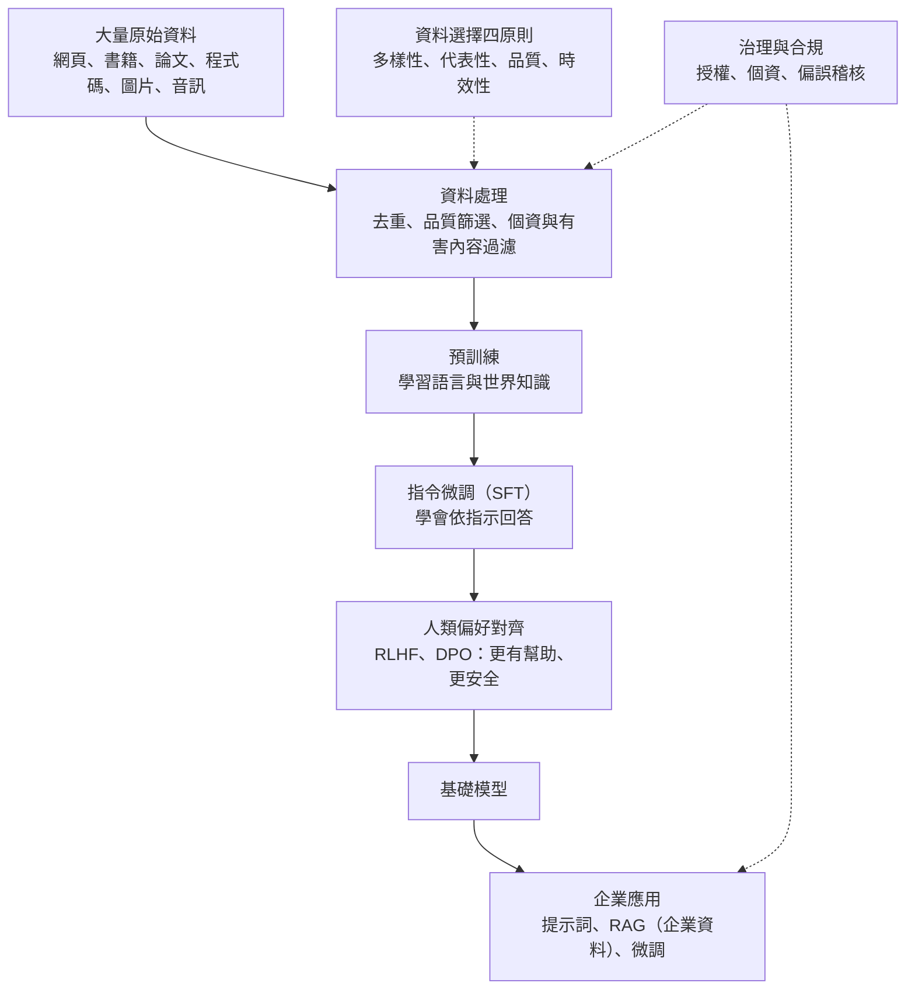
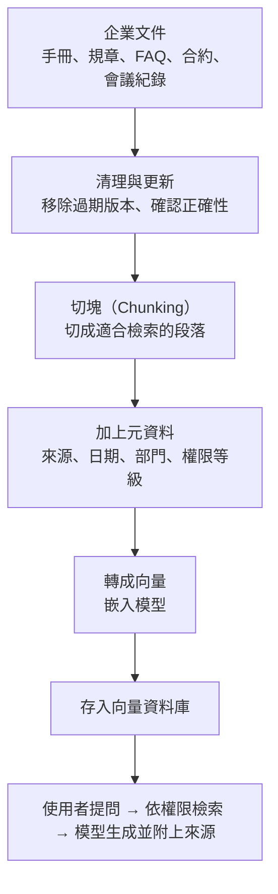

### Metadata
parent:: [[_【目錄】iPAS-AI應用規劃師(中級)：大數據處理分析與應用]]
sibling:: [[10大數據與機器學習]] · [[11大數據在鑑別式AI中的應用]] · [[13大數據隱私保護、安全與合規]]

## Key Points
> [!summary] 一句話看懂
> **生成式 AI 是「讀萬卷書」學出來的：讀什麼書，就會寫出什麼樣的文章。**
> 書讀得**不夠多樣**，只會寫一種風格；書裡**有偏見**，寫出來也有偏見；書**有錯字**，寫出來也會錯；書**太舊**，就不知道最近發生什麼事。所以生成式 AI 的品質，很大程度取決於**訓練資料的選擇與處理**。

#### 鑑別式 vs 生成式的資料需求
| | 鑑別式 AI | 生成式 AI |
|---|---|---|
| **資料型態** | 多為**有標註**的結構化資料 | 大量**無標註**的非結構化資料（網頁、書籍、圖片、程式碼） |
| **學習目標** | 輸入與答案的**對應關係** | 語言結構、視覺特徵、聲音模式等**資料本身的分佈** |
| **資料規模** | 數千到數百萬筆 | 大型語言模型動輒**數兆個 Token** |
| **關注重點** | 標籤正確、類別平衡 | **多樣性、代表性、品質、時效性、來源合法性** |

#### 資料選擇的四大面向
| 面向 | 意思 | 不足時的後果 | 例子 |
|---|---|---|---|
| **多樣性** | 涵蓋不同模態、語言風格、主題、情境 | 內容**單調**、無法適應新場景 | 只讀科技文章的模型寫不好醫療說明 |
| **代表性** | 能代表目標群體，不偏重特定族群或文化 | **系統性偏見**、不公平 | 預設醫師是男性、護理師是女性 |
| **品質與正確性** | 語法正確、清晰、資訊真實、無雜訊 | **語意混亂、失真、不可靠** | 錯字多的語料讓模型寫出錯誤的繁體中文 |
| **時效性** | 反映最新情境並持續更新 | **與現況脫節** | 不認識新流行語或新法規 |

#### 四種代表性偏誤
| 偏誤 | 來源 | 例子 |
|---|---|---|
| **性別與族群** | 語料以特定性別或族群視角為主 | 工程師預設為男性 |
| **地區與文化** | 語料以北美英文、歐洲為主 | 不懂台灣用語與文化脈絡 |
| **社經地位** | 資料集中於高收入、都市用戶 | 對偏鄉或中低收入族群需求理解不足 |
| **來源平台** | 語料集中於特定論壇或社群 | 語氣偏網路用語，難處理正式文件 |

> [!warning] 陷阱題
> 1. **生成式 AI 的品質極度依賴訓練樣本的「多樣性」與「語境一致性」**（官方考題原題）。
> 2. **GPT 是典型的語言（文字）生成模型**（官方考題原題）。
> 3. **生成式 AI 會放大訓練資料中的偏見**：資料偏誤不處理，模型會持續複製並放大刻板印象。
> 4. **資料代表性不足 → 系統性偏見**；**多樣性不足 → 內容單調、無法適應新場景**；**時效性不足 → 與現況脫節**。
> 5. **合成資料**可補足樣本不足、模擬罕見情境（如詐欺、設備故障）、測試模型穩健性。
> 6. **生成式 AI 的應用四大類：語言生成、圖像生成、多模態生成、資料增強與合成資料**。
> 7. **生成式 AI 的資料挑戰：偏誤放大、版權模糊、生成結果不穩定**。
> 8. **解決時效性最常見的方法不是重新訓練，而是 RAG**（即時檢索最新資料再生成）。
>
> ⚠️ **學習指引不完整的地方**
> - 指引只談「資料選擇原則」，**沒有說明生成式 AI 的訓練資料實際上怎麼處理**（去重、品質篩選、個資過濾、資料配比）以及**訓練的不同階段需要不同資料**（預訓練、指令微調、人類偏好對齊），本筆記已補上。
> - 指引談「時效性」時以「重新蒐集最新語料」為主要方向：實務上，大型模型**重新訓練成本極高**，企業最常用的是 **RAG** 把最新資料即時提供給模型；模型本身則有**知識截止日**。
> - 指引談合成資料時**沒有提到風險**：用模型生成的資料反覆訓練模型，可能造成**模型崩潰（Model Collapse）**，生成內容越來越單一、失去罕見但重要的資訊。

> [!tip] PM 要記住的 3 件事
> 1. **企業做生成式 AI，通常不是訓練模型，而是「準備資料給模型用」**：RAG 的知識庫品質（文件是否最新、正確、有權限控管）決定了回答品質。
> 2. **繁體中文與台灣在地內容在全球語料中比例很低**：選模型前要用**台灣情境的測試題**實測，不能只看英文排行榜。
> 3. **資料來源要能說清楚**：用了哪些資料、有沒有授權、有沒有個資，是法規與客戶越來越常問的問題（例如 EU AI Act 要求通用模型提供訓練資料摘要）。

--- 
## Notes
### 全局地圖：大數據如何變成生成式 AI 的能力

- 生成式 AI 的核心能力是「**從大量資料學習表徵，再據此產生新內容**」。資料不只是規模問題，更重要的是**語料的多元性與完整的語境**。
- 生成式 AI 的技術原理見 [[03生成式AI技術與應用]]；隱私與合規見 [[13大數據隱私保護、安全與合規]]。

---

### 一、生成式 AI 對資料的需求有何不同
#### 從「有標註」到「讀萬卷書」
**鑑別式 AI** 需要明確的「輸入 → 答案」配對，例如「這張圖 → 貓」。

**生成式 AI** 的資料需求更**開放、更依賴語意**：
- 大部分是**無標註**的非結構化資料，例如網頁、書籍、新聞、社群貼文、程式碼。
- 模型要從中學會**語言結構、邏輯、語氣、情緒、世界知識**等隱性特徵。
- 涵蓋多種模態：文字、圖片、影片、聲音，甚至感測器資料與醫療影像加病歷的組合。

規模也完全不同：目前主流大型語言模型的預訓練資料以**兆（Trillion）個 Token** 計。例如 Meta 的 Llama 3 使用超過 **15 兆個 Token** 訓練。

#### 新挑戰
這種資料來源與規模也帶來新的問題：
- **偏誤放大**：網路內容本身帶有偏見，模型會學起來並在生成時重現。
- **版權模糊**：大量網路內容的著作權歸屬與授權不明確。
- **生成結果不穩定**：品質參差的資料讓模型輸出時好時壞，甚至產生**幻覺**。

因此開發者在**資料蒐集、篩選與處理階段**必須更嚴謹，並把**資料治理與倫理風險**納入訓練流程設計。

---

### 二、資料選擇如何影響生成品質
#### 資料多樣性
**意思**：資料是否涵蓋不同**模態**（文字、圖片、聲音）、**語言風格**（正式、口語）、**主題**（科技、醫療、法律）與**使用情境**（客服、創作、分析）。

**為什麼重要**：模型只能生成它「見過類似東西」的內容。多樣性不足時，模型會產生**單調、不自然**的內容，或**無法應付新場景**。

**例子**：
- 只用科技文章訓練的語言模型，難以寫出合適的醫療衛教說明。
- 只用靜態圖片訓練的模型，無法處理動態影片。
- 只學正式書面語的客服模型，面對使用者的口語、錯字、注音文時表現不佳。

#### 資料代表性與偏誤風險
**意思**：訓練資料能否**準確涵蓋**模型要服務的所有群體，而不是過度集中在特定族群、文化、語言或背景。

**為什麼重要**：模型會學到資料中的**語言結構、價值觀、敘事方式**。資料偏了，生成結果就會出現**系統性偏見**，影響公平性與可信度。

**四種常見偏誤**：

**性別與族群偏誤**：語料若以某一性別或族群的視角為主（例如以男性視角為主的商業文本），模型容易產生刻板印象，例如把醫師、工程師自動寫成男性，護理師、助理寫成女性。圖片生成也有同樣問題：輸入「CEO」只生成某一種族的男性。

**地區與文化偏誤**：主流大型模型的訓練資料以**英文**為主，**繁體中文與台灣在地內容比例很低**。結果是模型可能：
- 用中國大陸用語回答（「視頻、軟件、質量」而非「影片、軟體、品質」）。
- 不熟悉台灣的法規、制度、地名、節慶與文化脈絡。
- 這也是台灣推動 **TAIDE**（國科會主導的可信任生成式 AI 對話引擎）等在地化模型、建立繁中語料庫的原因。

**社經地位偏誤**：資料若集中於高收入、都市用戶，模型在產品推薦、廣告文案上可能不理解中低收入或偏鄉族群的需求，產生商業與倫理風險。

**資料來源平台偏誤**：語料若主要來自特定論壇或社群，模型的用語與觀點會偏向該平台的文化，難以處理正式或多元的語境。

**未處理的後果**：模型會在應用中**持續放大**原始資料中的不平等與歧視，違反 AI 倫理原則，也可能違反公平性法規與企業社會責任。

**對策**：
- 蒐集時**刻意補足**代表性不足的群體與語言。
- 訓練後用**偏誤測試題**檢查（例如替換性別或族群後，輸出是否有不合理差異）。
- 對齊階段加入公平性準則，上線後持續監控與回報機制。

#### 資料品質與內容正確性
**意思**：資料是否語法正確、格式一致、資訊真實、沒有雜訊。不同模態有不同標準：
- **文字**：沒有錯字、語法正確、內容真實。
- **圖片**：解析度高、不模糊。
- **聲音**：低雜訊、清晰。
- **感測器**：精確、沒有異常值。

廣義的品質還包括**意義的正確性**（是否符合實際情境與專業標準）與**穩定度**。

**為什麼重要**：低品質資料會讓模型產出**語意混亂、視覺失真、不可靠**的內容，降低使用者信任。例如：錯字多的語料讓模型寫出不標準的繁體中文；模糊圖片導致生成影像失真；有雜訊的錄音讓語音合成不自然。

**業界經驗**：大型語言模型的發展顯示，**經過嚴格篩選的高品質資料**，效果往往勝過更多但雜亂的資料。例如 Hugging Face 的 **FineWeb** 資料集研究顯示，用品質分類器篩選出的「教育性內容」子集，訓練出的模型在多項評測中表現明顯更好。

#### 資料時效性與更新
**意思**：資料能否反映**當前環境**，並持續更新。各模態都有時效問題：
- **文字**：新聞、社群話題、法律與政策文件。
- **圖像**：產品設計、街景、流行趨勢。
- **語音**：新興口語詞彙。
- **感測器**：即時氣候、交通、設備狀態。

**為什麼重要**：資料過時會讓模型輸出與現況脫節。例如不認識新流行語、不知道最新法規、圖片生成停留在過時的設計風格。

**模型的知識截止日**：每個大型語言模型都有**訓練資料截止日期**，之後發生的事它不知道。重新預訓練一個大型模型的成本極高，不可能每天更新。

**實務上的解法**：
- **RAG（檢索增強生成）**：回答前先從**即時更新的資料庫或搜尋引擎**找到相關資料，再交給模型生成。這是企業處理時效性**最主要的方法**。
- **工具使用**：讓模型呼叫搜尋、資料庫、API 取得最新資訊。
- **定期微調**：針對特定領域用新資料微調，適合用語、格式等需要「內化」的知識。

---

### 三、生成式 AI 的訓練資料怎麼處理
指引沒有詳細說明，但這是理解「大數據如何變成生成式 AI」的關鍵。

#### 預訓練資料的處理流程
大型語言模型的預訓練資料主要來自網頁爬取（如 **Common Crawl**）、書籍、論文、維基百科、程式碼（如 GitHub）等。原始資料**品質極不穩定**，要經過多道處理：

- **文字萃取**：從網頁 HTML 中抽出正文，去掉選單、廣告、版權聲明。
- **語言辨識**：判斷每份文件的語言，依需要分流。
- **去重（Deduplication）**：網路上大量內容重複（轉貼、鏡像站、範本頁面）。重複資料會讓模型**死記**特定內容、浪費運算資源，因此要移除完全重複與**近似重複**（常用 MinHash 等技術）。
- **品質篩選**：用規則（文字長度、符號比例、重複行數）與**品質分類模型**過濾掉垃圾內容、機器生成的低品質文字。
- **有害內容過濾**：移除色情、暴力、仇恨等內容。
- **個資過濾**：偵測並移除或遮蔽 Email、電話、身分證字號等**個人資料**。
- **測試集污染檢查**：確認評測題目沒有混進訓練資料，否則分數會虛高。
- **資料配比（Data Mixture）**：決定網頁、書籍、程式碼、數學、各語言的比例。配比會直接影響模型擅長什麼，例如加入較多程式碼常能提升推理能力。

#### 不同訓練階段需要不同的資料
**預訓練（Pre-training）**：
- 資料：**大量無標註文本**（兆級 Token）。
- 學到：語言結構、世界知識、基本推理能力。
- 結果：一個「很會接話」但不一定會聽指令的模型。

**指令微調（SFT，Supervised Fine-Tuning）**：
- 資料：數萬到數百萬組**高品質的「指令 → 理想回答」配對**，通常由專業人員撰寫或嚴格審核。
- 學到：理解並遵循指令、以對話形式回答。

**人類偏好對齊（RLHF、DPO）**：
- 資料：人類對**多個回答的偏好排序**（「回答 A 比 B 好」）。
- 學到：回答更**有幫助、誠實、無害**，符合人類期待。

> [!example] 白話比喻
> - **預訓練**＝大量閱讀，培養語感與常識。
> - **指令微調**＝上職前訓練，學會「客戶問什麼、該怎麼回」。
> - **偏好對齊**＝主管給回饋，學會「哪種回答方式客戶比較滿意」。

#### 資料瓶頸與合成資料
- **高品質公開文本有限**：研究預估，網路上可用的高品質人類文本，可能在未來幾年被大型模型訓練「用完」，這被稱為**資料牆（Data Wall）**。
- **合成資料成為重要來源**：用強大的模型產生訓練資料，例如數學推理過程、程式題目與解答、多輪對話。
- **模型崩潰風險**：如果反覆用模型生成的資料訓練下一代模型，**罕見但重要的資訊會逐漸消失**，輸出變得越來越單一、甚至出錯。2024 年發表於 *Nature* 的研究證實了這個現象。對策是**保留足量的真實人類資料**，並嚴格篩選與驗證合成資料。

---

### 四、典型應用情境
#### 語言生成（Text Generation）
- **自動文本撰寫**：新聞摘要、電商商品描述、電子郵件草稿、會議紀錄、報告初稿。
- **客製化對話系統**：智慧客服（處理訂單、退貨問題）、虛擬助理（如台灣旅遊問答）。
- **程式碼生成與補全**：輔助開發，從補全一行程式到自動完成整個功能（AI 程式助理與 AI 代理）。

**資料重點**：企業應用通常需要**企業內部知識**（產品手冊、FAQ、政策文件），透過 **RAG** 或微調提供給模型。

#### 圖像生成（Image Generation）
- **廣告與設計輔助**：產生產品情境圖、風格轉換（如台灣特色包裝）、去背、擴圖。
- **藝術創作**：插畫、角色設計、概念圖。
- **視覺模擬**：室內設計預覽、時尚穿搭模擬。

**資料重點**：品牌一致性需要**品牌素材**（標誌、色彩、風格範例），常用 LoRA 等方法讓模型學會特定風格。要注意**著作權與肖像權**。

#### 多模態生成（Multimodal Generation）
- **文字生成圖像**：依文字描述產生廣告圖（如 DALL·E、Midjourney、Imagen 等）。
- **圖像生成文字**：為商品圖產生描述與標題、為圖片產生替代文字（提升無障礙）。
- **影片與語音合成**：產生講解影片、語音導覽（如台灣旅遊導覽）、多語配音。
- **跨模態互動**：結合文字、圖片、聲音的虛擬分身與互動內容。

**資料重點**：需要**對齊良好的多模態配對資料**（圖片與正確描述、影片與字幕），見 [[04多模態人工智慧應用]]。

#### 資料增強與合成資料（Synthetic Data）
- **補足訓練資料**：解決樣本不足或不平衡，例如補充少數族群語料、少見的客服問題類型。
- **模擬罕見情境**：產生詐欺行為資料、模擬感測器故障、罕見疾病影像，讓鑑別式模型學會辨識（見 [[11大數據在鑑別式AI中的應用]]）。
- **強化模型穩健性**：產生各種邊界情況與對抗樣本，測試模型在異常情境下的表現。
- **隱私保護**：用合成資料取代真實個資進行開發與測試（見 [[13大數據隱私保護、安全與合規]]）。

**注意**：合成資料必須**驗證是否貼近真實分佈**，並避免把生成模型本身的偏誤帶進來。

---

### 五、企業導入生成式 AI 的資料準備
對大多數企業而言，重點不是訓練基礎模型，而是**把自己的資料準備好，讓模型用得上、用得對**。

#### RAG 知識庫的資料準備

- **文件品質決定回答品質**：知識庫裡同時有新舊兩版規章，模型可能引用錯誤版本。
- **切塊方式很重要**：切太大，檢索不精準；切太小，失去上下文。表格、圖表要特別處理。
- **權限控管**：員工只能檢索到**自己有權限看**的文件，否則 RAG 會變成資料外洩的管道。
- **持續更新**：建立文件更新後自動重新索引的流程。

#### 評估資料集
- 建立一組**代表真實使用情境的測試題與標準答案**（包含台灣用語、在地法規、公司專有名詞）。
- 每次更換模型、修改提示詞或知識庫，都用同一組題目評估，追蹤正確率、幻覺率與引用正確性。

#### 微調資料
- 需要讓模型學會**特定格式、語氣或專業用語**時才考慮微調。
- 品質比數量重要：**數百到數千筆高品質範例**，常比數萬筆品質參差的資料有效。
- 確認資料**不含不該被模型記住的個資或機密**，因為微調後的模型可能在回答中洩漏訓練資料。

---

### PM 檢查清單：生成式 AI 的資料 8 問
1. **用什麼方式取得能力？** 直接用現成模型、RAG、還是需要微調？
2. **知識庫品質如何？** 文件是最新版嗎？有矛盾的版本嗎？誰負責更新？
3. **權限有控管嗎？** 使用者會不會檢索到不該看的文件？
4. **在地化夠嗎？** 用台灣用語、在地法規的測試題實測過嗎？
5. **有偏見嗎？** 做過性別、族群、地區的偏誤測試嗎？
6. **資料來源合法嗎？** 訓練或微調用的資料有授權嗎？含個資嗎？
7. **合成資料驗證過嗎？** 是否貼近真實？有沒有放大偏誤？
8. **怎麼評估？** 有代表真實情境的評估資料集與持續追蹤的指標嗎？

---
## References
- iPAS AI應用規劃師(中級)學習指引 科目2：大數據處理分析與應用 — 6.3 大數據在生成式 AI 中的應用、第六章考題解析
- Penedo, G. et al. (2024). *The FineWeb Datasets: Decanting the Web for the Finest Text Data at Scale*
- Shumailov, I. et al. (2024). *AI models collapse when trained on recursively generated data*. Nature
- Ouyang, L. et al. (2022). *Training language models to follow instructions with human feedback*
- Bender, E. M. et al. (2021). *On the Dangers of Stochastic Parrots: Can Language Models Be Too Big?*
- Meta (2024). *The Llama 3 Herd of Models*
- 國家科學及技術委員會 TAIDE 計畫
![[AI應用規劃師(中級)-學習指引-科目2大數據處理分析與應用_20251222101850.pdf]]
