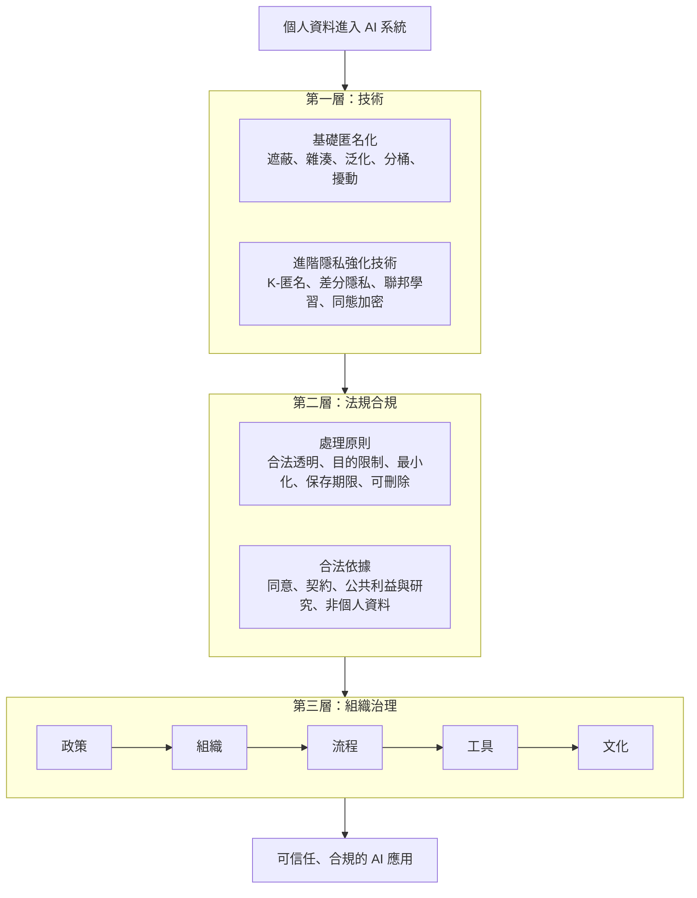
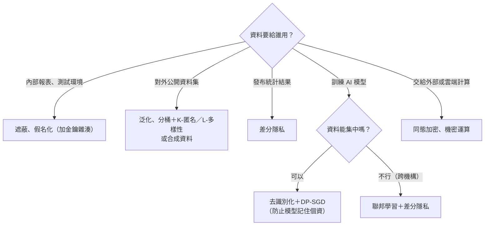

### Metadata
parent:: [[_【目錄】iPAS-AI應用規劃師(中級)：大數據處理分析與應用]]
sibling:: [[10大數據與機器學習]] · [[11大數據在鑑別式AI中的應用]] · [[12大數據在生成式AI中的應用]]

## Key Points
> [!summary] 一句話看懂
> **刪掉姓名不等於匿名。大數據最大的隱私風險，是把很多「看似無害」的資料拼在一起，就能認出你是誰。**
> 所以隱私保護要三層一起做：**技術**（匿名化與隱私強化技術）、**法規**（合法取得、目的限制、最小化）、**治理**（政策、組織、流程、文化）。

#### 三種個人資料
| 類型 | 意思 | 例子 |
|---|---|---|
| **直接識別資訊** | 單獨就能指出是誰 | 姓名、身分證字號、電話、Email、裝置 ID |
| **準識別資訊** | 單獨無法識別，**組合起來**就可能認出 | 性別＋出生年月日＋郵遞區號、行為軌跡 |
| **敏感／特種個資** | 外洩後傷害特別大，法律特別保護 | 病歷、醫療、基因、健康檢查、犯罪前科 |

#### 基礎匿名化技術
| 技術 | 做法 | 例子 | 主要限制 |
|---|---|---|---|
| **遮蔽** Masking | 部分內容換成符號 | 王大明 → 王○○ | 容易被推測或比對還原 |
| **雜湊** Hashing | 單向轉換成固定長度字串 | Email → SHA-256 值 | **輸入範圍小時可被暴力破解**；仍屬個資 |
| **泛化** Generalization | 降低精確度 | 1987-03-12 → 1980 年代；信義區某路 → 台北市 | 精度損失 |
| **分桶** Bucketing | 連續數值轉區間 | 32 歲 → 30～39 歲 | 區間太細仍可能識別 |
| **隨機擾動** Noise | 加入小幅隨機雜訊 | 薪資 50,000 → 50,123 | 太小沒保護、太大失真 |

#### 進階隱私強化技術（PETs）
| 技術 | 一句話 | 適合 | 限制 |
|---|---|---|---|
| **K-匿名** | 每筆資料至少和 K−1 筆在準識別欄位上**一模一樣** | 公開資料集 | 敏感欄位可能都一樣（被推測） |
| **L-多樣性** | 每組內的敏感欄位至少有 **L 種不同值** | 補 K-匿名的漏洞 | — |
| **T-接近性** | 每組敏感欄位的**分佈接近整體** | 進一步防推測 | 計算複雜 |
| **差分隱私** | 加入**數學上可控的雜訊**，有沒有某一個人，結果幾乎一樣 | 統計查詢、模型訓練（DP-SGD） | 降低精度 |
| **聯邦學習** | **資料不出門**，只傳模型參數更新 | 跨醫院、手機鍵盤預測 | 通訊成本、參數仍可能洩漏資訊 |
| **同態加密** | **在加密狀態下直接運算** | 雲端外包計算、金融 | **運算非常慢** |

> [!warning] 陷阱題
> 1. **降低個資風險、符合法規 → 資料匿名化**（移除姓名、轉換欄位）（官方考題原題）。
> 2. **加入雜訊保護個體、即使公開模型也難以反推 → 差分隱私**（官方考題原題）。
> 3. **處理醫療敏感資料 → 取得合法授權與病患同意，並執行隱私強化**（官方考題原題）。
> 4. **確保資料來源與處理歷程可稽核 → 資料版本管理與操作紀錄制度**（官方考題原題）。
> 5. **AI 治理 → 導入治理框架與跨部門監管流程**（技術、法務、業務共同參與）（官方考題原題）。
> 6. **K-匿名 → L-多樣性 → T-接近性**，一層比一層嚴格。
> 7. **聯邦學習傳的是「模型參數或梯度」，不是原始資料**。
> 8. **同態加密的最大缺點是運算效率低**。
> 9. **個資法五原則**：合法正當透明、**目的限制**、**資料最小化**、保存期限限制、可存取與可刪除。
> 10. **合法依據**：明確同意、契約履行必要、公共利益或學術研究（需去識別化）、非個人資料。
> 11. **模型卡（Model Card）＝模型的說明書**，記錄訓練資料、假設、測試結果與限制。
>
> ⚠️ **學習指引錯誤或不精確的地方**
> - 指引說雜湊「**不可逆，安全性高**」，並把雜湊列為讓資料成為「**非個人資料**」的強匿名化技術：這是**常見的誤解**。手機號碼、Email、身分證字號的可能組合有限，攻擊者可以**把所有可能值都算一次雜湊再比對**，很快還原。依 GDPR，**雜湊後的 ID 仍屬「假名化資料」，依然是個人資料**。較安全的做法是**加密金鑰的雜湊（HMAC）或加鹽**，並把金鑰分開保管。
> - 指引說隨機擾動能「**保留均值、方差**」：加入雜訊後**平均數大致不變，但變異數會變大**（多了雜訊的變異）。若要正確估計變異，分析時需扣除雜訊的影響。
> - 指引把「**信用狀況、宗教信仰**」列為需特別保護的敏感資料：在 **GDPR** 中，宗教信仰屬於特殊類別個資；但依**台灣個資法第 6 條**，特種個資是**病歷、醫療、基因、性生活、健康檢查、犯罪前科**。信用與宗教在台灣不屬於法定特種個資，但仍應謹慎處理。
> - 指引說非個人資料「**不受個資法約束，可自由用於 AI 訓練**」：前提是**真正無法再識別**。實務上很多「去識別化」資料仍能透過組合或外部比對還原，**只要仍可間接識別，就還是個資**。此外，即使不是個資，仍可能受**著作權、營業秘密、契約**限制。

> [!tip] PM 要記住的 3 件事
> 1. **在需求階段就問「真的需要這個欄位嗎？」**：最好的隱私保護是**一開始就不蒐集**（資料最小化），比事後匿名化便宜也安全。
> 2. **把資料送進外部大型模型 API 前要確認三件事**：資料會不會被拿去訓練、保存多久、存放在哪個國家。企業版服務通常可設定不保留、不訓練。
> 3. **匿名化不是一次性的**：外部公開資料越來越多，今天安全的資料集，明天可能被比對還原。要**定期做再識別風險測試**。

--- 
## Notes
### 全局地圖：大數據隱私保護的三層防線

- AI 在醫療、金融、電商、教育的應用，使用越來越**龐大、精細、個人化**的資料。大數據提升了模型效能，也**放大了再識別風險、資料濫用與不當自動化決策的後果**。
- AI 法規與治理框架（EU AI Act、AI 基本法、NIST AI RMF）的完整說明見 [[07AI風險管理]]；資料存取控制與零信任見 [[05數據儲存與管理]]。

---

### 一、個資識別風險
#### 三種個人資料
**直接識別資訊**：單獨就能指向特定個人，例如**姓名、身分證字號、電話、Email、裝置 ID**。這類資訊最容易辨認，也是匿名化時第一個被處理的對象。

**準識別資訊**：單獨看無法識別，但**組合起來**就可能指向某個人，例如**性別、出生年月日、郵遞區號、瀏覽紀錄、位置軌跡**。這是大數據隱私最大的盲點。

> [!example] 經典研究：三個欄位就能認出你
> 美國學者 Latanya Sweeney 的研究發現，只要知道「**郵遞區號＋性別＋完整出生日期**」，就能唯一識別約 **87%** 的美國人。她甚至用公開的選民名冊，比對出麻州州長在「匿名」醫療資料中的病歷。
> → 只刪除姓名，遠遠不夠。

**敏感資料／特種個資**：外洩後傷害特別嚴重，法律給予更高保護。
- **台灣個資法第 6 條的特種個資**：**病歷、醫療、基因、性生活、健康檢查、犯罪前科**，原則上不得蒐集處理，僅在法定例外情況下可以。
- **GDPR 的特殊類別個資**：另外包含種族、政治觀點、**宗教信仰**、工會會員、生物特徵、性傾向等。
- 信用狀況等財務資料雖不一定是法定特種個資，但外洩傷害大，實務上也應高度保護。

#### 再識別的風險來源
**橫向比對**：把「匿名」資料與**外部資料**（公開社群貼文、選民名冊、外洩資料庫）結合，比對出身分。

> [!example] Netflix 獎金競賽事件
> 2006 年 Netflix 公開約 50 萬名用戶的「匿名」電影評分資料，舉辦推薦演算法競賽。研究人員把它與 IMDb 上公開的評論比對，成功識別出部分用戶，甚至推斷出敏感偏好。Netflix 因此遭到訴訟並取消第二屆競賽。

**時間軸拼接**：透過**行為軌跡**（GPS 位置、購買時間、刷卡紀錄）推斷身分。研究顯示，只要 **4 個**時間與地點的資料點，就能在數百萬人的手機定位資料中識別出 **95%** 的人。因為每個人的「住家 → 公司」路線幾乎獨一無二。

**保護不足**：只做**表面處理**（例如只遮蔽姓名），其他準識別欄位原封不動。

**AI 模型特有的風險**：
- **模型記憶與訓練資料萃取**：大型語言模型可能**記住**訓練資料中的個資，並在特定提示下完整吐出。
- **成員推論攻擊**：攻擊者判斷「某個人的資料是否被用來訓練這個模型」，例如推斷某人是否在某醫院的病患資料集中。
- **模型反推攻擊**：從模型的輸出反推出訓練資料的特徵。

#### 各產業案例
- **醫療**：AI 診斷模型使用**未匿名化**的病歷（含年齡、診斷紀錄），被外部資料比對出患者身分，違反個資法遭罰款。
- **電商**：推薦系統的顧客瀏覽紀錄**未匿名化**，被駭客透過行為軌跡識別用戶，品牌信任度下降。
- **金融**：詐欺偵測模型使用**未脫敏**的交易資料，經時間軸拼接洩漏用戶身分。
- **教育**：學習分析模型**未移除年級與地區**資料，小班級中的學生身分容易被推測。

---

### 二、資料匿名化與隱私強化技術
#### 1. 先釐清三個名詞
- **去識別化（De-identification）**：泛指移除或降低識別性的處理，是台灣法規常用的說法。
- **假名化（Pseudonymization）**：用代號取代身分（例如把姓名換成 ID-0001），但**透過對照表或其他資訊仍可還原**。依 GDPR，**假名化資料仍是個人資料**。
- **匿名化（Anonymization）**：處理到**任何人以合理方法都無法再識別**。真正匿名化的資料才不受個資法規範，但要做到非常困難。

#### 2. 基礎匿名化技術
##### (1) 遮蔽（Masking）
- **做法**：用符號或假資料替換部分或全部內容。例如姓名「王大明」→「王○○」；身分證字號「A123456789」→「A12\*\*\*\*\*89」。
- **適合**：報表顯示、客服畫面、測試環境資料。
- **優點**：簡單快速，**保留資料格式**（如電話號碼長度），系統不必改。
- **限制**：只隱藏部分資訊，可能被推測或與其他資料比對還原。

##### (2) 雜湊（Hashing）
- **做法**：用單向函數（如 **SHA-256**）把帳號、Email 轉成固定長度的字串。同樣的輸入永遠得到同樣的輸出，所以可以**跨資料庫比對**同一個人，而不必顯示原始資料。
- **適合**：匿名化用戶 ID、跨系統串接、去重。
- **優點**：一致性好，方便比對。
- **限制（重要）**：
  - 手機號碼、身分證字號、Email 的**可能值有限**，攻擊者可以**把所有可能值都算一次雜湊**（暴力破解或彩虹表）再比對，很快就能還原。台灣手機號碼只有約一億種組合，現代電腦幾秒內就能算完。
  - 雜湊後仍是**假名化資料**，法律上依然是個資。
  - 無法用於數值分析。
- **較安全的做法**：**加鹽雜湊**或使用**金鑰雜湊（HMAC）**，並把鹽或金鑰與資料**分開保管**。

##### (3) 泛化（Generalization）
- **做法**：降低資料精確度。例如出生日期「1987-03-12」→「1980 年代」；地址「台北市信義區基隆路」→「台北市」。
- **適合**：公開資料集、統計分析。
- **優點**：簡單有效，保留資料的整體分佈。
- **限制**：精度損失，可能影響需要細緻分群的分析。

##### (4) 分桶（Bucketing）
- **做法**：把連續數值轉成區間。例如收入 58,000 元 →「5～6 萬」；年齡 32 歲 →「30～39 歲」。
- **適合**：統計報表、人口分析。
- **優點**：保留趨勢，降低個體識別風險。
- **限制**：區間設計要謹慎。若某區間只有一兩個人（例如「年收入 1,000 萬以上」只有董事長），一樣能被識別。

##### (5) 隨機擾動（Noise Injection）
- **做法**：在數值上加入小幅隨機雜訊。例如薪資 50,000 → 50,123。
- **適合**：數值資料分享、統計分析。
- **優點**：單筆資料難以反推，**平均數大致保持不變**。
- **限制**：雜訊太小沒有保護效果，太大會讓分析失真；加入雜訊後**變異數會變大**。

#### 3. 進階隱私強化技術（PETs）
面對**連結攻擊**、**生成式 AI 的記憶問題**等更進階的威脅，醫療、金融等高敏感領域需要更強的技術。

##### (1) K-匿名、L-多樣性、T-接近性
這三者是一系列**逐步加強**的概念，用來衡量「公開資料集」的再識別風險。

- **K-匿名**：每一筆資料在**準識別欄位**（年齡、性別、郵遞區號）上，至少和其他 **K−1 筆**完全相同。也就是說，攻擊者最多只能把目標縮小到 K 個人之中。
- **L-多樣性**：光有 K-匿名還不夠。如果某一組 5 個人的疾病**全部都是糖尿病**，即使不知道是誰，也知道這組人都有糖尿病。L-多樣性要求每組的**敏感欄位至少有 L 種不同的值**。
- **T-接近性**：更進一步，要求每組敏感欄位的**分佈**要接近整體資料的分佈。例如整體有 5% 的人罹癌，某一組卻有 60%，雖然有多樣性，仍洩漏了「這組人罹癌機率很高」。

> [!example] K-匿名示意（K＝3）
> | 年齡 | 性別 | 郵遞區號 | 疾病 |
> |---|---|---|---|
> | 30～39 | 女 | 110\*\* | 感冒 |
> | 30～39 | 女 | 110\*\* | 糖尿病 |
> | 30～39 | 女 | 110\*\* | 高血壓 |
>
> 三筆在準識別欄位上完全相同，攻擊者只知道目標是其中一人；疾病有三種不同值，也滿足 L＝3 的多樣性。

- **適合**：公開資料集、醫療研究、金融風險分析等**結構化資料**。
- **限制**：K 值越大越安全，但資料越模糊；計算複雜；**對文字等非結構化資料效果有限**。

##### (2) 差分隱私（Differential Privacy）
> [!example] 白話比喻
> 調查「有多少員工曾經偷懶」，直接問沒人會說實話。改成：每個人先**偷偷擲硬幣**，正面就照實回答，反面就再擲一次、正面答「有」反面答「沒有」。
> 任何一個人的「有」都可能只是硬幣造成的，**個人有了合理的否認空間**；但統計整體回答，仍能**推算出真實比例**。這就是差分隱私的精神。

- **做法**：在**查詢結果或模型訓練過程中**加入**數學上精確控制**的雜訊（如拉普拉斯或高斯雜訊），使得「**資料集中有沒有某一個人**」，對結果的影響**微乎其微**。
- **隱私預算 ε（epsilon）**：控制保護強度。**ε 越小，保護越強、雜訊越多、準確度越低**。
- **應用**：
  - **統計發布**：美國 2020 年人口普查正式採用差分隱私。
  - **企業資料蒐集**：Apple、Google 用於蒐集使用者行為統計（如熱門表情符號），而不取得個人明細。
  - **模型訓練**：**DP-SGD**（差分隱私隨機梯度下降）在訓練時限制每筆資料的影響並加入雜訊，讓模型**難以記住**任何單一個人的資料。
- **優點**：提供**數學上可證明**的隱私保證，不受攻擊者擁有多少外部資料影響。
- **限制**：雜訊會**降低精度**，需在隱私與效用間取捨；設定 ε 需要專業判斷。

##### (3) 聯邦學習（Federated Learning）
- **做法**：**資料留在原地**（各家醫院、各支手機），模型在本地訓練，只把**模型參數更新**送到中央伺服器彙整，再把改進後的模型發回各地。
- **應用**：
  - **跨醫院合作**：多家醫院共同訓練診斷模型，但病歷不離開醫院。
  - **手機鍵盤預測**：Google Gboard 用使用者的打字習慣改善預測，但打字內容不上傳。
  - **跨銀行反詐欺**：多家銀行共同訓練詐欺模型，不交換客戶資料。
- **優點**：原始資料**不出門**，降低外洩風險；適合資料無法集中的情境。
- **限制**：
  - **通訊成本高**，各地資料分佈不同時訓練較困難。
  - **參數更新本身仍可能洩漏資訊**（梯度反推攻擊），常需搭配**差分隱私**或**安全聚合**。

##### (4) 同態加密（Homomorphic Encryption）
- **做法**：資料**在加密狀態下直接運算**，解密後的結果和用明文運算完全一樣。
- **比喻**：把材料鎖在一個**手套箱**裡，別人可以隔著手套加工，但從頭到尾看不到也拿不出材料，只有持鑰匙的人能打開拿成品。
- **應用**：把資料交給雲端或外部廠商計算、金融資料分析、醫療資料外包運算。
- **優點**：資料**全程加密**，提供密碼學等級的安全保證。
- **限制**：**運算速度慢**，完全同態加密可能比明文運算慢數千倍以上，需要高效能硬體。目前多用於特定、計算量較小的情境。

##### (5) 其他實務常見技術
- **合成資料**：用生成模型產生**統計特性相近**、但不對應任何真實個人的資料，供開發與測試使用。仍需檢查是否不小心「複製」了真實資料。
- **可信執行環境（TEE）／機密運算**：在硬體隔離的安全區域內處理資料，連雲端業者也看不到。
- **安全多方計算（MPC）**：多方在不透露各自資料的情況下，共同算出結果。
- **資料無塵室（Data Clean Room）**：廣告主與平台在受控環境中比對受眾資料，只輸出彙總結果。

#### 4. 怎麼選擇隱私技術

---

### 三、AI 訓練資料的合規處理
#### 1. 主要法規
- **GDPR（歐盟一般資料保護規則）**：處理歐盟居民個資的所有企業都適用（不論企業在哪裡）。
- **CCPA／CPRA（加州消費者隱私法）**：美國最具代表性的州級隱私法。
- **台灣《個人資料保護法》**：2023 年修法提高罰則，並明定設立獨立的**個人資料保護委員會**。
- **AI 相關法規**：歐盟《人工智慧法》要求高風險 AI 的資料治理；台灣《人工智慧基本法》將**隱私保護與資料治理**列為基本原則（詳見 [[07AI風險管理]]）。

#### 2. 五大資料處理原則
##### (1) 合法性、正當性與透明性
- 資料的蒐集與使用必須合法，並**清楚告知**使用者蒐集目的、使用範圍與處理方式。
- 實務：在隱私政策或同意書中寫清楚，例如「您的對話紀錄將用於訓練客服模型」，而不是只寫「用於改善服務」。

##### (2) 目的限制（Purpose Limitation）
- 蒐集時要訂明確目的，**之後不得超出或改變**原目的。
- 實務：蒐集時說「用於客服模型訓練」，就不能拿去做廣告投放。這是 AI 專案最常踩的雷：**「反正資料都有了，拿來訓練模型吧」往往就超出原本告知的目的**。

##### (3) 資料最小化（Data Minimization）
- 只蒐集完成任務**所需的最少資料**。
- 實務：詐欺模型需要交易金額與時間，但不需要婚姻狀況；能用年齡區間就不要用完整生日。

##### (4) 保存期限限制
- 個資不得無限期保存，要設定保留期限，**到期刪除或匿名化**。
- 實務：建立資料生命週期管理，例如交易明細 2 年後自動匿名化。

##### (5) 可存取、可更正、可刪除
- 使用者有權查詢、更正、刪除自己的資料（GDPR 的「**被遺忘權**」）。
- 實務：提供查詢與刪除的管道並快速回應。
- **AI 特有難題**：資料已經被用來訓練模型，使用者要求刪除時，**模型裡學到的東西怎麼刪**？重新訓練成本很高，這催生了「**機器遺忘（Machine Unlearning）**」的研究；實務上通常是記錄資料用在哪些模型，並在下次重訓時排除。

#### 3. AI 訓練資料的合法依據
使用個資訓練 AI，需要具備以下合法依據之一：

##### (1) 明確同意（Explicit Consent）
- 使用者在蒐集前**主動同意**，並清楚了解用途。
- 實務：提供**獨立的勾選選項**，說明「您的對話將用於訓練客服模型」，並**允許隨時撤回**。不能預設已勾選，也不能藏在冗長條款裡。

##### (2) 契約履行所必要
- 資料處理是**提供使用者所購買的服務**所必需。
- 實務：信用卡公司為了核卡與防詐所做的風險評估。要注意：「訓練一個通用模型」通常**不算**履行個別契約所必要。

##### (3) 公共利益或學術研究
- 資料經過**去識別化、無法直接或間接識別特定個人**後，可用於公共利益或學術研究，例如醫療研究、政策分析。
- 實務：
  - 通過**人體研究倫理審查委員會**（IRB）或內部審查，評估研究目的、資料必要性與隱私保護措施。
  - 公開研究目的與處理方式，保留匿名化過程與審查紀錄，接受監督稽核。

##### (4) 非個人資料
- 經過**真正匿名化**、無法再識別的資料，不受個資法規範。
- 實務：
  - 使用**足夠強**的匿名化技術（K-匿名、差分隱私、泛化等；**單純雜湊不夠**）。
  - **定期做再識別風險測試**（模擬連結攻擊）。
  - **記錄匿名化流程**，以備合規查核。
- 提醒：即使不是個資，仍要注意**著作權、營業秘密與契約限制**。

#### 4. 生成式 AI 的特別注意事項
- **員工把資料貼進外部 AI 工具**：可能把客戶個資或公司機密送到外部。企業應提供**經審核的企業版工具**，並訂定使用規範。
- **確認供應商條款**：資料是否用於訓練、保留多久、存放區域、是否有資料處理協議（DPA）。
- **RAG 的權限控管**：檢索系統要依使用者權限過濾文件（見 [[12大數據在生成式AI中的應用]]）。
- **輸出端過濾**：偵測並遮蔽模型回答中出現的個資。

---

### 四、建立企業內部治理機制
資料治理是**跨部門的共同責任**，需要法務、資安、業務與資料科學團隊一起參與。缺乏治理架構，企業不但難以確保合規，還可能因模型**不透明、失準或偏誤**造成商業風險與罰款。治理可以從五個面向著手。

#### 政策：制定資料與 AI 治理規範
- **資料使用範圍與限制**：哪些資料可以用於分析、訓練、測試（例如僅限匿名化資料），哪些需要特別授權（敏感個資）。
- **AI 倫理準則**：公平、不歧視、透明（例如對外說明模型決策依據）。
- **跨境傳輸規範**：資料存放或處理在其他國家時的審核流程（例如使用海外雲端或外國 AI 服務）。
- **定期更新**：隨技術與法規變化修訂，例如新增生成式 AI 的使用規範、**AI 生成內容的標示與審核**。

#### 組織：建立跨部門治理單位
- **資料治理委員會**：由法務、資安、資料科學、資訊、業務代表組成，負責**審議資料使用規則、核准授權申請、處理違規事件**。
- **AI 責任角色**：
  - **首席 AI 官（CAIO）**：負責 AI 策略與整體治理。
  - **資料管理員（Data Steward）**：負責特定資料領域的品質、定義與存取管理。
  - **個資保護長（DPO）**：GDPR 要求特定組織設置，負責監督個資合規。

#### 流程：資料與模型的生命週期管理
從資料取得、處理、模型開發、上線到**下架**，每個階段都要可追蹤、可管控：

- **資料登記與資產盤點**：建立**資料目錄**，記錄每份資料的**來源、用途、風險等級、授權狀態**。
- **模型卡（Model Card）**：每個模型的**說明書**，記錄訓練資料、適用範圍、假設條件、各群體的測試結果與**已知限制**。對應地也有記錄資料集來源與限制的**資料卡（Datasheet）**。
- **權限控管與審核**：資料與模型的使用須經**申請與核准**，避免濫用或跨部門不當使用。
- **資料版本管理與操作紀錄**：記錄資料的處理歷程與每次存取，確保**可稽核**（考題重點）。
- **隱私影響評估（DPIA／PIA）**：高風險的資料處理在開始前先評估風險與對策。

#### 工具：導入自動化治理
只靠人工控管，容易遺漏、難以落實：

- **資料稽核與追蹤系統**：自動記錄資料的存取與使用，產生報表。
- **敏感資料偵測工具**：自動掃描資料庫、文件與日誌，找出**姓名、地址、身分證字號、IP** 等個資（例如 Microsoft Presidio、雲端 DLP 服務）。
- **模型監控系統**：定期檢查**偏誤、概念漂移**與輸出合理性（見 [[10大數據與機器學習]]）。
- **資料遺失防護（DLP）**：防止敏感資料被上傳或傳送到未經核准的地方（包括外部 AI 工具）。

#### 文化：教育訓練與回饋
制度能否落實，取決於每個人是否理解並執行：
- **分角色培訓**：資料科學家學隱私技術、工程師學安全開發、業務學合規界線、法務學 AI 技術基礎。
- **把合規納入日常流程與績效**：例如專案上線前的檢核清單必須包含隱私審查。
- **建立舉報與回饋機制**：員工能**匿名**反映違規疑慮或提出改善建議。

---

### PM 檢查清單：AI 專案隱私與合規 10 問
1. **真的需要這些個資嗎？** 能用匿名、彙總或合成資料取代嗎？
2. **合法依據是什麼？** 有取得同意嗎？使用範圍有超出當初告知的目的嗎？
3. **有特種個資嗎？** 病歷、基因、健康檢查等需要更高等級保護。
4. **去識別化夠嗎？** 準識別欄位處理了嗎？做過再識別風險測試嗎？
5. **雜湊有加金鑰嗎？** 還是只用了容易被破解的單純雜湊？
6. **資料要出境或交給外部嗎？** 供應商條款、資料處理協議、存放區域確認了嗎？
7. **使用者要求刪除時怎麼辦？** 能追蹤資料被用在哪些模型嗎？
8. **模型會不會洩漏個資？** 需要差分隱私或輸出過濾嗎？
9. **有模型卡與資料目錄嗎？** 審核與操作紀錄可稽核嗎？
10. **誰負責？** 資料治理委員會、資料管理員、DPO 的角色清楚嗎？

---
## References
- iPAS AI應用規劃師(中級)學習指引 科目2：大數據處理分析與應用 — 6.4 大數據隱私保護、安全與合規、第六章考題解析
- 《個人資料保護法》（2023 年修正）；European Union (2016). *General Data Protection Regulation (GDPR)*
- Sweeney, L. (2000). *Simple Demographics Often Identify People Uniquely*
- Narayanan, A. & Shmatikov, V. (2008). *Robust De-anonymization of Large Sparse Datasets*（Netflix 資料集）
- de Montjoye, Y.-A. et al. (2013). *Unique in the Crowd: The privacy bounds of human mobility*. Scientific Reports
- Dwork, C. & Roth, A. (2014). *The Algorithmic Foundations of Differential Privacy*
- McMahan, B. et al. (2017). *Communication-Efficient Learning of Deep Networks from Decentralized Data*（聯邦學習）
- Mitchell, M. et al. (2019). *Model Cards for Model Reporting*
- European Data Protection Board. *Guidelines on Pseudonymisation*
![[AI應用規劃師(中級)-學習指引-科目2大數據處理分析與應用_20251222101850.pdf]]
