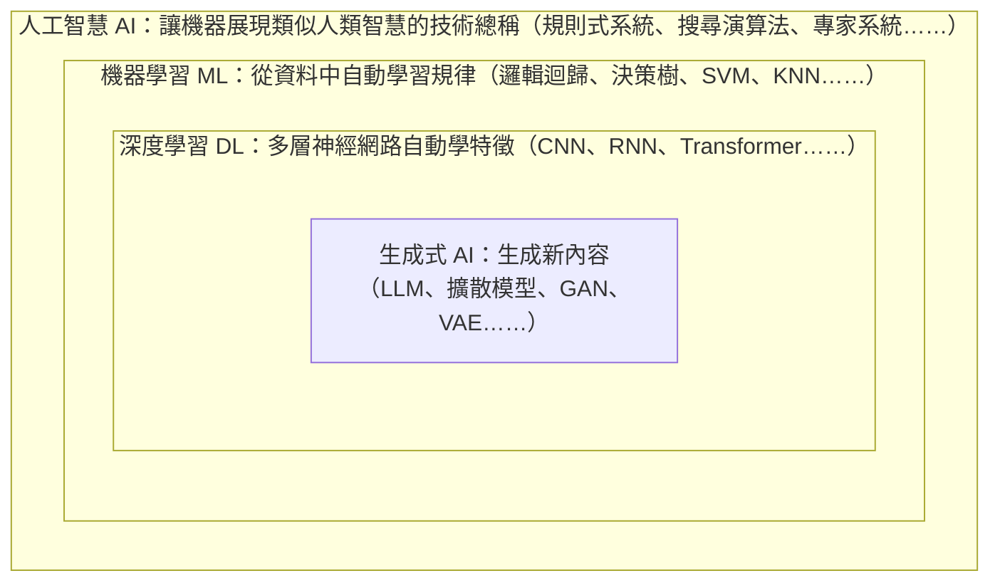
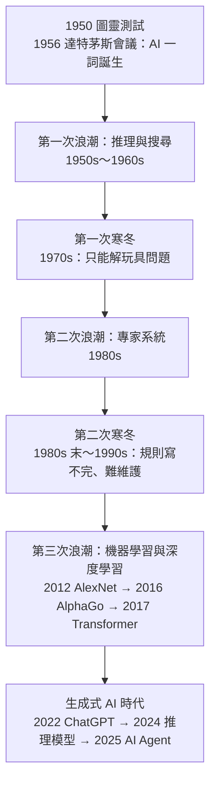

### Metadata
parent:: [[_【目錄】iPAS-AI應用規劃師(初級)：人工智慧基礎概論]]
sibling:: [[02資料處理與分析]] · [[03機器學習概念]] · [[04鑒別式AI與生成式AI概念]]

## Key Points
> [!summary] 一句話看懂
> **人工智慧是一組俄羅斯娃娃**：最外層是**人工智慧（AI）**，裡面是**機器學習（ML）**，再裡面是**深度學習（DL）**，而**生成式 AI** 是深度學習目前最熱門的應用。
> 每往內一層，**越依賴資料、越不需要人寫規則**。2024 年之後，生成式 AI 再往前一步，從「會回答」走向「會推理、會動手做事」（推理模型與 AI Agent）。

#### AI 的分類
| 分類方式  | 類型                  | 白話           | 現況                                     |
| ----- | ------------------- | ------------ | -------------------------------------- |
| 依能力範圍 | **弱 AI／狹義 AI（ANI）** | 只會做特定任務      | ✅ **目前所有 AI 都屬於這類**（包括 ChatGPT、Claude） |
|       | **強 AI／通用 AI（AGI）** | 像人一樣什麼都能學、能做 | 尚未實現，是各大 AI 公司公開宣示的目標                  |
|       | **超級 AI（ASI）**      | 全面超越人類       | 理論概念                                   |
| 依技術路線 | **符號主義**            | 人寫規則         | 專家系統                                   |
|       | **連結主義**            | 模仿神經元、從資料學   | 深度學習（**當今主流**）                         |
|       | **行為主義**            | 與環境互動試錯      | 強化學習                                   |

#### 學習方式
| 學習方式     | 白話         | 資料           | 典型任務               |
| -------- | ---------- | ------------ | ------------------ |
| **監督式**  | 有老師給標準答案   | 有標記          | 分類、迴歸              |
| **非監督式** | 自己找規律      | 無標記          | 分群、降維、異常偵測         |
| **半監督式** | 少量答案＋大量無答案 | 少量標記＋大量未標記   | 標註成本高的分類           |
| **自監督式** | 自己出題考自己    | 無標記，從資料本身造標籤 | **LLM 預訓練**（猜下一個字） |
| **強化學習** | 從獎懲中試錯學習   | 環境回饋         | 遊戲 AI、機器人、**RLHF** |

#### 經典神經網路
| 網路                 | 擅長                 | 一句話                          |
| ------------------ | ------------------ | ---------------------------- |
| **CNN** 卷積神經網路     | **圖像**             | 用放大鏡一格格掃描局部特徵                |
| **RNN** 循環神經網路     | **序列**（文字、語音、時間序列） | 邊讀邊記住前面的內容                   |
| **GAN** 生成對抗網路     | **生成**資料           | 偽造者與鑑定師互相對抗                  |
| **Transformer**    | 序列，現已通用於文字、圖像、語音   | 一次看全部、用注意力找關聯，**當今 LLM 的骨架** |
| **擴散模型** Diffusion | **生成圖像、影片**        | 把雜訊一步步「洗」成畫面，**當今生圖主流**      |

#### 搜尋演算法
| 演算法          | 做法                        | 前提             | 時間複雜度    |
| ------------ | ------------------------- | -------------- | -------- |
| **線性搜尋**     | 從頭一個一個比                   | 不需排序           | O(n)     |
| **二分搜尋**     | 每次和中間值比，砍掉一半              | **資料必須先排序**    | O(log n) |
| **深度優先 DFS** | 一條路走到底再回頭                 | 圖或樹狀結構，用**堆疊** | O(V＋E)   |
| **廣度優先 BFS** | 一層一層往外擴散                  | 圖或樹狀結構，用**佇列** | O(V＋E)   |
| **A\* 搜尋**   | 實際成本**＋預估剩餘成本**，優先走最有希望的路 | 需要好的啟發函數       | 視啟發函數而定  |

> [!warning] 陷阱題
> 1. **下圍棋、自動駕駛這類與環境動態、反覆互動的問題 → 強化學習**（官方考題原題）。
> 2. **AI 包括各種技術，例如機器學習、專家系統**，不限於深度學習，也廣泛應用於金融等產業（官方考題原題）。
> 3. **提升 AI 透明性＝透過報告、技術文件或網站對外揭露 AI 系統的相關資訊**（官方考題原題）。
> 4. **雷達圖不適合用來估計資料分佈**；直方圖、四分位數才適合（官方考題原題）。
> 5. **K-Means 的 K＝要分成的群組數量**（官方考題原題）。
> 6. **降低深度學習過擬合＝增加正則化項**；增加模型複雜度、提高學習率都不會降低過擬合（官方考題原題）。
> 7. **生成式 AI 最核心的能力＝生成新的、原創的內容**；**神經網路是生成式 AI 的重要基礎**（官方考題原題）。
> 8. **AI 治理的國際合作＝統一標準、避免濫用、促進技術轉移，以上皆是**（官方考題原題）。
> 9. **邏輯迴歸是「分類」演算法**，不是迴歸；**線性迴歸**才是預測連續數值。
> 10. **二分搜尋的前提是資料已排序**。
> 11. **DFS 走深（堆疊）、BFS 走廣（佇列）**；BFS 能找到**無權重圖**中層數最少的最短路徑，有權重時要用 Dijkstra 或 A\*。
> 12. **KNN** 分類用「多數決」，迴歸用「平均值或中位數」；KNN **沒有訓練過程**（惰性學習），預測時才計算距離。
> 13. **CNN 擅長圖像、RNN 擅長序列**；RNN 有梯度消失問題，**LSTM／GRU** 是改良版。
> 14. **GAN 的典型問題是模式崩潰（Mode Collapse）與訓練不穩定**。
> 15. **目前的 AI（含 ChatGPT）都是弱 AI**，不是強 AI。
> 16. **1956 年達特茅斯會議首次提出「人工智慧」一詞**；**1950 年圖靈提出圖靈測試**，兩個年份別搞混。
> 17. **Transformer 的核心是自注意力機制（Self-Attention）**，2017 年由 Google 提出。
> 18. **LLM 預訓練屬於自監督學習**：標籤（下一個字）來自資料本身，不需人工標註。
>
> ⚠️ **常見說法的更正**
> - 「生成式 AI 的訓練分兩階段（預訓練→微調）」：考試照此作答即可，但現代 LLM 實際上是**預訓練 → 監督式微調（SFT）→ 偏好對齊**（RLHF／DPO）三步，推理模型還會再加一層**強化學習**。
> - 「LLM 逐**字**生成」：精確說法是逐 **Token** 生成。Token 是模型切分文字的單位，一個中文字可能是 1～2 個 Token，一個英文單字也可能被拆成多個 Token。
> - 「參數越多，模型能力越強」：參數量只是因素之一。**訓練資料的量與品質、訓練算力、後訓練**（對齊）同樣關鍵；近年許多小模型靠高品質資料與蒸餾，表現追上數倍大的舊模型。
> - 「生成模型常見的有 GAN、VAE、Transformer」：還少了**擴散模型**。2022 年後的主流生圖工具（Stable Diffusion、Midjourney、DALL·E 3）都以擴散模型為核心，GAN 已退居特定用途。
> - 「池化層主要用來降低過擬合」：池化的主要作用是**縮小特徵圖、減少計算量，並讓模型對小幅位移不敏感**；降低過擬合只是附帶效果，現代架構也常改用步幅卷積取代池化。

> [!tip] PM 要記住的 3 件事
> 1. **不是每個問題都需要深度學習**：資料少、需要可解釋時，傳統機器學習或規則引擎往往更划算。
> 2. **AI 能力的瓶頸常常在資料，不在演算法**。
> 3. **AI 治理不是法務部門的事**：PM 從需求階段就要考慮公平、透明、隱私與人類監督。

--- 
## Notes
### 全局地圖：AI、機器學習、深度學習、生成式 AI 的關係

本科目四則筆記的分工如下：
- **01（本篇）**：AI 全貌概論，建立整體地圖。
- [[02資料處理與分析]]：資料的蒐集、清洗、分析、統計與隱私。
- [[03機器學習概念]]：機器學習的原理與完整流程。
- [[04鑒別式AI與生成式AI概念]]：各種模型的深入比較與整合應用。

---

### 一、什麼是人工智慧
#### 1. AI 的定義與圖靈測試
> [!example] 白話比喻
> AI 不是「會思考的機器人」，而是**讓電腦做出原本需要人類智慧才能完成的事**，例如看懂圖片、聽懂語音、做出判斷、寫出文章。

##### (1) 定義
**人工智慧**（Artificial Intelligence, AI）是研究如何讓機器**模擬人類的感知、學習、推理與決策能力**的技術總稱。它不是單一技術，而是一個大傘：從寫死的規則、搜尋演算法，到從資料中學習的機器學習，都屬於 AI。

##### (2) 圖靈測試
1950 年**艾倫・圖靈**在論文〈計算機器與智慧〉中提出「模仿遊戲」：如果人類透過文字對話，**無法分辨對方是人還是機器**，就可以說這台機器展現了智慧。

圖靈測試的價值在於把「機器會不會思考」這個哲學問題，轉成**可以實際檢驗的行為標準**。但它也有明顯限制：它只測「像不像人」，不測「對不對」。今天的大型語言模型在短對話中已經很難與人區分，卻仍會一本正經地說錯話（幻覺），所以業界評估 AI 已改用各種**基準測試**（Benchmark），例如數學、程式、專業考題的正確率。

##### (3) AI 的四大能力
- **感知**：看（電腦視覺）、聽（語音辨識）。
- **理解**：讀懂文字（自然語言處理）。
- **推理與決策**：判斷、預測、規劃。
- **生成與行動**：產生內容、操作工具、控制機器人。

#### 2. AI 的分類
##### (1) 依能力範圍：弱 AI、強 AI、超級 AI
**弱 AI／狹義 AI**（Narrow AI, ANI）只能完成**特定任務**，例如人臉辨識、推薦系統、AlphaGo。AlphaGo 下圍棋贏過世界冠軍，卻不會下西洋棋，這就是「狹義」的意思。

**強 AI／通用 AI**（Artificial General Intelligence, AGI）是指像人類一樣，能學習並完成**任何**智力任務的 AI。OpenAI、Google DeepMind、Anthropic 等公司都把 AGI 列為長期目標，但何時實現、甚至如何定義，業界仍有很大分歧。

**超級 AI**（Artificial Superintelligence, ASI）是在所有領域**全面超越人類**的 AI，目前只是理論概念。

> [!question] ChatGPT 能寫詩、寫程式、考律師，為什麼還算弱 AI？
> 主流分類仍把它歸為弱 AI，原因有三：它的能力來自訓練資料，**在訓練範圍外仍會犯錯**；它**不會自主設定目標**；也沒有證據顯示它有自我意識。不過它的通用性遠超傳統弱 AI，Google DeepMind 在 2023 年提出「AGI 等級」框架，把這類模型稱為「**初階 AGI**」（Emerging AGI）。考試作答請選「弱 AI」，但要知道這條界線正在變模糊。

##### (2) 依技術路線：三大學派
**符號主義**（Symbolism）主張由人類把知識寫成**規則**，讓電腦照規則推理，代表是專家系統與 `if-then` 規則引擎。優點是可解釋，缺點是規則寫不完。

**連結主義**（Connectionism）主張模仿大腦**神經元**，讓電腦從資料中自己學，代表是神經網路與深度學習，也是**當今主流**。

**行為主義**（Actionism）主張透過與環境**互動、試錯**來學習，代表是強化學習與機器人。

這三派不是互斥的。今天的 AI Agent 就是三者合體：用大型語言模型（連結主義）理解需求，用工具與規則（符號主義）確保動作正確，再用強化學習（行為主義）讓模型學會多步驟推理。

#### 3. AI 發展史：三次浪潮與兩次寒冬

##### (1) 第一次浪潮：推理與搜尋（1950s～1960s）
1956 年**達特茅斯會議**首次提出「人工智慧」一詞，被視為 AI 誕生的時刻。這時期的 AI 靠搜尋與邏輯推理解迷宮、下棋、證明定理，但只能處理規則明確的「玩具問題」，遇到真實世界的複雜情境就束手無策。期望落空後，經費被大幅刪減，進入**第一次 AI 寒冬**。

##### (2) 第二次浪潮：專家系統（1980s）
做法是訪談醫生、工程師等專家，把他們的知識寫成成千上萬條 `if-then` 規則。專家系統在醫療診斷、設備故障排除上有過商業成功，但很快遇到瓶頸：**規則寫不完、彼此衝突、難以維護**，專家自己也說不清楚的「直覺」更無法寫成規則。於是進入**第二次寒冬**。

##### (3) 第三次浪潮：機器學習與深度學習（2010s～）
這次成功的關鍵是三個條件同時到位：**大數據**（網路與手機產生海量資料）、**GPU 算力**（平行運算加速訓練）、**演算法突破**（深度神經網路的訓練技巧）。重要里程碑：
- **2012 年 AlexNet**：在 ImageNet 圖像辨識競賽中大幅領先，引爆深度學習熱潮。
- **2016 年 AlphaGo**：擊敗世界圍棋冠軍李世乭。
- **2017 年 Transformer**：Google 提出，成為日後所有大型語言模型的骨架。

##### (4) 生成式 AI 與代理時代（2022～）
- **2022 年底 ChatGPT**：讓一般大眾第一次直接用上大型語言模型，兩個月使用者破億。
- **2024 年推理模型**：OpenAI o1 等模型會先「想一想」再回答，在數學、程式等需要多步驟推理的任務上大幅進步。
- **2025 年起 AI Agent**：AI 不只回答問題，還能**自主拆解任務、操作工具、執行多步驟工作**，例如寫程式、操作瀏覽器、處理客服工單。

> [!tip] PM 為什麼在乎
> 每次 AI 寒冬都源自「**期待遠超實際能力**」。今天做 AI 產品，PM 要避免過度承諾，用 POC 驗證實際效益，並把「AI 會出錯」納入產品設計（人工覆核、信心門檻、回饋機制）。

#### 4. AI 治理：讓 AI 用得安心
> [!example] 白話比喻
> AI 治理就像**汽車的煞車、安全帶與駕照制度**：不是為了讓車跑不動，而是讓大家敢開快車。

##### (1) 定義
**AI 治理**是確保 AI 的開發與使用**符合倫理、法律與社會期待**的制度與流程，涵蓋從資料蒐集、模型開發、上線部署到持續監控的整個生命週期。

##### (2) 可信任 AI 的六大原則
各國指引用詞略有不同，但核心大同小異：

| 原則 | 白話 | 實務做法 |
|---|---|---|
| **公平性** | 不歧視特定群體 | 檢查不同性別、年齡族群的模型表現差異 |
| **透明與可解釋性** | 說得清楚 AI 為什麼做出這個決定 | 告知使用者正在與 AI 互動；用 SHAP 等工具解釋決策 |
| **隱私保護** | 妥善處理個人資料 | 去識別化、最小化蒐集、取得同意 |
| **安全與穩健** | 不會輕易被攻擊或出錯 | 對抗測試、紅隊演練、防範提示注入 |
| **問責** | 出問題時，知道誰該負責 | 明確的負責人、決策紀錄與稽核軌跡 |
| **以人為本** | 重要決策保留人類監督 | 人在迴路中（Human-in-the-Loop） |

##### (3) 主要規範與框架
**歐盟《AI 法案》**（EU AI Act）是全球第一部全面性的 AI 法律，2024 年 8 月生效、分階段施行。它依風險把 AI 分成四級：**不可接受風險**（禁止，如社會信用評分）、**高風險**（嚴格管理，如信用評分、招聘篩選）、**有限風險**（透明義務，如聊天機器人要告知是 AI）、**低風險**（無特別義務）。

**美國 NIST AI 風險管理框架**（AI RMF）是自願性框架，以**治理、映射、衡量、管理**四個功能協助組織管理 AI 風險。

**ISO/IEC 42001**（2023）是第一個 **AI 管理系統**國際標準，可以像 ISO 27001 一樣取得驗證，企業常用來向客戶證明 AI 治理到位。

**台灣**方面，《**人工智慧基本法**》於 2025 年 12 月三讀通過，確立風險分級、隱私保護、透明可解釋等基本原則；金融業則有金管會 2024 年發布的《**金融業運用人工智慧（AI）指引**》。

詳見 [[生成式AI風險管理]]。

---

### 二、演算法基礎
> [!example] 白話比喻
> 演算法就是**食譜**：明確、有限的步驟，照著做就能從材料（輸入）得到料理（輸出）。同一道菜有不同做法，有的快、有的省材料，這就是演算法效率的差別。

#### 1. 搜尋演算法
##### (1) 線性搜尋（Linear Search）
從資料集的==第一個元素開始，逐個與目標元素比較==，直到找到或比完為止。不需要先排序，但資料量大時很慢，時間複雜度 **O(n)**。就像在一疊沒整理的名片中找人，只能一張一張翻。

##### (2) 二分搜尋（Binary Search）
先將==中間元素與目標元素比較==：相等就找到了；目標較小就往左半部繼續找，較大就往右半部找。每比一次就**砍掉一半**，時間複雜度 **O(log n)**。

前提是**資料必須先排序**。就像查字典：翻到中間，發現要找的字在前面，就只看前半本。

##### (3) 深度優先搜尋（Depth-First Search, DFS）
在==圖形或樹狀結構==中，從起始節點出發，==沿著一條路儘可能往深處走，直到走不下去==，再回溯到上一個岔路，改走其他路徑。實作上使用**堆疊**（Stack，後進先出）或遞迴。

就像走迷宮時「靠右手扶牆一路走到底，死路再退回來」。適合**找出所有可能路徑**、偵測迴圈、解數獨這類需要窮舉的問題，比較省記憶體。

##### (4) 廣度優先搜尋（Breadth-First Search, BFS）
在==圖形或樹狀結構==中，從起始節點出發，==先訪問所有相鄰節點，再訪問相鄰節點的相鄰節點==，一層一層往外擴散。實作上使用**佇列**（Queue，先進先出）。

就像把石頭丟進池塘，漣漪一圈圈往外。因為是逐層擴散，BFS 第一次碰到目標時，走的一定是**層數最少**的路徑，所以適合找**無權重圖**的最短路徑，例如社群網路的「你和某人隔幾度」。若每條路的成本不同（例如道路長度不同），就要改用 **Dijkstra** 演算法。

##### (5) 啟發式搜尋：A\* 演算法
DFS 和 BFS 都是「盲目搜尋」，不知道目標在哪個方向。**A\*** 則在每一步計算：

$$f(n) = g(n) + h(n)$$

其中 $g(n)$ 是從起點走到目前節點的**實際成本**，$h(n)$ 是從目前節點到終點的**預估成本**（啟發函數，例如直線距離）。A\* 每次都優先展開 $f(n)$ 最小的節點，就像導航軟體會優先考慮「朝目的地方向」的路。只要啟發函數不高估實際成本，A\* 保證找到最短路徑。它廣泛用於**導航、遊戲角色尋路、機器人路徑規劃**，是經典 AI 搜尋的代表。

#### 2. 排序演算法與時間複雜度
##### (1) 常見排序演算法
比較排序演算法時，通常看三個指標：
- **平均效率**：一般情況下要花多少時間。
- **最差效率**：運氣最差時要花多少時間。
- **穩定性**：數值相同的資料，排序後是否**維持原本的先後順序**。例如交易紀錄先依日期排好，再依金額排序；如果排序法是穩定的，同金額的交易仍會按日期排列。

**穩定排序**不是另一種排序法，而是排序法的一種**特性**，也就是下表最後一欄。

| 排序法 | 做法 | 平均效率 | 最差效率 | 是否穩定 |
|---|---|---|---|---|
| **氣泡排序** Bubble Sort | 相鄰兩個比較，大的往後換，重複到排好 | O(n²) | O(n²) | ✅ 穩定 |
| **快速排序** Quick Sort | 選基準值，小的放左、大的放右，再各自排序 | O(n log n) | **O(n²)** | ❌ 不穩定 |
| **合併排序** Merge Sort | 拆成小份各自排好，再兩兩合併 | O(n log n) | O(n log n) | ✅ 穩定 |

快速排序的最差效率特別標粗，是因為它在選到很差的基準值時（例如資料本來就排好、每次都選第一個）會退化成 O(n²)。不過它實務上的平均表現最好，是許多程式語言內建排序的基礎；Python 內建的 Timsort 則是合併排序與插入排序的混合，兼顧速度與穩定。

##### (2) 時間複雜度（Big-O）
==**時間複雜度**描述**資料量變大時，計算時間增加的速度**==，而不是實際秒數。

- **O(1)**：不管資料多少，時間都一樣，例如用索引直接取值。
- **O(log n)**：資料多 1,000 倍，只多約 10 次比較，例如二分搜尋。
- **O(n)**：資料多 10 倍，時間多 10 倍，例如線性搜尋。
- **O(n log n)**：好的排序演算法。
- **O(n²)**：資料多 10 倍，時間多 100 倍，資料量大時會拖垮系統。

這也是為什麼**大量資料常==先排序或建索引再搜尋**==：一次性的排序成本，換來之後每次搜尋都很快。資料庫的索引、向量資料庫的近似最近鄰搜尋，都是同樣的道理。

   #### 3. 常見的入門機器學習演算法
##### (1) 線性迴歸（Linear Regression）
用一條直線（或多維的平面）描述輸入與輸出之間的關係，預測==連續數值==，例如房價、銷售額。

$$\hat{y} = w_1x_1 + w_2x_2 + \cdots + b$$

訓練的目標是找出讓==**預測值與實際值差距（均方誤差）最小**的權重 $w$ 與截距 $b$==。優點是簡單、可解釋，每個權重都能看出「這個因素影響多大」；缺點是只能捕捉線性關係。

##### (2) 邏輯迴歸（Logistic Regression）
名稱有「迴歸」，但實際上是==分類演算法==。它先算出和線性迴歸一樣的加權總和，再用 **Sigmoid 函數**==把結果壓到 0～1 之間，變成機率==，最後設定**閾值**（例如 0.5）==把機率轉換為類別==。

$$P(y=1) = \frac{1}{1 + e^{-(w_1x_1 + w_2x_2 + \cdots + b)}}$$

優點是簡單、計算快、輸出具有機率意義、係數可解釋，所以在**銀行信用評分**中至今仍廣泛使用。基本型只處理==二元分類==，多類別時要延伸為 **Softmax 迴歸**（多項式邏輯迴歸），或用「**一對多**」（One-vs-Rest）策略訓練多個二元分類器。

> [!tip] 閾值不一定是 0.5
> 閾值是**業務決策**，不是技術預設。詐欺偵測寧可多抓（漏掉一筆詐欺損失很大），閾值可調低到 0.3；行銷名單寧可精準（避免打擾客戶），閾值可調高到 0.7。

##### (3) K-最近鄰演算法（K-Nearest Neighbors, KNN）
「物以類聚」的演算法。對於一個新樣本，找出訓練集中==與它距離最近的 K 個樣本==：
- **分類**：看這 K 個鄰居中==出現最多次==的類別（多數決）。
- **迴歸**：取這 K 個鄰居的==平均值或中位數==。

KNN 屬於==基於實例的學習==（Instance-based），也叫**惰性學習**：它==沒有真正的訓練過程==，只是把資料記下來，等到預測時才計算距離。所以==**訓練很快、預測很慢**==，資料量大時不實用。

使用時要注意兩件事：
- ==**特徵要先標準化**==：否則「年收入（數十萬）」會完全壓過「年齡（數十）」對距離的影響。
- **K 值的選擇**：K 太小容易受雜訊影響（過擬合），K 太大會把不同類別混在一起（欠擬合）；二元分類常選**奇數**避免平手。

---

### 三、機器學習
**機器學習**（Machine Learning）是讓機器**==從資料中自動學習規律==**，而不是由人寫死規則的技術。

> [!example] 白話比喻
> 傳統程式是「**規則＋資料 → 答案**」：人告訴電腦「標題有『中獎』就是垃圾信」。
> 機器學習是「**資料＋答案 → 規則**」：給電腦一萬封已標好的信，讓它自己歸納出垃圾信的特徵。

依照「資料有沒有答案」與「怎麼學」，可分成以下幾種學習方式。

#### 1. 監督式學習（Supervised Learning）
用==帶有標記（Labeled Data）的訓練資料==，讓模型==學習「輸入特徵」與「正確答案」之間的關係==。訓練時模型不斷調整內部參數，縮小預測與答案的差距，最後能對沒看過的資料做出預測。主要任務有兩種：

- **分類**（Classification）：==把資料分到不同類別==，輸出是離散的類別。例如垃圾郵件過濾、信用卡詐欺偵測、影像辨識。  
- **迴歸**（Regression）：==預測連續數值==。例如房價預測、銷售額預測、客戶終身價值估算。

判斷方法很簡單：**答案是「哪一類」就是分類，答案是「多少」就是迴歸**。

監督式學習==最大的成本在**標註**==：需要人工準備大量正確答案，醫療影像等專業領域的標註更是昂貴。

#### 2. 非監督式學習（Unsupervised Learning）
資料**沒有標準答案**，演算法要==自己從資料中發掘模式、結構或分群==。常見任務：
- **分群**（Clustering）：把相似的資料歸在一起，例如依消費行為做**客戶分群**。
- **降維**（Dimensionality Reduction）：把上百個特徵壓縮成少數幾個，方便視覺化或加速運算。
- **異常偵測**（Anomaly Detection）：找出和大多數資料不一樣的點，例如異常交易。
- **關聯規則**：找出「買 A 的人也常買 B」，例如購物籃分析。

非監督式學習的難處在於**沒有標準答案可以評分**，分出來的群是否有商業意義，需要業務人員判斷。

#### 3. 半監督式與自監督式學習
##### (1) 半監督式學習（Semi-supervised Learning）
用**少量有標記**資料加上**大量未標記**資料一起訓練。適合標註成本高、但原始資料很多的情境，例如只有 1,000 張標註過的瑕疵照片，卻有 10 萬張未標註的產線照片。

##### (2) 自監督式學習（Self-supervised Learning）
**從資料本身自動產生標籤**，不需要人工標註。例如把一句話的最後一個字遮住，讓模型猜被遮住的是什麼字，答案就藏在原文裡。

這是**大型語言模型預訓練**的核心方法：GPT 類模型讀遍網路文字，一直練習「猜下一個字」；BERT 則練習「填空」。因為不需要人工標註，才能使用網路上兆級的文字來訓練。它常被歸在非監督式學習的大類下，但現在多半獨立列出。

#### 4. 強化學習（Reinforcement Learning, RL）
基於「==獎勵與懲罰==」的學習方法。**代理**（Agent）在**環境**中採取**行動**，環境回饋**獎勵**，代理的目標是學會一套**策略**，讓==長期累積的獎勵最大==。

> [!example] 白話比喻
> 就像訓練狗：做對了給零食，做錯了沒有。狗不需要知道「標準答案」，只要不斷嘗試，就會學會什麼行為能換到零食。

強化學習適合需要「**試錯學習**」和「**長期規劃**」的任務，例如遊戲 AI（AlphaGo）、機器人控制、自動駕駛、庫存與定價策略。

它在生成式 AI 中也扮演關鍵角色：**RLHF**（人類回饋強化學習）讓 ChatGPT 的回答更符合人類偏好；2024 年後的**推理模型**也是用強化學習，讓模型學會一步步推理數學與程式題。

> 完整流程（資料處理、模型訓練、評估優化）見 [[03機器學習概念]]。

---

### 四、深度學習
#### 1. 深度學習的基本原理
**深度學習**（Deep Learning, DL）是機器學習的子領域，==透過多層的人工神經網路==，從大量文字、語音、影像等資料中==自動學習特徵==。「深度」指的就是**層數很多**。

##### (1) 神經元與層
每個人工神經元接收前一層的輸出，做**加權總和**，再經過**激活函數**（如 ReLU、Sigmoid）做非線性轉 換，傳給下一層。網路由**輸入層、隱藏層、輸出層**組成，隱藏層越多，能學到的特徵越抽象。

激活函數是關鍵：如果沒有非線性轉換，疊再多層也只等於一層線性模型，學不到複雜的關係。

##### (2) 網路怎麼學習
訓練時，網路先做預測，用**損失函數**計算預測與答案的差距，再透過**反向傳播**（Backpropagation）算出每個權重該往哪個方向調、調多少，最後由**優化器**（如 SGD、Adam）更新權重。這個流程重複數萬到數百萬次，模型就會逐漸變準。

##### (3) 和傳統機器學習的差別
傳統機器學習需要**人工設計特徵**，例如辨識貓要先告訴模型「看耳朵形狀、鬍鬚」；深度學習則讓==模型自行學習特徵==：前幾層學邊緣與顏色，中間層學眼睛、耳朵，最後幾層學「貓臉」。代價是需要**更多資料、更多算力**，而且**較難解釋**。

#### 2. 經典網路架構
##### (1) 卷積神經網路（Convolutional Neural Network, CNN）
==特別擅長處理圖像==，設計靈感來自動物的視覺皮層。

> [!example] 白話比喻
> CNN 就像**拿放大鏡一格一格掃描照片**：先找出線條和邊緣，再組合成眼睛、鼻子，最後認出這是一張臉。

###### 結構組成
- **卷積層**（Convolutional Layer）：用小型濾鏡（卷積核）在影像上滑動，提取**局部特徵**，例如邊緣、紋理。同一個濾鏡在整張圖共用，所以參數量很少。
- **池化層**（Pooling Layer）：用最大池化或平均池化**縮小特徵圖**，減少運算量，並讓模型對物體的小幅位移不敏感。
- **全連接層**（Fully Connected Layer）：把提取出的特徵整合起來，做最後的分類或迴歸。

###### 優點
- ==適合處理高維資料==：權重共享讓參數量比全連接網路少很多。
- ==能提取層次化特徵==：從低層的邊緣，到高層的物體形狀與語意。

###### 應用場景
- **影像分類**：人臉辨識、手寫數字辨識（MNIST）。
- **物件偵測**：自動駕駛中的行人與障礙物偵測。
- **影像分割**：醫學影像中的病灶標記。

2020 年後，**Vision Transformer**（ViT）在大規模資料下挑戰了 CNN 的地位，但 ==CNN 在資料少、需要部署到手機或邊緣裝置的場景仍很常用==。詳見 [[02電腦視覺技術與應用]]。

##### (2) 循環神經網路（Recurrent Neural Network, RNN）
==專門處理序列資料==的模型。它的關鍵是**循環連接**：每一步不只接收當下的輸入，還會帶著前一步的「記憶」（隱藏狀態）。

> [!example] 白話比喻
> RNN 讀句子就像**人逐字閱讀**，讀到「他」的時候，腦中還記得前面提到的是「小明」。

###### 運作原理
RNN 的輸出==取決於當前輸入和前面的上下文==，能==捕捉資料中的時間依賴關係==，並支援**長度不固定**的序列，適合語音、文字、時間序列。

###### 缺點
- **梯度消失與梯度爆炸**：序列一長，訓練時誤差訊號往前傳會越來越小（或越來越大），導致模型**記不住太久以前的資訊**。
- **只能依序計算**：必須算完第 1 個字才能算第 2 個字，無法平行運算，長序列訓練很慢。

###### 改良版本：LSTM 與 GRU
- **LSTM**（Long Short-Term Memory，長短期記憶網路）：加入**遺忘門、輸入門、輸出門**，像是有一本筆記本，由閘門決定哪些資訊要記、哪些要忘，大幅改善長期依賴問題。
- **GRU**（Gated Recurrent Unit，門控循環單元）：把閘門簡化成**更新門與重置門**，參數較少、訓練較快，效果常與 LSTM 相近。

###### 應用場景
- **自然語言處理**：機器翻譯、文字生成（現已多被 Transformer 取代）。
- **語音辨識**：語音轉文字。
- **時間序列分析**：股價、銷量、感測器資料預測。

##### (3) 生成對抗網路（Generative Adversarial Network, GAN）
2014 年由 Ian Goodfellow 提出，==用來生成資料==。由兩個網路組成，==透過對抗共同進步==。

> [!example] 白話比喻
> GAN 是**偽鈔製造者與驗鈔員**的競賽：偽造者不斷改進技術，驗鈔員不斷提高眼力，最後偽鈔逼真到連驗鈔員都分不出來。

###### 運作原理
- **生成器**（Generator）：輸入隨機雜訊，產生模擬的資料樣本。
- **判別器**（Discriminator）：判斷輸入的資料是真實的還是生成的。
- ==生成器的目標是騙過判別器==，==判別器的目標是正確分辨真假==，兩者交替訓練。

###### 優點
- 生成速度快，**一次就能產生**完整影像。
- 能生成高品質、清晰的樣本，可用於資料增強與模擬。

###### 缺點
- **訓練不穩定**：兩個網路要維持平衡，一方太強就學不下去。
- **模式崩潰**（Mode Collapse）：生成器發現某幾種樣本特別容易騙過判別器，就只產生這幾種，**多樣性大幅下降**。例如要它生成各種人臉，結果全都長得差不多。

###### 應用場景
- **影像生成與轉換**：草圖轉寫實照片、超解析度、風格轉換。
- **資料增強**：合成罕見的瑕疵影像或詐欺樣本。
- **深偽**（Deepfake）：換臉影片，也是金融業身分驗證的主要威脅之一。

==文字生成以 **Transformer** 為主==，GAN 很少用於文字；==圖像生成的主流也已轉向**擴散模型**==，==GAN 則在需要即時生成的場景仍有優勢==。

#### 3. Transformer：當今 AI 的共同骨架
> [!example] 白話比喻
> RNN 讀文章像**逐字朗讀**，讀到最後容易忘記開頭；Transformer 像**把整篇文章攤在桌上**，一眼看完，再用螢光筆標出哪些字彼此相關。

##### (1) 起源與核心機制
**2017 年**由 Google 在論文《Attention Is All You Need》提出。

核心是**自注意力機制**（Self-Attention）：每個字都會計算自己和句中所有其他字的關聯程度，決定該「注意」誰。例如「這隻動物沒有過馬路，因為**牠**太累了」，模型會把「牠」和「動物」強烈連結；如果句子改成「因為**路**太寬了」，注意力就會轉向「馬路」。

##### (2) 相較 RNN 的三大優勢
- ==**平行運算**==：不用一個字一個字等，可以同時處理整段文字，訓練速度大幅提升，才有辦法訓練出數千億參數的模型。
- ==**長距離關聯**==：相隔很遠的字也能直接連結，解決 RNN 的遺忘問題。
- ==**通用性**==：從文字擴展到圖像（ViT）、語音、影片，成為**多模態模型**的共同基礎。

##### (3) 三種架構
| 架構 | 擅長 | 代表 |
|---|---|---|
| **編碼器**（Encoder-only） | 理解（分類、搜尋、情感分析） | BERT |
| **解碼器**（Decoder-only） | **生成** | GPT 系列、Claude、Gemini、Llama |
| **編碼器－解碼器** | 轉換（翻譯、摘要） | T5、原始 Transformer |

今天的大型語言模型幾乎都採用==**解碼器架構**==，因為「猜下一個字」這個單純的任務，==在模型夠大、資料夠多時，就能同時學會理解與生成==。

> [!tip] PM 為什麼在乎
> 自注意力要讓每個字和所有字兩兩比對，**計算量隨文字長度的平方成長**。這解釋了為什麼 LLM 有**上下文視窗**（Context Window）上限，以及為什麼長對話、長文件會更貴、更慢。設計產品時，與其把整份文件塞給模型，不如先檢索出相關段落（RAG）。

---

### 五、生成式人工智慧
#### 1. 生成式 AI 的運作原理
**生成式 AI** 是能夠**生成新內容**（文字、圖像、音訊、影片、程式碼）的 AI。它和**鑑別式 AI** 的差別在於：==鑑別式回答「這是什麼」==（例如這封信是不是垃圾信），==生成式則「創造出新的東西」==。兩者的比較詳見 [[04鑒別式AI與生成式AI概念]]。

##### (1) 大型語言模型怎麼產生文字
以最常見的**大型語言模型**（Large Language Model, LLM）為例，它的運作原理是==根據輸入的提示詞，在訓練時學到的「下一個 Token 的機率分布」中挑選接續的內容，並一個 Token 一個 Token 地生成回應==。

> [!example] 白話比喻
> LLM 就像**超強版的手機輸入法自動完成**：讀過幾乎整個網路的文字，所以能根據前文猜出最合理的下一個詞，一直接龍下去，就成了一整篇文章。

**Token** 是模型切分文字的基本單位，可能是一個字、半個字或一個詞。模型的計價、上下文長度上限，都是以 Token 計算。

##### (2) 溫度：控制創意與穩定
生成時，模型並不一定每次都選機率最高的字。==**溫度**（Temperature）參數控制隨機程度==：
- **溫度低**（接近 0）：幾乎都選最可能的字，回答穩定、一致，適合客服、資料擷取、程式碼。
- **溫度高**：更常選較不常見的字，回答多樣、有創意，但也更容易出錯，適合腦力激盪、文案發想。

##### (3) 幻覺
因為 LLM 是在「接出最順的下一個字」，而不是「查證事實」，它可能**一本正經地編出不存在的內容**，這稱為**幻覺**（Hallucination）。==降低幻覺的常見方法是 **RAG**（先檢索可信資料再回答）==、要求引用來源，以及在高風險場景加入人工覆核。

#### 2. 主流生成模型家族
| 模型 | 原理 | 擅長 | 代表 |
|---|---|---|---|
| **Transformer（自迴歸）** | 一個 Token 一個 Token 接著生成 | **文字**、程式碼 | GPT、Claude、Gemini、Llama |
| **擴散模型** Diffusion | 從純雜訊開始，一步步去除雜訊還原成影像 | **圖像、影片**（當今主流） | Stable Diffusion、Midjourney、DALL·E 3、Sora |
| **GAN** | 生成器與判別器對抗 | 即時影像、風格轉換 | StyleGAN |
| **VAE** 變分自編碼器 | 把資料壓成機率分布，再從分布抽樣還原 | 資料壓縮、異常偵測，也是擴散模型的元件 | — |

> [!example] 擴散模型的白話比喻
> 把一張照片**一點一點撒上雜訊**，直到變成電視雪花；模型學的是「**反過來把雪花一步步清掉**」。學會之後，給它一張全新的雪花，再用文字提示引導方向，就能「清」出一張從沒存在過的圖。
> 和 GAN 相比，擴散模型**訓練穩定、生成多樣性高**（不容易模式崩潰），代價是生成需要多個步驟、速度較慢。

#### 3. 生成模型的訓練流程
##### (1) 預訓練階段
模型在海量資料上學習語言或影像的規律，==目的是讓模型具備基本的理解與生成能力==。LLM 的預訓練就是**自監督學習**：反覆練習「猜下一個 Token」。

###### 資料準備
- **資料蒐集**：網頁、書籍、論文、程式碼等。
- **資料清洗**：去除重複、低品質、有害內容與個資。
- **資料前處理**：用**分詞器**（Tokenizer）把文字切成 Token，再==轉換成數字向量==，模型才能運算。

###### 模型選擇與搭建
依任務選擇模型架構：文字生成選 Transformer，圖像生成選擴散模型。再依架構搭建輸入層、隱藏層、輸出層，並決定模型大小（層數、參數量）。

###### 模型訓練
- **損失函數**：==衡量模型生成的結果與真實資料之間的差異==。LLM 通常用**交叉熵**，衡量模型對正確下一個 Token 給的機率有多低。
- **優化器**：例如 Adam、SGD，==負責更新模型參數==，讓損失越來越小。
- **迭代訓練**：反覆輸入資料、計算損失、更新參數，直到模型收斂或達到預定的訓練量。大型模型的預訓練需要數千張 GPU 跑上數週到數月。

##### (2) 微調階段
在預訓練模型的基礎上，==使用特定領域或任務的資料進一步訓練，提升模型在特定任務上的表現==。

###### 特定任務優化
- **調整超參數**：微調時的學習率通常比預訓練小很多，避免把原本學到的通用能力洗掉（**災難性遺忘**）。
- **加上任務專用層**：例如在分類任務中，於模型最後加上一個**分類層**（Classification Head）。

###### 資料精調
- **使用特定資料集**：用與任務相關、高品質的資料微調。微調的資料**重質不重量**，幾千筆精心整理的範例，往往勝過幾十萬筆雜亂資料。
- **資料增強**：對資料做變換，如圖像的旋轉、翻轉，或文字的同義詞替換、改寫，增加多樣性、提升泛化能力。

##### (3) 現代 LLM 的完整訓練流程
現代 LLM（如 ChatGPT、Claude）實際上分為三步，第二、三步合稱「**後訓練**」（Post-training）：

| 階段 | 名稱 | 白話 | 對應上面的流程 |
|---|---|---|---|
| ① | **預訓練** Pre-training | 讀遍海量文字，學會「猜下一個字」，成為**博學但不聽話**的模型 | 預訓練階段 |
| ② | **監督式微調** SFT | 用「指令＋示範回答」教它**聽懂指令、照格式回答** | 微調階段 |
| ③ | **偏好對齊** RLHF／DPO | 讓人類比較兩個回答哪個好，依偏好調整，回答**更有用、更安全** | 微調階段的延伸 |

2024 年後的**推理模型**再加入一層**強化學習**：給模型大量有標準答案的數學與程式題，答對就給獎勵，讓模型自己學會「先列步驟、檢查、再作答」。

#### 4. 影響生成模型效果的因素
##### (1) 資料品質
資料的**數量、品質與多樣性**對模型效能有決定性影響。「垃圾進、垃圾出」在生成式 AI 特別明顯：訓練資料有偏見，生成內容就會有偏見；資料有錯誤，模型就會自信地重複錯誤。

##### (2) 模型規模與架構
不同架構適合不同任務。**規模法則**（Scaling Laws）指出，模型參數、資料量與算力**同步擴大**時，效能會穩定提升；但只加大參數、不增加資料，效果有限。

##### (3) 超參數設定
學習率、批次大小等設定會影響模型能否順利收斂。

##### (4) 計算資源
訓練大型生成模型需要大量 GPU。這也是為什麼企業多半**不自己預訓練**，而是使用現成模型。

#### 5. 企業如何客製化生成式 AI
企業導入時，通常依成本由低到高嘗試：

- **提示工程**（Prompt Engineering）：寫好指令、給範例，成本最低、最快見效。
- **RAG**（檢索增強生成）：先從企業知識庫檢索相關資料，再交給模型回答，適合**知識常更新**、需要**引用來源**的場景，例如內規問答、客服。
- **微調**（Fine-tuning）：用企業資料調整模型，適合要求**特定格式、語氣或專業任務**的場景；常用 **LoRA** 等參數高效微調方法降低成本。
- **AI Agent**：讓模型能呼叫工具、查系統、執行多步驟任務，例如自動處理理賠申請的前置審查。

詳見 [[訓練模型與如何優化]]、[[03生成式AI技術與應用]]。

---

### PM 檢查清單：評估 AI 解法的 6 個問題
1. **需要 AI 嗎？** 規則寫得出來、變化不大的問題，用規則引擎可能更便宜、更好維護。
2. **哪一種 AI？** 預測數值或分類用機器學習；圖像、語音、文字理解用深度學習；產生內容、對話、摘要用生成式 AI。
3. **資料夠嗎？** 有沒有標記資料？量夠不夠？品質如何？有沒有個資問題？
4. **要可解釋嗎？** 金融授信、醫療等場景，可解釋性與法規遵循可能比準確度更重要。
5. **錯了怎麼辦？** AI 一定會出錯，產品要設計人工覆核、信心門檻、回饋與申訴機制。
6. **治理到位嗎？** 公平性、隱私、透明度、責任歸屬，在需求階段就要納入，而不是上線前才補。

---
## References
![[AI應用規劃師(初級)-學習指引-科目1_人工智慧基礎概論1141203_20251222172144.pdf]]
