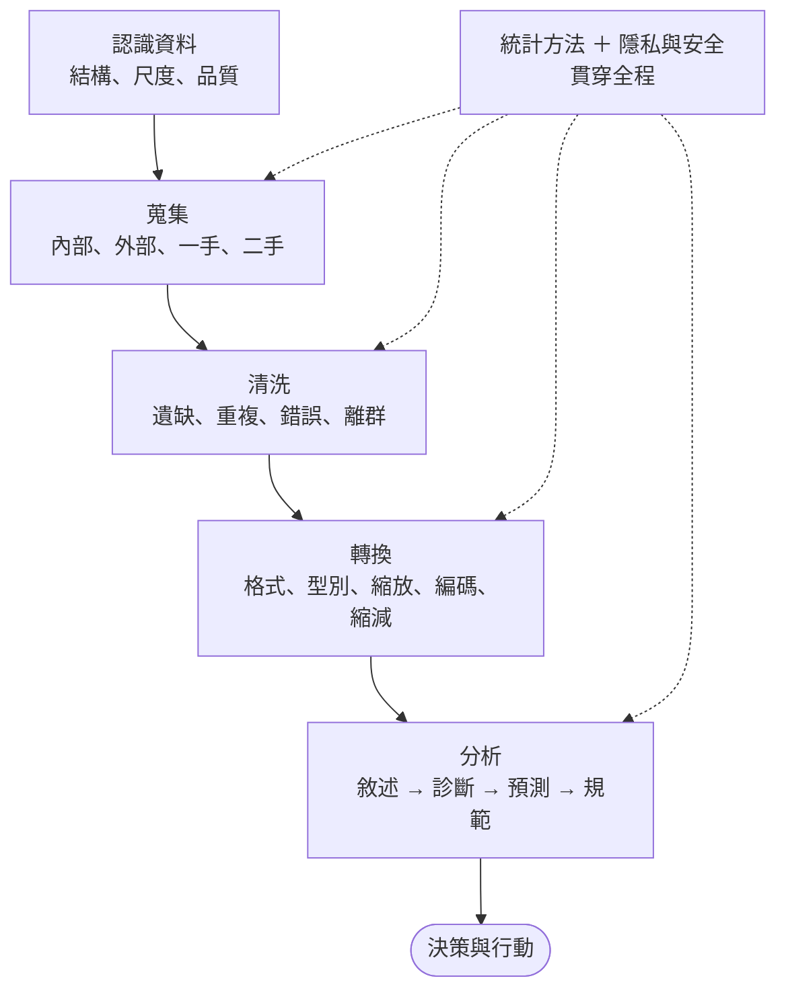
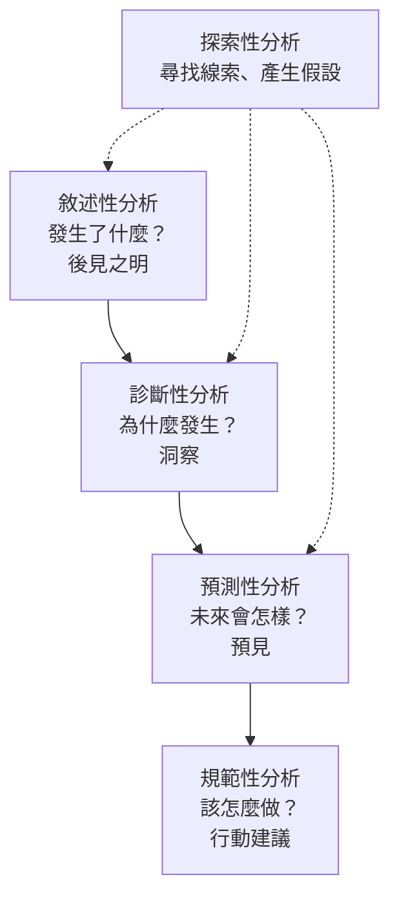

### Metadata
parent:: [[_【目錄】iPAS-AI應用規劃師(初級)：人工智慧基礎概論]]
sibling:: [[01人工智慧概論]] · [[03機器學習概念]] · [[04鑒別式AI與生成式AI概念]]

## Key Points
> [!summary] 一句話看懂
> **資料是 AI 的食材**：先認識食材（資料類型）→ 採買（蒐集）→ 洗菜（清洗）→ 切配（轉換）→ 試味道（分析）→ 用數字說話（統計）→ 顧好食安（隱私與安全）。
> AI 專案常見的說法：**資料準備往往占掉大部分的工時**，模型反而是最快的一段。

#### 資料結構三分類
| 類型 | 白話 | 例子 | 常見儲存方式 |
|---|---|---|---|
| **結構化** | 整齊的表格，欄位固定 | 交易紀錄、客戶資料表 | 關聯式資料庫（MySQL、PostgreSQL） |
| **半結構化** | 有標籤、但格式有彈性 | JSON、XML、Log 檔（教材也列 CSV） | 文件資料庫（MongoDB）、檔案 |
| **非結構化** | 沒有固定格式 | 圖片、影片、音訊、自由文字、PDF | 物件儲存、資料湖 |

#### 資料的量測尺度
| 尺度 | 特性 | 例子 | 可用的中央趨勢 |
|---|---|---|---|
| **名目** Nominal | 只是標籤，沒有大小 | 性別、血型 | 眾數 |
| **順序** Ordinal | 有順序，間距不一定相等 | 滿意度、信用評等 | 眾數、中位數 |
| **區間** Interval | 間距相等，**沒有真正的零點** | 攝氏溫度 | ＋平均數 |
| **比率** Ratio | 間距相等，**有真正的零點** | 身高、收入 | ＋可說「兩倍」 |

#### 資料清洗：四種問題值
| 問題 | 白話 | 處理 |
|---|---|---|
| **遺缺值** | 欄位空白 | 平均數／中位數／眾數填補、插補法、預測模型填補、刪除 |
| **重複值** | 同一筆資料出現兩次 | 用主鍵或關鍵欄位找出後刪除 |
| **錯誤值** | 明顯不合理（年齡 200 歲） | 檢測並修正或設為遺缺 |
| **離群值** | 跟大家差很多，但**可能是真的** | 依業務需求判斷保留、轉換或截尾 |

#### 資料分析的層次
| 分析 | 回答的問題 | 例子 |
|---|---|---|
| **敘述性** Descriptive | 發生了什麼？ | 上月營收 1,000 萬 |
| **診斷性** Diagnostic | 為什麼發生？ | 營收下滑是因為北區客戶流失 |
| **預測性** Predictive | 未來會怎樣？ | 預測下季營收 |
| **規範性** Prescriptive | 該怎麼做？ | 建議對哪些客戶發優惠券 |
| **探索性** Exploratory | 資料裡有什麼模式？（不預設假設） | 發現週五晚上交易量特別高 |

#### 統計量速記
| 類型 | 指標 | 受極端值影響？ |
|---|---|---|
| **中央趨勢** | 平均數 | ❌ 會 |
| | 中位數、眾數 | ✅ 不太會 |
| **分散度** | 全距（最大 − 最小） | ❌ 會 |
| | **四分位距 IQR**（Q3 − Q1） | ✅ 不太會 |
| | 變異數、標準差 | ❌ 會 |

> [!warning] 陷阱題
> 1. **K-Means 不能直接處理類別型資料**（它靠平均值與距離計算）；不同的起始中心可能得到不同結果，且容易受離群值影響（官方考題原題）。
> 2. **品質管理中標準差顯著偏大＝生產過程波動大、品質不穩定**（官方考題原題）。
> 3. **K-Means 的特點是原理簡單**；不適合非球形、密度差異大或有離群值的資料（官方考題原題）。
> 4. **CDA 著重驗證先前產生的假設**；初步描述、視覺化、探索模式是 EDA（官方考題原題）。
> 5. **含少數豪宅極端高價的房價 → 用中位數**（官方考題原題）。
> 6. **平均數 < 中位數 → 負偏（左偏）；平均數 > 中位數 → 正偏（右偏）**（官方考題原題）。
> 7. **p 值 0.03 < α 0.05 → 拒絕虛無假設**（官方考題原題）。
> 8. **IQR＝Q3 − Q1**，代表中間 50% 資料的範圍，不受極端值影響（官方考題原題）。
> 9. **某一項目出現次數遠高於其他項目 → 用眾數描述**（官方考題原題）。
> 10. **離群值 ≠ 錯誤值**：離群值可能是有意義的真實資料（例如真的有大戶），不能一律刪除。
> 11. **四分位距不受極端值影響**，全距會；所以箱型圖用 IQR 找離群值。
> 12. **正規化**（Normalization）多指縮放到 [0, 1]；**標準化**（Standardization）多指轉成平均 0、標準差 1（Z-score）。
> 13. **探索性分析不需要預設假設、用來產生假設**；**驗證性分析（CDA）用來驗證假設**。
> 14. **虛無假設 H0**＝「沒有差異、沒有效果」；**對立假設 H1**＝「有差異」。
> 15. **型一錯誤**＝冤枉好人（H0 為真卻拒絕，機率 α）；**型二錯誤**＝放走壞人（H0 為假卻沒拒絕，機率 β）。
> 16. **p 值 < 顯著水準 α（常用 0.05）→ 拒絕 H0**。
> 17. **眾數是唯一能用在名目（類別）資料的中央趨勢指標**。
> 18. **假名化的資料仍是個資**（可用對照表還原）；只有無法還原的**匿名化**資料才不算個資。
> 19. **相關不等於因果**：冰淇淋銷量和溺水人數正相關，真正原因是天氣熱。
>
> ⚠️ **教材錯誤或不精確的地方**
> - 官方練習題「下列何者**並非** K-Means 的特點」，公布答案為（B）「可結合其他方法，使用上較為彈性」，解析只寫「用於估計結果不穩定時」：這題答案**存疑**。K-Means 最大的特點就是**原理簡單**，所以「（A）原理相對其他集群法較為複雜」才明顯不是它的特點。
> - 官方練習題 p 值 0.03 的解析寫「我們有 **95% 的信心**拒絕虛無假設」：考試照此作答，但這是常見的不精確說法。正確的意思是「在顯著水準 0.05 下拒絕 H0」；p 值與 α 都**不是**「H0 為真的機率」，也不是「結論正確的信心」。
> - 教材的假設檢定表格把「H0 為真卻拒絕 H0」標成「**Type II 錯誤（α）**」：應為 **Type I 錯誤（α）**，型二錯誤才是 β。
> - 教材的統計方法分類表用「**有因果關係／無因果關係**」區分，並把相關分析、迴歸分析放在「有因果關係」：統計上**相關與迴歸本身都無法證明因果**。這張表真正的分類依據是「**有沒有區分自變數與依變數**」（有依變數時用迴歸、羅吉斯迴歸、區別分析），以及「**依變數是類別還是連續**」。要證明因果，需要隨機實驗（A/B 測試）或因果推論方法。
> - 教材寫假設檢定的結論是「**接受**或拒絕 H0」：統計上精確說法是「**拒絕**或**不拒絕** H0」。沒有拒絕 H0 只代表證據不足，不代表 H0 是對的，就像法庭判「無罪」不等於證明「清白」。
> - 教材把 **CSV** 列為半結構化：業界多把 CSV 視為**結構化**資料（固定欄位的表格），JSON、XML 才是典型的半結構化。**考試照教材作答**，實務上要知道兩種說法都存在。
> - 教材寫「標準差越大，表示產品品質越不穩定，**良率越低**」：標準差大代表**變異大、品質不穩定**，但良率還要看規格範圍有多寬、平均值是否偏離中心；實務上用**製程能力指標 Cpk** 綜合判斷。

> [!tip] PM 要記住的 3 件事
> 1. **Garbage In, Garbage Out**：模型表現不好，第一個要懷疑的是資料。
> 2. **「平均」很容易騙人**：所得、交易金額這類分佈很偏的資料，看中位數比較準。
> 3. **個資是法律問題，不只是技術問題**：資料要先確認蒐集目的與授權，才能拿去訓練 AI。

--- 
## Notes
### 全局地圖：從原始資料到可用洞察

這套流程在業界常被稱為**資料管線**（Data Pipeline）。傳統做法是 **ETL**：先擷取（Extract）、在專用伺服器上轉換（Transform）、再載入（Load）資料倉儲；雲端時代則多採 **ELT**：先把原始資料載入雲端資料倉儲或資料湖，再利用倉儲本身的運算能力轉換，彈性更高，也保留了原始資料。

本筆記整理科目一「資料處理與分析概念」的三大主題：**資料基本概念與來源、資料整理與分析流程、資料隱私與安全**。

---

### 一、認識資料
#### 1. 資料的結構類型
##### (1) 結構化資料（Structured Data）
有固定欄位與資料型別，可以整齊放進**列與欄**的表格，例如交易紀錄、客戶主檔。通常存在**關聯式資料庫**（MySQL、PostgreSQL、Oracle），用 **SQL** 查詢。好處是查詢、統計都很容易；缺點是欄位要事先定義，臨時想多記一個欄位就得改資料表結構。

##### (2) 半結構化資料（Semi-structured Data）
**有標籤或鍵值描述結構，但格式有彈性**，每筆資料的欄位不必完全一樣。典型例子是 **JSON、XML** 與系統 Log 檔，常存在 **MongoDB** 等文件資料庫。例如 App 回傳的事件紀錄，有的事件多帶「商品編號」，有的沒有，用 JSON 就能彈性記錄。

教材把 **CSV** 也列在這一類，但業界多視 CSV 為結構化資料，因為它就是用逗號分隔的固定欄位表格。考試請照教材作答。

##### (3) 非結構化資料（Unstructured Data）
**沒有預先定義的格式**，例如圖片、影片、音訊、自由文字、PDF、客服通話錄音。企業資料中**非結構化資料占了大多數**，過去難以分析，現在則可以靠深度學習與大型語言模型擷取資訊，例如用 OCR 讀取文件、用 LLM 摘要客訴內容。通常存在**物件儲存**（如 AWS S3）或**資料湖**中。

> [!tip] PM 為什麼在乎
> 生成式 AI 讓非結構化資料第一次變得「可以大規模利用」。合約、客服紀錄、會議記錄這些過去躺在檔案伺服器裡的資料，現在可以透過 **RAG** 變成企業知識庫，這往往是導入生成式 AI 最快見效的地方。

#### 2. 資料的量測尺度：四種資料「等級」
> [!example] 白話比喻
> 同樣是數字，「球衣背號 10」和「身高 180 公分」意義完全不同。背號不能拿來相加平均，身高可以。**資料的尺度決定了你能做哪些運算。**

##### (1) 名目尺度（Nominal）
只是**分類標籤**，沒有大小或順序，例如性別、血型、縣市。即使用數字編碼（1＝男、2＝女），也不能拿來計算平均。只能**計數**與找**眾數**。

##### (2) 順序尺度（Ordinal）
**有先後順序，但間距不一定相等**，例如滿意度（差／普通／好）、信用評等 AAA／AA／A、學歷。可以排序、找中位數，但「好」和「普通」之間的差距，不一定等於「普通」和「差」之間的差距。

##### (3) 區間尺度（Interval）
**間距相等，但沒有真正的零點**，例如攝氏溫度、西元年份。可以做加減、算平均：20°C 比 10°C 高 10 度是有意義的，但不能說 20°C 是 10°C 的「兩倍熱」，因為 0°C 並不代表「沒有溫度」。

##### (4) 比率尺度（Ratio）
**間距相等，且有真正的零點**，例如身高、收入、交易金額、等待時間。所有運算都可以做，也能說「A 的收入是 B 的兩倍」。

##### (5) 類別型與數值型
名目與順序尺度合稱**類別型（質化）資料**，區間與比率尺度合稱**數值型（量化）資料**。數值型資料又可分為**離散型**（可數，如交易筆數、子女人數）和**連續型**（可無限細分，如金額、時間）。

> [!tip] PM 為什麼在乎
> 問卷的「滿意度 1～5 分」是順序尺度，嚴格來說**取平均有爭議**（4 分不一定是 2 分的兩倍滿意）。報表上看到「平均滿意度 3.8」時要知道這個限制，搭配分佈圖或「4 分以上比例」（Top-2 Box）一起看更準確。

#### 3. 資料品質的六個面向
資料能不能用，不只看「有沒有」，還要看「好不好」。業界常用以下面向檢查資料品質：

- **完整性**（Completeness）：該有的資料有沒有缺，例如客戶電話欄位有 30% 空白。
- **正確性**（Accuracy）：資料是否反映真實情況，例如地址是不是客戶真正的住址。
- **一致性**（Consistency）：同一件事在不同系統的紀錄是否相同，例如 CRM 和核心系統的客戶生日不一樣。
- **有效性**（Validity）：是否符合格式與規則，例如年齡不能是負數、Email 要有 @。
- **唯一性**（Uniqueness）：有沒有重複的紀錄。
- **時效性**（Timeliness）：資料是否夠新，例如用三年前的收入資料做授信就有問題。

#### 4. 資料來源與蒐集方法
##### (1) 常見的蒐集方式
- **問卷與調查**：能問到行為背後的動機，但樣本可能有偏差（願意填問卷的人不代表所有人）。
- **自有產品資料**：App 點擊、交易紀錄、客服紀錄，量大且真實，是企業最有價值的資料。
- **外部公開資料**：政府資料開放平台、統計資料，免費但不一定符合需求。
- **外部付費資料**：徵信資料、市場調查報告，要注意**授權範圍**。
- **網路爬蟲**：自動抓取網頁內容，成本低但法律風險高。
- **API 串接**：透過合作夥伴或開放銀行 API 取得資料，格式穩定、授權清楚，是業界越來越主流的方式。
- **感測器與物聯網**：設備、車輛、穿戴裝置持續產生的串流資料。

##### (2) 資料來源的兩種分類
| 分類 | 類型 | 例子 |
|---|---|---|
| 依蒐集者 | **一手資料**（自己蒐集） | 問卷、自家 App 使用紀錄 |
| | **二手資料**（他人蒐集） | 政府開放資料、市調報告 |
| 依來源 | **內部資料** | 交易紀錄、客服紀錄、CRM |
| | **外部資料** | 開放資料平台、付費資料商、網路爬蟲 |

> [!caution] 網路爬蟲的法律風險
> 「網頁公開」不等於「可以任意使用」。爬取前要確認網站的使用條款、robots.txt 規範，並注意**著作權**與**個資法**；爬到含有個人資料的內容（姓名、電話）更要謹慎。用爬來的內容訓練生成式 AI，更是近年著作權訴訟的焦點。

> [!tip] PM 為什麼在乎
> 蒐集資料前先問三件事：**這份資料能不能合法使用？品質夠不夠？取得成本多少？** 外部付費資料要看授權範圍，例如是否允許用來訓練 AI 模型。

---

### 二、資料整理流程
#### 1. 資料清洗
> [!example] 白話比喻
> 資料清洗就像**洗菜挑菜**：爛掉的葉子挑掉（錯誤值）、同一顆菜不要洗兩次（重複值）、少了的配料想辦法補（遺缺值）、特別大顆的不一定是壞的（離群值）。

##### (1) 遺缺值（Missing Value）處理
先問「**為什麼會缺**」，再決定怎麼處理。統計上把遺缺分成三種：

- **完全隨機遺缺**（MCAR）：缺漏與任何因素無關，例如系統偶發故障漏記。直接刪除不會造成偏差。
- **隨機遺缺**（MAR）：缺漏與**其他已觀察到的欄位**有關，例如年輕客戶比較常不填收入。可以用其他欄位推估填補。
- **非隨機遺缺**（MNAR）：缺漏與**該欄位本身的值**有關，例如高收入者刻意不填收入。最難處理，任何填補都可能有偏差，「有沒有填」本身就是重要資訊。

常見的處理方法：
- **刪除**：遺缺比例低且屬於完全隨機時，可以刪除整筆紀錄；某個欄位遺缺比例太高時，可考慮刪除整個欄位。
- **統計值填補**：數值欄位用**平均數**或**中位數**（資料偏斜時用中位數），類別欄位用**眾數**。簡單快速，但會低估資料的變異。
- **插補法**（Interpolation）：適合時間序列，例如用前後兩天的值估計中間缺漏的那天。
- **模型填補**：用迴歸、KNN 等模型，根據其他欄位預測遺缺值，較準確但較費工。
- **加上遺缺標記**：新增一個「此欄是否遺缺」的欄位，讓模型自己學習「沒填」背後的意義。

> [!caution] 避免資料洩漏
> 用平均數填補時，平均數要**只用訓練資料計算**，再套用到測試資料。如果用全部資料算平均，測試資料的資訊就「偷跑」進訓練過程，模型評估會過度樂觀。

##### (2) 重複值（Duplicate Value）處理
重複值是指同一筆資料出現多次，常見原因是**多次匯入、系統重送、多個來源合併**。

處理方式是先透過**主鍵、唯一識別碼或關鍵欄位組合**找出重複紀錄，再刪除或合併。比較麻煩的是「**近似重複**」：例如「王小明／台北市信義路」和「王曉明／臺北市信義路」可能是同一人，需要用模糊比對或**實體解析**（Entity Resolution）判斷。

##### (3) 錯誤值（Error / Invalid Value）處理
指資料**不符合合理範圍或格式**，例如年齡 200 歲、生日在未來、金額為負、拼寫錯誤、單位不一致（有的用元、有的用千元）。

處理方式是先訂好**驗證規則**找出錯誤，能從原始來源修正的就修正，無法修正的設為遺缺再處理。根本解法是在**資料輸入端**就加上檢核，例如表單限制格式，比事後清洗更省成本。

##### (4) 離群值（Outlier）處理
離群值是**遠離大多數資料的值**，它**可能是錯誤，也可能是有意義的真實資料**。例如一筆 500 萬的交易，可能是輸入錯誤，也可能是真正的大客戶，甚至是洗錢交易。

常見的偵測方法：
- **IQR 法**：超出 Q1 − 1.5×IQR 或 Q3 ＋ 1.5×IQR 的值視為離群值，也就是箱型圖的做法。
- **Z-score 法**：與平均數相差超過 3 個標準差的值。適合接近常態分佈的資料。
- **視覺化**：箱型圖、散佈圖。
- **模型法**：孤立森林（Isolation Forest）等異常偵測演算法，適合多維資料。

處理策略要**依業務目標決定**：
- **確認是錯誤** → 修正或刪除。
- **是真實資料、但會干擾模型** → 用**截尾**（把超過上限的值設為上限）、**對數轉換**縮小影響，或改用不受極端值影響的模型與指標。
- **離群值本身就是目標** → 保留並深入分析，例如詐欺偵測、設備異常預警。

#### 2. 資料轉換
##### (1) 格式轉換（Data Format Transformation）
統一資料的呈現格式，例如日期統一為 `YYYY-MM-DD`、電話統一去掉連字號、全形半形統一、民國年轉西元年。多個系統的資料合併前一定要做。

##### (2) 型別轉換（Data Type Conversion）
把資料轉成正確的型別，例如把文字「1,000」轉成數值 1000、把字串轉成日期。型別錯誤會讓排序與計算出錯：文字排序時「10」會排在「9」前面。

##### (3) 特徵縮放：正規化與標準化
不同欄位的單位與範圍差很多時（年收入幾十萬、年齡幾十），需要把數值縮放到相近範圍，消除單位的影響。

**正規化**（Min-Max Normalization）把資料縮放到 [0, 1]：

$$x' = \frac{x - x_{min}}{x_{max} - x_{min}}$$

**標準化**（Z-score Standardization）把資料轉成平均 0、標準差 1：

$$z = \frac{x - \mu}{\sigma}$$

正規化容易受極端值影響（一個極大值會把其他值都壓到接近 0）；標準化較穩健，是多數機器學習的預設選擇。要注意：**標準化只改變刻度，不會讓資料變成常態分佈**。

KNN、SVM、神經網路這類依賴距離或梯度的模型**一定要縮放**；決策樹、隨機森林則不受影響。

##### (4) 類別編碼（Encoding）
模型只能處理數字，所以類別資料要先編碼：
- **One-Hot 編碼**：每個類別變成一個 0／1 欄位，例如「縣市」變成「是否台北」「是否台中」……。適合沒有順序的名目資料。
- **順序編碼**（Ordinal Encoding）：依順序給數字，例如「低＝1、中＝2、高＝3」。只適合有順序的資料，若用在名目資料，模型會誤以為「台中（2）」比「台北（1）」大。

##### (5) 離散化（Data Discretization）
把連續型資料轉成區間或類別，例如把年齡分成「青年」「中年」「老年」，或把收入分成五個級距。好處是**降低雜訊、讓結果更好解釋**，也能讓模型捕捉非線性關係；代價是損失部分細節。

##### (6) 資料縮減（Data Reduction）
減少資料的**維度或體積**，以提高分析效率、節省儲存空間：
- **特徵選擇**：挑出最有用的欄位，刪除無關或重複的欄位。
- **特徵萃取／降維**：把多個欄位組合成少數新欄位，例如**主成分分析**（PCA）把 100 個欄位壓縮成 10 個主成分，保留大部分資訊。
- **抽樣**：資料量太大時，抽取具代表性的子集分析。

---

### 三、資料分析
#### 1. 分析成熟度階梯
業界（Gartner 分析成熟度模型）把資料分析分成四個層次，越往上**價值越高、難度也越高**：

教材列出敘述性、探索性、診斷性、預測性四種；**探索性分析**並不是階梯中的一層，而是貫穿各階段、**尋找線索**的方法。

> [!tip] PM 為什麼在乎
> 很多公司的「數據儀表板」其實只停在**敘述性分析**。PM 可以用這條階梯檢視產品：我們的資料能力在哪一層？下一步要往哪一層走？

#### 2. 敘述性分析（Descriptive Analysis）
回答「**發生了什麼**」。用統計指標（平均數、中位數、標準差、百分位數）與圖表（直方圖、長條圖、折線圖）總結資料的基本特徵與分佈。日常的營運報表、KPI 儀表板都屬於這一層。

#### 3. 探索性分析（Exploratory Analysis）
==在不預設假設的情況下，從多個角度探索資料==，發現模式、關聯與異常，為後續分析或建模打基礎。

> [!example] 白話比喻
> 探索性分析就像**偵探剛到案發現場**：還不知道兇手是誰，先四處觀察、拍照、找線索，再從線索提出推理。

##### (1) 視覺化工具
- **箱型圖**（Box Plot）：一眼看出中位數、四分位數與**離群值**，適合比較多組資料的分佈。
- **熱圖**（Heatmap）：用顏色深淺呈現數值大小，最常用來看**變數之間的相關係數**。
- **散佈圖矩陣**（Scatter Plot Matrix）：把多個變數兩兩畫成散佈圖，適合初步探索多個變數的關係。
- **平行座標圖**（Parallel Coordinates Plot）：每個變數一條垂直軸，每筆資料是一條折線，適合觀察高維資料的群組與趨勢。

##### (2) 分析方法
- **相關性分析**（Correlation Analysis）：衡量兩個變數**一起變動**的程度，相關係數介於 −1 到 ＋1。
- **聚類分析**（Clustering Analysis）：把資料分成數個群組，**組內相似、組間差異大**，例如客戶分群。
- **主成分分析**（PCA）：降低資料維度、保留大部分資訊，方便視覺化。
- **異常偵測**（Anomaly Detection）：找出不尋常的資料點。

#### 4. 診斷性分析（Diagnostic Analysis）
回答「**為什麼發生**」。==通常以敘述性分析的結果為起點，深入找出背後的原因與影響因素==。

- **鑽取分析**（Drill-down）：從總數逐層往下拆。例如全公司營收下滑 → 拆到地區，發現北區下滑最多 → 再拆到產品，發現是某支基金贖回。
- **關聯分析**（Association Analysis）：找出哪些因素經常一起出現。
- **因果分析**（Causal Analysis）：確認某個因素是否真的**造成**結果。

> [!caution] 相關不等於因果
> 冰淇淋銷量和溺水人數高度正相關，但吃冰淇淋不會讓人溺水，真正的原因是**天氣熱**（干擾因子）。要確認因果，最可靠的方法是**隨機對照實驗**，在產品上就是 **A/B 測試**。

#### 5. 預測性分析（Predictive Analysis）
回答「**未來會怎樣**」。用歷史資料建立模型，預測未來的事件或趨勢。

- **迴歸模型**：預測**數值**，例如房價、銷售額、客戶終身價值。
- **分類模型**：預測**類別**，例如信用風險高低、客戶是否流失、交易是否為詐欺。
- **時間序列模型**：分析隨時間變化的資料，捕捉**趨勢、季節性與週期性**，例如需求預測、現金流預測。
- **集成學習**（Ensemble Methods）：結合多個模型提高準確度，例如隨機森林、XGBoost，是表格資料預測的主流做法。

#### 6. 規範性分析（Prescriptive Analysis）
回答「**該怎麼做**」。在預測的基礎上，進一步建議**最佳行動**，常用最佳化演算法、模擬、規則引擎。

例如：預測哪些客戶可能流失（預測性）→ 計算對每位客戶發多少折扣、透過哪個管道聯繫最划算（規範性）。

#### 7. 探索性與驗證性資料分析（EDA vs CDA）
##### (1) 探索性資料分析（Exploratory Data Analysis, EDA）
由統計學家 John Tukey 提倡，強調**靈活、開放的探索過程**，==通常在專案初期、對資料還不熟悉時進行==。

EDA ==不只是描述資料，更是產生假設的過程==：透過視覺化觀察分佈、找出異常與關聯，提出「可能是這樣」的初步假設，作為後續驗證的方向。

##### (2) 驗證性資料分析（Confirmatory Data Analysis, CDA）
==著重於驗證事先提出的假設==，使用假設檢定、信賴區間、迴歸模型等統計方法，判斷探索階段發現的模式是否**真的成立**，而不是巧合。必要時也會結合質性分析（如訪談），深入理解數字背後的原因。

> [!example] 兩者的分工
> EDA：「我發現週五晚上的轉帳量特別高，可能和發薪日有關？」
> CDA：「設計檢定，確認週五晚上轉帳量顯著高於其他時段，且與發薪日有統計上的關聯。」

> [!caution] 不要用同一份資料「找到」又「證明」
> 在一份資料裡翻來覆去找，總能找到看起來顯著的模式（這叫 **p-hacking** 或資料窺探）。嚴謹的做法是用一份資料探索、用另一份新資料驗證。

---

### 四、統計基礎
統計學的任務，是從有限的資料中萃取資訊，並**量化結論有多可靠**。

#### 1. 中央趨勢與分散度
##### (1) 中央趨勢：資料集中在哪裡
當我們想==了解一組資料的整體水準==時，會關注==資料的集中位置==，稱為「中央趨勢」。

- **平均數**（Mean）：所有數值加總後除以個數。**容易被極端值拉動**，例如一位富豪會讓全班平均所得暴增。
- **中位數**（Median）：排序後位在正中間的數值。**不受極端值影響**，適合所得、房價這類偏斜資料。
- **眾數**（Mode）：出現次數最多的數值。**唯一能用在名目資料**的中央趨勢指標，例如最多人選的方案。

三者的關係可以看出資料的偏態：**右偏**（長尾在右，如所得）時，平均數 > 中位數；**左偏**時，平均數 < 中位數；**對稱**時，三者接近。

##### (2) 分散度：資料散得多開
==衡量資料的離散程度==，幫助判斷資料是否穩定，並找出變異的原因。

**全距**（Range）是最大值減最小值。計算最簡單，但只看兩個極端值，**很容易受離群值影響**。

**四分位數**（Quartile）是==把排序後的資料分成四等份的分割點==：Q1（第 25 百分位）、Q2（中位數）、Q3（第 75 百分位）。

**四分位距**（IQR）等於 **Q3 − Q1**，代表**中間 50% 資料**的分佈範圍。因為排除了頭尾各 25%，**不受極端值影響**，是箱型圖判斷離群值的基礎。

**平均差**（Mean Absolute Deviation）是每個值與平均數之差的**絕對值平均**。

**變異數**（Variance）是每個值與平均數之差的**平方平均**；**標準差**（Standard Deviation）是變異數開根號，單位與原始資料相同，較好解讀。標準差越大，資料越分散。

$$\sigma = \sqrt{\frac{\sum (x_i - \mu)^2}{N}}$$

樣本標準差會除以 $n-1$ 而不是 $n$，以修正用樣本估計母體時的偏差。

**變異係數**（Coefficient of Variation, CV）是標準差除以平均數，用來比較**單位或規模不同**的資料哪個比較不穩定。例如比較股票 A（平均 1,000 元）和股票 B（平均 50 元）的波動，直接比標準差不公平，要比變異係數。

> [!example] 標準差的應用
> 在品質管理中，標準差小代表製程穩定。但良率還要看**規格範圍**：即使標準差不大，若平均值偏離規格中心，仍可能大量超出規格。實務上會用**製程能力指標 Cpk** 綜合判斷。在金融業，標準差則是衡量投資**風險**（波動度）的基本指標。

#### 2. 常見統計方法的選擇
選擇統計方法時，先問兩個問題：**有沒有要預測或解釋的目標變數（依變數）？** 以及**變數是類別還是連續**？

|                            | 類別變數                     | 連續變數                                 |
| -------------------------- | ------------------------ | ------------------------------------ |
| **不區分自變數與依變數**（看變數間的關係或結構） | 敘述統計、複選題分析、交叉分析、**卡方檢定** | 相關分析、偏相關分析、**主成分分析**、因素分析、集群分析       |
| **區分自變數與依變數**（用 X 解釋或預測 Y） | 依變數為類別：**羅吉斯迴歸**、區別分析    | 依變數為連續：**迴歸分析**、變異數分析（ANOVA）、偏最小平方迴歸 |

> [!quote]- 教材原圖（分類標題「有／無因果關係」不精確，見上方說明）
> ![[Pasted image 20260514011139.png]]

#### 3. 抽樣變異與假設檢定
##### (1) 抽樣變異
從母體抽樣分析時，因為樣本是隨機的，算出來的統計量和母體的真實值之間一定會有差距，這稱為**抽樣變異**。==為了量化這種不確定性，我們需要機率模型==，進而做**區間估計**（例如「平均年齡 35 歲，95% 信賴區間 33～37 歲」）與**假設檢定**。

##### (2) 假設檢定的流程
> [!example] 白話比喻
> 假設檢定就像**法庭審判**：先假設被告無罪（H0），檢察官提出證據，證據強到「如果被告真的無罪，幾乎不可能出現這些證據」時，才判有罪（拒絕 H0）。

1. **提出假設**：寫下虛無假設與對立假設。
2. **設定顯著水準 α**：事先決定可以接受的誤判機率，常用 0.05。
3. **蒐集資料、計算檢定統計量**：例如 t 值、卡方值。
4. **計算 p 值或比對拒絕域**，做出決策：**拒絕 H0**，或**不拒絕 H0**。

##### (3) 統計假設
**統計假設**是對母體分佈或參數的陳述。

- **虛無假設**（Null Hypothesis, H0）：表示**沒有效果、沒有差異**，是檢定的基準。例如「新舊版 App 的轉換率相同」。
- **對立假設**（Alternative Hypothesis, H1 或 Ha）：與 H0 相反，表示**有效果、有差異**，通常是研究者想證明的事。
- **簡單假設**（Simple Hypothesis）：完全確定母體分佈的所有參數，例如「μ＝100」。
- **複合假設**（Composite Hypothesis）：只對部分參數或一個範圍做假設，例如「μ > 100」。

##### (4) 檢定的關鍵名詞
**接受域與拒絕域**：檢定統計量落在**拒絕域**時拒絕 H0，落在接受域時不拒絕 H0。決定一個檢定，就是決定拒絕域在哪裡。

**檢定統計量**（Test Statistic）：由樣本算出的一個數值，例如 t 值，用來判斷是否拒絕 H0。

**顯著水準 α**（Significance Level）：事先訂好「**可以接受冤枉好人的機率**」，常取 0.1、0.05 或 0.01。

**p 值**（p-value）：**假設 H0 為真**時，看到「和目前觀測結果一樣極端或更極端」的機率。p 值越小，代表目前的結果越不像巧合。**p 值 < α 時拒絕 H0**，稱結果「具統計顯著性」。

> [!caution] p 值常見誤解
> - p 值**不是**「H0 為真的機率」，而是「H0 為真時看到這種結果的機率」。
> - **統計顯著不等於實務重要**：樣本數夠大時，轉換率差 0.01% 也可能顯著，但對業務毫無意義。要同時看**效果大小**與信賴區間。

##### (5) 兩種錯誤（用法庭比喻：H0＝被告無罪）
| | 實際無罪（H0 真） | 實際有罪（H0 假） |
|---|---|---|
| **判有罪**（拒絕 H0） | ❌ **型一錯誤**：冤枉好人，機率 = α | ✅ 正確（機率 1 − β，稱為**檢定力**） |
| **判無罪**（不拒絕 H0） | ✅ 正確 | ❌ **型二錯誤**：放走壞人，機率 = β |

兩種錯誤互相拉扯：在樣本數固定時，α 訂得越嚴格（越不想冤枉好人），就越容易放走壞人。想同時降低兩種錯誤，唯一的方法是**增加樣本數**。

這對應到模型評估的**偽陽性**（False Positive，型一錯誤）與**偽陰性**（False Negative，型二錯誤），見 [[03機器學習概念]]。

> [!quote]- 教材原圖（表中「拒絕 H0｜H0 為真」應為 Type I 錯誤，教材誤植為 Type II）
> ![[Pasted image 20260514025439.png]]

> [!tip] PM 為什麼在乎
> 做 **A/B 測試**時，「新版轉換率高 2%」可能只是巧合。要看 p 值是否小於 0.05，才能說新版**真的**比較好。三個常見地雷：
> - **樣本數太少**：檢定力不足，真的有效也測不出來。測試前要先估算需要多少樣本。
> - **偷看結果、提早停止**：每天看一次、一看到顯著就停，會大幅提高型一錯誤。
> - **同時比太多指標**：比 20 個指標，光靠運氣就可能有 1 個「顯著」。

---

### 五、資料隱私與安全
#### 1. 個資保護：法律怎麼規定
> [!example] 白話比喻
> 客戶把個資交給你，就像把家裡鑰匙交給管理員。管理員只能**為了約定的目的**使用（收包裹），不能拿去開別人的門，也不能弄丟。

##### (1) 台灣《個人資料保護法》
適用於在台灣蒐集、處理、利用個人資料的行為。核心精神是：
- **特定目的**：蒐集前要有明確的目的，並**告知當事人**。
- **目的內利用**：只能在原本的目的範圍內使用；要做目的外利用，原則上需要當事人**同意**或符合法定例外。
- **特種個資**：病歷、醫療、基因、性生活、健康檢查、犯罪前科等，原則上**禁止**蒐集、處理、利用，只有法律明定的例外才可以。
- **安全維護義務**：要採取適當的安全措施，防止個資被竊取、竄改、毀損、滅失或洩漏，發生事故要通知當事人。

2023 年修法確立設置**個人資料保護委員會**作為獨立的個資監管機關，監理將逐步從各目的事業主管機關（如金管會）分散管理，走向統一監管。

##### (2) 歐盟 GDPR
《一般資料保護規則》適用於處理**歐盟境內個人**資料的組織，**即使公司不在歐盟**也適用（例如服務歐洲客戶的台灣銀行）。違規罰款最高可達**全球年營業額 4% 或 2,000 萬歐元**（取較高者）。

GDPR 常考的原則與權利：
- **合法基礎**：處理個資必須有合法依據，同意只是其中一種，另外還有履行契約、法定義務、正當利益等。
- **資料最小化**：只蒐集達成目的所需的最少資料。
- **被遺忘權**（刪除權）：當事人可要求刪除自己的資料。
- **資料可攜權**：當事人可要求取得自己的資料，並轉給其他業者。
- **不受純自動化決策約束的權利**：對當事人有重大影響的決定（如貸款核准），當事人有權要求人工介入與說明。這條和 AI 應用直接相關。

#### 2. 讓資料「看不出是誰」：去識別化技術
| 技術                            | 做法                  | 例子                | 還算個資嗎？      |
| ----------------------------- | ------------------- | ----------------- | ----------- |
| **遮罩** Masking                | 隱藏部分內容              | 0912-\*\*\*-678   | 視情況         |
| **假名化** Pseudonymization      | 用代號取代身分，但保留對照表      | 王小明 → 客戶 A123     | **仍算**（可還原） |
| **匿名化** Anonymization         | 徹底移除，無法還原           | 刪除所有可識別欄位並確認無法再識別 | 不算          |
| **一般化** Generalization        | 降低精細度               | 年齡 34 歲 → 30～39 歲 | 降低風險        |
| **差分隱私** Differential Privacy | 加入數學雜訊，統計結果準、但推不回個人 | 公布「平均月薪約 5 萬」     | 降低風險        |
| **合成資料** Synthetic Data       | 用模型生成「統計特徵相同」的假資料   | 生成虛擬客戶資料供測試       | 視生成品質       |

> [!caution] 去識別化不是萬靈丹
> 多個「看似無害」的欄位組合起來，仍可能認出是誰。例如「郵遞區號＋生日＋性別」就可能鎖定特定個人，這稱為**再識別風險**。另外，**雜湊（Hash）不等於匿名化**：手機號碼只有幾億種組合，攻擊者可以把所有號碼都算一次雜湊再比對，輕易還原。

#### 3. 資料安全的基本防線
##### (1) 資料分級
依敏感程度把資料分為**公開、內部、機密、極機密**等級，不同等級套用不同的管控措施。分級是其他所有防線的基礎：不知道哪些資料最敏感，就無法決定該把資源投在哪裡。

##### (2) 存取控制
遵循**最小權限原則**：員工只能存取工作所需的資料，並定期檢視權限。常見做法是**角色型存取控制**（RBAC），依職務角色給權限，而不是一個個人設定。

##### (3) 加密
資料在**儲存時**（靜態加密）與**傳輸時**（如 HTTPS、TLS）都要加密，即使資料外洩，沒有金鑰也無法讀取。金鑰本身要另外妥善管理。

##### (4) 稽核紀錄
記錄**誰在什麼時間、存取或修改了哪些資料**，事後可追查，也能即時偵測異常存取。

##### (5) 資料保存期限
目的達成後依規定刪除，不無限期保留。資料留得越多、越久，外洩時的損失越大。

##### (6) 零信任架構
傳統資安像城堡：進了城牆就被信任。**零信任**（Zero Trust）則是「**永不信任、持續驗證**」，每次存取都要驗證身分、裝置與權限，即使是內部網路也一樣。這已是金融業資安的主流方向。

> [!tip] PM 為什麼在乎
> 用客戶資料訓練 AI 前，要先確認：**當初蒐集時告知的目的，有沒有包含「訓練 AI」？** 若沒有，可能需要重新取得同意，或改用去識別化、合成資料。另外，員工把客戶資料貼進外部生成式 AI 工具，也是常見的外洩管道，要有明確的使用政策。這部分和 [[生成式AI風險管理]] 的資料隱私章節直接相關。

---

### PM 檢查清單：資料專案的 6 個問題
1. **類型**：資料是結構化、半結構化還是非結構化？需要什麼工具處理？
2. **來源**：資料能合法使用嗎？授權範圍包含訓練 AI 嗎？
3. **品質**：遺缺、重複、錯誤、離群值的比例多少？誰負責清洗？資料品質有沒有持續監控？
4. **分析層次**：我們要回答的是「發生什麼」、「為什麼」、「會怎樣」還是「該怎麼做」？
5. **統計判斷**：結論有沒有統計顯著性？樣本數夠嗎？是相關還是因果？平均數會不會被極端值誤導？
6. **隱私安全**：有沒有個資？做了去識別化嗎？存取權限與保存期限設好了嗎？

---
## References
![[AI應用規劃師(初級)-學習指引-科目1_人工智慧基礎概論1141203_20251222172144.pdf]]
