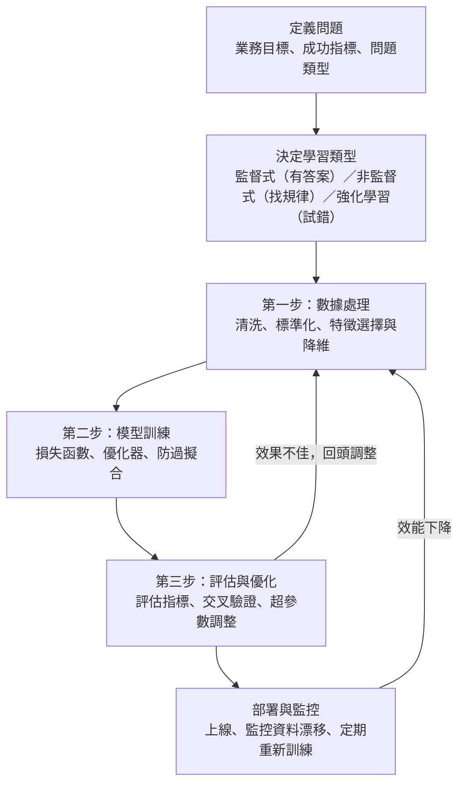

### Metadata
parent:: [[_【目錄】iPAS-AI應用規劃師(初級)：人工智慧基礎概論]]
sibling:: [[01人工智慧概論]] · [[02資料處理與分析]] · [[04鑒別式AI與生成式AI概念]]

## Key Points
> [!summary] 一句話看懂
> 機器學習就是**讓電腦從資料中找規律**，而不是由人寫死規則。整個流程像**培養一位學生**：
> **整理教材（數據處理）→ 上課練習（模型訓練）→ 考試檢討（評估與優化）**，然後不斷循環；實務上還要再加上**上線後的持續監控**。

#### 學習方式
| 學習方式     | 白話          | 資料        | 核心任務        | 代表演算法                  |
| -------- | ----------- | --------- | ----------- | ---------------------- |
| **監督式**  | 老師給標準答案     | 有標記       | **分類、迴歸**   | 線性迴歸、邏輯迴歸、決策樹、SVM、神經網路 |
| **非監督式** | 自己找規律       | 無標記       | **聚類、降維**   | K-Means、PCA            |
| **強化學習** | 從獎懲中試錯      | 環境回饋      | **最大化累積獎勵** | Q-Learning、DQN、PPO     |
| 半監督式     | 少量有答案＋大量沒答案 | 部分標記      | 降低標記成本      | 自我訓練（偽標籤）              |
| 自監督式     | 自己出題自己答     | 從資料本身產生標記 | 預訓練大模型      | GPT 的「猜下一個字」           |

#### 機器學習三步驟速記
| 步驟 | 子項目 | 關鍵詞 |
|---|---|---|
| **① 數據處理** | 清洗 | 遺缺值（均值／中位數／眾數填補、刪除）、異常值（IQR、標準差法） |
| | 標準化 | **Min-Max**（縮到 0～1，怕極端值）、**Z-score**（平均 0、標準差 1） |
| | 特徵選擇與降維 | **過濾法**（快）、**包裝法**（準但慢）、**嵌入法**（平衡，如 LASSO）、**PCA** |
| **② 模型訓練** | 損失函數 | **MSE → 迴歸**；**交叉熵 → 分類** |
| | 優化演算法 | **BGD**（穩但慢）、**SGD**（快但抖）、**Adam**（業界標配） |
| | 防過擬合 | **正則化**（數學層面）、**早停**（時間層面）、**數據增強**（數據層面）、**Dropout**（結構層面） |
| **③ 評估與優化** | 評估指標 | **準確率**（平衡資料）、**F1**（不平衡資料）、**MSE**（迴歸） |
| | 交叉驗證 | **K 折交叉驗證** |
| | 調參 | **網格搜索**（地毯式）、**隨機搜索**（抽樣）、**貝葉斯優化**（帶探測器） |

> [!warning] 陷阱題
> 1. **機器學習的三個核心要素＝數據、模型、損失函數**（官方考題原題）。
> 2. **監督式學習的特點＝資料集包含標記**；「只探索資料內部結構」是非監督式，「代理與環境互動」是強化學習（官方考題原題）。
> 3. **過擬合的主要原因＝模型過度學習資料中的雜訊**；模型太簡單造成的是欠擬合（官方考題原題）。
> 4. **交叉驗證的目的＝評估模型穩健性、降低過擬合風險**（官方考題原題）。
> 5. **梯度下降用來優化模型參數、最小化損失函數**（官方考題原題）。
> 6. **線性迴歸最適合預測連續數值，例如銷售額**（官方考題原題）。
> 7. **決策樹最大的優勢＝可解釋性佳**；**隨機森林＝集成多棵隨機決策樹並投票**（官方考題原題）。
> 8. **神經網路與傳統模型的主要差別＝多層結構能學習複雜特徵**（官方考題原題）。
> 9. **MSE 用於迴歸、交叉熵用於分類**，不要配錯。
> 10. **參數**是模型自己學的（權重）；**超參數**是人設定的（學習率、K 值、樹深度）。
> 11. **K-Means 是非監督式（聚類）**；**KNN 是監督式（分類／迴歸）**，名字很像但完全不同。
> 12. **PCA 是降維（非監督式）**，轉換後的主成分**彼此正交、互不相關**。
> 13. **資料不平衡時看 F1、召回率**，不要只看準確率。
> 14. **強化學習三要素：代理、環境、獎勵**；**探索 vs 利用**是核心取捨。
> 15. **早停法需要驗證集**：驗證誤差開始上升時就停止。
> 16. **L1 正則化（LASSO）會把不重要的權重壓成 0**，兼具特徵選擇效果；**L2（Ridge）只把權重縮小**。
>
> ⚠️ **教材錯誤或不精確的地方**
> - 教材的 Min-Max 公式分母寫成「$X_{man} - X_{min}$」：應為 **$X_{max} - X_{min}$**。
> - 教材說交叉驗證能「**降低過擬合風險並提升泛化能力**」：考試照此作答，但精確地說，交叉驗證本身不會改變模型，它是**更可靠地估計**模型在新資料上的表現，幫助我們**發現**過擬合、挑出泛化較好的模型與超參數。
> - 教材說 K 折交叉驗證「每次選一個子集作為**測試集**」：業界的用詞是**驗證集**。真正的測試集應在一開始就切出來、全程不碰，只在最後評估一次，否則反覆用它調參，測試成績會過度樂觀。
> - 教材說 Z-score「適用於資料接近常態分佈」：Z-score 標準化本身**不要求常態分佈**，任何資料都能用；只有在把 Z 值換算成百分位（例如「Z＞2 代表前 2.5%」）時，才需要常態假設。另外，**標準化不會把資料變成常態分佈**。
> - 教材中「正規化」一詞同時指兩件事：**Normalization**（資料縮放，如 Min-Max）與 **Regularization**（防過擬合的懲罰項，也譯「正則化」）。本筆記以「**正則化**」專指後者，看到考題要從上下文判斷。

> [!tip] PM 要記住的 3 件事
> 1. **先問「是哪一種問題」**：要預測數字（迴歸）、分類別（分類）、找群體（聚類），還是做連續決策（強化學習）？選錯類型，後面全錯。
> 2. **標記資料很貴**：監督式學習需要大量標準答案，標記成本常是專案預算的大頭。
> 3. **評估指標要對齊業務成本**：漏抓詐騙和誤擋好客戶的代價不同，選指標前先算清楚。

--- 
## Notes
### 全局地圖：機器學習的完整流程

教材把機器學習的核心流程分成**數據處理、模型訓練、評估與優化**三步。實務上前面還有「**定義問題**」，後面還有「**部署與監控**」：模型上線後，世界持續變化，資料分佈會改變（資料漂移），模型效能會慢慢下降，必須持續監控並定期重新訓練。這整套做法稱為 **MLOps**。

---

### 一、機器學習基本原理
#### 1. 什麼是機器學習
**機器學習**（Machine Learning）是利用資料中的模式與規律，透過演算法建立模型來做預測與決策。目的是讓電腦系統能**自動從資料中學習**，在**沒有明確寫好規則**的情況下，隨著資料增加不斷改進表現。

> [!example] 白話比喻
> 傳統程式是「**規則＋資料 → 答案**」：工程師寫好「交易金額 > 50 萬且在凌晨就是可疑」。
> 機器學習是「**資料＋答案 → 規則**」：給模型 10 萬筆已標好「是否詐欺」的交易，讓它自己歸納出可疑交易的特徵，連人沒想到的組合都能找到。

#### 2. 三個核心要素
機器學習的三個核心要素是**數據、模型、損失函數**：
- **數據**（Data）：提供學習的素材。
- **模型**（Model）：學習資料中規律的數學結構，例如一條直線、一棵決策樹、一個神經網路。
- **損失函數**（Loss Function）：衡量模型預測錯得多離譜，指引模型往哪個方向改進。

三者再加上**優化演算法**（負責實際調整模型參數），就構成了完整的訓練流程。

#### 3. 機器學習的特徵與優勢
##### (1) 從資料學習、持續更新
機器學習的特徵是**以資料為基礎的學習與自適應能力**：分析大量歷史資料建立預測模型，新資料進來時還能重新訓練、持續更新。

例如在金融業，信用風險模型可以根據客戶的歷史交易行為與信用資料，自動識別潛在的違約風險；新的還款資料進來後，模型也能定期更新，反映最新的經濟狀況。

##### (2) 能處理規則寫不出來的問題
機器學習不只能處理大規模的結構化資料，也能從**非結構化資料**（圖像、文字、語音）中擷取資訊。很多問題人類能做、卻說不出規則，例如「這張臉是誰」「這段話的情緒是正面還是負面」，正是機器學習的強項。

##### (3) 可擴展性
資料越多、算力越強，模型的表現通常越好。推薦系統、需求預測、自動駕駛，都是靠持續累積的資料不斷進步。

#### 4. 挑戰
##### (1) 資料品質
**資料品質直接決定模型的上限**。許多領域的資料存在缺失、不平衡或雜訊問題；標記資料不足，更是監督式學習最常見的瓶頸。

##### (2) 可解釋性
複雜模型（如深度神經網路）像**黑盒子**，很難說清楚「為什麼做出這個決定」。在醫療、法律、金融授信等需要說明理由的領域，這會影響專業人士的信任，也可能不符合法規要求。業界常用 **SHAP、LIME** 等可解釋 AI（XAI）工具輔助說明。

##### (3) 公平性與隱私
訓練資料若帶有歷史偏見，模型就會學到偏見，例如過去的放款紀錄若對某些族群較嚴格，模型也會複製這種歧視。另外，訓練資料中的個人資料也必須妥善保護。

---

### 二、機器學習的類型
#### 1. 監督式學習（Supervised Learning）
以「==有標記的資料==」為基礎，目標是==學習輸入與輸出之間的映射關係==。資料集中的每一筆樣本，都要有輸入特徵與對應的正確答案（標記），模型在這些答案的指導下，從歷史資料中建立預測規則。監督式學習是機器學習中**最常見**的方法。

主要任務有兩種：**迴歸**預測連續數值，**分類**預測類別。

##### (1) 迴歸：線性迴歸
**線性迴歸**是經典的基礎演算法，==透過擬合資料來預測連續數值==。例如根據房屋面積、地段、屋齡等特徵，找出價格變化的規律，進而預測新房屋的售價。

##### (2) 分類：支援向量機（SVM）
**支援向量機**（Support Vector Machine, SVM）==在資料之間找出一條「最寬的分界線」（超平面），把資料分成不同類別==，特別適合**二元分類**。

> [!example] 白話比喻
> 桌上有紅棋和黑棋，SVM 要畫一條線把它們分開，而且要讓這條線**離兩邊最近的棋子都盡量遠**，留下最寬的「安全走廊」。那幾顆貼著走廊邊緣的棋子，就叫**支援向量**。
> 如果紅黑棋混在一起、畫直線分不開，SVM 會用**核技巧**（Kernel Trick）：像拍一下桌子讓棋子彈到空中，在更高維的空間裡，就能用一刀把它們切開。

SVM 的**優點**：
- 在**樣本數不多**時，分類效果通常很好。
- **特徵維度很高**時仍能處理，不容易過擬合，例如文字分類。
- 透過核技巧能處理**非線性**問題。

SVM 的**缺點**：
- 資料量達到數十萬、數百萬筆時，**計算非常耗時**。
- 對核函數與參數設定很敏感，**調參較費時**。
- 只輸出「是 A 還是 B」，**不像邏輯迴歸那樣直接給出機率**。

應用例子：分析醫學影像，協助醫生判斷腫瘤是良性還是惡性。

##### (3) 分類與迴歸：決策樹與隨機森林
**決策樹**用一連串「是或否」的問題做判斷，例如「年收入 > 60 萬？」→「是否有房貸？」→ 核准或拒絕。最大優勢是**可解釋性佳**，判斷路徑一目了然，也**不需要特徵標準化**；缺點是單一棵樹**容易過擬合**。

**隨機森林**改進了這個缺陷：**隨機抽樣資料與特徵、建立多棵決策樹，再由所有樹投票**，結果更穩定、更不容易過擬合。這種「多個模型集體決策」的方法稱為**集成學習**，詳見 [[04鑒別式AI與生成式AI概念]]。

##### (4) 分類與迴歸：神經網路
**神經網路**（Neural Networks）==模仿人腦神經元的運作方式，透過多層結構學習複雜的特徵，能處理高度非線性的資料==。例如語音辨識中，神經網路能把音訊轉成文字，資料越多辨識越準。

和傳統模型相比，神經網路的主要差別在於**多層結構能自動學出高層次特徵**，代價是需要更多資料與算力、可解釋性較差。

#### 2. 非監督式學習（Unsupervised Learning）
不依賴標記資料，而是==分析資料的內在結構，找出潛在的模式或規律，讓模型自行辨識資料間的相似性或關聯性==。核心任務是「**聚類**」和「**降維**」，應用於資料探勘、市場區隔、基因分析等領域。

##### (1) 聚類：K-Means
**K 均值聚類**（K-Means Clustering）==把資料分成 K 個群組，讓同一群內的資料彼此相似==。

運作步驟：
1. 隨機選 K 個點當作各群的**中心點**。
2. 每筆資料歸到**最近**的中心點那一群。
3. 重新計算每一群的平均位置，作為新的中心點。
4. 重複 2～3，直到中心點不再移動。

例子：分析客戶的購買行為，把消費者分成「高頻小額」「低頻大額」等族群，制定更精準的行銷策略；在資安領域，也能找出不屬於任何正常群組的異常行為。

K-Means 的**優點**：
- **運算快**，適合大規模資料。
- **邏輯簡單**，容易理解與實作。
- 通常很快就能收斂到一個不錯的結果。

K-Means 的**限制**：
- **K 值要事先指定**。不知道該分幾群時，常用**手肘法**（Elbow Method）：畫出不同 K 值的群內誤差，找出曲線像手肘一樣轉折的點。
- **對離群值敏感**：一個極端值就能把中心點拉偏。
- **只擅長「圓球狀」的群**：資料形狀像長條、環形時表現很差。
- **結果受初始中心點影響**：實務上用 **K-Means++** 改善初始點的選法。

##### (2) 降維：主成分分析（PCA）
**主成分分析**（Principal Component Analysis, PCA）==透過線性轉換，把高維資料壓縮到低維空間，同時保留主要資訊==。

> [!example] 白話比喻
> 替一群人拍照，從正面拍能看出高矮胖瘦，從正上方拍只看到一堆頭頂。PCA 就是**自動找出「最能看出差異」的拍攝角度**，用最少張照片保留最多資訊。

PCA 找出的新特徵叫**主成分**，第一主成分保留最多資訊、第二主成分次之，而且主成分之間**彼此正交、互不相關**，去除了重複的資訊。

PCA 的**優點**：
- **化繁為簡**：把上百個變數壓縮成少數幾個，模型跑得更快。
- **消除重複資訊**：自動把高度相關的變數（例如月薪與年薪）合併。
- **過濾雜訊**：較小的波動常被當成雜訊捨棄，突顯主要趨勢。
- **方便視覺化**：把高維資料壓成 2D 或 3D 圖表，一眼看出分群。

PCA 的**缺點**：
- **難以解釋**：原本是「身高」「體重」，壓縮後變成「主成分 1」，很難說明代表什麼。
- **資訊損失**：壓縮一定會丟掉細節，丟掉的若剛好是關鍵資訊，結果就會不準。
- **怕離群值**：極端值會把主成分的方向帶偏。
- **只能處理線性關係**：資料規律若是彎曲的，PCA 效果有限，可改用 t-SNE、UMAP 等非線性方法（多用於視覺化）。

應用例子：圖像壓縮、基因資料分析中萃取最具代表性的特徵。

#### 3. 強化學習（Reinforcement Learning）
**代理**（Agent）在環境中嘗試各種行動，根據環境的回饋不斷更新策略，本質是「==試錯學習==」（Trial-and-Error）。核心目標是==最大化**累積獎勵**，在長期決策中取得最佳效益==，而不是只看眼前的一步。

> [!example] 白話比喻
> 就像學騎腳踏車：沒有人能給你每個瞬間「正確的龍頭角度」，你只能一直嘗試，摔倒（懲罰）就調整，騎得穩（獎勵）就記住，最後自然學會。

##### (1) 核心要素
- **代理**（Agent）：負責做決策與行動的學習系統。
- **環境**（Environment）：代理所處的世界，會根據代理的行動給出回饋。
- **獎勵**（Reward）：代理執行行動後得到的回饋，表示這個行動的好壞。

另外還有三個常見名詞：**狀態**（State，目前的處境）、**行動**（Action，可以做的選擇）、**策略**（Policy，在什麼狀態下做什麼行動的規則）。

##### (2) 學習流程
1. **觀察狀態**：代理從環境取得目前的狀態。
2. **選擇行動**：代理根據策略選擇行動。
3. **執行行動**：環境根據行動回傳**新的狀態**與**獎勵**。
4. **更新策略**：代理根據結果調整策略，讓未來的累積獎勵更大。
5. 重複以上步驟。

##### (3) 探索與利用
選擇行動時，代理面臨一個核心取捨：
- **探索**（Exploration）：嘗試沒做過的行動，可能發現更好的選擇。
- **利用**（Exploitation）：選擇目前已知最好的行動，確保拿到獎勵。

就像選餐廳：一直去最愛的那家（利用）很安全，但可能錯過更好吃的新店；每次都試新店（探索）又可能常踩雷。常見做法是 **ε-greedy**：大部分時候選最好的，偶爾（機率 ε）隨機嘗試。

##### (4) 常見方法
**Q-Learning** 讓 AI ==學習在每個狀態下，每個行動的長期價值（Q 值）==，再選 Q 值最高的行動。它用一張 **Q 表**記錄所有「狀態 × 行動」的價值，邊探索邊更新。例如遊戲 AI 學會在每個局面下，哪一步最可能贏。

**Deep Q-Learning（DQN）**==解決 Q-Learning 在高維環境中的限制==。當狀態多到 Q 表存不下時（例如遊戲畫面的每個像素組合），改用**深度神經網路來估計 Q 值**：輸入是目前的狀態，輸出是每個行動的 Q 值。為了讓訓練穩定，DQN 引入兩個技巧：
- **經驗回放**（Experience Replay）：把過去的經驗存起來，隨機抽取來訓練，打破連續資料之間的相關性。
- **目標網路**（Target Network）：用一個更新較慢的網路計算目標值，避免「自己追自己」造成震盪。

**策略梯度與 PPO**：Q-Learning 是學「每個行動值多少分」，策略梯度方法則**直接學習策略本身**。其中 **PPO**（Proximal Policy Optimization）訓練穩定、應用廣泛，也是 ChatGPT 早期做 **RLHF** 時使用的演算法。

##### (5) 應用
- **遊戲**：AlphaGo 結合深度學習與強化學習，透過自我對弈不斷進步，擊敗世界頂尖棋手；DQN 在 Atari 遊戲中達到甚至超越人類水準。
- **機器人控制**：學會行走平衡、機械臂抓取不同形狀與材質的物體。
- **自動駕駛**：路徑規劃與駕駛決策。
- **商業決策**：動態定價、庫存管理、推薦系統的長期使用者互動最佳化。
- **大型語言模型**：用 **RLHF** 讓回答符合人類偏好；2024 年後的**推理模型**也用強化學習，讓模型學會一步步推理。

#### 4. 延伸：半監督式與自監督式學習
> [!example] 白話比喻
> - **半監督式**：老師只批改了 10 份作業，學生先從這 10 份學會方法，再自己練習剩下的 990 份。
> - **自監督式**：學生把課本的字遮起來，自己猜被遮住的是什麼，再翻開對答案。**題目和答案都來自課本本身**，不需要老師。

##### (1) 半監督式學習
用**少量標記資料**加上**大量未標記資料**一起訓練，大幅降低標記成本。常見做法是**偽標籤**（Pseudo-labeling）：先用少量標記資料訓練模型，讓模型替未標記資料標上「有把握的答案」，再一起訓練。適用於醫療影像（專家標記昂貴）、內容審核等場景。

##### (2) 自監督式學習
**從資料本身自動產生「題目與答案」**，完全不需要人工標記，因此能使用海量資料。**大型語言模型的預訓練**（猜下一個字）、圖像模型的預訓練（遮住一部分影像讓模型還原）都屬於這一類。

當今的 GPT、Claude 之所以能讀完幾乎整個網路，正是因為自監督學習不需要人工標記。詳見 [[訓練模型與如何優化]]。

---

### 三、第一步：數據處理
資料是機器學習的基礎，**資料品質直接決定模型的學習效果與預測能力**。數據處理主要包括清洗、標準化、特徵選擇與降維。更完整的資料處理內容見 [[02資料處理與分析]]。

#### 1. 數據清洗
處理資料集中的**遺缺值、重複值與異常值**。

##### (1) 遺缺值的處理
- **均值填補**：用該特徵的平均值填補，適用於分佈對稱的數值型特徵。
- **中位數或眾數填補**：==針對偏態分佈用中位數、類別型特徵用眾數==。
- **刪除法**：遺缺比例過高、無法合理填補時，直接刪除該筆紀錄或整個特徵。
- **模型填補**：用 KNN、迴歸等模型，根據其他特徵預測遺缺值，較準確但較費工。

##### (2) 異常值的處理
異常值可能來自**輸入錯誤**，也可能是**真實的極端事件**，例如股票交易資料中突然出現異常高的成交量。
- **四分位距法**：超出 Q1 − 1.5×IQR 或 Q3 ＋ 1.5×IQR 的值視為異常，再修正或剔除。
- **標準差法**：與平均值相差超過一定倍數標準差（常用 3 倍）的值視為異常。

處理前要先判斷異常值是不是錯誤：在詐欺偵測中，異常值本身就是要找的目標，不能刪除。

#### 2. 數據標準化
目的是==把不同量級的資料轉換到一致的範圍，消除特徵之間的尺度差異==。

> [!example] 為什麼需要標準化
> 用「年收入（30 萬～300 萬）」和「年齡（20～70）」預測違約，若不標準化，模型計算距離或梯度時，年收入的數字大了上萬倍，年齡幾乎被忽略。

標準化對**依賴距離或梯度**的演算法特別重要，例如 KNN、SVM、K-Means、邏輯迴歸、神經網路；**決策樹與隨機森林則不需要**，因為它們只看大小順序。

##### (1) 最小-最大標準化（Min-Max Scaling）
把資料映射到 **0 到 1** 的區間：

$$X_{scaled} = \frac{X - X_{min}}{X_{max} - X_{min}}$$

適合需要固定範圍的場合，例如影像像素值、神經網路輸入。缺點是==對極端值敏感==：只要出現一個超大值，其他資料都會被擠到接近 0。

##### (2) Z-score 標準化
把資料轉換成**平均 0、標準差 1**：

$$X_{scaled} = \frac{X - \mu}{\sigma}$$

轉換後的數值代表「==距離平均值幾個標準差==」：
- 分子 $X - \mu$：原始值與平均值的距離，正數代表高於平均，負數代表低於平均。
- 分母 $\sigma$：把距離除以標準差，==消除原始單位的影響==，讓不同特徵可以放在一起比較。

Z-score 比 Min-Max 更不受極端值影響，是多數機器學習的預設選擇。它**不改變分佈的形狀**：原本右偏的資料，標準化後仍然右偏。

> [!caution] 避免資料洩漏
> 計算平均值、標準差、最大最小值時，**只能用訓練資料**，再把同一組數值套用到驗證與測試資料。用全部資料計算，等於讓模型偷看了考卷。

#### 3. 特徵選擇與降維
目的是**提升模型效率、減少計算負擔**，同時降低過擬合風險。特徵太多不一定比較好：無關的特徵會帶進雜訊，這稱為**維度詛咒**。

##### (1) 特徵選擇
根據特徵對預測結果的影響力，**挑出最有用的原始特徵**，其他的捨棄。

**過濾法**（Filter Methods）在訓練模型之前，==用統計指標==（如皮爾森相關係數、卡方檢定）==計算每個特徵與目標的關係==，分數高的留下。運算極快，適合處理巨量資料；缺點是**一次只看一個特徵**，發現不了特徵組合起來才有的效果。

**包裝法**（Wrapper Methods）==把特徵選擇當成搜尋問題，反覆嘗試不同的特徵組合，實際丟進模型訓練看效果==，例如**遞迴特徵消除**（RFE）：每次刪掉最不重要的特徵，重新訓練，直到剩下想要的數量。因為是針對模型量身打造，通常能找到最準確的組合；但==非常耗時==，特徵一多，組合數量會多到算不完。

**嵌入法**（Embedded Methods）在==模型訓練的過程中，自動把不重要的特徵剔除==，例如 **LASSO**（L1 正則化）會把不重要特徵的權重壓成 0，決策樹類模型則會算出特徵重要性。它==在準確度與速度之間取得平衡==，也有助於防止過擬合；缺點是篩選結果**依賴所選的模型**。

| 方法 | 核心邏輯 | 速度 | 準確度 | 成本 |
|---|---|---|---|---|
| **過濾法** | 靠統計指標決定 | 極快 | 一般 | 低 |
| **包裝法** | 暴力嘗試各種組合 | 慢 | 高 | 高 |
| **嵌入法** | 訓練時模型自帶篩選 | 中等 | 高 | 中 |

##### (2) 降維
針對高維資料，==透過轉換降低特徵空間的維度，同時保留重要資訊==。

和特徵選擇不同，降維是**把原本的特徵組合成新特徵**，而不是挑選其中幾個。最常見的方法是**主成分分析**（PCA），把彼此相關、重複的特徵壓縮成少數幾個主成分。代價是新特徵難以解釋，所以在需要說明「哪些因素影響結果」的場景（如授信），通常優先用特徵選擇。

---

### 四、第二步：模型訓練
目標是==學習輸入特徵與輸出結果之間的關係，找出最佳的模型參數==。訓練過程包含三個關鍵決定：**用什麼損失函數衡量錯誤、用什麼優化演算法調整參數、用什麼方法避免過擬合**。

#### 1. 資料切分：訓練集、驗證集、測試集
訓練之前，要先把資料切成三份：

- **訓練集**（Training Set）：讓模型學習，像**課本與習題**。通常占 60～80%。
- **驗證集**（Validation Set）：訓練過程中用來調整超參數、決定何時停止，像**模擬考**。
- **測試集**（Test Set）：最後只用一次，評估模型的真實實力，像**正式考試**。

測試集**絕對不能拿來調整模型**，否則就像先看過考卷再考試，分數再高也不代表真的學會。

#### 2. 損失函數
**損失函數**（Loss Function）是==衡量模型「現在錯得多離譜」的尺==。損失值越高，代表預測與實際差距越大。

訓練過程中，系統會不斷計算損失，再==透過優化器==（Optimizer）使用梯度下降等方法==把損失降到最低==，模型就越來越準。

##### (1) 均方誤差（Mean Squared Error, MSE）
==用於迴歸任務==，當要預測的是**連續數值**（房價、股價、氣溫）時使用。

$$MSE = \frac{1}{n}\sum_{i=1}^{n}(y_i - \hat{y}_i)^2$$

計算方式：
1. 算出每一筆「預測值」與「真實值」的差距。
2. 把差距**平方**：消除負號，並**放大較大的誤差**。
3. 取所有平方誤差的平均。

因為平方的關係，MSE ==對極端錯誤非常敏感==：只要有一筆預測特別歪，MSE 就會暴增，強迫模型去修正它。如果資料有很多異常值，不希望模型被少數極端值牽著走，可改用 **MAE**（平均絕對誤差）或 **Huber Loss**。

##### (2) 交叉熵損失（Cross-Entropy Loss）
==用於分類任務==。分類模型通常會輸出機率，例如「這張圖 80% 是貓、20% 是狗」，交叉熵==衡量模型預測的機率分佈與真實答案之間的差距==。

它的關鍵特性是：**對「很有自信的錯誤」懲罰極重**。如果正確答案是貓，模型說「99% 是貓」，損失很小；說「50% 是貓」，損失中等；說「只有 1% 是貓」，損失會以對數方式暴增。這逼迫模型不只要答對，還要對正確答案有信心。

大型語言模型的預訓練，用的也是交叉熵：衡量模型對「正確的下一個字」給了多高的機率。

| 特性 | 均方誤差（MSE） | 交叉熵（Cross-Entropy） |
|---|---|---|
| **應用場景** | **迴歸**：預測具體數字 | **分類**：預測類別或機率 |
| **衡量什麼** | 預測值與真實值的距離 | 預測分佈與真實分佈的差異 |
| **直觀感受** | 差多少錢？差幾度？ | 猜對的機率有多高？ |

#### 3. 優化演算法
如果說損失函數是衡量錯誤的尺，**優化演算法**就是帶領模型**下山的路線指南**，目標是走到山谷最低點（損失最小）。

最基本的方法是**梯度下降**（Gradient Descent）：計算損失函數對每個參數的**梯度**（坡度），然後**往下坡方向走一小步**。每一步走多遠，由**學習率**（Learning Rate）決定：太大會在山谷兩側來回跳、甚至越走越高；太小則走得非常慢。

##### (1) 批次梯度下降（Batch Gradient Descent, BGD）
每次更新參數前，**看完整個資料集**的所有樣本，算出平均梯度後才走一步。路徑平滑穩定，但資料量大時每一步都非常慢，也需要大量記憶體。

**白話比喻**：下山前，先用望遠鏡看清楚整座山的每一塊石頭，確定方向後才走一小步。

##### (2) 隨機梯度下降（Stochastic Gradient Descent, SGD）
**每看一筆樣本**就立刻更新一次參數。速度快，但每一筆資料的方向都不太一樣，路徑歪歪斜斜、收斂不穩定。不過這種抖動有時反而能幫模型跳出不好的局部低點。

**白話比喻**：眼睛矇上一半下山，踩到一顆石頭就立刻轉彎，走得快，但路線很亂。

##### (3) 小批次梯度下降（Mini-batch Gradient Descent）
**實務上最常用的折衷做法**：每次看「一小批」樣本（例如 32、64、256 筆）就更新一次。兼顧 BGD 的**穩定**與 SGD 的**速度**，也最能發揮 GPU 平行運算的效率。現代深度學習所說的「SGD」或「Adam 訓練」，通常都是以小批次進行。

##### (4) Adam（Adaptive Moment Estimation）
結合**動量法**與 **RMSProp** 兩個技巧，能**自動調整每個參數的學習率**，是目前業界最廣泛使用的優化器：
- **動量**（Momentum）：參考過去的移動方向，像下坡時的慣性，方向一致時越走越快，遇到來回震盪時互相抵消。
- **自適應學習率**（RMSProp）：記錄每個參數過去梯度的大小。梯度一直很大、很陡的參數，步伐自動縮小；梯度一直很小、很平緩的參數，步伐自動放大。

**白話比喻**：帶著高級導航系統下山，導航會根據坡度自動換檔，平坦時加速，陡峭時煞車。大型語言模型多使用 Adam 的改良版 **AdamW**。

| 特性 | BGD | SGD | Mini-batch | Adam |
|---|---|---|---|---|
| **每次更新看多少資料** | 全部 | 1 筆 | 一小批 | 通常搭配小批次 |
| **下山路徑** | 平滑穩定 | 雜訊多、亂跳 | 相對穩定 | 快速且相對平滑 |
| **運算開銷** | 極高 | 極低 | 中等 | 中等 |
| **目前主流度** | 低 | 中（常用於精調） | 高 | **極高（首選）** |

#### 4. 過擬合的防範
##### (1) 過擬合與欠擬合
**過擬合**（Overfitting）是模型在訓練資料上表現很好，在新資料上卻表現很差，原因是**模型把訓練資料中的雜訊也背了起來**。就像學生把考古題答案全背下來，換一題就不會。

**欠擬合**（Underfitting）則相反：**模型太簡單**，連訓練資料的規律都學不起來，訓練和測試成績都差。就像學生只讀了目錄就去考試。

好的模型要在兩者之間取得平衡，這稱為**偏差與變異的權衡**（Bias-Variance Tradeoff）：模型太簡單偏差大（欠擬合），太複雜變異大（過擬合）。

| 狀況 | 訓練表現 | 驗證表現 | 對策 |
|---|---|---|---|
| **欠擬合** | 差 | 差 | 用更複雜的模型、增加特徵、訓練更久 |
| **剛好** | 好 | 好 | — |
| **過擬合** | 很好 | 差 | 正則化、早停、資料增強、Dropout、增加資料 |

##### (2) 正則化（Regularization）
在==數學層面==給模型戴上「緊箍咒」，==防止它變得太複雜==。做法是在損失函數後面加一個**懲罰項**：模型的權重越大、越複雜，懲罰越重，逼模型保持簡單。
- **L1 正則化**（LASSO）：會把不重要特徵的權重**直接壓成 0**，同時達到特徵選擇的效果。
- **L2 正則化**（Ridge）：把所有權重**縮小但不歸零**，讓模型更平滑。

**白話比喻**：告訴模型「答案越簡單越好」，不要為了穿過每一個資料點，畫出一條彎彎曲曲的詭異曲線。

##### (3) 早停法（Early Stopping）
在==時間層面==控制訓練，==防止模型訓練過頭==。做法是訓練過程中持續用**驗證集**檢查表現：一開始訓練誤差與驗證誤差都會下降；到某個點之後，模型開始死背，訓練誤差繼續下降，驗證誤差卻開始上升。就在這個轉折點停止訓練。

**白話比喻**：唸書唸到一個程度，再唸下去就開始鑽牛角尖，反而考不好，這時趕快去睡覺效果最好。

##### (4) 數據增強（Data Augmentation）
在==資料層面==增加題庫的多樣性，讓模型沒辦法死背。透過對現有資料做變化，產生「新」的訓練樣本，==提高泛化能力==：
- **影像**：左右翻轉、旋轉、縮放、裁切、調整亮度。
- **文字**：同義詞替換、回譯（翻成英文再翻回中文）、用大型語言模型改寫。

要注意變化**不能改變正確答案**：數字 6 旋轉 180 度會變成 9，醫學影像左右翻轉可能把左肺變右肺。

**白話比喻**：要讓 AI 認識貓，不只給它看正面的貓，還把照片翻轉、裁一半、換顏色給它看，讓它知道不管怎麼變，有這些特徵就是貓。

##### (5) Dropout 與其他方法
- **Dropout**（神經網路專用）：訓練時**隨機關掉一部分神經元**，逼網路不依賴少數神經元。就像團隊每天隨機讓幾位成員請假，大家被迫都學會所有工作。
- **增加訓練資料**：最根本的解法，資料越多越難死背。
- **簡化模型**：減少層數與參數，或限制決策樹深度。
- **集成學習**：多個模型投票，降低單一模型的變異，例如隨機森林。

| 層面 | 方法 | 解決什麼問題 |
|---|---|---|
| 數學層面 | 正則化（L1／L2） | 模型參數太大、太複雜 |
| 時間層面 | 早停法 | 訓練太久導致死背 |
| 資料層面 | 資料增強、增加資料 | 資料太少、多樣性不足 |
| 結構層面 | Dropout、簡化模型、集成學習 | 模型容量過大、過度依賴少數特徵 |

---

### 五、第三步：模型評估與優化
模型訓練完成後，要用評估指標驗證效能，再根據結果進一步優化。

#### 1. 效能評估指標
##### (1) 混淆矩陣：所有分類指標的基礎
以「詐騙偵測」為例，把「詐騙」當作**陽性**（Positive）：

| | 實際是詐騙 | 實際是正常 |
|---|---|---|
| **預測為詐騙** | **TP** 真陽性（抓對） | **FP** 偽陽性（誤報、冤枉好人，**型一錯誤**） |
| **預測為正常** | **FN** 偽陰性（漏報、放走壞人，**型二錯誤**） | **TN** 真陰性（正確放行） |

**偽陽性**（FP）是「本來沒事卻說有事」，例如把正常郵件誤判為垃圾郵件，誤報越多，**精確率**越低。**偽陰性**（FN）是「真的有事卻說沒事」，例如沒檢查出病人的癌症，通常更危險，漏報越多，**召回率**越低。

##### (2) 分類指標
**準確率**（Accuracy）是==所有預測中答對的比例==，(TP＋TN) ÷ 全部。==適用於各類別數量平衡的問題==。

> [!caution] 準確率陷阱
> 詐騙交易只占 0.1%，一個「把所有交易都判為正常」的模型，準確率高達 99.9%，卻一筆詐騙都抓不到。**資料不平衡時，準確率幾乎沒有參考價值。**

**精確率**（Precision）＝ TP ÷ (TP＋FP)，回答「**抓到的裡面，有幾成是真的**？」重視**不冤枉好人**。適用於誤判代價高的場景，例如垃圾信過濾（把重要郵件丟進垃圾桶很糟）、行銷名單。

**召回率**（Recall）＝ TP ÷ (TP＋FN)，回答「**該抓的裡面，抓到了幾成**？」重視**不放走壞人**。適用於漏抓代價高的場景，例如詐騙偵測、疾病篩檢。

**F1 分數**（F1 Score）是==精確率與召回率的調和平均==，兩者都要高，F1 才會高，==適合資料不平衡的問題==。

$$F1 = 2 \times \frac{Precision \times Recall}{Precision + Recall}$$

精確率與召回率通常**互相拉扯**：把判斷門檻調低，抓得多（召回率升）但誤報也多（精確率降），反之亦然。這和假設檢定中型一、型二錯誤的取捨是同一件事。

**AUC-ROC** 是 ROC 曲線下的面積，介於 0.5（亂猜）到 1（完美），衡量模型**整體區分好壞的能力，不受門檻影響**，常用來比較不同模型，在信用評分領域非常普遍。資料**極度不平衡**時，業界更常看 **PR-AUC**（精確率－召回率曲線下面積）。

##### (3) 迴歸指標
| 指標 | 白話 | 特性 |
|---|---|---|
| **MSE** 均方誤差 | 誤差平方的平均 | 放大大誤差 |
| **RMSE** 均方根誤差 | MSE 開根號 | 單位和原始資料相同，好解讀 |
| **MAE** 平均絕對誤差 | 誤差絕對值的平均 | 對極端值較不敏感 |
| **R²** 決定係數 | 模型解釋了多少變異 | 越接近 1 越好 |

#### 2. 交叉驗證
交叉驗證==透過把資料切成多份，反覆訓練與驗證，更可靠地評估模型的穩健性==。只切一次訓練集與驗證集，結果可能剛好受到「這次切法」的運氣影響；交叉驗證則讓每一筆資料都輪流當過驗證資料，評估結果更穩定，也能幫助發現過擬合、挑選泛化較好的模型。

##### K 折交叉驗證（K-Fold Cross-Validation）
1. 把資料平均分成 K 份（例如 K＝5）。
2. 每次取其中 1 份當**驗證集**，其餘 K − 1 份當訓練集。
3. 重複 K 次，讓每一份都當過一次驗證集。
4. 取 K 次結果的**平均**，作為模型的整體表現。

類別不平衡時，要用**分層 K 折**（Stratified K-Fold），確保每一份中各類別的比例和整體一致。

> [!caution] 時間序列資料不能隨便切
> 預測股價、營收這類**有時間順序**的資料時，**不能隨機打散做 K 折**，否則會「用未來資料預測過去」（資料洩漏），回測結果過度樂觀。實務上改用**時間序列交叉驗證**，例如滾動視窗：用 1～6 月訓練、7 月驗證；再用 1～7 月訓練、8 月驗證……

#### 3. 模型調參
**參數**是模型自己從資料中學出來的，例如權重，像**肌肉記憶**；**超參數**則是訓練前由人設定的，例如學習率、決策樹深度、K 值，像**訓練計畫**（練幾組、休息多久）。調整超參數的過程稱為**調參**。

##### (1) 網格搜索（Grid Search）
在預定範圍內==逐一嘗試所有超參數組合==。最暴力也最不會漏掉，但組合數會隨超參數數量爆炸：3 個超參數各試 10 個值，就要訓練 1,000 次。

**白話比喻**：地毯式搜索。在沙灘找戒指，把整片沙灘畫成格子，每一格都挖開看。

##### (2) 隨機搜索（Random Search）
在範圍內==隨機抽取超參數組合==測試，適合超參數很多的情況。研究發現，在相同預算下，隨機搜索常常比網格搜索更快找到好結果，因為通常只有少數幾個超參數真正重要。

**白話比喻**：隨機抽樣。不挖整片沙灘，隨便挑 50 個點挖，往往很快就找到差不多好的位置。

##### (3) 貝葉斯優化（Bayesian Optimization）
==建立一個代理模型，根據過去的測試結果，預測哪一區的超參數最有潛力，再優先測試那一區==。它會邊做邊學，用最少的嘗試次數找到好的組合，適合每次訓練都很昂貴的模型。

**白話比喻**：帶金屬探測器找戒指，根據探測器的聲響（過去的結果）決定下一步往哪裡挖。

> [!tip] 實務補充：自動化調參
> - 業界常用 **Optuna**、**Ray Tune** 等工具自動執行貝葉斯優化等調參方法。
> - **AutoML**（自動機器學習）更進一步，連模型選擇、特徵工程都自動化，例如 Google Vertex AI、H2O AutoML。
> - PM 觀點：每一組超參數都要重新訓練一次，**調參就是在花錢買準確度**，要設定預算與停損點。

#### 4. 上線之後：部署與監控
教材的三步驟停在評估與調參，但模型上線才是真正的開始。真實世界會改變：疫情改變消費習慣、新的詐騙手法出現，模型面對的資料和訓練時越來越不一樣，效能會逐漸下降。實務上要：
- **監控模型效能**：持續追蹤準確率、召回率等指標，以及預測結果的分佈。
- **監控資料漂移**：輸入資料的分佈是否改變，例如客戶年齡層突然變年輕。
- **定期重新訓練**：用新資料更新模型，並保留版本，出問題時能快速回復舊版。

這套讓模型持續穩定運作的做法稱為 **MLOps**，詳見 [[09AI技術系統集成與部署]]。

---

### PM 檢查清單：機器學習專案的 7 個問題
1. **問題類型**：這是分類、迴歸、聚類，還是連續決策問題？成功的業務指標是什麼？
2. **資料**：有標記嗎？標記成本多少？資料平衡嗎？有沒有時間順序？
3. **前處理**：遺缺值、異常值怎麼處理？特徵需要標準化嗎？有沒有資料洩漏的風險？
4. **防過擬合**：訓練、驗證、測試資料切開了嗎？測試集有沒有被拿來調參？
5. **評估指標**：選的指標符合業務成本嗎？漏抓和誤判哪個比較貴？
6. **調參預算**：要跑幾組實驗？時間與算力預算多少？什麼程度就可以停？
7. **上線後**：誰負責監控？效能下降到多少要重新訓練？需要向客戶或主管機關解釋模型決策嗎？

---
## References
![[AI應用規劃師(初級)-學習指引-科目1_人工智慧基礎概論1141203_20251222172144.pdf]]
