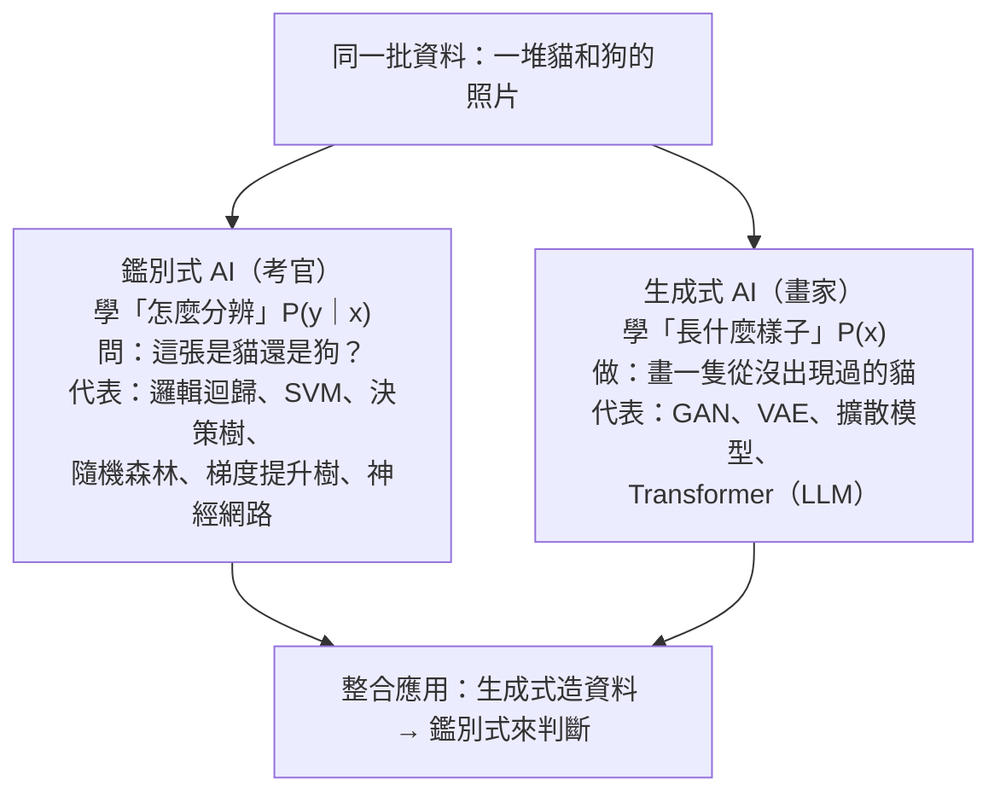

### Metadata
parent:: [[_【目錄】iPAS-AI應用規劃師(初級)：人工智慧基礎概論]]
sibling:: [[01人工智慧概論]] · [[02資料處理與分析]] · [[03機器學習概念]]

## Key Points
> [!summary] 一句話看懂
> - **鑑別式 AI＝考官**：學的是 **P(y|x)**，「看到這筆資料，它屬於哪一類？」專注**畫出分界線**。
> - **生成式 AI＝畫家**：學的是 **P(x)** 或 **P(x, y)**，「這類資料長什麼樣子？」所以能**創造新資料**。
> - 實務上兩者**最強的用法是合作**：生成式負責「造資料、產內容」，鑑別式負責「判斷、把關」。

#### 鑑別式模型比較
| 模型 | 一句話 | 可解釋性 | 資料需求 | 速度 | 代表場景 |
|---|---|---|---|---|---|
| **邏輯迴歸** | 算出 0～1 機率，再劃一條直線 | ⚪ 白箱 | 少 | 極快 | 信用評分卡、廣告點擊率 |
| **SVM** | 找出最寬的安全間隔 | ⚪ 線性時白箱，用核函數後變黑箱 | **小樣本、高維度** | 中 | 文本分類、生醫訊號 |
| **決策樹** | 一連串是非題 | ⚪ **最透明** | 少 | 快 | 授信規則、流失預警 |
| **隨機森林** | 幾百棵樹投票 | 🔘 灰箱 | 中 | 中 | 風控、詐欺偵測 |
| **梯度提升樹** | 一棵接一棵修正前面的錯 | 🔘 灰箱 | 中 | 中 | **表格資料的實務冠軍**：信用評分、行銷預測 |
| **神經網路** | 多層神經元自動學特徵 | ⚫ 黑箱 | **大量** | 訓練慢 | 影像、語音、非結構化資料 |

#### 生成式模型比較
| 模型 | 一句話 | 優點 | 痛點 |
|---|---|---|---|
| **GAN** | 偽造者 vs 鑑定師對抗 | 畫質高、生成快 | 訓練不穩、**模式崩潰** |
| **VAE** | 壓縮成機率分佈再還原 | 平滑可控、適合**異常偵測** | 圖像偏**模糊** |
| **擴散模型** | 加噪後逐步去噪 | 畫質最好、訓練穩定 | **生成慢**、成本高 |
| **Transformer／LLM** | 逐 Token 預測下一個 | 文字生成的絕對主流 | 幻覺、推論成本 |

> [!warning] 陷阱題
> 1. **鑑別式 AI 的主要目標＝分類或迴歸**；學習的是條件機率 **P(y|x)**，不是聯合機率 P(x, y)（官方考題原題）。
> 2. **GAN 是生成式模型**；SVM、邏輯迴歸、隨機森林都是鑑別式（官方考題原題）。
> 3. **「分類醫學影像」是鑑別式 AI 的應用**，不屬於生成式 AI 的主要應用（官方考題原題）。
> 4. **GAN 的兩個核心組件＝生成器與鑑別器**；「編碼器與解碼器」是 VAE（官方考題原題）。
> 5. **醫學影像整合應用的目的＝提高診斷準確性與資料多樣性**，不是取代醫生（官方考題原題）。
> 6. **生成式支援鑑別式的典型案例＝模擬交通場景訓練自動駕駛模型**（官方考題原題）。
> 7. **解決 GAN 訓練不穩定＝採用 WGAN**（官方考題原題）。
> 8. **生成式 AI 的資料增強主要解決資料稀缺或不平衡**（官方考題原題）。
> 9. **整合兩者的未來關鍵方向＝開發更高效的整合框架**（官方考題原題）。
> 10. **邏輯迴歸用 Sigmoid 把分數壓到 0～1**，參數用**最大似然估計**（MLE）求得。
> 11. **SVM 的分界只由「支援向量」決定**；**核函數技巧**讓它處理非線性問題；**C 值越大越容易過擬合**。
> 12. **決策樹用資訊增益（ID3／C4.5）或基尼不純度（CART）選切割點**；靠**剪枝**防過擬合。
> 13. **隨機森林＝Bagging（自助抽樣）＋特徵隨機選擇＋多數決**，主要降低**變異**；約 36.8% 的袋外資料（OOB）可當驗證集。
> 14. **梯度提升（Boosting）是「接力修正」，主要降低偏差**；隨機森林（Bagging）是「平行投票」。
> 15. **深層神經網路容易梯度消失**；Sigmoid 導數最大只有 0.25。
> 16. **GAN → 模式崩潰；VAE → 模糊；擴散 → 慢**。
> 17. **VAE 的損失＝重建損失＋KL 散度**；擴散模型用 **CFG** 控制文字引導強度。
>
> ⚠️ **教材錯誤或不精確的地方**
> - 教材說鑑別式 AI「具有**良好的解釋性**」：這只適用於邏輯迴歸、決策樹等簡單模型。**神經網路也是鑑別式模型，卻是典型的黑箱**；隨機森林、梯度提升樹則是灰箱。可解釋性取決於模型，而不是「鑑別式」這個分類。
> - 教材說隨機森林「保證每棵樹在**不同特徵子集**上獨立訓練」：精確地說，隨機森林是在**每一次節點分裂時**重新隨機抽選候選特徵，而不是一棵樹固定使用一組特徵子集（後者是「隨機子空間法」）。
> - 教材說 WGAN 能「**避免**模式崩潰」：WGAN 大幅**改善**訓練穩定性、**減輕**模式崩潰，但無法保證完全避免。
> - 教材把 **SVM 用於人臉識別、物件分類**列為代表應用：這是 2012 年前的做法，現代影像辨識的主流是 **CNN 與 Vision Transformer**；SVM 目前多用於資料量小、特徵維度高的場景。
> - 教材以「**相同輸入產生不同輸出**」區分生成式與鑑別式：這是常見特徵，但不是本質。把溫度設為 0 時，LLM 對相同輸入也會產生幾乎相同的輸出；兩者真正的差別在於**學習的機率分佈**與**輸出是否為新內容**。

> [!tip] PM 要記住的 3 件事
> 1. **可解釋性 vs 準確度是核心取捨**：金融授信先考慮白箱模型；人臉辨識、語音等可接受黑箱。
> 2. **表格資料先試梯度提升樹**：在信用評分、行銷預測這類結構化資料上，它常常比深度學習更準、更便宜。
> 3. **生成式負責「造」、鑑別式負責「判」**：AI 客服的「生成回答＋安全過濾」就是最常見的整合模式。

--- 
## Notes
### 全局地圖：考官與畫家

教材用下圖說明兩者的流程差異：鑑別式是「**資料 → 邊界判定 → 決策**」的單向流程；生成式則是「**提示 → 反覆輸入與調整 → 生成內容**」的循環，使用者常會一再修改提示詞，直到得到滿意的結果。

![[Pasted image 20260516191616.png]]

---

### 一、鑑別式 AI（Discriminative AI）
**鑑別式 AI** 學習資料特徵與目標標記之間的**條件機率 P(y|x)**：「已知這筆資料長這樣，它屬於哪一類的機率是多少？」它==主要用於分類與迴歸任務==。

鑑別式 AI **不去理解資料是怎麼產生的**，而是==專注於找出區分不同類別的邊界==。就像銀行的鑑偽員不需要會印鈔票，只要知道真鈔和假鈔差在哪裡。也因為目標單純，在==標記資料充足、任務明確==的場景下，它通常**準確度高、計算效率好**。

可解釋性則**因模型而異**：邏輯迴歸、決策樹是白箱，隨機森林、梯度提升樹是灰箱，神經網路是黑箱。

#### 1. 邏輯迴歸（Logistic Regression）
處理「==分類問題==」（尤其是==二元分類==）最常用的基礎模型。它是一個**線性分類器**：先==算出 0 到 1 之間的機率值，再用一條分界線決定類別==。

它==只能切出「直線」或「平面」來區分兩組資料==。如果資料的邊界是圓形或波浪形（非線性），原生的邏輯迴歸表現就會受限，需要加入特徵工程（例如加入平方項、交互項），或改用 SVM、樹模型、神經網路。

##### (1) 核心機制
###### 線性加權評分
邏輯迴歸==假設每個特徵和目標之間存在線性關係==，先把所有特徵乘上權重後加總，得到一個綜合分數 $z$：

$$z = w_1x_1 + w_2x_2 + \cdots + b$$

$z$ 的範圍從負無限大到正無限大，就像大腦把各種線索加權打分數。

###### Sigmoid 函數：把分數變成機率
$z$ 無法直接當作機率，所以要代入 **Sigmoid 函數**（一種非線性的激活函數），==把任何數值壓縮到 0 到 1 之間==，解釋為「==屬於某一類別的機率==」：

$$P(y=1) = \frac{1}{1 + e^{-z}}$$

###### 最大似然估計（MLE）：找出最佳權重
線性迴歸用**最小平方法**，讓預測值與答案的距離最小；邏輯迴歸的輸出是機率，所以改用**最大似然估計**：==找出一組權重，讓「歷史資料中實際發生的結果」出現的機率最大==。

###### 決策邊界
算出機率後，還需要一個**決策規則**決定分類結果，例如「機率 > 0.5 判為違約」。這條規則在特徵空間中形成的分界線，就叫**決策邊界**。

##### (2) 應用場景
###### 電商用戶購買意願預測
以購物車商品數、頁面停留時間、歷史購買次數、是否領取優惠券，預測本次瀏覽是否會下單。

邏輯迴歸的價值在於輸出的是**連續的機率值**，而不只是「會／不會」。PM 可以依機率分層營運：機率高於 80% 的不給優惠券（反正會買）、50%～80% 的推播限時折扣（臨門一腳），把行銷預算花在最有效的地方。

###### 銀行信貸違約風險評估
以年收入、負債比、信用卡遲繳次數、工作年資，預測未來是否違約。

金融風控必須說得清楚「多遲繳一次，違約風險增加多少」。邏輯迴歸的係數可以直接解讀為**對數勝算比**（Log Odds）的變化，能轉成傳統的**信用評分卡**（Scorecard），符合金融業的透明監管要求。

###### 數位廣告點擊率（CTR）預測
以投放時間、用戶年齡層、過去點擊偏好、廣告類別，預測用戶是否點擊。

廣告系統要在**幾毫秒內**決定顯示哪則廣告。邏輯迴歸的計算只是一次加權加總再代入 Sigmoid，速度極快、伺服器成本極低，能處理每秒數萬筆的即時預測。

##### (3) 實務心法
###### 閾值是商業槓桿
模型輸出的機率只是數學結果，「**分界線切在哪裡**」才是 PM 的商業決策。把貸款核准門檻調嚴（例如違約機率低於 5% 才核准），能降低呆帳，但會拒絕大量好客戶、犧牲營收；放寬門檻則反過來。閾值應該隨公司現階段的策略目標調整，而不是永遠停在 0.5。

###### 天然的白箱模型
在重視合規的金融、醫療、資安領域，可解釋性往往比準確度更重要。邏輯迴歸的每個特徵都有清楚的係數，PM 可以直接向法務或業務主管說明：「因為『近半年遲繳次數』的權重最高，所以模型判定為高風險。」這種透明度讓模型容易推動落地。

###### 高併發場景的成本優勢
在廣告、即時推薦這類**低延遲**是硬指標的場景，複雜模型雖然更準，但運算成本高、可能拖慢回應。邏輯迴歸常是用最低成本驗證 MVP 的首選，也是評估其他複雜模型的**基準線**（Baseline）：新模型如果贏不了邏輯迴歸，就沒有上線的理由。

#### 2. 支援向量機（Support Vector Machine, SVM）
處理「==分類問題==」的經典強大模型。核心思想是用一個==超平面==把資料切開，並==追求「最安全、容錯率最高」的分界線==。

##### (1) 核心機制
###### 超平面：在空間中切一刀
區分兩類資料的邊界叫做==超平面==（Hyperplane）：在二維是一條線，三維是一個平面，更高維就叫超平面。SVM 是一個「==幾何分類器==」，不算機率，而是直接在空間中拉出一面隱形的牆，看新資料落在牆的哪一邊。

###### 最大化間隔
能把兩組資料切開的線有無數條，==SVM 要找的是「最優超平面」==：在分界線兩側往外推出兩條平行線，直到碰到最近的資料點，兩線之間的距離叫做==間隔==（Margin）。SVM 的目標是==讓間隔最大==，因為==間隔越寬，容錯空間越大，新資料進來時越不容易判斷錯誤==。

###### 支援向量：決定大局的關鍵少數
數學推導（拉格朗日乘子與 KKT 條件）會發現：絕大多數遠離分界線的資料點，對邊界**完全沒有影響**；==只有剛好貼在間隔邊緣的少數點==（軟間隔時，也包含落在間隔內或被分錯的點）決定了分界線的位置。這些點就叫**支援向量**。

這個特性讓 SVM ==在小樣本、高維度資料上特別有效率==：後方的大量資料怎麼增減，都不影響邊界。

###### 軟間隔與 C 參數：完美主義與容錯的權衡
真實資料一定有雜訊，硬要完美切開（硬間隔）可能無解，或導致過擬合。所以 SVM 引入**鬆弛變數** $\xi$，==允許部分資料點越界==，並==用 C 參數控制懲罰力道==：
- **C 值高**：對越界懲罰極重，邊界會變得曲折複雜，**容易過擬合**。
- **C 值低**：允許部分點越界，換取更平滑、寬敞的邊界，**泛化能力較好**。

###### 核函數技巧（Kernel Trick）
當資料呈現**同心圓**這類分佈（內圈是 A 類、外圈是 B 類），在平面上找不到一條直線能分開。SVM 的絕招是==把資料投影到更高維的空間==，在那裡就能用一個平面切開。

> [!example] 白話比喻
> 紙上畫著兩個同心圓，內圈紅點、外圈藍點，平面上沒辦法用直線分開。現在**從紙張中心往上一頂**，讓紙變成一個立體的碗：內圈的紅點被抬高，外圈的藍點留在低處。這時只要**水平切一刀**，就能把紅藍完美分開。

真的把資料算到高維空間會非常耗費運算，核函數的巧妙之處在於==直接在原本的低維空間，算出高維空間中的結果==，不必真的升維。常見的核函數有**多項式核**與**高斯核**（RBF）。

##### (2) 應用場景
###### 醫療篩檢與生醫訊號分類
以基因表達資料、蛋白質序列特徵、生醫訊號指標，判斷細胞是否病變。

基因資料的==特徵動輒上萬個，但病例樣本很少==。SVM 的邊界只由支援向量決定，在這種「高維度、小樣本」的情境中，表現比許多需要大量資料的模型更穩定。

###### 文本分類
以 TF-IDF 詞頻向量、關鍵字頻率等，判斷是否為垃圾郵件或文章主題。

==文字轉成向量後，維度極高且大部分是 0（稀疏）==。SVM 擅長在高維稀疏空間中找出最大間隔，在深度學習普及前，是文本分類的主力方法。

###### 圖像識別
以像素、邊緣特徵、色彩直方圖，判斷是否為目標物體。

影像資料在原始空間中往往交錯複雜，SVM 可透過核函數處理非線性邊界。不過**現代影像辨識的主流已是 CNN 與 Vision Transformer**，SVM 多用於資料量小、或搭配深度學習萃取出的特徵使用。

##### (3) 實務心法
###### 冷啟動與小樣本場景的利器
神經網路需要大量資料，資料不足時很容易過擬合。SVM 的邊界只由少數支援向量決定，當產品剛上線、樣本很少，或罕見疾病、罕見風控事件這類難以收集資料的場景，SVM 常能用很低的資料成本得到穩健的準確度。

###### C 參數是容錯政策
高 C 值是「不容許任何錯誤」的完美主義者，邊界扭曲複雜，上線遇到新資料容易翻車；低 C 值則是抓大放小，包容少數雜訊，換取平滑的邊界。調整 C 值，本質上是在決定產品對雜訊的容忍度。

###### 核函數的黑箱代價
線性 SVM 的權重還能解讀，一旦用上核函數，模型就變成難以解釋的黑箱。如果產品受到嚴格金融監管、需要向客戶說明拒絕原因，就留在線性模型（或改用邏輯迴歸）；如果不需要對外解釋、只追求準確度，才考慮核函數。

#### 3. 決策樹（Decision Tree）
處理「==分類與迴歸問題==」最直觀的經典演算法，也是隨機森林與梯度提升樹的基礎。

核心思想是==透過一連串「是／否」的問題，把資料不斷切割成越來越小的子集==，最後形成一張樹狀的決策流程圖。每個**節點**是一個特徵條件，每個**葉節點**是最終的類別或預測值。

##### (1) 核心機制
###### 資訊熵：衡量混亂程度
決策樹要決定「==先問哪一個問題==」，需要==一個指標衡量資料的純度==。**資訊熵**（Entropy）==代表資料的混亂程度（不確定性）==：資料全部屬於同一類時，熵為 0；兩類各占一半、最混亂時，熵為 1（二元分類、以 log₂ 計算）。

###### 資訊增益：哪個問題最能切中要害
**資訊增益**（Information Gain）==代表「用某個特徵切割後，整體混亂度下降了多少」==。決策樹在每個節點會計算所有特徵的資訊增益，==選擇讓混亂度下降最多的特徵==作為切割標準。ID3、C4.5 演算法使用這個指標。

###### 基尼不純度：隨機抽兩個不一樣的機率
**CART** 演算法改用計算更快的**基尼不純度**（Gini Impurity）：==從資料中隨機抽兩個樣本，類別不一樣的機率==。==越接近 0 代表越純==。

> [!example] 白話比喻
> 箱子裡有 99 顆紅球、1 顆藍球，閉眼抽兩顆，抽到不同顏色的機率極低（Gini 接近 0，很純）；紅藍各半時，抽到不同色的機率最高（Gini＝0.5）。決策樹的目標，就是把資料切成一個個格子，讓每格裡幾乎只剩一種顏色的球。

###### 剪枝：防止鑽牛角尖
如果不加限制，決策樹會為了遷就訓練資料裡的每個雜訊與特例，一直往下切，直到每個葉節點都完全純淨，這就是嚴重的==過擬合==。解決方法是**剪枝**（Pruning）：
- **預剪枝**：訓練時就設限，例如==限制樹的最大深度==、==規定每個節點至少要有多少樣本==。
- **後剪枝**：先長完整棵樹，再剪掉對驗證集效果沒有幫助的分支。

##### (2) 應用場景
###### 銀行信貸自動審批
以年收入、工作年資、名下房產、信用黑名單紀錄，判斷是否核准貸款。

決策樹能輸出白紙黑字的 `if-else` 規則，例如「年資 < 1 年且無房產 → 拒貸」。當客戶或主管機關質疑「憑什麼拒絕」時，==有清楚的邏輯路徑可以說明==。

###### 電商用戶流失預警
以 30 天登入次數、帳戶餘額、客服投訴次數、優惠券使用率，預測下個月是否流失。

決策樹會==自動把最重要的指標放在樹的頂端==。營運團隊一眼就能看出關鍵因素（例如客服投訴次數），立刻針對它設計挽留活動，這比單純追求準確率更有商業指導價值。

###### 數位行銷購買預測
以購物車商品數、停留時間、購買頻率、是否點擊促銷，預測是否下單。

行銷資料同時有數值與類別欄位，決策樹==不需要標準化==，也能直接處理類別資料，讓團隊用最快速度驗證想法。

##### (3) 實務心法
###### 白箱之王：降低溝通與合規成本
決策樹是商業可解釋性最強的模型，切出的每一條路徑都能直接翻譯成人聽得懂的規則。面對銀行授信、醫療診斷、保險理賠等受監管的場景，不需要額外的解釋工具，就能向主管、法務或客戶說清楚決策原因。

###### 不挑食：免除繁瑣的特徵工程
實務上最花時間的往往是資料前處理。決策樹只是在各個特徵上「切一刀」，不受數值大小影響，不需要標準化，也能同時處理數值與類別資料，非常適合產品初期快速驗證。

###### 偏執的完美主義：引出集成學習
單一決策樹最大的弱點是容易過擬合，而且資料稍有變動，長出來的樹可能完全不同（變異大）。PM 在規劃時要確認團隊設定了深度等限制；這個弱點也正是隨機森林與梯度提升樹出現的原因。

#### 4. 隨機森林（Random Forest）
核心原理是「**不要把雞蛋放在同一個籃子裡**」：透過**集成學習**（Ensemble Learning），把幾百棵容易走極端的決策樹組合起來，用投票決定最終結果。

##### (1) 核心機制
###### 自助抽樣（Bootstrap Sampling）：刻意製造多樣性
訓練每一棵樹時，不使用全部資料，而是==有放回地隨機抽取 N 筆樣本==。數學上，大約有 **63.2%** 的原始資料會被抽中，剩下約 **36.8%** 沒被抽中的稱為**袋外資料**（Out-of-Bag, OOB），==天生可以當作驗證集==，不需要另外切分。

如果每棵樹都看一模一樣的資料，長出來的樹就會千篇一律，失去分散風險的意義。隨機抽樣讓每棵樹看到不同的樣本組合，形成略有差異的觀點。

###### 特徵隨機選擇：逼出隱藏的規律
除了抽樣本，隨機森林在==每一次節點分裂時，只隨機挑出部分特徵==（分類問題常用 $\sqrt{M}$ 個，M 為特徵總數），再從這些特徵中選最好的來切。

如果每次都能自由選擇，所有樹都會優先用「年收入」「信用評分」這幾個最強特徵，長得幾乎一樣。限制每次可選的特徵，逼得部分樹去「工作年資」「帳戶餘額」等次要特徵裡找答案，反而能挖掘出隱藏的規律，也讓樹與樹之間更不相關。

###### Bagging 聚合：多數決中和偏見
所有樹訓練完成後，新資料進來時，每棵樹各自給出預測，再用==多數決==（分類）或==平均==（迴歸）得出最終結果。這==能有效降低整體的變異==，讓模型更穩定。

單一棵樹容易因為某個極端樣本畫出扭曲的邊界，但當 500 棵樹一起投票，A 樹的偏見會被 B 樹抵銷，C 樹的盲點會被 D 樹補足，最後的邊界平滑而穩健。

##### (2) 應用場景
###### 信用卡盜刷偵測
以刷卡金額、頻率、IP 位置、商店類別、是否跨國，判斷交易是否為盜刷。

盜刷通常只占 0.1%，==極端不平衡的資料是多數模型的盲點==。要特別注意：**隨機森林本身不會自動解決不平衡**，隨機抽樣會保留原本的比例，有些樹甚至抽不到盜刷樣本。實務上要搭配**類別權重**、**平衡隨機森林**或**過採樣**（如 SMOTE），再靠多棵樹集體決策，穩定抓出少數的壞人。

###### 信用風險評級
以延遲還款次數、總資產、職業風險、負債比，判斷是否核發高額度信用卡。

==個人財務資料常有極端值或突發雜訊==（例如某月突然一大筆轉帳），單棵樹會因此畫出偏激的邊界，隨機森林的多數決能抵銷這類隨機雜訊，輸出穩健的評級。

###### 保險理賠詐欺識別
以理賠金額、出險時間點、歷史出險次數、保單生效天數，判斷是否涉嫌詐欺。

詐欺者會刻意規避常見的查核指標。隨機森林每次分裂只看部分特徵，逼迫部分樹從「投保天數」「出險時間點」等看似邊緣的特徵找規律，反而能抓出隱藏較深的詐欺模式。

##### (3) 實務心法
###### 不平衡資料的主力，但一定要搭配技巧
高價值事件往往極度稀少：好人占 99.9%，壞人只占 0.1%。模型只要全部猜「好人」，準確率就有 99.9%，卻完全失去抓壞人的能力。常見誤解是「Bootstrap 抽樣能自動解決不平衡」，實際上並不會。風控 PM 驗收時，要確認團隊做了類別權重、平衡抽樣等處理，並改用**召回率、F1、PR-AUC** 評估，而不是只看準確率。

###### 群體智慧的抗噪能力
真實資料永遠是髒的：輸入錯誤、市場突發波動、系統遺漏值。單棵樹碰到髒資料會走火入魔，隨機森林的多數決則會把這些雜訊造成的小鋸齒磨平，讓產品上線後面對多變的市場仍能穩定運作。

###### 從白箱到灰箱
隨機森林把準確度和泛化能力大幅提升，代價是 500 棵樹混在一起投票，很難再用一句話說清楚「為什麼拒絕這位客戶」，從白箱變成**灰箱**。實務上可用**特徵重要性**（Feature Importance）排名，或用 **SHAP** 解釋單筆預測，例如「近半年還款紀錄對這筆判斷貢獻最大」。

#### 5. 梯度提升樹（Gradient Boosting：XGBoost／LightGBM）
處理「==表格型（結構化）資料==」**實務上最常用、也最常在資料科學競賽中奪冠**的模型家族。

核心思想是：不讓很多樹各自投票（隨機森林），而是讓**一棵接一棵的樹「接力修正」前一棵犯的錯**。

##### (1) 核心機制
###### Boosting：接力賽，後面的人專補前面的漏洞
第一棵樹先做一個粗略的預測；第二棵樹不重新預測，而是**專門學習第一棵樹預測錯誤的部分（殘差）**；第三棵再修正前兩棵剩下的誤差……最後把所有樹的結果加總。

> [!example] 白話比喻
> 新人寫報告（第一棵樹），主管 A 標出錯誤，新人只針對錯誤修改；主管 B 再標出剩下的錯誤……幾輪下來，報告越來越精準。

###### 梯度：用數學決定下一棵樹該修哪裡
每一棵新樹學習的目標，是損失函數的**負梯度方向**，也就是「往哪個方向修正誤差最快」，這就是「梯度」提升名稱的由來。

###### 學習率與正則化：每次只修一點點
每棵樹的貢獻會乘上一個小的學習率（例如 0.1），並加入正則化懲罰，避免模型為了修正雜訊而矯枉過正、過擬合。

##### (2) 與隨機森林的比較
| 比較 | 隨機森林（Bagging） | 梯度提升（Boosting） |
|---|---|---|
| 樹的關係 | **平行**、各自獨立 | **串行**、接力修正 |
| 主要降低 | **變異**（結果不穩） | **偏差**（預測不準） |
| 準確度 | 高 | **通常更高** |
| 調參難度 | 低，預設值就不錯 | 較高，需要調學習率、樹深度等 |
| 過擬合風險 | 低 | 較高，需注意早停與正則化 |

##### (3) 主流工具
- **XGBoost**：最經典，穩定、功能完整。
- **LightGBM**：微軟開發，**速度快、省記憶體**，適合大資料。
- **CatBoost**：擅長處理**類別型特徵**（如職業、縣市），不需要大量前處理。

##### (4) 應用場景
###### 信用評分與違約預測
以收入、負債比、還款紀錄、帳戶行為，預測是否違約。梯度提升樹在**表格資料上準確度頂尖**，搭配 SHAP 能說明各特徵的貢獻，兼顧準確與合規說明，是許多銀行新一代評分模型的主力。

###### 行銷回應預測
以消費紀錄、瀏覽行為、人口特徵，預測是否回應活動。它能自動捕捉特徵之間複雜的交互作用，訓練與推論成本又遠低於深度學習。

###### 詐欺偵測
以交易金額、時間、地點、裝置，判斷是否詐欺。可設定**類別權重**處理不平衡資料，是風控模型的主力之一。

##### (5) 實務心法
###### 表格資料的第一選擇
在結構化資料上，梯度提升樹常常**贏過深度學習**，而且訓練快、成本低。看到團隊直接用神經網路處理表格資料時，PM 可以先問：「有沒有和 XGBoost、LightGBM 比較過？」

###### 用 SHAP 打開灰箱
梯度提升樹不像單一決策樹那麼透明，但搭配 **SHAP**（SHapley Additive exPlanations），就能說明「這位客戶被拒絕，主要是負債比貢獻了多少風險分數」，符合金融業的可解釋要求。

###### 注意過擬合與資料洩漏
它的學習能力很強，若特徵中不小心混入「未來資訊」（例如用結案後才知道的欄位預測結案結果），分數會好得不真實。驗收時要確認每個特徵在預測當下真的拿得到。

#### 6. 神經網路（Neural Networks）
機器學習與深度學習的核心，靈感來自人腦的神經元結構。單一神經元能力有限，但==透過「輸入層 → 隱藏層 → 輸出層」的多層結構，加上非線性轉換==，理論上能逼近任意複雜的函數（**萬能近似定理**），學會人類難以明確寫成規則的規律。

神經網路既可做鑑別式任務（分類、迴歸），也是 GAN、VAE、擴散模型、LLM 等生成式模型的基本元件。這裡討論的是它作為**鑑別式模型**的角色。

##### (1) 核心機制
###### 神經元與激活函數：打破線性
每個神經元接收輸入 $x$，乘上權重 $w$ 再加上偏差 $b$，得到 $z = w^Tx + b$，接著代入非線性的**激活函數**輸出訊號。如果沒有激活函數，不論疊多少層，本質上都只是一個線性方程，無法處理非線性問題。

> [!example] 白話比喻
> ==真實世界的因果關係很少是直線==。激活函數就像「==跨過門檻才會發生的質變==」：用戶滿意度在 80 分以下，續約意願都很低；一旦超過 80 分，續約機率才大幅上升。激活函數賦予模型「轉彎」的能力。

###### 前向傳播與反向傳播：學習的閉環
**前向傳播**：資料從輸入層出發，逐層乘上權重、經過激活函數，在輸出層得到預測值，再計算損失。就是==依現有資訊由因推果，最後與現實比對出差距==。

**反向傳播**：利用微積分的**連鎖律**，把誤差從輸出層往回傳，算出每一層、每個權重對誤差的「責任」（梯度），再據此調整權重。就像==專案出狀況後由後往前追溯，評估每個環節該承擔多少責任，再針對性改進==。

###### 梯度消失與梯度爆炸
反向傳播時，梯度是一層一層**連乘**回去的：
- **梯度消失**：若使用 Sigmoid 這類激活函數，其導數最大只有 0.25，連乘幾十層後，傳到前面的梯度幾乎為 0，前面幾層就學不到東西。就像==傳話遊戲，每傳一層訊息就打折一次，傳到最前面已經微弱到沒有作用==。現代網路改用 **ReLU** 激活函數、**殘差連接**（ResNet）、**批次正規化**等技術解決。
- **梯度爆炸**：若權重過大，連乘會讓梯度呈指數暴增，導致數值溢位、訓練崩潰。就像==蝴蝶效應，一個微小的變動經過多層放大，最後引發系統性的雪崩==。常用**梯度裁剪**與適當的權重初始化處理。

##### (2) 應用場景
###### 高頻交易與趨勢預測
以毫秒級成交量、即時報價、匯率波動、歷史走勢，預測短期價格方向。市場資料瞬息萬變、高度非線性，深度神經網路能透過多層結構萃取傳統統計方法難以發現的微弱訊號。不過金融市場雜訊極高，模型很容易過擬合歷史資料，實務上需要嚴謹的回測與風控。

###### 網銀人臉辨識登入
以手機鏡頭擷取的影像，判斷是否為帳戶持有人本人。人臉由數百萬個像素組成，CNN 的前幾層學會看邊緣，中間層學會看眼睛、鼻子，最後組合成整張臉。這種**由淺入深的特徵萃取**是處理影像的主流方法，搭配**活體偵測**才能防止照片或深偽攻擊。

###### 智慧語音客服與風險偵測
以語音訊號與對話內容，判斷客戶是否可能遭受電話詐騙。語音與語意都有強烈的前後文關聯，神經網路擅長處理這類序列資料，能在第一線協助篩選高風險對話。

##### (3) 實務心法
###### 精準度與合規的權衡
神經網路是準確度的天花板，但也是典型的**黑箱**：成千上萬個權重交錯相乘，無法直接說清楚為什麼得出某個結果。雖然可以用 SHAP、LIME 做事後解釋，但無法像白箱模型那樣直接讀懂。受嚴格監管、需要對客戶說明理由的授信或理賠系統，使用神經網路要先評估合規風險；不需要對外解釋、只追求準確度的人臉辨識、語音辨識，則是首選。

###### 自動特徵萃取的價值
傳統模型的上限，取決於團隊能不能用人工找出好特徵。神經網路最大的價值在於能**自動**從影像像素、語音訊號、文字這些原始資料中，層層萃取出高階特徵，省下大量人工試錯的時間。

###### 資料飢渴與算力成本
神經網路需要大量資料，資料不足時很容易過擬合，表現甚至不如簡單的決策樹；訓練與部署也需要昂貴的 GPU。PM 要問：我們真的有足夠的資料嗎？為了多 2% 的準確度，付出的算力與時程成本值得嗎？資源有限時，先用邏輯迴歸或樹模型打頭陣，往往是更成熟的選擇。

---

### 二、生成式 AI（Generative AI）
**生成式 AI** 學習資料的**聯合分佈 P(x, y)** 或**邊際分佈 P(x)**，也就是「這類資料長什麼樣子」，因此能==生成全新的資料樣本==。它能根據輸入條件或隨機變數，產生文字、圖像、音訊、影片等內容，==展現高度的靈活性與創造力==。

生成式 AI 也能在**無標記資料或資料稀缺**時，透過合成資料擴充資料集。它的挑戰包括訓練不穩定（模式崩潰、梯度消失）、計算成本高，以及倫理、著作權與資料隱私問題。

#### 1. 生成對抗網路（Generative Adversarial Network, GAN）
生成式 AI 的經典代表，由**生成器**（Generator）與**鑑別器**（Discriminator）兩個神經網路組成。核心思想是==讓兩個網路互相對抗，在賽局的動態平衡中，逐漸產生接近真實的新資料==。

##### (1) 核心機制
###### 生成器：把雜訊變成作品
生成器（$G$）接收一個隨機雜訊向量 $z$，透過多層神經網路轉換，輸出一個模擬的資料樣本 $G(z)$。它的目標是==讓鑑別器把假資料判斷為真==，也就是讓 $D(G(z))$ 趨近於 1。

> [!example] 白話比喻
> 生成器是**偽造大師**。隨機雜訊就像腦中的一絲靈感，生成器把這段毫無意義的亂碼，透過層層聯想與組合，捏造出一張連毛細孔都有的「假人臉」。

###### 鑑別器：不講情面的真假法官
鑑別器（$D$）==是一個二元分類器==：輸入一個樣本（可能是真資料，也可能是生成器的假資料），輸出 0 到 1 的機率，表示「這是真的」的可能性。它希望真資料得到接近 1 的分數、假資料得到接近 0 的分數。

有趣的是，GAN 內部的鑑別器本身就是一個**鑑別式模型**：GAN 是鑑別式與生成式合作的最早範例之一。

###### 極小極大賽局：道高一尺，魔高一丈
GAN 的訓練是一個**零和賽局**：生成器想讓鑑別器犯錯，鑑別器想不犯錯。理想狀態下雙方達到**納許均衡**，鑑別器再也分不出真假，對任何樣本都只能給出 0.5。

兩者的實力必須旗鼓相當：鑑別器太弱，生成器隨便畫都能過關，學不到東西；鑑別器太強，生成器得不到有用的回饋（梯度消失），也會放棄學習。偽造者每進化一次，法官就被迫提升眼力，生成品質就在這種循環中不斷提升。

##### (2) 應用場景
###### 圖像生成與修復
以隨機雜訊或毀損的圖像，生成逼真的人臉（如 StyleGAN）或補全缺損部分。鑑別器在後方用高標準把關，逼得生成器產生符合視覺規律、細節紋理逼真的像素，而不只是把缺口模糊帶過。

###### 風格轉換
把真實照片轉成油畫或動漫風格（如 CycleGAN）。實務上幾乎找不到「同一張風景照對應一幅油畫」的成對資料，CycleGAN 透過兩組生成器與鑑別器的循環對抗，能在**沒有成對資料**的情況下，學會兩種風格之間的對應關係。

###### 稀缺醫療影像生成
罕見疾病的病理影像很難收集，導致診斷模型缺乏訓練資料。GAN 可以生成大量符合病理特徵的合成影像，補足下游診斷模型的訓練資料，改善資料不平衡。

###### 虛擬場景模擬
把粗略的線稿或 3D 幾何方塊，渲染成具有真實光影與材質的場景，用於遊戲、VR 與自駕模擬，降低美術與建模成本。

##### (3) 實務心法
###### 用對抗取代人工標記
GAN 的商業價值在於不需要大量人工標記：生成器與鑑別器建立了一個自給自足的「評分與學習閉環」，在缺乏標籤的情境下能省下可觀的成本。

###### 警惕模式崩潰
這是 GAN 最著名的弱點：生成器發現某幾種樣本特別容易騙過鑑別器，就只產生這幾種，**多樣性大幅下降**。例如要它生成各種人臉，結果全都長得差不多。評估產出時不能只看單張圖多美，還要檢查**多樣性**，否則產品上線會出現嚴重的同質化。

###### 預留調參時間
GAN 訓練非常不穩定，兩邊實力一失衡，模型就可能報廢。實務上常改用 **WGAN**（以 Wasserstein 距離衡量分佈差異）等改良版本，並花大量時間微調兩邊的學習率。規劃時程時，要比一般模型預留更多調整期。

#### 2. 變分自編碼器（Variational Autoencoder, VAE）
==數學上嚴謹的機率生成模型==，由**編碼器**（Encoder）與**解碼器**（Decoder）兩個神經網路組成。

核心思想是：==不把資料壓縮成一個固定的點，而是壓縮成一個由「平均值」與「標準差」描述的機率分佈==。這讓隱藏空間（Latent Space）連續而平滑，模型能==平滑地調配出介於兩者之間的新資料==。

##### (1) 核心機制
###### 編碼器：輸出一個分佈，而不是一個點
傳統的自編碼器（AE）直接把輸入壓縮成一個固定向量。VAE 的編碼器則輸出兩組參數：==平均值== $\mu$ 與==變異數== $\sigma^2$（實作上輸出對數變異數）。接著透過**重參數化技巧**（Reparameterization Trick）從這個分佈中抽樣：

$$z = \mu + \epsilon \odot \sigma, \quad \epsilon \sim \mathcal{N}(0, I)$$

這樣抽樣的動作也能被反向傳播訓練。

> [!example] 白話比喻
> 評估一家公司的未來營收，傳統做法是鐵口直斷「就是 100 萬」（傳統 AE）；VAE 則像精算師：「平均 100 萬，上下約 10 萬的波動。」把資料表示成**區間**而非單一數字，隱藏空間就有了連續的彈性。

###### 解碼器與重建損失：把密碼還原成原貌
解碼器接收抽樣出的 $z$，把它「放大」還原成與原始輸入盡量一樣的資料 $\hat{x}$。用**重建損失**（如 MSE 或交叉熵）衡量 $x$ 與 $\hat{x}$ 的差距，逼解碼器學會精準還原。

就像編碼器把一張貓的照片打包成一組密碼，解碼器要在沒看過原圖的情況下，只憑密碼把貓畫回來；畫錯了（例如少一隻耳朵），反向傳播就會懲罰它。

###### KL 散度：把隱藏空間整理成平滑的調色盤
如果==只追求重建準確==，編碼器會把不同類別的資料放得很開，中間留下大片「空白地帶」，從空白處抽樣只會生成怪物。所以 VAE 在損失函數中加入 **KL 散度**作為正則化，==強迫所有分佈都盡量接近標準常態分佈 $\mathcal{N}(0, I)$==，讓資料在隱藏空間中緊密、規律地排列。

> [!example] 白話比喻
> 沒有 KL 散度時，「貓的密碼」放在左上角、「狗的密碼」放在右下角，中間是一片死區。KL 散度像**重力場**，把貓和狗的分佈都往中心拉攏、產生重疊與漸層。這時在兩者中間抽樣，就能畫出一隻「一半像貓、一半像狗」的平滑過渡生物。

**VAE 的總損失＝重建損失＋KL 散度**：前者要求「還原得像」，後者要求「空間整齊」，兩者互相拉扯。

##### (2) 應用場景
###### 異常偵測
在工業與資安領域，99.9% 都是正常資料，異常樣本極少。VAE 只用大量**正常資料**訓練，學會「正常長什麼樣子」；當異常資料進來時，解碼器因為==沒學過而還原不好，重建誤差暴增==，就能據此發出警報。

###### 資料修復與重建
修補受損或缺失的影像。VAE 學到了資料的整體統計規律，能根據破損處周圍的資訊推測合理的內容。不過 VAE 的修復結果常**偏模糊**，高畫質修復實務上多改用擴散模型。

###### 平滑可控的生成
在隱藏空間中找出代表某個特徵的方向（例如「微笑程度」），微調這個數值，生成的人臉就會平滑地從哭臉變成笑臉，==適合需要細緻控制的場景==，例如語音合成的音調調整。

###### 醫療資料增強
真實病患資料受到嚴格的==隱私保護==，研發團隊常無資料可用。VAE 可以學習病患特徵的機率分佈，再抽樣出「現實中不存在、但統計特徵合理」的合成資料。但要注意：合成資料仍可能記住真實病患的特徵，需要搭配隱私評估或差分隱私。

##### (3) 實務心法
###### 控制力與畫質的權衡
GAN 追求極致的**畫質**，代價是控制力差、訓練不穩定；VAE 追求**控制力**與數學穩定性，代價是生成的圖像常偏模糊。產品需要精準調控時考慮 VAE，追求視覺震撼時選 GAN 或擴散模型。

###### 天然的異常偵測器
在金融科技中，VAE 常常不是拿來「生成」，而是拿來做**風控**：利用「重建不出來就代表有異狀」的特性，能在完全沒有異常標籤的情況下，建立靈敏的詐欺或洗錢預警系統。

###### 現代生成模型的幕後元件
VAE 本身較少直接用於生成高品質影像，但 **Stable Diffusion** 就是先用 VAE 把影像壓縮到較小的隱藏空間，再在這個空間裡做擴散，大幅降低運算成本。

#### 3. 擴散模型（Diffusion Models）
當今==視覺生成==領域的主流，Stable Diffusion、Midjourney、DALL·E 3、影片生成模型 Sora 都屬於這個家族。

核心思想是==不急著一步到位==：==訓練時，把清晰的圖片逐步加入雜訊，直到變成一片雜訊；生成時，讓神經網路一步步預測並去除雜訊，從純雜訊中「還原」出全新的圖像==。

##### (1) 核心機制
###### 前向擴散：把秩序變成混沌
給定一張真實圖像 $x_0$，依照預先設定的速率，一步步加入微小的高斯雜訊。經過 $T$ 步之後，$x_T$ 完全失去原圖特徵，變成純粹的高斯雜訊。這個過程是固定的數學運算，==不需要學習==。

> [!example] 白話比喻
> 一杯有完美拉花的拿鐵，任由時間流逝，咖啡與牛奶逐漸融合，最後變成一杯看不出拉花的均勻褐色液體。

###### 反向去噪：從雜訊中雕出作品
==反向過程才是擴散模型真正要學的==。訓練一個神經網路（早期多用 **U-Net**，新一代改用 Transformer，即 **DiT**），在給定目前的雜訊圖像 $x_t$ 與步數 $t$ 時，**預測這一步被加了多少雜訊**，再把它扣掉。從第 $T$ 步一路倒推回第 0 步，就能從純雜訊還原出清晰的圖像。

就像雕刻家看著一塊粗糙的石頭，腦中早已學會萬物的樣子，一層層刮去多餘的部分，作品的輪廓就慢慢浮現。

###### 文字條件引導（CFG）：用文字控制方向
==如果沒有任何提示，反向去噪只會隨機生成任意圖像==。為了用文字控制生成，模型會在去噪過程中注入**文字的向量表示**（Embedding），並透過**無分類器引導**（Classifier-Free Guidance, CFG）控制文字的影響力：把「有文字提示」和「沒有文字提示」兩種預測做比較，再把去噪方向往文字的方向推。

> [!example] 白話比喻
> 文字提示像一塊**磁鐵**。模型在雜訊中不知道該捏成貓還是狗時，你輸入「奔跑的柴犬」，每一步去噪都會被磁鐵往這個方向拉。**CFG 數值越高，磁力越強**，畫面越嚴格服從文字；但太高會讓畫面僵硬、失真。

##### (2) 應用場景
###### 高品質圖像生成
擴散模型逐步去噪的機制訓練穩定，不容易發生 GAN 的模式崩潰，能學會非常複雜的圖像分佈，生成的畫面細膩度與光影質感是目前最好的。

###### 文字生成圖像
把文字描述轉成對應的圖像，用於行銷素材、廣告設計、商品示意圖。CFG 機制讓生成結果與文字語意高度對齊，降低「答非所問」的情況。

###### 醫療影像合成
病理診斷對影像細節要求極高。VAE 生成的影像太模糊，GAN 容易產生結構扭曲、多樣性不足；擴散模型既能保持器官的整體結構，又能還原微小的病灶紋理，適合擴增稀缺的醫療影像資料。

##### (3) 實務心法
###### 速度與品質的拉鋸
擴散模型最大的缺點是**生成慢、成本高**：GAN 和 VAE 一次運算就能出圖，擴散模型則要反覆去噪 20～50 次，使用者要等、GPU 成本也高。實務上會採用加速方法，例如較少步數的抽樣器（DDIM）、在壓縮後的隱藏空間運算（**Latent Diffusion**，Stable Diffusion 的做法），或蒸餾成少步數模型。

###### 開源與閉源的選型
Midjourney 是閉源服務，畫面精美、開箱即用，但無法客製化底層模型；開源的 Stable Diffusion 系列則允許用 **LoRA** 學習特定風格或角色，用 **ControlNet** 控制姿勢、構圖。若產品需要嚴格符合品牌視覺或控制人物姿勢，開源模型的二次開發更有彈性，但也要自行處理授權與內容安全。

###### 把難題拆小的技術哲學
GAN 像警察與小偷在激烈對抗中求進步，爆發力強但不穩定；擴散模型則把「一步生成完美圖像」這個難題，拆成幾十個「去掉一點雜訊」的小問題，逐步迭代。這種拆解思維是它勝出的關鍵。2024 年後的新趨勢是 **DiT＋Flow Matching**，以及用自迴歸方式直接生成圖像的**原生多模態模型**，詳見 [[根據數據特性與問題需求選擇合適的生成式 AI 的架構與演算法]]。

#### 4. Transformer 與大型語言模型（LLM）
當今==文字生成==的絕對主流，也逐步擴展到圖像、語音、影片，是 ChatGPT、Claude、Gemini 的共同骨架。

核心思想是：用**自注意力機制**一次看完整段文字，找出字與字之間的關聯，再**逐 Token 預測下一個 Token**（自迴歸生成）。

##### (1) 核心機制
###### 自注意力：一眼看全文
每個 Token 都會計算自己與其他所有 Token 的關聯程度，因此能理解長距離的上下文，解決 RNN「讀到後面忘了前面」的問題。

###### 自迴歸生成：文字接龍
模型每次根據前面所有內容，預測下一個最可能的 Token，接上去後再繼續預測。所以 ChatGPT 的回答是一段一段跳出來的。

###### 規模化：越大越聰明
參數量、訓練資料量、算力同步放大時，模型能力會穩定提升，並展現小模型沒有的能力，例如多步驟推理、寫程式。

##### (2) 應用場景
###### 智慧客服
輸入客戶問題，搭配知識庫檢索（**RAG**），生成自然且有依據的回答。LLM 能理解同一個問題的各種問法，比傳統的關鍵字客服更有彈性。

###### 文件摘要與分析
輸入財報、合約、研究報告，產出重點摘要與風險提示，快速處理過去需要人工閱讀的長篇文件。

###### 程式碼生成
輸入需求描述，產生程式碼、測試與說明文件，大幅提升開發效率；搭配 AI Agent，還能自主修改、執行與除錯。

##### (3) 實務心法
###### LLM 同時能生成，也能判斷
LLM 不只能生成文字，也能透過提示詞直接做分類，例如「判斷這則客訴屬於哪一類」，不需要另外訓練分類模型。

###### 幻覺是天生的
LLM 的本質是「預測最可能的下一個字」，而不是查資料庫，所以會自信地說錯話。搭配 **RAG**、要求引用來源、加上鑑別式的事實查核，是主流的降低幻覺方法。

###### 延伸閱讀
架構、訓練與選型細節見 [[根據數據特性與問題需求選擇合適的生成式 AI 的架構與演算法]] 與 [[訓練模型與如何優化]]。

---

### 三、鑑別式與生成式的比較
#### 1. 技術差異比較
| 比較項目 | 鑑別式 AI | 生成式 AI |
|---|---|---|
| **學習什麼** | 條件機率 **P(y\|x)**：資料屬於哪一類 | 資料分佈 **P(x)** 或 **P(x, y)**：資料長什麼樣子 |
| **模型目標** | 找出**決策邊界**，做**分類或預測** | 學習資料的**內在分佈**，**生成新資料** |
| **輸出** | 類別標籤（是否為垃圾信）或數值（房價） | 新的資料樣本：文字、影像、音樂、語音 |
| **應用** | 影像辨識、語音辨識、情感分析、信用評級、詐欺偵測 | 內容生成、風格轉換、資料增強、影音合成 |
| **代表模型** | 邏輯迴歸、SVM、決策樹、隨機森林、神經網路 | GAN、VAE、擴散模型、LLM |
| **主要挑戰** | 資料偏見、過擬合、標記成本 | 內容真實性（幻覺、深偽）、可控性、計算成本 |

##### (1) 鑑別式 AI 的挑戰
- **資料偏見**（Bias in Data）：模型會學到資料中既有的偏見，影響公平性與準確性。
- **過擬合**（Overfitting）：資料不夠多樣時，模型可能只適用於特定場景。
- **標記成本**（Labeling Cost）：監督式學習需要大量標記資料，在醫學診斷等專業領域特別昂貴。

##### (2) 生成式 AI 的挑戰
- **內容真實性**（Authenticity）：生成內容可能包含不正確或虛構的資訊，例如 AI 產生的假新聞、虛假圖片與深偽影片。
- **可控性**（Controllability）：輸出的可控性較低，不一定能精確符合特定需求。
- **計算成本**（Computational Cost）：訓練與推論都需要大量運算資源，尤其是高解析度影像與大規模文字生成。
- **著作權與授權**：訓練資料與生成內容的著作權歸屬，是近年訴訟與法規的焦點。

#### 2. 界線正在模糊：一個模型同時判斷與生成
傳統上鑑別式與生成式分工清楚，但大型語言模型出現後，兩者的界線越來越模糊。

##### (1) 生成式模型直接做判斷
用提示詞讓 LLM 分類，例如「請判斷這則評論是正面還是負面」，**不需要標記資料、不需要訓練**，這稱為**零樣本分類**。

##### (2) Embedding：生成式模型產生特徵，鑑別式模型做判斷
用模型把文字轉成**向量**（Embedding），再交給鑑別式模型做分類、搜尋、分群，例如語意搜尋、客訴自動分類。

##### (3) LLM 當評審
用一個 LLM 評判另一個 LLM 的輸出品質（**LLM-as-a-Judge**），例如自動評估客服回答是否正確、有禮貌。

> [!tip] PM 為什麼在乎
> 過去做一個分類功能，要收集資料、標記、訓練模型，耗時數月；現在用 LLM＋提示詞，**幾天就能做出可用的原型**。但量大時，傳統鑑別式模型通常**更便宜、更快、更穩定**。常見策略是：**先用 LLM 快速驗證需求 → 確認價值後，再用 LLM 產生的標記資料訓練小型鑑別式模型降低成本。**

---

### 四、鑑別式與生成式的整合應用
#### 1. 整合應用的價值
##### (1) 資料增強與分析的協同效應
核心邏輯是：**生成式 AI 負責「製造資料」，鑑別式 AI 負責「分析與判斷」**。透過**合成資料**（Synthetic Data），能解決真實資料稀缺、個資隱私限制，以及罕見樣本不足（資料不平衡）造成的訓練瓶頸。

- **醫療影像分析**：用 GAN 等生成模型產生罕見病灶的模擬影像，供鑑別式模型訓練，在減少使用真實病患資料的前提下，提升辨識異常的準確率與泛化能力。
- **金融風險評估**：生成式 AI 模擬不同的極端市場情境（如金融海嘯），產生大量模擬資料；鑑別式 AI 據此評估潛在風險，做壓力測試。

##### (2) 多模態資料的處理
**多模態**是指同時處理圖像、文字、語音等多種資料形式。生成式 AI 負責跨模態的生成與轉換，鑑別式 AI 負責精確的分類與決策。

- **自動駕駛**：生成式 AI 扮演**模擬器**（世界模型），虛擬出各種天氣、光線、路況，節省大量實車測試成本；鑑別式 AI 扮演**大腦**，在虛擬環境中進行壓力測試，學習複雜情境下的判斷。
- **智慧語音助理**：鑑別式 AI 負責語音辨識與意圖分析，確保聽懂使用者；生成式 AI 再依分析結果生成自然的回應。

##### (3) 提升模型的泛化能力
生成式 AI 產生多樣化、變形的資料，進行**資料增強**，防止鑑別式模型只會死背訓練資料，提升它面對**沒看過的邊緣案例**（Edge Cases）時的應變能力。

- **教育**：模擬不同背景學生的學習行為與題目變化，讓學習分析模型能更準確地面對新學生，設計個人化學習方案。
- **智慧城市**：模擬罕見的交通事故、極端天災，產生應急演練資料，讓預測模型學會在極端情境下評估風險。

#### 2. 整合應用的技術優勢
##### (1) 資料生成與判斷的融合
生成式 AI 提供高品質、多樣化的資料，鑑別式 AI 做精確判斷，把「擴充邊界」與「精準收斂」結合成一個決策系統。

- **醫療影像診斷**：生成模型產生的模擬病理影像，直接用來訓練 CNN 等鑑別式模型，提高對真實影像的分類準確性。
- **異常檢測**：在工業瑕疵、網路攻擊這類樣本稀少的場景，生成式 AI 模擬各種潛在異常，鑑別式 AI 負責識別與標記，建立完整的特徵庫。

##### (2) 即時分析與回饋機制
生成式 AI 動態調整模擬環境，鑑別式 AI 即時評估並修正決策，形成雙向的**回饋閉環**（Feedback Loop）。

- **自動駕駛**：生成式 AI 即時模擬濃霧、冰雪路面、突發障礙；鑑別式 AI 據此做環境辨識、避障與路徑規劃。
- **資安主動防禦**：生成式 AI 扮演**駭客**，持續模擬最新的攻擊手法；鑑別式 AI 扮演**守衛**，即時分析網路流量、識別異常並部署防禦。這也是**紅隊演練**的自動化版本。

##### (3) 系統的靈活性與適應性
系統能依不同業務情境與安全標準，動態調整「生成」與「過濾」的流程，在創意與合規之間取得平衡。

- **智慧客服**：生成式 AI 根據用戶需求與情緒，生成自然的回應；鑑別式 AI 扮演**安全閘門**，即時過濾敏感或不當內容。
- **內容生成與審核**：生成式 AI 產出新聞稿、廣告文案；鑑別式 AI 同步做事實查核、著作權與法規合規檢查。

#### 3. 整合應用的挑戰與解決策略
##### (1) 模型訓練穩定性
**挑戰**：生成模型（尤其是傳統 GAN）訓練不穩定，常遇到**模式崩潰**與**梯度消失**，導致合成資料多樣性不足、品質低落，連帶削弱下游鑑別式模型的訓練效果。

**解決策略**：
- **改良模型架構**：採用 **WGAN**，以 Wasserstein 距離衡量分佈差異，大幅改善訓練穩定性、減輕梯度消失與模式崩潰；或直接改用訓練更穩定的**擴散模型**。
- **自適應優化**：使用 Adam、RMSProp 等能動態調整學習率的優化器，平抑訓練震盪。

##### (2) 資料偏差與公平性
**挑戰**：生成模型學的是現有資料的分佈，容易**放大**原始資料中的偏見（例如性別、地區的統計偏差）。鑑別式模型若用這些合成資料訓練，可能做出不公平的決策，引發合規風險。

**解決策略**：
- **演算法去偏**（Debiasing）：在生成階段就加入去偏約束，主動修正生成的分佈。
- **強化資料審核**：建立合成資料的審核與統計檢驗機制，確認各族群的代表性與多樣性。

##### (3) 整合架構的設計
**挑戰**：結合兩種不同性質的模型，需要處理模型之間的通訊、資料即時共享，以及龐大的運算負載。

**解決策略**：
- **分層架構**（Layered Architecture）：把系統分成負責生成的「生成層」與負責判斷的「決策層」，兩層透過**共享層**交換資訊。
- **動態學習框架**（Dynamic Learning Framework）：讓系統能隨著資料分佈的變化（**概念漂移**）動態調整生成與決策流程。

#### 4. 實務上最常見的四種整合模式
| 模式 | 生成式負責 | 鑑別式負責 | 例子 |
|---|---|---|---|
| **生成＋護欄** | 產生回答或內容 | 過濾有害、敏感、違規內容 | AI 客服、行銷文案產生器 |
| **合成資料＋訓練** | 產生稀缺樣本 | 用擴充後的資料訓練判斷模型 | 罕見詐欺樣本、罕見疾病影像 |
| **檢索＋生成（RAG）** | 根據找到的資料組織回答 | 判斷哪些文件最相關（重排序模型） | 企業知識庫問答 |
| **自動標記＋蒸餾** | 用 LLM 大量標記資料 | 訓練輕量、低成本的分類模型上線 | 客訴分類、意圖辨識 |

> [!caution] 合成資料的兩個風險
> 1. **偏差放大**：生成模型學到的偏見，會透過合成資料傳給下游模型。
> 2. **隱私不一定安全**：生成模型可能「記住」並重現真實個資，合成資料仍需隱私評估。

---

### PM 檢查清單：選模型前的 6 個問題
1. **任務性質**：要「判斷」（鑑別式）還是要「產出內容」（生成式）？還是兩者都要？
2. **資料型態**：表格資料先試梯度提升樹；圖像、語音、文字考慮深度學習。
3. **可解釋性**：需要向客戶或主管機關說明理由嗎？白箱、灰箱還是黑箱可以接受？
4. **資料量**：有多少標記資料？資料少時，邏輯迴歸、SVM、決策樹可能更合適。
5. **延遲與成本**：需要毫秒級回應嗎？擴散模型、LLM 的推論成本是否可接受？
6. **風險控管**：生成式輸出有沒有鑑別式護欄把關？合成資料有沒有檢查偏差與隱私？

---
## References
![[AI應用規劃師(初級)-學習指引-科目1_人工智慧基礎概論1141203_20251222172144.pdf]]
