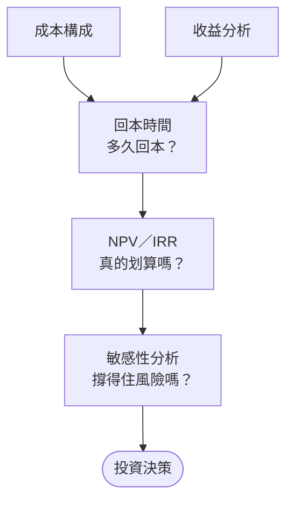
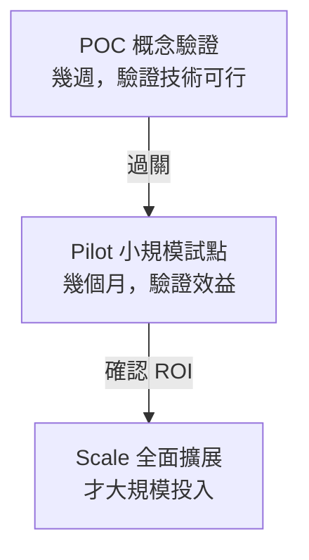

### Metadata
parent:: [[_【目錄】iPAS-AI應用規劃師(初級)：生成式AI應用與規劃]]
sibling:: [[驗證模型方案與檢查效能]] · [[訓練模型與如何優化]] · [[根據數據特性與問題需求選擇合適的生成式 AI 的架構與演算法]] · [[建立完善的監控與重新訓練機制]] · [[生成式AI風險管理]] · [[05AI導入評估]] · [[06AI導入規劃]]

## Key Points

> [!summary] 一句話看懂
> 評估 AI 方案值不值得做，就像評估**要不要開一家分店**：
> **算清楚要花多少錢（成本）→ 估計能賺多少（收益）→ 多久回本（回本期）→ 考慮錢的時間價值後還划不划算（NPV、IRR）→ 情況變差時還撐不撐得住（敏感性分析）。**

#### ROI 計算的五個步驟（教材架構）

| # | 步驟 | 回答什麼問題 | 關鍵詞 |
|---|---|---|---|
| 1 | **成本構成** | 總共要花多少？ | 設備購置、基礎設施維護、專業人力 |
| 2 | **收益分析** | 能帶來多少好處？ | **直接效益**＋**間接效益** |
| 3 | **回本時間** | 多久能把錢賺回來？ | 回本期（Payback Period）、現金流時間分佈 |
| 4 | **NPV／IRR** | 考慮時間價值後還划算嗎？ | 淨現值、內部報酬率 |
| 5 | **敏感性分析** | 假設出錯時會怎樣？ | 市場、業務情境、成本變動 |

#### 四大財務指標速記

| 指標 | 公式／概念 | 白話 | 判斷標準 | 考慮時間價值？ |
|---|---|---|---|---|
| **ROI** 投資報酬率 | (總收益 − 總成本) ÷ 總成本 × 100% | 每投入 1 元賺回多少 | **> 0** 有賺，越高越好 | ❌ |
| **回本期** Payback Period | 累積淨現金流轉正的時間 | 幾年把本錢賺回來 | **越短越好** | ❌（簡單回本期） |
| **NPV** 淨現值 | 未來每年淨現金流折現加總 − 初始投資 | 把未來的錢換算成今天的價值後，淨賺多少 | **> 0 可行** | ✅ |
| **IRR** 內部報酬率 | 讓 NPV = 0 的折現率 | 這個專案「年化報酬率」多少 | **> 資金成本（門檻報酬率）可行** | ✅ |

#### 直接效益 vs 間接效益（教材分類）

| 直接效益 | 間接效益 |
|---|---|
| 營收增長 | 內部流程效率提升 |
| 客戶滿意度提升 | 人力資源最佳化配置 |
| 市場擴展 | |

> [!warning] 陷阱題
> 1. **「客戶滿意度」在教材中歸類為「直接效益」**。直覺上容易歸為間接，考試請照教材。
> 2. **ROI 和簡單回本期都「不考慮」貨幣時間價值**；**NPV、IRR 有考慮**。
> 3. **NPV > 0 才可行**；**IRR 要大於資金成本（折現率）才可行**，不是大於 0。
> 4. **回本期忽略回本之後的現金流**：回本快不代表總獲利高。
> 5. 這裡的「**敏感性分析**」是**財務**用語（改變假設，看收益怎麼變），和 [[驗證模型方案與檢查效能]] 的「**敏感性與公平性檢查**」（看模型有沒有偏見）**是兩回事**。
> 6. 成本三大類要背：**設備購置、基礎設施維護、專業人力資源**。

> [!tip] PM 要記住的 3 件事
> 1. **AI 的成本大頭常常是「持續性」的**（API 用量、維運、重新訓練），不是一次性的建置費。
> 2. **人力節省不等於裁員**，比較常見的是「人力重新配置」。寫進提案時要說清楚，否則會變成組織阻力。
> 3. **敏感性分析才是說服主管的關鍵**：「最差情況下會虧多少」比「最好情況賺多少」更有說服力。

--- 
## Notes

### 全局地圖：五步驟算出「值不值得做」

貫穿全篇的範例：**某金融公司導入 AI 客服**（金額單位：萬元，評估期 3 年）

---

### 一、算清楚成本

#### 自建、採購還是合作？成本結構的第一個決定

> [!example] 白話比喻
> 公司要有員工餐廳：可以**自己請廚師開伙**（自建）、**直接訂便當**（採購）、或**找餐飲公司進駐**（合作）。三種做法的初期成本、每月成本、彈性和品質掌控度都不一樣。

| 做法 | AI 專案的樣子 | 初期成本 | 持續成本 | 優點 | 風險 |
|---|---|---|---|---|---|
| **自建** Build | 自己部署開源模型、自己開發整套系統 | **高**（GPU、人才） | 中（維運人力） | 資料不出公司、可深度客製 | 人才難找、技術落後風險 |
| **採購** Buy | 直接買 SaaS 產品（例如現成 AI 客服平台） | **低** | 依用量或席次計費 | 上線快、免維運 | 客製受限、綁定供應商 |
| **合作** Partner | 用大模型 API＋自己做應用層（最常見） | 中 | **依 Token 用量** | 兼顧速度與客製 | API 成本隨用量成長 |

**會計上的差異（金融業 PM 會被財務問到）：**
- **資本支出 CapEx**：一次性買設備（例如自購 GPU 伺服器），分年**折舊**攤提。
- **營運支出 OpEx**：按月付的雲端與 API 費用，當期認列費用。
- 生成式 AI 專案多數走 **OpEx 模式**：初期門檻低，但要特別注意**用量成長後的總費用**。

> [!tip] PM 為什麼在乎
> 成本構成的第一步不是列清單，而是先決定**自建、採購還是合作**，因為這個決定會改變整張成本表的結構。多數企業的合理起點是「**合作**」：用 API 快速驗證效益，規模大到一定程度、或資料無法外流時，再評估自建。

#### 成本構成：全面列出要花的錢

> [!example] 白話比喻
> 開分店不只要付裝潢費（一次性），還要付每個月的房租、水電、員工薪水（持續性）。只算裝潢費就說「很便宜」，是最常見的錯誤。

**教材列出的三大類成本：**

| 成本類別 | AI 專案中的例子 | 一次性／持續性 |
|---|---|---|
| **設備購置** | GPU 伺服器、或雲端資源的初期設定 | 多為一次性 |
| **基礎設施維護** | 雲端費用、API 呼叫費、系統維運、資安 | **持續性** |
| **專業人力資源** | AI 工程師、資料標註、PM、領域專家 | 一次性＋持續性 |

**PM 補充：容易被漏掉的隱藏成本**
- **資料準備**：清洗、標註、整理知識庫，常常比想像中貴。
- **API 用量會隨使用者成長**：用戶越多，Token 費用越高。
- **模型重新訓練與監控**（見 [[建立完善的監控與重新訓練機制]]）。
- **人工審核**：高風險回答仍需要真人複核。
- **法遵與資安**：金融業尤其重要。

> 這些加總起來，稱為 **TCO（Total Cost of Ownership，總持有成本）**。教材要求的「準確性與細緻性」就是指不要漏算。

**範例：AI 客服成本**

| 項目 | 金額（萬元） |
|---|---|
| 初期建置（系統開發、RAG 知識庫、系統整合） | **400**（一次性） |
| 每年營運：API 與雲端 60＋維運人力 50＋監控 10 | **120／年** |
| **3 年總成本** | 400 + 120 × 3 = **760** |

#### AI 成本的前瞻特性（FinOps for AI）

| 特性 | 對 ROI 的影響 | PM 怎麼做 |
|---|---|---|
| **同等能力的模型 API 價格持續快速下降** | 今天算不划算的專案，一兩年後可能變划算 | 架構保留**換模型的彈性**，避免綁死單一供應商 |
| **但用量會隨普及暴增** | 單價降了，總帳單可能反而變大 | 設定預算上限與用量監控 |
| **模型路由** Model Routing | 簡單問題給便宜小模型，複雜問題才給大模型 | 常能大幅降低成本 |
| **提示詞快取** Prompt Caching、**批次 API** | 重複內容和不急的任務享有折扣 | 適合固定系統指令、大量離線處理 |

---

### 二、估計收益

#### 收益分析：直接效益＋間接效益

> [!example] 白話比喻
> 開分店的好處，有些直接進到收銀機（**直接效益**：多賣的營業額），有些看不到現金卻很實在（**間接效益**：總店員工不用加班了，可以去做更有價值的事）。

| 類型 | 教材例子 | AI 客服範例 | 好不好量化 |
|---|---|---|---|
| **直接效益** | 營收增長、客戶滿意度提升、市場擴展 | 24 小時回覆，提高申辦轉換率 | 較容易 |
| **間接效益** | 內部流程效率提升、人力資源最佳化配置 | 客服人員從重複問答轉去做高價值的理財諮詢 | 較難，需要換算 |

**間接效益怎麼換算成金額？**
- 流程效率 → **節省工時 × 時薪**。例：每月省下 2,000 小時 × 時薪 500 元 ＝ 每月 100 萬元。
- 人力配置 → 原本要新招聘的人不用招了，或釋出的人力創造的新價值。

**範例：AI 客服每年收益**

| 項目 | 類型 | 金額（萬元／年） |
|---|---|---|
| 24 小時服務帶來的轉換率提升 | 直接 | 80 |
| 客服人力重新配置（約當 4 人的工時價值） | 間接 | 240 |
| **每年總收益** | | **320** |

→ **每年淨現金流** ＝ 320 − 120 ＝ **200 萬**
→ **3 年 ROI** ＝ (320 × 3 − 760) ÷ 760 ＝ 200 ÷ 760 ≈ **26.3%**

> [!caution] ROI 的盲點
> ROI 26.3% 看起來不錯，但它把「第 1 年的 200 萬」和「第 3 年的 200 萬」當作一樣值錢，而且沒告訴你**多久才回本**。所以教材說要「進一步」用回本模型和 NPV、IRR。

#### AI 客服類專案的主流 KPI

| KPI | 白話 |
|---|---|
| **自助解決率**（Deflection Rate／Containment Rate） | 不需要轉真人就解決的比例 |
| **平均處理時間** AHT | 真人客服在 AI 輔助下，每件處理時間縮短多少 |
| **CSAT／NPS** | 客戶滿意度、推薦意願 |
| **首次解決率** FCR | 一次就解決、不用再來問的比例 |

#### 單位經濟（Unit Economics）：比 ROI 更直覺的算法

主管常常不想看 NPV，只想知道「**一次服務花多少錢**」：

| 比較 | 算法 |
|---|---|
| **AI 每次對話成本** | （Token 費用＋基礎設施＋維運分攤）÷ 對話數 |
| **真人每次服務成本** | （客服薪資＋管理成本）÷ 服務件數 |
| **每次成功解決的成本** | 總成本 ÷「**真正解決**」的件數（不是對話數！） |

> [!caution] 常見陷阱
> 用「對話數」算很便宜，但如果一半的對話最後還是轉真人，**每次「解決」的成本**可能沒省多少。要看的是**解決率**，不是對話量。

---

### 三、判斷值不值得：回本、NPV 與 IRR

#### 回本時間預估：多久把本錢賺回來？

> [!example] 白話比喻
> 分店花了 400 萬裝潢，每年淨賺 200 萬，大約 2 年回本。

**範例：累積現金流**

| 年度 | 第 0 年 | 第 1 年 | 第 2 年 | 第 3 年 |
|---|---|---|---|---|
| 淨現金流 | −400 | +200 | +200 | +200 |
| **累積** | −400 | −200 | **0（回本）** | +200 |

→ **簡單回本期 ＝ 2 年**

- 教材說的「**將現金流時間分佈納入分析**」，指的是：錢**什麼時候**進來很重要。同樣 3 年賺 600 萬，第 1 年就賺 400 萬的方案，比第 3 年才賺 400 萬的方案好。
- **盲點**：回本期只看「多快回本」，**不管回本之後還賺多少**。

#### NPV 與 IRR：把「時間」算進去

> [!example] 白話比喻：為什麼今天的 100 元比明年的 100 元值錢？
> 今天的 100 元拿去定存或投資，明年會變成 108 元。反過來說，**明年的 108 元，只等於今天的 100 元**。
> 把未來的錢換算回今天的價值，叫做「**折現**」；用的利率（例如 8%）叫做「**折現率**」，通常是公司的**資金成本**或**期望報酬率**。

**① NPV（淨現值）＝ 未來所有淨現金流換算成今天的價值，再減掉初始投資**

範例（折現率 8%）：

| 年度 | 淨現金流 | 折現後的價值 |
|---|---|---|
| 第 1 年 | 200 | 200 ÷ 1.08 ＝ 185.2 |
| 第 2 年 | 200 | 200 ÷ 1.08² ＝ 171.5 |
| 第 3 年 | 200 | 200 ÷ 1.08³ ＝ 158.8 |
| **合計** | 600 | **515.4** |

→ **NPV ＝ 515.4 − 400 ＝ +115.4 萬** → **> 0，方案可行** ✅

- 補充：考慮折現後，回本時間會變長（**折現回收期約 2.3 年**，比簡單回本期的 2 年長）。

**② IRR（內部報酬率）＝ 讓 NPV 剛好等於 0 的折現率**

- 白話：**這個專案本身的「年化報酬率」**。
- 範例：這個 AI 客服專案的 IRR ≈ **23.4%**。
- 判斷：公司資金成本 8% → **23.4% > 8%** → 值得投資 ✅
- 用法：多個 AI 專案搶預算時，IRR 越高的越優先（但專案規模差很多時，要搭配 NPV 一起看）。

> [!tip] NPV vs IRR 怎麼記
> - **NPV 回答「能多賺多少錢」**（金額，單位是萬元）。
> - **IRR 回答「報酬率有多高」**（百分比）。
> - 兩者都考慮時間價值，教材說它們用來評估「**財務可行性與長期收益潛力**」。

---

### 四、管理不確定性

#### 敏感性分析：假設出錯時會怎樣？

> [!example] 白話比喻
> 開分店前要問：「如果房租漲 50%？如果客人比預期少 30%？如果裝潢晚半年完工？」每個假設都改一次，看還賺不賺錢。

**教材說的三種變動來源：** 市場條件、業務情境、成本變動。

**範例：一次只改一個假設，看 NPV 怎麼變**

| 情境 | 改了什麼 | NPV（萬元） | IRR | 結論 |
|---|---|---|---|---|
| **基準** | — | **+115.4** | 23.4% | 可行 |
| 成本變動 | API 費用 +50%（用量比預期多） | +38.1 | 13.2% | 仍可行，但變薄 |
| 業務情境 | 人力節省效益 −30%（流程改造不如預期） | **−70.1** | −2.0% | ❌ **虧損** |
| 時程延誤 | 上線晚半年（第 1 年收益減半） | **−32.7** | — | ❌ **虧損** |
| 樂觀情境 | 收益 +25% | +321.6 | 48.7% | 大好 |
| 悲觀情境 | 收益 −22.5% 且 API +50% | **−147.4** | — | ❌ 明顯虧損 |

**從這張表讀出什麼？**
- 這個專案**對「人力節省效益」最敏感**：只要少 30%，就從賺錢變成虧錢。
- 對 API 成本比較不敏感：漲 50% 還撐得住。
- **行動建議**：上線前先做小規模試點，確認人力節省效益真的達得到，再全面導入。

> [!tip] PM 為什麼在乎（這是 PM 的主場）
> 教材說敏感性分析能「**識別風險與機會，制定更靈活的投資策略**」。實務上就是：
> 1. **找出最敏感的假設**，優先驗證它（例如先跑 POC 量測實際省下的工時）。
> 2. **分階段投資**：先小額試點，數據證明可行再加碼，降低一次押注的風險。
> 3. **向主管報告時同時給「基準、樂觀、悲觀」三個情境**，比只給一個漂亮數字更可信。

#### 風險調整後的效益

教材只算「成本 vs 收益」，實務上還要扣掉**風險成本**：
- **幻覺造成的損失**：AI 給錯資訊導致客訴、賠償。
- **合規成本**：金融業 AI 需符合金管會指引，可能需要額外的審核人力與文件。
- **聲譽風險**：AI 出包上新聞。

→ 這些和 [[生成式AI風險管理]] 直接相關，成熟的提案會把它們量化，列為成本或敏感性情境。

#### 分階段投資（Stage-Gate）：避免一次押注

- 多份產業調查顯示，**大量生成式 AI 專案停在 POC 或試點，沒能擴大到產生實際財務效益**。主因通常不是技術，而是**資料品質、流程沒跟著改、效益沒有被追蹤**。
- 所以每一關都要設好「**過關標準**」，達標才進入下一階段，這就是把敏感性分析變成實際決策的方式。

---

### 五、上線後：追蹤效益是否實現

提案時估的 ROI，**上線後要真的追蹤**：每季比對「預估 vs 實際」的成本與效益。很多 AI 專案失敗不是因為沒效益，而是**沒有人在追**，以致無法證明價值、拿不到下一階段預算。

**領先指標 vs 落後指標**：ROI 是**落後指標**，通常要半年到一年才算得出來，等發現沒效益時，錢已經花了。上線初期要先盯**領先指標**：
- **使用率**：目標使用者中，有多少人真的在用？
- **留存率**：用過一次的人，下週、下個月還會回來用嗎？
- **任務完成率**：使用者是用 AI 完成任務，還是用到一半放棄、改回舊方法？

使用率低，ROI 就不可能好看。這時要先回頭檢查流程設計與教育訓練（見 [[05AI導入評估]] 的「流程重新設計」），而不是急著換模型。

---

### PM 提案清單：寫 AI 投資提案前的 6 個問題

1. **成本**：一次性和持續性成本都列了嗎？API 費用有考慮用戶成長嗎？
2. **收益**：直接、間接效益分開列了嗎？間接效益怎麼換算成金額？
3. **回本**：多久回本？主管能接受的回本期是多久？
4. **NPV／IRR**：用的折現率是多少（問財務部門的資金成本）？NPV 是正的嗎？
5. **敏感性**：哪個假設最敏感？最差情況會虧多少？
6. **分階段**：能不能先做小規模試點，再決定是否全面投入？

---
## References
- iPAS AI應用規劃師(初級)：生成式AI應用與規劃 教材 — C. ROI 的計算方式
- 範例數字為教學用假設情境，NPV、IRR 以折現率 8%、評估期 3 年計算
- 實務做法參考 2025～2026 年業界公開資料整理
