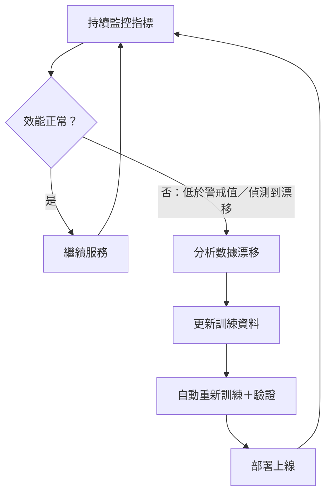

### Metadata
parent:: [[_【目錄】iPAS-AI應用規劃師(初級)：生成式AI應用與規劃]]
sibling:: [[如何評估生成式 AI 方案的財務可行性與投資效益]] · [[驗證模型方案與檢查效能]] · [[訓練模型與如何優化]] · [[根據數據特性與問題需求選擇合適的生成式 AI 的架構與演算法]] · [[生成式AI風險管理]] · [[09AI技術系統集成與部署]]

## Key Points

> [!summary] 一句話看懂
> 延續新人比喻：**訓練＝新人培訓 → 驗證＝試用期考核 → 監控與重新訓練＝轉正後的定期績效考核與在職回訓**。
> 市場和客人一直在變，昨天的優秀員工，明天可能就跟不上。所以要**持續監控 → 發現漂移 → 更新資料 → 自動重新訓練 → 重新上線**，形成一個循環。

#### 教材三步驟

| # | 步驟 | 新人比喻 | 關鍵詞 |
|---|---|---|---|
| 1 | **設定監控指標** | 每月績效考核 | 準確率 Accuracy、召回率 Recall、預測錯誤率 Error Rate |
| 2 | **定期檢查數據漂移** | 發現客群變了 | 數據漂移 Data Drift：**輸入數據的分佈改變** |
| 3 | **自動化重新訓練** | 自動排定回訓課程 | 重新訓練管道 Retraining Pipeline；**達警戒值自動觸發**，並部署到生產環境 |

**最終目的（教材原意）**：延長模型使用壽命，確保在動態環境中的**穩定性與準確性**。

#### 三個監控指標速記

| 指標 | 白話 | 公式 |
|---|---|---|
| **準確率** Accuracy | 全部判斷中，對了幾成 | 判斷正確數 ÷ 總數 |
| **召回率** Recall | **該抓的壞人，抓到幾成**（寧可錯殺） | 抓到的真陽性 ÷ 實際所有陽性 |
| **預測錯誤率** Error Rate | 全部判斷中，錯了幾成 | **1 − 準確率** |

> [!warning] 陷阱題
> 1. **錯誤率 ＝ 1 − 準確率**，兩者是一體兩面。
> 2. **召回率 vs 精確率（Precision）**：召回率問「該抓的有沒有漏」，精確率問「抓到的有沒有冤枉」。教材只寫召回率，但兩者常一起考。
> 3. **資料不平衡時，準確率會騙人**：盜刷只占 0.1%，模型全部猜「正常」，準確率也有 99.9%，卻一個盜刷都沒抓到。
> 4. **數據漂移（Data Drift）vs 概念漂移（Concept Drift）**：前者是「**輸入**變了」，後者是「**輸入和答案的關係**變了」。教材只提前者，但後者是常見考點。
> 5. 重新訓練的觸發方式：**定期觸發**、**效能低於警戒值觸發**（教材寫的）、**偵測到漂移觸發**。
> 6. 教材說「自動部署到生產環境」，實務上會在部署前加上**自動評估關卡＋小流量上線＋可回滾**，金融業通常還要**人工核准**（見 [[#安全上線：不要「自動直接部署」|安全上線]]）。

> [!tip] PM 要記住的 3 件事
> 1. **AI 上線不是終點，是起點**。沒有監控的 AI 產品，就像沒有儀表板的車。
> 2. **監控什麼指標由業務決定**：盜刷偵測重召回率（不能漏），行銷推薦重精確率（不要亂推）。
> 3. 對**生成式 AI**來說，多數企業不自己訓練模型，「重新訓練」常常被「**更新 RAG 知識庫、調整 Prompt、換模型版本**」取代，成本差很多。

--- 
## Notes

### 全局地圖：一個永不停止的循環

- **為什麼需要？** 模型是用「過去的資料」訓練的，但世界一直在變。教材稱之為「**動態業務環境**」。
- 這整套做法業界稱為 **MLOps**（Machine Learning Operations），用在大型語言模型時稱為 **LLMOps**。

---

### 一、監控：及早看見問題

#### 設定監控指標：每月績效考核

> [!example] 白話比喻
> 員工轉正後，主管每個月看績效報表，一旦數字往下掉，就及早介入。教材說的「**及早發現效能下降或異常行為**」就是這個意思。

**用一個例子看懂三個指標：盜刷偵測模型**

某天有 **1,000 筆**交易，其中 **50 筆**是真的盜刷。模型標記了 60 筆可疑交易：

| | 實際是盜刷 | 實際是正常 |
|---|---|---|
| **模型說是盜刷** | ✅ 40 筆（抓對） | ❌ 20 筆（冤枉好人） |
| **模型說是正常** | ❌ 10 筆（漏掉壞人） | ✅ 930 筆（放行正確） |

- **準確率** ＝ (40 + 930) ÷ 1,000 ＝ **97%**
- **錯誤率** ＝ 1 − 97% ＝ **3%**
- **召回率** ＝ 40 ÷ 50 ＝ **80%**（50 個盜刷抓到 40 個，漏了 10 個）
- 補充：**精確率** ＝ 40 ÷ 60 ≈ **66.7%**（標記的 60 筆裡，只有 40 筆真的是盜刷）

> [!caution] 準確率 97% 看起來很好，但……
> 如果模型「偷懶」，把所有交易都判為正常：準確率 ＝ 950 ÷ 1,000 ＝ **95%**，但**召回率 ＝ 0%**，一個盜刷都沒抓到。
> 所以**資料不平衡時（壞人很少），一定要看召回率**，不能只看準確率。

**依業務選指標：**

| 業務場景 | 最怕什麼 | 優先看 |
|---|---|---|
| 盜刷、詐騙偵測 | 漏掉壞人 | **召回率** |
| 行銷推薦、垃圾信過濾 | 冤枉好人、亂推薦 | **精確率** |
| 一般分類 | 整體表現 | 準確率、錯誤率 |

> [!tip] PM 為什麼在乎
> 「漏抓一筆盜刷」和「誤擋一筆正常交易」的成本完全不同。**PM 要和業務單位一起決定哪個錯誤比較貴**，再據此設定監控指標和警戒值。

#### 生成式 AI 的監控指標：LLM 可觀測性

教材的準確率、召回率適合**分類模型**；生成式 AI 的輸出是一段文字，業界改看以下四類（稱為 **LLM 可觀測性，LLM Observability**）：

| 類別 | 監控指標 | 例子 |
|---|---|---|
| **品質** | 幻覺率、**忠實度**（回答有沒有根據知識庫）、答案相關性 | 客服是否捏造不存在的優惠 |
| **安全** | 有害內容、提示詞注入攔截數、個資外洩 | 有人試圖誘導 AI 說出內部資訊 |
| **使用者** | 👍👎 比例、追問率、**轉真人率**、對話放棄率 | 轉真人率突然升高，代表 AI 回答不了 |
| **營運** | 回應延遲、Token 用量、**每次對話成本**、錯誤率 | 成本暴增，可能是 Prompt 太長或被濫用 |

- **怎麼監控文字品質？** 線上抽樣，用 **LLM-as-a-Judge**（另一個模型）自動評分，再搭配人工抽查校準。
- **常見工具**（知道名字即可）：Langfuse（開源）、LangSmith、Arize Phoenix、Datadog LLM Observability；傳統 ML 監控：Evidently AI、各大雲端平台內建的模型監控（AWS SageMaker、Google Vertex AI、Azure ML）。

---

### 二、漂移：找出變化的原因

#### 定期檢查數據漂移：客群變了

> [!example] 白話比喻
> 一家早餐店開在辦公區，菜單是為上班族設計的。幾年後附近蓋了大學，客人變成學生，菜單沒改，生意就開始變差。
> 菜單（模型）沒變，但**客人（輸入數據）變了**，這就是**數據漂移**。

**教材定義**：分析**輸入數據的分佈變化**。當**業務場景或用戶行為改變**時，數據漂移可能導致**模型預測準確性降低**。解法是**及時更新訓練數據集**。

**兩種漂移（考試常一起出）：**

| 類型 | 白話 | 早餐店比喻 | 金融例子 |
|---|---|---|---|
| **數據漂移** Data Drift | **輸入**的分佈變了 | 客人從上班族變成學生 | 行動支付普及，交易管道比例大變 |
| **概念漂移** Concept Drift | **輸入和答案的關係**變了 | 客人還是上班族，但大家開始流行吃健康餐 | 詐騙集團換新手法，過去的「正常」特徵現在可能是詐騙 |

**怎麼偵測？** 拿「訓練時的資料」和「最近的資料」比分佈有沒有明顯差異。
- 金融業最常用的指標是 **PSI（Population Stability Index，群體穩定度指標）**，信用評分模型幾乎都會看：
  - PSI < 0.1 → 穩定
  - 0.1 ～ 0.25 → 輕微漂移，需留意
  - PSI > 0.25 → 顯著漂移，應重新訓練
- 其他常見統計檢定：KS 檢定（Kolmogorov-Smirnov）、卡方檢定。

> [!tip] PM 為什麼在乎
> **PM 往往最早知道「業務要變了」**：新產品上市、法規修改、行銷活動、競爭對手推新方案。這些都會造成漂移。PM 可以**事先通知 RD 加強監控**，不必等指標掉了才發現。

#### 生成式 AI 特有的三種「漂移」

| 漂移 | 白話 | 業界做法 |
|---|---|---|
| **問題分佈漂移** | 用戶開始問新類型的問題（例如新商品上市） | 用 Embedding 把問題自動分群，觀察新主題比例 |
| **知識過期** | 世界變了，知識庫還停在過去 | 知識庫設定更新週期與負責人 |
| **模型供應商更新** | 同一個 API 名稱，供應商換了底層模型，行為變了；舊版本也會被淘汰下架 | **固定模型版本（Pin Version）**＋換版前跑回歸測試 |

---

### 三、更新：修復與重新訓練

#### 生成式 AI 的「重新訓練」，多數時候不是真的重新訓練

教材的三步驟源自傳統機器學習（例如盜刷模型）。但生成式 AI 的現況是：**大多數企業用的是 API 基礎模型（GPT、Claude、Gemini 等），根本沒有自己訓練。** 所以發現問題時，業界依**成本由低到高**處理：

| 層級 | 做法 | 適用情況 | 成本 |
|---|---|---|---|
| 1 | **更新 RAG 知識庫** | 資訊過期（新費率、新商品、新法規） | 極低，當天可完成 |
| 2 | **調整 Prompt／系統指令** | 語氣不對、格式不對、遺漏規則 | 低 |
| 3 | **換模型版本或供應商** | 能力不足、成本太高 | 中 |
| 4 | **微調（LoRA 等）** | 需要特定專業能力或風格 | 中高 |
| 5 | **從頭訓練** | 幾乎只有大型科技公司 | 極高 |

#### 自動化重新訓練管道：自動補貨系統

> [!example] 白話比喻
> 便利商店的**自動補貨系統**：庫存低於安全量（警戒值），系統就自動下單、自動上架，不需要店長每天盯著。
> **重新訓練管道（Retraining Pipeline）**就是 AI 模型的自動補貨系統。

**管道的標準流程：**

| 步驟 | 做什麼 |
|---|---|
| ① 觸發 | 效能低於**警戒值**（教材重點）、偵測到漂移、或定期（例如每月） |
| ② 收集新資料 | 抓取最近的資料，並完成標註 |
| ③ 資料檢查 | 確認新資料品質沒問題（避免 Garbage In） |
| ④ 重新訓練 | 用新資料訓練新版模型 |
| ⑤ 自動評估 | 新版必須在測試集上**不輸舊版**才能過關（見 [[驗證模型方案與檢查效能]]） |
| ⑥ 部署 | 部署到**生產環境**（正式服務用戶的環境） |
| ⑦ 回到監控 | 持續觀察新版表現 |

**教材列出的好處：**
1. **縮短模型更新的周期**：不用每次都等人工排程。
2. **提升模型的響應速度**：環境一變就能快速跟上。
3. **減少人為干預的時間成本**：工程師不用手動重跑。

**名詞補充**：傳統軟體有 CI／CD（持續整合／持續部署），MLOps 多了一個 **CT（Continuous Training，持續訓練）**，指的就是這條自動重新訓練管道。

#### 安全上線：不要「自動直接部署」

自動部署前，實務上會加上多道保險：

| 做法 | 白話 |
|---|---|
| **評估關卡** Eval Gate | 新版必須在黃金測試集上不輸舊版，否則自動擋下 |
| **影子部署** Shadow Deployment | 新版在背景用真實流量跑，但結果不給用戶看，只拿來比較 |
| **金絲雀發布** Canary Release | 先開放給 1～5% 用戶，沒問題再逐步擴大 |
| **模型登錄＋一鍵回滾** Model Registry | 每個版本都留存，出事馬上切回舊版 |
| **人工核准** Human-in-the-Loop | 高風險領域（金融、醫療）上線前需人工簽核，也符合監理要求 |

---

### 四、長期價值：延長壽命與資料飛輪

#### 成果：延長模型壽命

教材結論：透過**持續監控、數據更新、自動化訓練**三管齊下，企業能**延長模型使用壽命**，確保模型在動態環境中的**穩定性與準確性**，進而支持長期業務需求。

#### 資料飛輪：讓產品越用越好

把**用戶回饋（👍👎）、客服人員修正後的答案、轉真人的對話**收集起來，變成新的評估集與訓練資料。用戶越多 → 資料越多 → 模型越好 → 用戶越多，這叫**資料飛輪（Data Flywheel）**，是 AI 產品的重要護城河。

---

### PM 檢查清單：上線後的 6 個問題

1. **指標**：我們監控哪些指標？哪個錯誤最貴（漏抓 vs 誤判）？警戒值設多少？
2. **儀表板**：品質、安全、使用者、營運四類指標，有沒有一個 Dashboard 能一眼看到？
3. **漂移**：業務即將有什麼變化（新產品、新法規）？有沒有事先通知 RD？
4. **更新方式**：問題發生時，先用 RAG 或 Prompt 解決，還是真的需要重新訓練？
5. **上線保險**：新版有評估關卡、小流量上線、回滾機制嗎？需要人工核准嗎？
6. **飛輪**：用戶回饋有被收集、整理成下一輪改善的資料嗎？

---
## References
- iPAS AI應用規劃師(初級)：生成式AI應用與規劃 教材 — B. 模型監控與重新訓練
- Google Cloud, *MLOps: Continuous delivery and automation pipelines in machine learning*（CT 持續訓練概念）
- 實務做法參考 2025～2026 年業界公開資料整理
